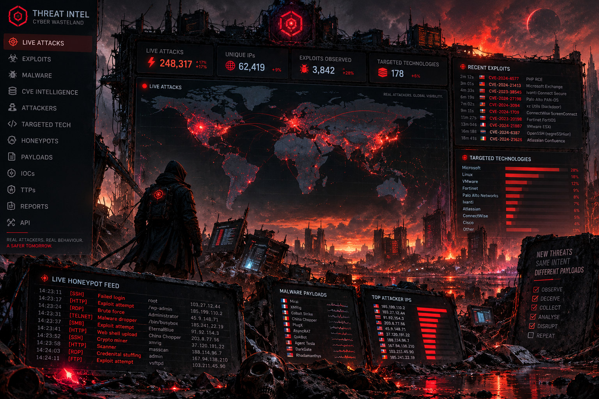

# Foiled

Foiled runs sandboxed and emulated vulnerable decoys that foil exploit attempts and capture threat intelligence.

It stands up real software at deliberately old, known-vulnerable versions (and lightweight high-fidelity product emulations) inside tightly contained environments. Every request, payload and process an attacker triggers is captured, enriched and exported as threat intelligence (STIX 2.1, MISP, TAXII and plain IOC files).

The idea: if you expose "Product X at version Y, which is affected by CVE Z", the traffic that hits it tells you who is exploiting CVE Z right now, how they do it and what they drop.

## Start here

- MVP slice, the first thing we are building: [#22](https://github.com/jusso-dev/foiled/issues/22)
- Threat model: [docs/threat-model.md](docs/threat-model.md)
- How to contribute: [CONTRIBUTING.md](CONTRIBUTING.md)
- Reporting a vulnerability or sandbox escape: [SECURITY.md](SECURITY.md)
- Docs index and glossary: [docs/README.md](docs/README.md), [docs/glossary.md](docs/glossary.md)
- Code of conduct: [CODE_OF_CONDUCT.md](CODE_OF_CONDUCT.md)

## Status

Early build. The Rust workspace, the front-end Worker and CI are in place; features land issue by issue. Design and roadmap live in issues and docs:

- Roadmap and tracking: https://github.com/jusso-dev/foiled/issues/23
- MVP scope: https://github.com/jusso-dev/foiled/milestone/1
- All issues: https://github.com/jusso-dev/foiled/issues
- Research landscape: [docs/research/landscape.md](docs/research/landscape.md)
- Lessons from commercial platforms: [docs/research/lessons.md](docs/research/lessons.md)
- Design direction: [docs/design/design-direction.md](docs/design/design-direction.md)
- Deployment modes and the MVP topology: [docs/deploy/modes.md](docs/deploy/modes.md)
- Dashboard target (v3, chosen): [docs/design/mockup-v3.png](docs/design/mockup-v3.png) ([HTML](docs/design/mockup-v3.html)). Earlier explorations: [v1](docs/design/mockup.png), [v2](docs/design/mockup-v2.png)

## Safety

This project deliberately runs vulnerable software. The design treats containment, egress control and legal limits as the first requirement, not an add-on. It will never "hack back" or interact with attacker infrastructure beyond passive observation.

## Licence

MIT. See [LICENSE](LICENSE). Third-party honeypot modules shipped as separate container images keep their own licences; see the [landscape doc](docs/research/landscape.md) and the [licence and data-terms register](docs/compliance/licence-register.md), which also says what may and may not go into a paid feed.
