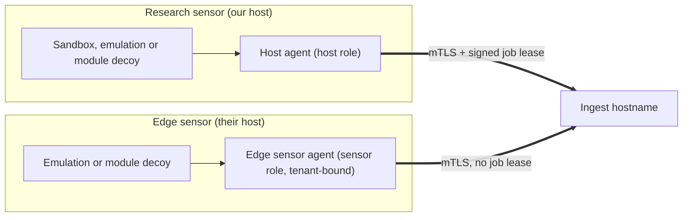

# ADR 0001: Architecture overview (decoys, sensors, radar boundary)

- Date: 2026-10-17
- Issue: #1
- Related: #40 (platform, recorded in [ADR 0009](0009-axum-workers-and-front-end.md)), #41 (sandbox host agent), #31 (edge ingest), #2 (threat model), #23 (roadmap)

## Status

Accepted.

This ADR fixes the overall shape of Foiled: which components exist, what each one does, where each one runs and which trust zone it sits in. Later ADRs decide the internals of single components. The platform choices behind it (Axum on Workers, the front end, the data services and what cannot run on Workers) are recorded in [ADR 0009](0009-axum-workers-and-front-end.md) (#40). This ADR does not repeat those tables.

## Context

Foiled runs decoys: real, pinned builds of vulnerable software in sandboxes, and lightweight emulations of products and protocols. It captures what attackers do to them, groups that into exploit attempts and maps attempts to CVEs, MITRE ATT&CK techniques, campaigns and, cautiously, public threat actor groups, with a confidence score on every link. Over time decoys run on many vantage points, both hosts we run (research sensors) and hosts other people run (edge sensors), and the central side turns that fleet into a radar-style feed and intel exports.

That means Foiled deliberately invites attackers onto machines it controls. The design problem is keeping the hostile side (decoys, the hosts they run on, and edge sensors we do not control) sharply separated from the trusted side (configuration, evidence, intel, operator access and publishing). A breakout from a decoy must not reach the control plane, and data arriving from the hostile side must be treated as untrusted input, however it is authenticated.

Fixed inputs from #40:

- The control plane and API are Rust with Axum on Cloudflare Workers (workers-rs `worker` 0.8.x with the `http` and `axum` features, no Tokio runtime). Shared types live in `crates/core`, the API in `crates/api`.
- The operator console is React Router v8 on Workers with static assets (`web/`), calling the API Worker over a Service Binding. Public exploit pages and write-ups are Astro (`site/`) on Workers.
- Data: D1 for config and catalogue, Postgres via Hyperdrive for attempts and intel, Durable Objects with hibernating WebSockets for the live stream, Queues for ingest, R2 for pcaps and quarantine, AI Gateway in front of any LLM, Analytics Engine for radar counters.
- Workers cannot run decoys: no KVM, no raw sockets, no arbitrary TCP or UDP listeners, no public IP per decoy. Decoys run on KVM-capable VPS or bare-metal sandbox hosts driven by a native Rust host agent, `crates/hostd` (#41).

Several issues still suggest Go-style paths such as `cmd/...` and `pkg/...`. Treat those as indicative names only. Under this ADR, trusted-side code lands in `crates/api` and `crates/core`, host-side code in `crates/hostd`, and front ends in `web/` and `site/`.

Background reading: [landscape and reuse plan](../research/landscape.md) and [lessons from commercial platforms](../research/lessons.md).

## Decision

### Trust zones

Foiled has three zones. Every component belongs to exactly one, except where a component is deliberately split (marked "Split" below).

| Zone | Who runs it | Trust | What lives there |
| --- | --- | --- | --- |
| Cloudflare trusted zone | Foiled operator, on Cloudflare | Trusted | Control API, ingest, Queues, D1, Postgres via Hyperdrive, R2, Durable Objects, AI Gateway, Analytics Engine, console, MCP, public pages, all intel processing |
| Sandbox host zone | Foiled operator, on a VPS or bare metal with KVM | Hostile. The guest is assumed compromised; the host OS and agent are assumed compromisable | Decoys, sandbox runtime, network isolation, capture, instrumentation hooks, host agent |
| Edge sensor zone | Someone else (a fleet partner or tenant) | Hostile and third-party. We cannot inspect or trust the box at all | Edge decoys (mostly emulations), capture subset, edge sensor agent |

Rules at the boundary:

1. Hosts and edge sensors only dial out. The control plane never opens a connection into a host or sensor, and no host exposes a management port on a public interface (#41).
2. The only channels that cross into the trusted zone are (a) HTTPS with mTLS to a dedicated ingest hostname, and (b) HTTPS PUTs of single objects to R2 using short-lived upload URLs minted by the control plane. They are drawn as separate edges below.
3. The ingest hostname is protected twice: a WAF rule drops any request without a verified client certificate, and the Worker then checks `request.cf.tlsClientAuth` and maps the certificate to a host or sensor identity in D1 (#31). Our own sandbox hosts get the `host` role; edge sensors get the `sensor` role, bound to a tenant.
4. Hosts and sensors hold no database credentials and no admin scopes. A stolen certificate can lease jobs for that host and post evidence as that host or sensor, nothing else (#21 scopes).
5. Jobs sent to a host are signed by the control plane, carry an idempotency key, a reason and an expiry, and are checked against a local allow-list of catalogue digests. The agent never accepts free-form shell commands (#41).
6. Large artefacts (pcaps, file diffs, quarantined payloads) never pass through a Worker request body. They go to R2 directly and events carry a `payload_ref`.
7. Guests have no route to the ingest hostname, to R2 or to each other. Only the host agent can reach those two endpoints (#4).
8. Decoys are never behind the Cloudflare proxy. Only the control plane, console and public pages are (#7).
9. Everything that arrives over ingest is treated as attacker-influenced data: parsed with strict schemas, size-capped, never executed, never rendered as HTML without escaping, and never passed to an LLM as instructions (#28).

### Architecture diagram

Thick edges are the mTLS ingest path. Dotted edges are the R2 direct-upload path. Red edges cross the trust boundary into the Cloudflare zone; nothing crosses in the other direction except responses on connections the host or sensor opened.

```mermaid
flowchart LR
  ATK["Attacker (internet)"]

  subgraph EDGE["Edge sensor zone (someone else's host, untrusted)"]
    EDEC["Edge decoy: emulation or decoy module"]
    ECAP["Capture subset + hooks"]
    EAGT["Edge sensor agent, offline buffer"]
  end

  subgraph HOST["Sandbox host zone (our VPS or bare metal, hostile)"]
    DEC["Decoy: decoy_kind = sandbox or emulation"]
    CAP["Capture + vulnerable-path hooks"]
    HAGT["Host agent (crates/hostd), offline buffer"]
  end

  subgraph CF["Cloudflare trusted zone: TRUST BOUNDARY, inbound only via mTLS ingest and presigned R2 PUT"]
    ING["Ingest routes on the mTLS hostname (WAF rule + cert check)"]
    Q[["Queue"]]
    R2[("R2, private: pcaps, diffs, quarantine")]
    ATT["Attempts (Postgres via Hyperdrive)"]
    INTEL["Confidence + CVE / ATT&CK / actor / campaign intel"]
    RAD["Central radar + review queue"]
    EXP["Intel exporters: STIX, MISP, TAXII, CSV"]
  end

  ATK -->|"exploit traffic, real client IP"| DEC
  ATK -->|"exploit traffic, real client IP"| EDEC
  DEC --> CAP --> HAGT
  EDEC --> ECAP --> EAGT
  HAGT ==>|"mTLS: job lease, envelopes, heartbeat"| ING
  EAGT ==>|"mTLS: envelopes, heartbeat"| ING
  HAGT -.->|"HTTPS PUT, short-lived upload URL"| R2
  EAGT -.->|"HTTPS PUT, short-lived upload URL"| R2
  ING --> Q --> ATT --> INTEL
  ATT -.->|"payload_ref"| R2
  INTEL --> RAD
  INTEL --> EXP

  linkStyle 6,7,8,9 stroke:#d33,stroke-width:3px
  style CF stroke-width:3px
```

The operator path stays inside the trusted zone: operator browser, Cloudflare Access, console Worker (`web/`), Service Binding, API Worker (`crates/api`), D1 and Postgres. The live attempt stream goes from the Queue consumer to a Durable Object and out to the console over a hibernating WebSocket.

### Research sensor path vs edge sensor path

Both sensor types use the same capture envelope (#9), the same ingest hostname and the same R2 upload pattern. They differ in who runs the box, what runs on it and how far we trust its evidence.

| | Research sensor (on-box, #7, #41) | Edge sensor (#31) |
| --- | --- | --- |
| Who runs the host | Foiled operator, on a VPS or bare metal with KVM | A fleet partner or tenant, on their hardware or cloud |
| Milestone | MVP (one VPS) | v0.2 |
| Agent | Host agent, `crates/hostd` | Edge sensor agent (may share code with `crates/hostd` later; separate decision in #41 and #31) |
| Identity and role | Cloudflare-managed client certificate, `host` role | Enrolment token exchanged for a client certificate, `sensor` role bound to a `tenant_id` |
| Decoys | Full sandboxes (Firecracker, gVisor, Docker fallback for local use only), emulations and decoy modules | Emulations and decoy modules by default; full sandboxes optional and documented as heavy |
| Control | Leases signed jobs from the control plane (create, start, stop, rotate, destroy, snapshot) | Runs the decoy set assigned at enrolment or by tenant config; no admin reach into the control plane |
| Capture | All channels in #9: network, app logs, FS diff, exec tracing, quarantine, #32 hooks | A subset of #9 channels, chosen per sensor build |
| Evidence trust | Medium: we run the host, but it is hostile and may be compromised | Low: the sensor owner can forge anything; the confidence layer (#27) weights source and flags IP or ASN jumps |
| Offline behaviour | Local buffer with cap and oldest-drop, drains on reconnect | Same buffer semantics |
| Data that crosses | Envelopes, heartbeats, job results over mTLS; large artefacts to R2 | Envelopes, attempt summaries, heartbeats over mTLS; large artefacts to R2 |

### Components

Each component has one job, one owning issue and one placement. "Workers" means the Cloudflare trusted zone. "Sandbox host" means our KVM host. "Split" means a trusted half on Workers and a hostile-side half on the host, joined only by the boundary channels above.

#### Decoys and the hostile side

| Component | Owner | Job | Runs on | Why there |
| --- | --- | --- | --- | --- |
| Catalogue | #5 | Describes each decoy as product, version, CVEs, `decoy_kind` and pinned artefact, so an operator can say "run X at version Y". | Workers (D1), authored in the repo and linted in CI | It is configuration and metadata, which D1 is for; the host only receives digests in signed jobs. |
| Image builder | #6 | Turns a catalogue entry into a digest-pinned OCI image or Firecracker rootfs with an SBOM. | Neither: a trusted build runner (CI or a dedicated build machine) | Builds need Docker Buildx and rootfs tools, which Workers lack, and #6 forbids building on honeypot hosts. |
| Emulator plug-ins | #30 | Present a product or protocol profile (banners, routes, opcodes, claimed CVEs) as a lightweight `emulation` decoy and emit capture envelopes. | Sandbox host (and edge sensors) | They listen on arbitrary TCP and UDP ports with the attacker's real IP, which Workers cannot do. |
| Decoy modules | #30 | Run upstream open source honeypots (Cowrie, OpenCanary, SNARE and TANNER, later Heralding, Conpot and others) as isolated containers with a module manifest. | Sandbox host (and edge sensors) | Same network needs as emulators; GPL modules must stay separate containers and are never imported into Foiled code. |
| Sandbox runtime | #3 | Creates, starts, stops, snapshots and destroys decoys through one interface for both decoy kinds (Firecracker, gVisor, Docker fallback, emulator supervisor). | Sandbox host | Needs KVM and process control. |
| Network isolation | #4 | Puts each decoy on a private segment with deny-by-default egress, published ports only, no route to the control plane or other decoys. | Sandbox host | Enforced with nftables, bridges and taps on the host kernel. |
| Rotation and reset | #8 | Replaces compromised or aged decoys with a clean image while keeping capture data outside the guest. | Split: policy and schedule on Workers, execution by the host agent | The decision is trusted; the act of destroying and rebooting a guest is local. |
| Capture | #9 | Records network, application logs, filesystem diffs, exec tracing, quarantined payloads and hook events into capture envelopes the guest cannot alter. | Split: collection on the sandbox host, storage on Workers (Queue, Postgres, R2) | Packet capture needs raw sockets on the host; evidence must leave the hostile box quickly to a store the guest and host cannot rewrite. |
| Vulnerable-path instrumentation | #32 | Fires a structured event with the exact request slice and follow-on actions when a known vulnerable code path is actually triggered. | Sandbox host, inside or beside the decoy | Hooks must sit in the decoy process or emulator; hook code is trusted-maintained and fails closed. |
| Host agent | #41 | Leases signed jobs, drives the runtime, attaches capture, buffers evidence and ships it out over mTLS and R2. | Sandbox host (native Rust with Tokio, `crates/hostd`) | It is the only bridge between the hostile host and the control plane and needs local process and KVM access. |
| Edge sensor agent | #31 | Runs decoys on someone else's host and forwards envelopes over mTLS with enrolment identity, signed builds and an offline buffer. | Edge sensor host | Vantage points have to be where the traffic is, outside our infrastructure. |
| Canaries | #17 | Plant unique fake secrets in guests so any use of them elsewhere is a high-confidence compromise signal. | Split: generation, registry and beacon listener on Workers; planting by the host agent at decoy start; egress proxy match on the sandbox host | Canary values must live only in the trusted store; planting and egress inspection have to happen next to the guest. |
| Fingerprint resistance | #18 | Keeps decoys from looking like honeypots to casual scanners and runs a self-check. | Sandbox host (decoy config), with the self-check result reported over ingest | Realism is a property of the decoy and its network presentation. |

#### Trusted side: ingest, evidence and intel

| Component | Owner | Job | Runs on | Why there |
| --- | --- | --- | --- | --- |
| Central ingest | #31 (ADR `docs/adr/0007-edge-ingest.md`), #41 | Authenticates hosts and sensors by client certificate, validates envelopes, enqueues them and mints short-lived R2 upload URLs. | Workers (mTLS hostname, Queues) | It is the trust boundary; it must sit on the trusted side and scale without us running servers. |
| Attempts | #25 | Groups raw events into first-class exploit attempts with state, payloads, hook hits and a noise score. | Workers (Queue consumer, Postgres via Hyperdrive) | Pure data processing over trusted storage. |
| Attempt timeline | #10 | Rebuilds an ordered timeline of an attempt, with optional pcap slices from R2. | Workers | Read model over Postgres and R2. |
| IOC extraction | #34 | Pulls network, payload, behavioural and memory-only indicators out of attempts. | Workers | Parsing of stored evidence; no execution of payloads. |
| Enrichment | #11 | Adds ASN, geo and terms-safe lookups (GreyNoise, CrowdSec, DShield, Shadowserver, Hunt.io) to observables, cached and async. | Workers (Queue consumer); YARA scanning runs as a trusted batch job off the decoy hosts, placement decided in #11 | Outbound HTTP lookups suit Workers; YARA needs native libraries and must never run on a decoy host. Enrichment data is never resold or republished. |
| Confidence | #27 | Scores every asserted link (CVE, technique, actor, campaign) from weighted evidence with thresholds, overrides and an explanation. | Workers | Deterministic scoring over Postgres; needs Workers Paid CPU limits. |
| CVE intel | #12 | Maps attempts to likely CVEs through mapping tiers (signatures, sequences, hooks, later predisclosure). | Workers | Rule evaluation over stored evidence. |
| ATT&CK intel | #26 | Maps attempts to ATT&CK techniques using pinned STIX data. | Workers | Lookup and rules over pinned data. |
| Actor intel | #29 | Attaches cautious possible-association labels at nexus or public cluster level with external report links. | Workers | Analyst-gated data processing. |
| Campaign intel | #33 | Clusters attempts across the fleet by infrastructure, TTP, targeting and payload similarity. | Workers (Queue or Cron consumer, 15 minute wall time) | Batch work over Postgres; can move to a trusted batch host if it outgrows Workers limits. |
| LLM correlation | #28 | Proposes structured links between indicators, CVEs and attempts behind the confidence layer. | Workers, through AI Gateway (`docs/adr/0010-llm-provider-and-ai-gateway.md`) | One place for logging, caching, rate limits and provider fallback; never auto-publishes and never calls MCP tools. |
| Retention purge | #16 | Deletes or redacts capture data on configured TTLs with a dry-run mode and an audit log. | Split: Cron Worker for D1, Postgres and R2; host agent purges local buffers after acknowledged upload | Most data lives on Cloudflare; the host only keeps what it has not shipped yet. |

#### Trusted side: operator, publishing and outputs

| Component | Owner | Job | Runs on | Why there |
| --- | --- | --- | --- | --- |
| Control API | #21 | The single OpenAPI surface for decoys, attempts, campaigns, IOCs, review queue, exports, audit and host jobs. | Workers (Axum, `crates/api`) | Decided in #40; it holds the only database bindings. |
| MCP server | #24 | Gives agents scoped, rate-limited, audited tools to create, reset and query decoys and attempts. | Workers, as a pure client of the control API | It must never touch the runtime or capture store directly; keeping it on the trusted side behind API scopes enforces that. |
| Dashboard | #14, #39 | Authenticated operator console: launch wizard, decoy status, attempt triage, review queue, campaigns, IOCs and exports. | Workers (React Router v8, `web/`, behind Cloudflare Access, Service Binding to the API) | Decided in #40; live updates come from a Durable Object. |
| Central radar and review queue | #35 | Time-ordered feed of high-confidence CVE assessments, predisclosure spikes, campaigns and sensor anomalies, plus the analyst review queue. | Workers (Postgres, Analytics Engine counters) | Trusted-side only by design; aggregates the whole fleet. |
| Research write-up workflow | #35 | Turns a confirmed review queue item into a reviewed public write-up with tenant data stripped and "we assess as" wording. | Workers (review queue state) plus pull requests to `research/` in the repo | Publishing stays human-gated with a second reviewer. |
| Public pages | #35, #39 | Public exploit pages and write-ups. | Workers (Astro, `site/`, static assets) | Mostly static content; contains only reviewed material and no live data. |
| Alerting | #15 | Sends bounded alerts for high-signal events by webhook or email and can enqueue review items instead of paging. | Workers (Queue consumer) | Fed from trusted events; outbound only. |
| Intel exporters | #13 | Produce STIX 2.1, MISP, TAXII and IOC CSV or JSON with confidence gating and cautious wording. | Workers (Cron and Queue consumers, R2 for large bundles) | Reads trusted data only; never exports direct from a host. |
| Contribute back | #37 | Shares delayed, community-safe signal with DShield, CrowdSec and SentryPeer. | Workers (scheduled, from the trusted store) | Keeps the boundary one-way: hosts never talk to third parties on Foiled's behalf. |

### `decoy_kind`: dual mode

The catalogue (#5) has one field that decides how a decoy runs:

- `sandbox`: a real, pinned build of the vulnerable software from the image builder (#6), run in Firecracker when KVM is present (gVisor or a hardened Docker fallback for local use only, never as the default for internet exposure). Highest fidelity, highest risk, full capture channels.
- `emulation`: an emulator plug-in profile (#30) run under the runtime's emulator supervisor (#3) with seccomp or landlock and the same deny-by-default egress. Lower fidelity, much cheaper, the default for edge sensors.
- Module-backed decoys: upstream open source honeypots run as isolated containers from a module manifest (#30). This ADR assumes they are catalogued as `emulation` entries whose artefact points at the module manifest (image digest, licence, ports, event mapping), not as a third `decoy_kind`. #5 and #30 make the final schema call.

Every component downstream of capture (attempts, confidence, intel, radar, exports) must accept both kinds. Capture channels that do not apply to a kind (for example exec tracing on a pure emulator) are marked as not applicable, not faked.

### Milestones

Split matches the roadmap in #23.

| Milestone | Components |
| --- | --- |
| MVP | Architecture and platform ADRs (#1, #40), threat model (#2), sandbox runtime with the sandbox path first (#3), network isolation (#4), catalogue with `sandbox` entries (#5), image builder (#6), control API (#21), host agent with the `host` role subset of mTLS enrolment (#41), capture: network flows, HTTP logs, FS diff on rotate (#9), retention purge (#16), research sensor deployment on one VPS (#7), rotation (#8), docs and CI (#20, #19), MVP slice with manual rotate and IOC CSV export (#22). MVP topology: one Workers control plane plus one VPS sandbox host running #41. |
| v0.2 Capture and enrichment | Emulator plug-ins and decoy modules (#30), vulnerable-path instrumentation (#32), attempts (#25), timeline (#10), IOC extraction (#34), confidence (#27), CVE mapping tiers without predisclosure (#12), ATT&CK (#26), enrichment (#11), edge sensor agent and edge forwarding (#31), MCP (#24), licence and data-terms register (#38). |
| v0.3 Intel outputs and operator UI | Dashboard and design system (#14, #39), radar, review queue, public pages and write-ups (#35), campaign clustering (#33), predisclosure tracking (rest of #12), intel exporters (#13), alerting (#15), canaries (#17), LLM correlation (#28), actor association (#29), contribute back (#37). |
| v1.0 Hardening | Fingerprint resistance and self-check (#18). |

In MVP there is no dashboard; operators use the control API (#21) directly. Capture events are stored as raw events until the attempts entity lands in v0.2.

### Threat model mapping

The threat model (#2, `docs/threat-model.md`) walks each component named in the tables above and maps every risk to its owning component and issue. Use the component names in this ADR as the vocabulary, so that, for example, sandbox breakout maps to the sandbox runtime (#3), network isolation (#4) and rotation (#8); a stolen host or sensor certificate maps to central ingest (#31) and the host agent (#41); capture store poisoning maps to capture (#9) and confidence (#27); prompt injection from attempt payloads maps to LLM correlation (#28) and MCP (#24); and over-retention of personal information maps to retention purge (#16).

## Consequences

Positive:

- The control plane has no presence on any machine that runs attacker-reachable code. A full breakout on a sandbox host yields, at worst, that host's client certificate, which can only lease that host's jobs and post its own evidence.
- The trusted side runs on managed services with no servers for us to patch, and scales by adding Workers consumers rather than machines.
- One envelope format and one ingest path serve research and edge sensors, so adding edge sensors in v0.2 is an identity and packaging change, not a new pipeline.
- Large evidence goes straight to R2 and never hits Worker body limits or CPU time.
- Both decoy kinds share one runtime interface and one capture envelope, so intel features do not fork by decoy type.

Negative and costs:

- Two runtimes and two languages: Rust on wasm32 for Workers (no Tokio, `#[worker::send]` on handlers that touch bindings, every dependency must build for `wasm32-unknown-unknown`), native Rust for `crates/hostd`, and TypeScript for `web/` and `site/`. `crates/core` must stay wasm-compatible.
- Workers limits shape the intel jobs: 128 MB per isolate, CPU caps, 15 minute wall time for Queue and Cron consumers. Heavy jobs (campaign clustering, YARA, large exports) may need a trusted batch host later. Workers Paid is assumed.
- Hosts need egress to exactly two Cloudflare endpoints (ingest hostname and R2), and network isolation (#4) must make sure guests cannot reach either.
- Evidence from a compromised host or any edge sensor can be forged. Capture outside the guest stops guest tampering but not host tampering, so the confidence layer must weight evidence by source and sensor trust.
- If the control plane is unreachable, decoys keep running but cannot be rotated on schedule; hosts buffer evidence with a cap and drop the oldest first.
- Analytics Engine keeps three months of data, so long-range radar trends need Postgres rollups.
- Cloudflare-managed client certificates are the MVP CA; bring-your-own CA is Enterprise only and out of the MVP path.

## Alternatives considered

1. **Control plane on the same VPS as decoys.** This was the original single-VPS layout in #7 ("control plane on localhost"). Rejected: a sandbox breakout or a kernel bug shared between guest and host lands the attacker next to the database, admin tokens and the operator UI. Network isolation becomes the only control between a guest and everything trusted. Replaced by the host agent (#41) dialling out to Workers.
2. **Decoys on Cloudflare Containers.** Rejected: container traffic is routed through a Worker and end users cannot make non-HTTP TCP or UDP requests to an instance, so SSH, Redis, SIP, ICS and most decoys are impossible. Instances top out at 4 vCPU and 12 GiB, there is no KVM for Firecracker, attackers would not see a real, dedicated IP, and hosting deliberately vulnerable software there is a terms question not cleared. Containers may be used later for trusted batch jobs only (#40).
3. **Proa as the Rust web framework.** Rejected: its Axum integration pulls in Tokio `full` and mio, which do not build for Workers, and its islands crate fails on wasm32 because of `linkme` distributed slices (#40).
4. **A single monolithic Go or Python service** (API, ingest, intel, UI and decoy management in one process or one deploy). Rejected: one process would hold both hostile-facing code (decoy control, evidence parsing at the host) and trusted secrets (database credentials, admin tokens), so there would be no trust boundary to enforce. It also could not run on Workers, would put a long-lived server back on our patch list, and conflicts with the decided Rust split (`crates/api`, `crates/core`, `crates/hostd`).
5. **Decoys behind the Cloudflare proxy.** Rejected: attribution needs the real client IP, and trusting forwarded headers on a decoy is fragile. A Cloudflare edge in front makes the decoy look wrong to attackers and scanners, filters or alters some of the traffic we want to see, and only covers HTTP-style ports without extra products. Only the control plane, console and public pages sit behind Cloudflare (#7).
6. **Control plane pushes to hosts (SSH or an inbound management API).** Rejected: it needs an inbound port on a hostile host and control-plane credentials that can reach every host. Outbound-only job leasing over mTLS keeps the host's public interfaces limited to decoy ports (#41).

## Related decisions

- [ADR 0002: Sandbox and emulation runtime](0002-sandbox-runtime.md) (#3)
- `docs/adr/0003-network-isolation.md` (#4)
- `docs/adr/0004-image-builder.md` (#6)
- `docs/adr/0005-capture-layer.md` (#9)
- `docs/adr/0006-emulation-plugins.md` (#30)
- `docs/adr/0007-edge-ingest.md` (#31)
- `docs/adr/0008-sandbox-host-agent.md` (#41)
- `docs/adr/0009-axum-workers-and-front-end.md` (#40)
- `docs/adr/0010-llm-provider-and-ai-gateway.md` (#28)
