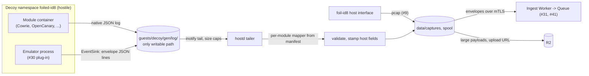
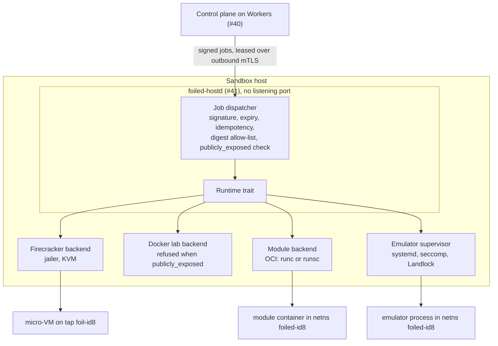

# ADR 0002: Sandbox and emulation runtime

- Date: 2026-10-18
- Issue: #3
- Related: #2 (threat model), #4 (network isolation, [ADR 0003](0003-network-isolation.md)), #5 (catalogue), #6 (image builder), #8 ([rotation](../rotation.md)), #9 (capture layer), #24 (MCP), #30 (emulation plug-ins and decoy modules), #31 (edge sensors), #32 (vulnerable-path instrumentation), #38 (licence register), #40 ([ADR 0009](0009-axum-workers-and-front-end.md)), #41 (sandbox host agent)

## Status

Accepted (18 Oct 2026).

This ADR decides how decoys run on a sandbox host: which isolation each kind of decoy gets, how the host agent supervises them, and the one `Runtime` interface that covers both `decoy_kind` values. Network plumbing is in [ADR 0003](0003-network-isolation.md). The rotation sequence and its rules are in [rotation.md](../rotation.md). The host agent's job protocol belongs to ADR 0008 (#41, `docs/adr/0008-sandbox-host-agent.md`), and the emulator plug-in interface to ADR 0006 (#30, `docs/adr/0006-emulation-plugins.md`).

## Context

Foiled runs software that is meant to be compromised. The catalogue (#5, [catalogue.md](../catalogue.md#decoy-kinds)) has two decoy kinds, and the emulation kind has two artefact shapes:

| Kind | Artefact | What runs |
| --- | --- | --- |
| `sandbox` | Digest-pinned image or rootfs from the image builder (#6) | A real build of vulnerable software. Attackers can get root in it. |
| `emulation` (custom) | `emulator_id` plus profile (#30) | A Foiled emulator plug-in that fakes a product's banners, routes and opcodes. |
| `emulation` (module) | `module_id`, profile, licence, image digest (#30) | A reused open source honeypot (Cowrie, OpenCanary, SNARE and TANNER, and later Heralding, Conpot, SentryPeer, ADBHoney, Dionaea). |

All three parse hostile input, so all three need containment. They differ in how much the attacker is expected to get:

- A sandbox decoy is expected to be fully compromised. Post-exploit behaviour is the point. The boundary has to hold against guest root plus a kernel exploit for the guest kernel ([threat model](../threat-model.md#sandbox-breakout), #2).
- An emulator or module is not supposed to give the attacker code execution at all. A parser bug in it is still a real risk, and some modules (Dionaea in particular) are old C code that handles malware.

Fixed inputs:

- Decoys run on KVM-capable VPS or bare-metal hosts that we control, driven by the native Rust host agent `foiled-hostd` in `crates/hostd` (#41). The control plane runs on Cloudflare Workers (#40) and reaches a host only through signed jobs that the agent leases over outbound mTLS. Nothing on the host listens for management traffic.
- Threat model controls C1 to C5 and C7: hypervisor boundary for internet-facing sandboxes, no privileged containers or host networking, jailer per micro-VM, rebuild from digest after compromise, no useful secrets in guests, no shared writable volumes.
- Network isolation is fixed by [ADR 0003](0003-network-isolation.md): one routed /29 per decoy in `10.85.0.0/16`, a named network namespace with a veth pair for namespace decoys, a tap device for Firecracker decoys, deny-by-default egress through the logging resolver and proxy, and published ports DNATed from the frontend address.
- Rotation (#8, [rotation.md](../rotation.md)) already names the runtime methods each rotation step calls (`Stop`, `Snapshot`, `Destroy`, `Create` or `Restore(baseline)`, `Start`). This ADR has to match it.

## Decision

### Summary

| Workload | Runtime on an internet-facing host | Allowed elsewhere | Never |
| --- | --- | --- | --- |
| `sandbox` decoy | **Firecracker micro-VM under the jailer. KVM required.** | Hardened Docker on a local lab host only | Docker, gVisor or any container runtime on a host marked `publicly_exposed` |
| `emulation` custom plug-in | Host process under a systemd sandbox, seccomp and Landlock, in its own network namespace | OCI container (same rules as modules), or a Firecracker micro-VM for high-risk parsers | A general shell, any outbound route |
| `emulation` module | One OCI container per module, rootless, hardened, `runc` by default or gVisor (`runsc`) | Same | Privileged mode, host networking, the Docker socket, linking into Foiled code |

### Sandbox decoys: Firecracker with the jailer

Firecracker is the primary and, on any internet-facing host, the only runtime for `sandbox` decoys.

- **KVM is required.** The agent checks `/dev/kvm` at start and reports it in every heartbeat (#41). A host without KVM can run emulation decoys but is never scheduled a `sandbox` decoy unless it is a lab host (see below).
- **Jailer for every VM.** Each Firecracker process starts through the jailer, which builds a chroot under `/srv/jailer/firecracker/<id>/`, joins the decoy's network namespace, applies cgroup v2 limits, then drops to a per-VM UID from the reserved range with group `foiled-decoy` before it runs the VMM (threat model C3). The suggested unit is [`foiled-jailer@.service`](../../deploy/systemd/foiled-jailer@.service), started by the agent through systemd and checked by the root-run `foiled-vmctl` helper against fixed policy ([vps.md](../deploy/vps.md#services)).
- **Firecracker's own seccomp filter stays on** (the default filter for the release in use). No `--no-seccomp`, no custom permissive filter.
- **Minimal device model.** One virtio-net device on the tap from ADR 0003, one read-only root drive from `images/<digest>/`, one writable drive per generation under `guests/<decoy_id>/<generation>/`, serial console for boot logs. vsock off unless a capture hook (#9) needs it. MMDS off.
- **API socket.** The Firecracker API socket lives inside the jail, owned by the VM UID with group access for `foiled-agent` only. It is needed for pause, resume and snapshot ([rotation.md](../rotation.md#rotation-sequence) step 1 and 3). It is a Unix socket, never TCP, and never reachable from any decoy namespace. The current unit template passes `--no-api`; that changes when snapshot support lands in #41.
- **Per-device rate limiters** on the net and block devices cap bandwidth and IOPS, so one decoy cannot starve the host or the capture writer.
- **Linux guests only.** Firecracker does not boot Windows or other non-Linux guests. Products that only ship for Windows are out of scope for `sandbox` until a separate ADR adds a different VMM.

### Hardened Docker: local labs only

`runtime: docker` on a `sandbox` catalogue entry exists so contributors can test entries on a laptop or a host without KVM. It is never the default and never runs on an internet-facing host.

When it runs, the container gets all of the following, with no per-entry override:

- Docker's default seccomp profile (or a stricter one), never `seccomp=unconfined`.
- `--security-opt no-new-privileges`.
- `--read-only` root filesystem, with a per-generation writable volume and `tmpfs` scratch only where the entry needs them.
- `--cap-drop ALL`. No capability is added back.
- User namespaces: the Docker daemon runs with `userns-remap` or rootless, so root in the container is an unprivileged host UID.
- `--network none`, with the agent wiring the ADR 0003 veth into the container's namespace. Never `--network host`, never Docker port publishing on a public address.
- Never `--privileged`, never host PID or IPC namespaces, never the Docker socket mounted, never device pass-through.
- `--pids-limit`, `--memory`, `--cpus` from the spec's `ResourceLimits`.

**Refused on `publicly_exposed` hosts.** Each host has a `publicly_exposed` flag:

- It is set in `/etc/foiled/hostd.toml` and defaults to `true`. An operator can set it to `false` only on a lab host.
- The agent forces it to `true`, whatever the config says, if any interface has a globally routable address or a decoy frontend address is configured. A lab host is one behind NAT or on a private network only.
- The agent reports the effective value in every heartbeat.

The Docker sandbox backend is refused in three places, so a single bug or a forged instruction cannot get past all of them:

1. **Host agent (authoritative).** `Runtime::create` for a `docker` sandbox spec on a `publicly_exposed` host returns `RuntimeError::DockerRefusedOnPublicHost` before anything is created, and the job fails. The control plane cannot override this.
2. **Control plane.** The scheduler (#21) never places a `runtime: docker` decoy on a host whose last heartbeat says `publicly_exposed: true`.
3. **MCP and console.** The MCP server (#24) and the launch wizard refuse the request with the same error, and say why.

The operator-facing version of this rule is in [vps.md](../deploy/vps.md#docker-fallback-not-for-public-exposure).

### gVisor: an option for emulators and modules

gVisor (`runsc`) is an OCI runtime with a user-space kernel. It cuts the host kernel surface a container can reach, which suits code that parses hostile input but is not supposed to give out a shell.

- It is an **option** for decoy module containers and for container-packaged emulators. A module manifest or catalogue entry may ask for `isolation: gvisor`, and the operator can make it the host default.
- It is **required** for Dionaea when that module is added, unless Dionaea runs in a Firecracker micro-VM instead. Dionaea is old C code that handles malware samples and is stale upstream ([landscape](../research/landscape.md#reuse-plan)).
- It is **not** used for `sandbox` decoys. A real product running on gVisor behaves differently from one on a real kernel (missing or emulated syscalls, a synthetic `/proc`), which hurts fidelity and makes the decoy easier to fingerprint once an attacker has a shell (#18). On an internet-facing host a `sandbox` decoy needs Firecracker.
- gVisor's systrap platform works without KVM, which makes it useful on edge sensors (#31) that cannot run Firecracker. That packaging is #31's call.

### Emulation supervisor

The supervisor is the part of the host agent that runs `emulation` decoys. It does not take free-form commands any more than the rest of the agent does: it starts, stops and destroys what a signed job names, by digest.

#### Custom emulator plug-ins (#30)

The default is a host process, one per decoy, in a transient systemd unit (planned template `foiled-emulator@.service`, owned by #41 alongside the units in `deploy/systemd/`). The binary is the emulator host built from Foiled code, pinned by digest and checked against the local allow-list like any image. The plug-in interface itself is ADR 0006.

Containment, all at once:

- **systemd sandboxing:** a per-decoy UID from the reserved range with group `foiled-decoy` (as for the jailer), `NoNewPrivileges=yes`, empty `CapabilityBoundingSet=`, `ProtectSystem=strict`, `ProtectHome=yes`, `PrivateTmp=yes`, `PrivateDevices=yes`, `ProtectKernelTunables=yes`, `ProtectKernelModules=yes`, `ProtectKernelLogs=yes`, `ProtectControlGroups=yes`, `ProtectClock=yes`, `RestrictNamespaces=yes`, `RestrictSUIDSGID=yes`, `LockPersonality=yes`, `MemoryDenyWriteExecute=yes`, `RestrictAddressFamilies=AF_INET AF_UNIX`, `NetworkNamespacePath=/run/netns/foiled-<id8>` (the ADR 0003 namespace), `ReadWritePaths=` the generation's state and log directory only, and `MemoryMax=`, `CPUQuota=`, `TasksMax=` from `ResourceLimits`.
- **seccomp, two layers:** `SystemCallFilter=@system-service` with `~@privileged @resources @mount @module @raw-io @reboot @swap @debug` from systemd, then a second, tighter filter the emulator host installs itself once its listeners are bound. That filter denies `execve`, `execveat`, process creation (`fork`, `vfork`, and `clone` without `CLONE_THREAD`), `ptrace`, and new listening sockets. A parser bug cannot start a shell, because there is nothing it is allowed to start.
- **Landlock:** applied by the emulator host before it reads any input. Read-only access to its profile directory, read and write to its state and log directory, no execute right anywhere. On kernels with Landlock network rules (ABI 4 and later) it may bind only its listen ports and may not connect anywhere.
- **Network:** the same deny-by-default egress as every other decoy (#4). An emulator never needs outbound traffic, so any egress attempt from an emulator namespace is treated as a compromise signal (`egress_blocked`).

An emulator may instead be packaged as an OCI image and run on the module container path below, for example on an edge sensor without systemd, or when a plug-in is not written in Rust. An emulator for a complex binary protocol may also run in a Firecracker micro-VM. In both cases `decoy_kind` stays `emulation`; only the backend changes.

#### Third-party decoy modules: one container per module

Each module runs as its own container, one module per decoy, never several modules in one container and never a module inside a sandbox guest. This is the T-Pot pattern (one container per honeypot, a health check each, a shared event path), learned rather than copied: no T-Pot compose or config files come into the repo, the orchestration is our own code in `crates/hostd`, and two of T-Pot's choices are changed on purpose, as listed below.

| Module | Licence | Milestone | Isolation |
| --- | --- | --- | --- |
| Cowrie | BSD-3-Clause | MVP | `runc`, hardened |
| OpenCanary | BSD-3-Clause | MVP | `runc`, hardened |
| SNARE + TANNER | GPL-3.0 | MVP | Two containers in one decoy (the /29 holds companion guests, ADR 0003), `runc`, hardened |
| Heralding | GPL-3.0 | v0.2 | `runc`, hardened |
| Conpot | GPL-2.0 | v0.2 | `runc`, hardened |
| SentryPeer | GPL-2.0-only or GPL-3.0-only | v0.2 | `runc`, hardened. Peer sharing off unless #37 turns it on from the trusted side. |
| ADBHoney | GPL-3.0 | v0.2 | `runc`, hardened |
| Dionaea | GPL-2.0 | later | gVisor or Firecracker only |

How the agent runs them:

- **No Docker daemon on internet-facing hosts.** The agent writes an OCI bundle from the module manifest (`modules/<module_id>/manifest.yaml`, #30) and starts it with the OCI runtime (`runc` or `runsc`) in a transient systemd unit (planned `foiled-module@.service`) for cgroup limits. Docker group membership is equivalent to root, and Docker's own port publishing bypasses host filtering ([vps.md](../deploy/vps.md#docker-fallback-not-for-public-exposure)), so neither is used.
- **Image by digest.** The bundle root is the read-only unpacked image under `images/<digest>/`, verified against the local allow-list (#41) and re-hashed before each create (#6 owns fetching and verification).
- **Hardening baseline,** the same as the lab Docker list above: default seccomp profile or stricter, `noNewPrivileges`, read-only root, no capabilities, a user namespace mapping container root to an unprivileged UID in the `foiled-decoy` range, the ADR 0003 network namespace joined by path, no host PID, IPC or network namespace, no device pass-through, no Docker socket, `pids`, memory and CPU limits from the spec.
- **Writable paths:** one per-generation log directory (bind-mounted read-write, the only path the agent reads back) and the module's own state directory, both under `guests/<decoy_id>/<generation>/` and wiped on destroy ([rotation.md](../rotation.md#quarantine-volumes-and-wipe-rules)).
- **Health checks from the host side,** defined in the module manifest: TCP connect, banner match or HTTP probe into the decoy's namespace, every 30 s by default. A decoy that fails three checks in a row while `healthy` is rotated with reason `health_failed`. **Change from T-Pot:** T-Pot restarts unhealthy containers in place (Autoheal). Foiled never restarts a decoy in place, because a crash may be a compromise; it rebuilds from digest (rule 1 of [rotation.md](../rotation.md#rules-that-never-bend)).
- **Change from T-Pot:** T-Pot starts every honeypot on a host together. Foiled starts one persona per decoy on demand, from a signed job.
- **Deny-by-default egress** from ADR 0003 applies unchanged. A module that wants outbound access (for example Cowrie's download emulation) gets the logging proxy and an empty allow-list. Any egress attempt outside it fires `egress_blocked`.

#### How module and emulator events reach the capture bus

Modules and emulators write events; the host agent turns them into capture envelopes (#9). Nothing in a decoy talks to the control plane.



- Most modules already have a JSON log output (Cowrie's `jsonlog`, OpenCanary's file logger and so on). The module manifest names the log file and an **event schema mapping** from the module's fields to the envelope. Where a module has no usable JSON output, the manifest names a small adapter. The adapter is Foiled code that runs as a separate process in the module's container and reads the module's log, so it never links module code.
- Custom emulators use the #30 `EventSink`, which writes capture envelopes as JSON lines into the same log directory.
- The agent tails the directory (inotify), applies the mapper, validates each envelope against the #9 schema and stamps the fields a decoy may not set: `host_id`, `decoy_id`, `generation`, `catalogue_id`, `received_at` and `source` (`module:<module_id>` or `emulator:<emulator_id>`). Values the decoy wrote for those fields are discarded.
- The log directory is attacker-reachable once a module is compromised, so tailed events are untrusted input: line length cap (64 KiB by default), per-decoy rate cap, malformed lines counted and dropped, nothing in them ever executed or used as a path. The confidence layer (#27) weights them below host-side evidence such as the pcap on `foil-<id8>`, which the decoy cannot touch.
- From there the path is the same as for sandbox decoys: envelopes to ingest over mTLS, large artefacts straight to R2 with a short-lived upload URL ([rotation.md](../rotation.md#capture-data-path-outside-the-guest), #41).

### Licence boundary

Foiled's own code is MIT. GPL modules (SNARE, TANNER, Heralding, Conpot, SentryPeer, ADBHoney, Dionaea) only ever run as **separate processes in their own container images**:

- No GPL module code is imported, vendored, linked or copied into any Foiled crate or package, and no GPL upstream is cloned into this repository as a submodule or subtree.
- The agent talks to modules only across process boundaries: it starts the container with an OCI runtime and reads the JSON the module writes. The event mappers and adapters are written from the modules' documented output formats, not from their source.
- Any module image we build and distribute ships the upstream licence text and offers the corresponding source, with our patches published under the module's own licence.
- Each module's SPDX licence is in its catalogue entry and module manifest (#5, #30), and `foiled-lint` requires it. The project-wide register is `docs/compliance/licence-register.md` (#38).

This is a design constraint the project follows, not legal advice. Operators who redistribute images should check their obligations with their own counsel.

### `Runtime` interface

One trait in `crates/hostd` covers every backend. The `decoy_kind` and artefact shape in `DecoySpec` select the backend.

**`Runtime` is called only by the host agent's job dispatcher (#41).** It is a library interface inside the `foiled-hostd` process. It has no network port, no HTTP or gRPC endpoint and no local socket that accepts `Runtime` calls from other processes. The only way to reach it is a signed, unexpired, idempotent job that the agent leased over its outbound mTLS connection and checked against its local digest allow-list. The control plane never calls it directly, and nothing on a decoy's side of the network can reach it.

Indicative sketch. Names may change in #41; the method set and the mapping to jobs may not without updating this ADR and [rotation.md](../rotation.md).

```rust
use std::net::{Ipv4Addr, SocketAddr};
use std::path::PathBuf;
use std::time::{Duration, SystemTime};

use foiled_core::catalogue::{DecoyKind, Protocol};

// Digest, Reason, JobType and SnapshotRef are small types defined with the
// agent protocol (#41) and left out here.

/// Passed with every call so the journal and the job ack carry
/// the job's reason and idempotency key (see the job mapping table).
pub struct JobCtx {
    pub job_id: String,
    pub job_type: JobType,          // decoy.create, decoy.rotate, ...
    pub idempotency_key: String,    // or `<key>/<step>` inside decoy.rotate
    pub reason: Reason,             // { code, text } from rotation.md
    pub expires_at: SystemTime,
}

/// Identifies one generation of one decoy on this host.
pub struct GuestRef {
    pub decoy_id: String,
    pub generation: u32,
}

pub struct DecoySpec {
    pub decoy_id: String,
    pub generation: u32,
    pub decoy_kind: DecoyKind,       // sandbox | emulation
    pub catalogue_id: String,        // e.g. "foiled/demo-app/1.0.0"
    pub artefact: RunArtefact,
    pub limits: ResourceLimits,
    pub network: NetworkHandle,
    pub capture_hooks: CaptureHooks,
    pub lifetime: Lifetime,
}

/// Resolved, digest-pinned form of the catalogue artefact.
pub enum RunArtefact {
    Sandbox { digest: Digest, backend: SandboxBackend },
    Emulator { emulator_id: String, profile: String, digest: Digest, packaging: EmulatorPackaging },
    Module { module_id: String, profile: String, digest: Digest, licence: String, isolation: Isolation },
}
pub enum SandboxBackend { Firecracker, DockerLab }
pub enum EmulatorPackaging { HostProcess, Container(Isolation), MicroVm }
pub enum Isolation { Runc, Gvisor }

pub struct ResourceLimits {
    pub vcpus: u8,      // VM vCPUs, or a CPU quota of this many CPUs
    pub mem_mib: u32,
    pub disk_mib: u32,  // writable drive, volume or state directory quota
    pub pids: u32,      // cgroup pids.max for the VMM, container or process
}

pub struct NetworkHandle {
    pub attach: NetAttach,
    pub guest_ip: Ipv4Addr,                  // .2 of the decoy's /29 (ADR 0003)
    pub published_ports: Vec<PublishedPort>, // from the catalogue entry only
}
pub enum NetAttach {
    Netns { path: PathBuf },  // /run/netns/foiled-<id8>
    Tap { ifname: String },   // foil-<id8>, owned by the jailer UID
}
pub struct PublishedPort { pub port: u16, pub protocol: Protocol }

pub struct CaptureHooks {
    pub pcap_iface: String,            // host-side foil-<id8> (#9)
    pub log_dir: PathBuf,              // the only path read back from the decoy
    pub event_mapping: Option<String>, // module manifest mapping id (#30)
    pub fs_diff: bool,                 // diff writable volume on flush (#9)
    pub instrumentation: Vec<String>,  // hook ids (#32)
    pub canary_slots: Vec<String>,     // slots filled at start (#17)
}

pub struct Lifetime {
    pub start_timeout: Duration,  // boot plus first health check
    pub stop_timeout: Duration,
    pub max_lifetime: Duration,   // jitter already applied by the control plane
    pub hard_deadline: SystemTime, // signed backstop, see below
}

pub struct ExecMeta {
    pub listen_addrs: Vec<SocketAddr>,
    pub pid_or_cid: ExecHandle,
    pub image_or_emulator_digest: Digest,
}
pub enum ExecHandle { VmmPid(u32), ContainerId(String), Pid(u32) }

pub enum StopMode { Freeze, Kill }
pub enum SnapshotKind { Baseline, Forensic }

/// Can only be built from a snapshot manifest with kind `baseline` whose
/// digest matches the decoy. A forensic snapshot cannot become one.
pub struct BaselineSnapshot { /* private fields */ }

#[allow(async_fn_in_trait)]
pub trait Runtime {
    async fn create(&self, ctx: &JobCtx, spec: &DecoySpec) -> Result<ExecMeta, RuntimeError>;
    async fn start(&self, ctx: &JobCtx, guest: &GuestRef) -> Result<ExecMeta, RuntimeError>;
    async fn stop(&self, ctx: &JobCtx, guest: &GuestRef, mode: StopMode) -> Result<(), RuntimeError>;
    async fn destroy(&self, ctx: &JobCtx, guest: &GuestRef) -> Result<(), RuntimeError>;
    async fn snapshot(&self, ctx: &JobCtx, guest: &GuestRef, kind: SnapshotKind)
        -> Result<SnapshotRef, RuntimeError>;
    /// Only from a clean baseline (rotation.md). Never from a forensic snapshot.
    async fn restore(&self, ctx: &JobCtx, spec: &DecoySpec, from: &BaselineSnapshot)
        -> Result<ExecMeta, RuntimeError>;
}

pub enum RuntimeError {
    DigestNotAllowed,
    DigestMismatch,
    KvmUnavailable,
    DockerRefusedOnPublicHost,
    GenerationAlreadyPublished,
    NotRestorable,      // forensic, wrong digest or missing snapshot
    Timeout,
    Backend(String),
}
```

Rules every backend follows:

- **Idempotent.** Each method checks host state first. `create` for a `(decoy_id, generation)` that already exists with the same digest returns its `ExecMeta`; with a different digest it fails. `stop` on a stopped guest, and `destroy` on an absent one, succeed. This is what lets a replayed job or a resumed rotation journal be safe ([rotation.md](../rotation.md#checklist)).
- **Host side only.** `stop` and `destroy` act from outside the guest (VMM API, cgroup freeze or kill, `SIGSTOP` or `SIGKILL`), never by asking the guest to shut down. `Freeze` pauses; `Kill` does not wait.
- **`create` does not publish.** Ports are published by `start` after the health check passes, and unpublished by `stop`. Network rule changes go through the agent's nftables transactions from ADR 0003.
- **`restore` is only from a clean baseline.** The argument type cannot hold a forensic snapshot, and the backend re-checks the manifest's `kind` and digest before it loads anything. Baseline snapshots are taken with `snapshot(.., Baseline)` only on a generation that has booted, passed its health check and has never been published; the agent refuses otherwise. After restore the guest's entropy is reseeded (VMGenID where the guest supports it), else the agent falls back to a cold `create` ([rotation.md](../rotation.md#rotation-sequence) step 5).
- **What each backend does:**

| Method | Firecracker | Module container | Emulator process |
| --- | --- | --- | --- |
| `create` | Stage drives, write VM config, start the jailer unit with the VMM configured but not booted (no `InstanceStart` yet) | Write OCI bundle, create container (not started) | Write unit environment, create state and log directories |
| `start` | Boot, health check, publish | Start, health check, publish | Start unit, health check, publish |
| `stop` | `PATCH /vm` Paused (freeze) or `SIGKILL` the VMM | cgroup freeze or kill | `SIGSTOP` or `SIGKILL` |
| `destroy` | Kill VMM, remove tap, jail and cgroup, wipe writable drive | Delete container, wipe writable paths | Stop unit, wipe state directory |
| `snapshot` | Full snapshot (memory and VM state) plus writable drive copy | Export writable layer and state directory | Copy state directory |
| `restore` | Load baseline snapshot into a fresh jail | Not supported, falls back to `create` | Not supported, falls back to `create` |

### Job mapping

Each `Runtime` method is driven by exactly one host agent job type. The dispatcher passes the job's `reason` and idempotency key into the call (`JobCtx`), writes them to the local job journal before and after the call, and returns them in the job ack. The control plane writes the audit row from the ack, using the fields in [rotation.md](../rotation.md#audit-log) (`action`, `reason_code`, `reason_text`, `job_id`, `idempotency_key`, `outcome`, plus `generation`, `step` and `error`). The host never writes to the audit log directly; it has no credential for it.

| `Runtime` method | Host agent job | Job fields used | `reason` and idempotency key in the audit row |
| --- | --- | --- | --- |
| `create` | `decoy.create` | `catalogue_id`, `catalogue_digest`, generation, limits, publish list, lifetime | Job `reason`, job `idempotency_key`. `action: decoy.create`. |
| `start` | `decoy.start` | `publish` | Job `reason`, job `idempotency_key`. `action: decoy.start`. |
| `stop` | `decoy.stop` | `mode: freeze` or `kill` | Job `reason` (for a local fast-path freeze, the trigger's reason code and key `<decoy_id>:g<generation>:<reason_code>`). `action: decoy.stop`. |
| `destroy` | `decoy.destroy` | none | Job `reason`, job `idempotency_key`. `action: decoy.destroy`. |
| `snapshot` | `decoy.snapshot` | `kind: forensic` or `baseline` | Job `reason`, job `idempotency_key`. `action: decoy.snapshot`. |
| `restore` | `decoy.rotate` (composite, `source.kind: baseline`) | `snapshot_id` | Rotation `reason`, step key `<idempotency_key>/create`. `action: decoy.rotation_step`, `step: 5`. |

`decoy.rotate` is the composite job from [rotation.md](../rotation.md#job-mapping). It calls `stop(Freeze)`, then `snapshot(Forensic)` when the snapshot policy asks for it, then `destroy`, then `create` (cold) or `restore` (baseline), then `start`. Each step uses the sub-key `<idempotency_key>/<step>` and the rotation's `reason`, and each step result becomes one `decoy.rotation_step` audit row. `restore` is reachable only through `decoy.rotate`; a plain `decoy.create` always builds cold. `capture.flush` has no `Runtime` method (capture is host-side, #9), and `host.drain` calls `stop` and `destroy` for every decoy on the host, each recorded with the drain job's reason and a per-decoy sub-key.

### Lifetime and destroy-on-compromise

Both decoy kinds follow the same lifecycle and the same rotation sequence ([rotation.md](../rotation.md)). What the runtime adds:

- **Start timeout.** If a decoy does not pass its health check within `start_timeout` (default 120 s), `start` kills it, removes any rule it installed and fails. The decoy goes to `failed`, never to a retry loop on the host.
- **Maximum lifetime.** The control plane schedules `decoy.rotate` with reason `max_lifetime` (defaults: 24 h for sandboxes, 7 days for emulators and modules, plus or minus 10 % jitter).
- **Host-side backstop.** `hard_deadline` is part of the signed `decoy.create` job. If a generation is still published at `hard_deadline` because the control plane is unreachable, the agent freezes it locally (the only local action [rotation.md](../rotation.md#local-fast-path) allows) and reports `max_lifetime`. It does not destroy or rebuild until a signed job arrives. An offline control plane can therefore delay rotation but cannot keep an aged decoy published.
- **Destroy on compromise, both kinds.** Compromise signals (`reverse_shell`, `egress_blocked`, `yara_match`, `canary_used`) lead to freeze, then `decoy.rotate`, which destroys the generation and rebuilds from digest. For emulators and modules the signals are the same, plus two that only make sense there: any egress attempt at all, and a seccomp or Landlock denial in the emulator host (a sign that something tried to run code it should not). Until [rotation.md](../rotation.md#triggers-and-reason-codes) gains a dedicated reason code for sandbox denials, the agent reports them as `egress_blocked` when they are network denials and as `health_failed` with the compromise flag set otherwise.
- **Never restart in place.** A crashed VMM, container or emulator process is not restarted. systemd units use `Restart=no`. The decoy is rotated (`health_failed`) or, after a compromise, rebuilt from digest only.

### Placement in the system



## Validation: unit-test sketch

The real test lands in `crates/hostd` with #41 (for example `crates/hostd/src/runtime/fake.rs`). It uses a `FakeRuntime` that implements `Runtime`, does nothing on the host, and records every call (method, `JobCtx` and the spec or `GuestRef`) in a `Vec` behind a mutex. Tests drive the real job dispatcher with signed test jobs and assert on the recorded calls.

```rust
#[derive(Debug, Clone, PartialEq)]
enum Call {
    Create { kind: DecoyKind, catalogue_id: String, idem: String, reason: String },
    Start { decoy_id: String, generation: u32, idem: String },
    Stop { mode: StopMode, idem: String },
    Snapshot { kind: SnapshotKind, idem: String },
    Destroy { idem: String },
    Restore { snapshot_id: String, idem: String },
}

#[derive(Default)]
struct FakeRuntime { calls: Mutex<Vec<Call>>, public_host: bool }
```

Cases:

1. **Sandbox spec.** `decoy.create` then `decoy.start` for `foiled/demo-app/1.0.0` (`decoy_kind: sandbox`, Firecracker, `NetAttach::Tap`). The fake records `Create { kind: Sandbox, .. }` then `Start`, each with the job's idempotency key and reason, and the `ExecMeta` digest equals the spec digest.
2. **Emulation spec.** The same two jobs for `emulator/redis/7.0` (`decoy_kind: emulation`, `HostProcess`, `NetAttach::Netns`). The fake records `Create { kind: Emulation, .. }` then `Start`. Repeat with `module/cowrie/2.6` to cover the module shape.
3. **Rotate.** `decoy.rotate` with a compromise reason and `snapshot: best_effort` records exactly `Stop(Freeze)`, `Snapshot(Forensic)`, `Destroy`, `Create`, `Start`, in that order, each with the sub-key `<key>/<step>` and the rotation's reason. With `source.kind: baseline` the `Create` is replaced by `Restore`.
4. **Forensic restore refused.** A `decoy.rotate` naming a forensic snapshot as its baseline fails with `NotRestorable` and the fake records no `Restore` and no `Create`.
5. **Docker on a public host refused.** A `docker` sandbox spec with `publicly_exposed = true` fails with `DockerRefusedOnPublicHost` and the fake records no calls.
6. **Replay.** The same job delivered twice produces one set of recorded calls.

## Consequences

Positive:

- Internet-facing sandbox decoys always sit behind a hypervisor boundary plus the jailer, which is what threat model C1 and C3 ask for.
- One interface covers both decoy kinds and every backend, so the host agent, rotation and capture code do not fork by kind. Adding a backend (a different VMM, a new OCI runtime) is a new `Runtime` implementation, not a protocol change.
- `Runtime` has no network surface. Reaching it means forging a signed job and getting past the digest allow-list, not finding an open port.
- Emulators and modules are cheap to run and still get seccomp, Landlock or a user-namespaced container, deny-by-default egress and the same rotation guarantees.
- GPL modules stay outside the MIT code base by construction: the only interface is a container start and a JSON log.

Negative and costs:

- KVM is a hard requirement for public sandbox decoys. Many cheap VPS plans do not offer nested virtualisation, so research sensors need a provider that does, or bare metal ([vps.md](../deploy/vps.md#requirements)).
- Firecracker boots Linux guests only. Windows-only products cannot be `sandbox` decoys until another VMM is added.
- Running OCI bundles directly (rather than through Docker) means the agent owns image unpacking, container lifecycle and cleanup. That is more code in `crates/hostd`, but fewer privileged daemons on the host.
- Module and emulator events are written by a process an attacker can reach, so they can be forged after a compromise. They are weighted below host-side evidence (#27).
- The suggested `foiled-jailer@.service` template needs the Firecracker API socket enabled for pause and snapshot, and the polkit rule in [vps.md](../deploy/vps.md#services) needs to allow the planned `foiled-module@` and `foiled-emulator@` units. Both changes belong to #41.
- Snapshots of running Firecracker VMs need disk headroom and care with guest entropy; when either is missing, rotation falls back to a cold create, which is slower.

## Alternatives considered

1. **Hardened Docker as the default for internet-facing sandbox decoys.** Rejected. A container shares the host kernel, so a kernel exploit from a guest where the attacker already has root reaches the host directly. Threat model C1 and residual risk R2 require a hypervisor boundary. Kept for local labs only, and refused on `publicly_exposed` hosts.
2. **gVisor as the primary sandbox runtime.** Rejected for `sandbox` decoys: real software behaves differently on gVisor's user-space kernel, which costs fidelity and is detectable from a shell (#18). Kept as an option for modules and emulators, where fidelity of the kernel underneath does not matter.
3. **Kata Containers, Cloud Hypervisor or QEMU.** Not chosen for MVP. Kata adds a containerd and in-guest agent stack. QEMU has a much larger device model. Cloud Hypervisor is a reasonable candidate, but Firecracker's jailer, small device model and snapshot support fit disposable decoys well. Revisit in a new ADR if a product needs devices or guest operating systems Firecracker does not support.
4. **Separate interfaces for sandboxes and emulators.** Rejected. Rotation, capture and the job protocol would each need two code paths, and the control plane would have to know which backend a host uses.
5. **A runtime daemon with its own API (gRPC or HTTP on a local socket).** Rejected. It adds a socket a breakout could aim at and a second privileged process to audit. The runtime is a library inside the agent instead.
6. **Copying T-Pot's compose files and Docker setup.** Rejected. T-Pot is GPL-3.0, starts every honeypot on a host at once, restarts unhealthy containers in place and depends on the Docker daemon. Its one-container-per-honeypot and health-check pattern is reused in our own code ([landscape](../research/landscape.md#reuse-plan)).
7. **Decoys on Cloudflare Containers.** Rejected. Attackers cannot make non-HTTP TCP or UDP connections to a container instance, there is no KVM, and hosting deliberately vulnerable software there is a terms risk that has not been cleared. Recorded in [ADR 0009](0009-axum-workers-and-front-end.md) (#40) and [ADR 0001](0001-architecture.md#alternatives-considered).
8. **Every emulator in its own micro-VM.** Not the default: it multiplies memory and boot cost for decoys that are meant to be cheap. Allowed per catalogue entry for high-risk parsers, as above.

## Related decisions

- [ADR 0001: Architecture overview](0001-architecture.md) (#1)
- [ADR 0003: Network isolation](0003-network-isolation.md) (#4)
- `docs/adr/0004-image-builder.md` (#6)
- `docs/adr/0005-capture-layer.md` (#9)
- `docs/adr/0006-emulation-plugins.md` (#30)
- `docs/adr/0008-sandbox-host-agent.md` (#41)
- [ADR 0009: Axum on Workers and front end](0009-axum-workers-and-front-end.md) (#40)
- [Rotation and reset](../rotation.md) (#8)
- [Threat model](../threat-model.md) (#2)
- [Landscape and reuse plan](../research/landscape.md) (#30)
