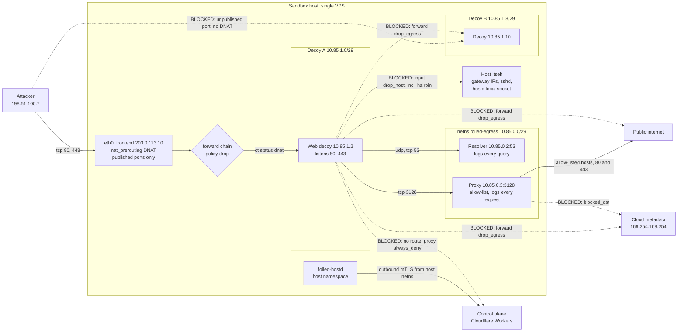

# ADR 0003: Network isolation for decoys

## Status

Proposed, 17 October 2026. Tracks #4.

Related: #2 (threat model), #3 (sandbox runtime, ADR 0002), #7 (deployment modes), #8 (rotation), #9 (capture layer), #30 (emulation plug-ins), #40 (Axum on Workers, ADR 0009), #41 (sandbox host agent, ADR 0008).

## Context

Foiled runs software that is meant to be compromised. A guest sandbox (#3) limits what an attacker can do on the host's CPU and kernel, but it does nothing about the network. An attacker with root in a decoy will try to scan the internet, send spam, pull a second stage, join a botnet, reach the host's own services, move sideways into other decoys, or find the control plane. Network policy is the second half of containment.

What the network layer must deliver:

- Attackers reach the published decoy ports and nothing else.
- Decoys reach nothing by default. Any outbound path is narrow, logged and opt-in.
- Decoys have no path to the control plane, the host agent or the host itself.
- The real attacker source address reaches the decoy and the capture layer unchanged, because attribution depends on it.
- It works on one Ubuntu VPS with KVM for MVP (#7), with no service mesh, and leaves room for cloud VPCs later.

The control plane is not on the sandbox host. It runs on Cloudflare Workers (#40). The host agent `foiled-hostd` (#41) dials out to it over HTTPS with an mTLS client certificate and never listens on a public port. That changes the "no path to the control plane" problem: there is no control-plane subnet to firewall off, because the control plane sits on Cloudflare anycast addresses shared with a large part of the web. Isolation therefore has to come from decoys having no general route out at all, rather than from blocking one destination.

## Decision

### Hard requirements

These are not options. A host that cannot meet them must not run decoys, and `foiled-hostd` refuses to start decoys if its checks fail.

1. **Egress is denied by default.** A decoy can reach exactly two addresses: the logging resolver (DNS) and the logging proxy (HTTP and CONNECT). Everything else is dropped and logged.
2. **No path to the control plane.** Decoys have no route to the internet, so they cannot reach the Cloudflare-hosted control plane. The proxy refuses control-plane hostnames even if someone allow-lists them by mistake. No control-plane credential, certificate or token is ever placed in a decoy, its image or its environment.
3. **The host agent dials out from the host network namespace only**, never from a decoy namespace or the egress namespace. Decoys cannot reach the agent's local socket, the host's own addresses (gateway addresses, the frontend address, loopback services) or the host's SSH daemon.
4. **No decoy-to-decoy traffic.** Every decoy has its own routed /29 and its own host-side interface. There is no shared layer 2 segment, and hairpin traffic through the frontend address is blocked.
5. **Ingress is published ports only**, DNATed from the host frontend address to the guest. Nothing else on the honeypot range is reachable from outside.
6. **IPv4 only for MVP.** IPv6 is disabled on every honeypot interface and also dropped by the ruleset.
7. **Fail closed.** If the ruleset is missing or changed, the host agent turns IP forwarding off and stops publishing ports.

### Address plan

The honeypot range is `10.85.0.0/16`. It never leaves the host: decoy addresses are never source-NATed, so even a packet that slipped past the forward chain would go out with an unroutable source.

| Block | Use |
| --- | --- |
| `10.85.0.0/29` | Egress services namespace `foiled-egress`: `.1` host side (`foilsvc0`), `.2` logging resolver, `.3` logging proxy on TCP 3128 |
| `10.85.0.8/29` | Optional TLS frontend namespace `foiled-front`: `.9` host side (`foilfront0`), `.10` Caddy |
| `10.85.0.16` to `10.85.0.255` | Reserved for future host services |
| `10.85.1.0/29` upwards | Decoys, one /29 each |

Each decoy /29 is laid out the same way:

| Address | Use |
| --- | --- |
| `.0` | Network |
| `.1` | Host-side gateway on interface `foil-<id8>` |
| `.2` | Primary guest (the decoy's listening address) |
| `.3` to `.6` | Companion guests that belong to the same decoy, for example a SNARE front with its TANNER back end |
| `.7` | Broadcast |

Decoy slot `n` (from 0) uses `10.85.1.0 + 8n`. That gives 8,160 slots per host, far more than one host can run. A /29 rather than a /30 leaves room for multi-guest decoys without renumbering. The host agent owns the allocator, persists it in local state and holds a released slot for 60 seconds before reuse so stale conntrack entries and ARP caches age out.

Interface names: `foil-` plus the first 8 hex characters of the decoy id (13 characters, inside the 15-character Linux limit). The ruleset matches `foil-*`, so per-decoy rules are not needed for filtering.

Addressing is static. The host agent assigns addresses directly (`ip addr` inside a namespace, or the kernel `ip=` boot argument for a Firecracker guest). There is no DHCP server, so nothing on the host needs to accept packets from decoys.

### Per-decoy plumbing

- **Namespace decoys** (decoy module containers under runc or gVisor, emulator plug-ins from #30): the host agent creates a named network namespace `foiled-<id8>` and a veth pair. The host end is `foil-<id8>` with the `.1` address; the namespace end is `eth0` with `.2` and a default route via `.1`. The runtime joins that namespace by path (`/run/netns/foiled-<id8>` in the OCI `linux.namespaces` list). Docker's own bridge networking, port publishing and iptables rules are not used for decoys.
- **Firecracker decoys**: the host agent creates a tap device `foil-<id8>` owned by the Firecracker jailer user, gives it the `.1` address and passes `ip=10.85.x.2::10.85.x.1:255.255.255.248::eth0:off` on the guest kernel command line. Firecracker's MMDS metadata service is not enabled for decoys.
- **Multi-guest decoys**: the host agent creates a per-decoy bridge named `foil-<id8>` holding the `.1` address and enslaves each guest's tap to it. Guests inside one decoy can talk to each other; the bridge is never shared between decoys.

Sysctls the host agent sets on every `foil-*` interface: `net.ipv6.conf.<if>.disable_ipv6=1`, `net.ipv4.conf.<if>.send_redirects=0`, `proxy_arp=0`, `arp_ignore=1`, `arp_announce=2`. Inside each namespace: `net.ipv6.conf.all.disable_ipv6=1`, `net.ipv6.conf.default.disable_ipv6=1`, and `net.ipv4.ip_unprivileged_port_start=0` so the decoy can bind low ports without capabilities. Globally: `net.ipv4.ip_forward=1` (set only after the ruleset check passes) and `net.ipv4.conf.all.send_redirects=0`.

### Ruleset

The ruleset is [`configs/nftables/honeypot.nft`](../../configs/nftables/honeypot.nft): one `inet foiled` table, loaded atomically. In order of evaluation:

| Chain | Hook | What it does |
| --- | --- | --- |
| `raw_prerouting` | prerouting, raw | Drops IPv6 from honeypot interfaces. Strict reverse-path check on `foil-*` (`fib saddr . iif oif missing`), so a decoy can only send from its own /29. Drops honeypot source addresses arriving on the WAN. |
| `nat_prerouting` | prerouting, dstnat | DNAT from `frontend address . port` to the guest via the `published_tcp` and `published_udp` maps. Bound to the WAN interface, so hairpin traffic from a decoy is never translated. |
| `input` | input | Anything from `foil-*`, `foilsvc0` or `foilfront0` to the host itself is dropped, except replies to connections the host opened (host agent health probes). |
| `forward` | forward, policy drop | Five accept paths, listed below. Everything else jumps to a log-and-drop chain. |
| `nat_postrouting` | postrouting, srcnat | Masquerades the resolver and proxy only. Decoys are never masqueraded. |

The five forward accept paths:

1. WAN to `foil-*` when the connection was DNATed (`ct status dnat`), which only happens for published ports.
2. Caddy (`10.85.0.10`) to a guest address and port in `front_targets`, when the TLS frontend is in use.
3. `foil-*` to the resolver `10.85.0.2` on UDP and TCP 53.
4. `foil-*` and Caddy to the proxy `10.85.0.3` on TCP 3128.
5. The proxy to the internet on TCP 80 and 443, and the resolver to `upstream_resolvers` on 53, never to `blocked_dst` (private ranges including `10.85.0.0/16`, CGNAT, loopback, link-local and cloud metadata, multicast, reserved, and the host's own address).

Every drop is counted and logged with a prefix starting `foiled drop ` (`spoof`, `ipv6`, `egress`, `host`, `svc`, `inbound`, `forward`), rate limited so a noisy decoy cannot flood the kernel log. The capture layer (#9) can switch these to `log group` for nflog collection without changing the rule logic.

A drop verdict in any nftables base chain is final, so this table's forward policy blocks all routed traffic on the host, not just decoy traffic. That is intended: decoys run on a dedicated sandbox host. Two common conflicts follow from the same rule. Ubuntu's `ufw` defaults to `DEFAULT_FORWARD_POLICY="DROP"`, which would drop the published-port path; set it to `ACCEPT` and let this table own forwarding, or disable `ufw` and manage host input separately. The Docker daemon sets the iptables `FORWARD` policy to drop; if Docker is installed for building images, run it with `"iptables": false` or keep it off the sandbox host.

### Egress proxy and resolver

Both run in their own network namespace, `foiled-egress`, as unprivileged users. They are reachable only from decoys and the frontend, cannot reach the host (input chain) or any decoy (no forward path), and can only reach the internet on the narrow paths above. They write logs to files on the host that the host agent tails; there is no network path from either service to the host agent.

- **Proxy**: a forward proxy on `10.85.0.3:3128` that logs every request (allowed, denied or canned), allows only hosts in [`configs/proxy/egress-allowlist.yaml`](../../configs/proxy/egress-allowlist.yaml), refuses control-plane hostnames and private destinations unconditionally, and can return canned responses for plain HTTP without contacting the upstream. The allow-list is empty by default. HTTPS goes through `CONNECT`, and the proxy sees only the target name and port; it does not break TLS.
- **Active inspection** is a separate, clearly labelled mode that is off by default. When an operator turns it on for named hosts, the proxy terminates TLS with a Foiled CA baked into that decoy's image and logs decrypted request lines and headers. Turning it on is an audited operator action with a reason. It is never implied by any other setting.
- **Resolver**: a logging resolver on `10.85.0.2:53`. It logs every query with the decoy's source address and answers `NXDOMAIN` for every name not on the allow-list, without resolving it upstream. That keeps DNS from being a tunnel out and means the resolver never contacts an attacker's name servers. Allow-listed names are forwarded to the configured upstream resolvers only.
- **Which decoys use the proxy**: the runtime sets `HTTP_PROXY` and `HTTPS_PROXY` for decoy processes where the catalogue entry (#5) says so. Many applications honour these for update checks, webhooks and out-of-band callbacks, which is where server-side request forgery and callback-style exploits show up. Attacker tools that ignore the proxy are dropped at the forward chain; their DNS lookups and the dropped connection attempts are still logged.
- **Implementation**: the target is a small Foiled proxy that understands the allow-list schema, decoy attribution by source address and canned responses. Until it exists, the worked example below uses Squid (allow-list and logging, no canned responses beyond a deny page) and Unbound. Squid is GPL-2.0 and runs only as a separate process, never linked into Foiled code, under the same rule as GPL decoys. Unbound is BSD-licensed.

### Ingress and the host frontend

**MVP decision: bare host-port DNAT for every TCP and UDP decoy.** The frontend is the host's public IPv4 address (example `203.0.113.10`). Each published port maps to exactly one guest, and the guest listens on the same port number it is published on. The guest sees the real attacker address because nothing source-NATs inbound traffic. With one public address, each port can be published once per host; more web decoys on 80/443 need more public addresses, which the `published_tcp` map already supports because its key includes the frontend address (the `nat_prerouting` rule then matches a set of frontend addresses instead of one).

The operator's own SSH should not sit on the frontend address. Reach the host over a private overlay (WireGuard or Tailscale) as described in `docs/deploy/vps.md` (#7). If a decoy publishes TCP 22, the real `sshd` must not listen on the public address at all.

**Optional for web decoys: Caddy TLS termination with a real certificate.** A self-signed certificate is one of the quickest ways to spot a honeypot. When a catalogue entry asks for it, the host agent runs Caddy in its own namespace `foiled-front` (`10.85.0.10`) and publishes ports 80 and 443 to Caddy instead of the guest. Caddy obtains a certificate over ACME through the egress proxy (an allow-list entry scoped to the frontend only), serves the HTTP-01 challenge on port 80, and reverse-proxies to the guest's published port, which must be listed in `front_targets`. Caddy overwrites `X-Forwarded-For` with the client address and its access log is the authoritative record of the client IP for those decoys. The guest sees Caddy's address as the TCP source. Caddy is an internet-facing parser, so it gets the same treatment as a decoy: own namespace, no path to the host, no route out except the proxy. Caddy is Apache-2.0.

### Cloudflare in front: trade-offs

**Decoys are never behind the Cloudflare proxy** (#7, #40). Only the control plane is. Any DNS record that points at a decoy is DNS-only. MVP ships without Cloudflare in front of decoys, and the trade-offs are recorded here so the option is not reopened without them.

| Concern | Effect |
| --- | --- |
| Real client IP | The decoy sees a Cloudflare edge address. The client address arrives only in `CF-Connecting-IP` (or `X-Forwarded-For`), which anyone can forge unless the frontend trusts that header strictly from Cloudflare's published ranges. Non-HTTP decoys would need Spectrum and PROXY protocol support. Attribution quality drops either way, and confidence scoring (#27) would have to treat the client IP as claimed rather than observed. |
| Abuse handling | Cloudflare's bot management and WAF block or challenge many exploit attempts, which is exactly the traffic we want to see. Abuse reports about a deliberately vulnerable app would go to Cloudflare first, and hosting such an app behind their proxy is a terms question we have not cleared. |
| Looks wrong | An old, unpatched appliance behind a Cloudflare edge is an unusual combination. Cloudflare's TLS handshake, headers and anycast ASN replace the decoy's own fingerprint, which makes the decoy easier to spot and less faithful. |
| Hides the host | The one real benefit: the host's address is not exposed. For a honeypot that is not a goal, since the address is meant to be found. |

If an operator puts an HTTP decoy behind Cloudflare anyway, the frontend must accept `CF-Connecting-IP` only from Cloudflare's published ranges, record both the edge address and the claimed client address, and mark those attempts as proxied.

### Host agent integration

**Decision: rule application lives in the host agent crate `crates/hostd` (#41), not in a separate `cmd/net-agent` binary.**

Reasons:

- One privileged process to audit and to give `CAP_NET_ADMIN` (and `CAP_SYS_ADMIN` for named namespaces), instead of two. ADR 0008 lists the capabilities one by one.
- Network steps are part of the same signed, idempotent jobs the agent already handles. A separate binary would need its own local control socket, which is one more thing a breakout could aim at.
- The codebase is Rust. A `cmd/` directory is a Go layout convention that does not fit the workspace.

The agent applies each job's network changes as one atomic nftables transaction (nftables JSON or a batch through libnftables), never by editing the file on disk. Adding an existing element is a no-op and deleting a missing one counts as success, so a replayed job with the same idempotency key changes nothing.

| Agent job | Network steps |
| --- | --- |
| Agent start | Load `honeypot.nft` with the operator's `WAN_IF` and `FRONTEND_V4`; verify the table, chains and forward policy; flush and rebuild `published_tcp`, `published_udp`, `front_targets` and `upstream_resolvers` from local state; delete orphaned `foil-*` interfaces and `foiled-*` namespaces; then enable IP forwarding. |
| `decoy.create` | Allocate a slot; create the namespace and veth, or the tap; set addresses, routes and sysctls; start the guest through the runtime (#3); wait for the health check; then add the decoy's elements to `published_tcp` or `published_udp`. The job result returns the guest address, the slot, the interface name and the published `frontend:port` list. |
| `decoy.stop` | Remove the decoy's published elements, then flush its conntrack entries (`conntrack -D -s <guest>` and `conntrack -D -r <guest>`). |
| `decoy.start` | Re-add published elements after the health check passes. |
| `decoy.rotate` (#8) | Freeze networking (remove published elements, flush conntrack), flush capture, destroy, create the replacement in a new slot, re-add published elements to the new guest. |
| `decoy.destroy` | Remove published elements; flush conntrack; stop the guest; delete the namespace, veth, tap or bridge; remove `/etc/netns/foiled-<id8>`; release the slot after the cool-down. |
| `host.drain` | Remove every published element first, then stop decoys. |
| Watchdog (every 10 s) | Check the table is present and the forward policy is drop. If not, set `net.ipv4.ip_forward=0`, stop publishing and report it in the heartbeat. |

The capture layer (#9) attaches to the host-side `foil-*` interface. Because inbound traffic is not source-NATed, packets there carry the real attacker address, and dropped egress attempts are visible there before the forward chain drops them.

### Packet flow

Solid arrows are allowed paths. Dashed arrows are blocked paths, each stopped by the rule named on the arrow.



### Worked example: one web honeypot on a single Ubuntu VPS

Assumptions: Ubuntu 24.04 with KVM, public address `203.0.113.10` on `eth0`, operator access over a private overlay, `ufw` off or set to forward-accept, no Docker daemon. The decoy is a stand-in web server inside a network namespace so the network can be tested before a real catalogue image is involved. In production the host agent does every step below; these commands are what it does, written out so an operator can follow and check them. Run as root.

**1. Packages and host settings**

```sh
apt-get install -y nftables iproute2 conntrack unbound squid dnsutils curl netcat-openbsd
# The packaged services would listen in the host namespace. Foiled runs its own copies.
systemctl disable --now unbound squid

sysctl -w net.ipv4.conf.all.send_redirects=0 net.ipv4.conf.default.send_redirects=0
install -d -m 0755 /etc/foiled /var/log/foiled
```

**2. Load the ruleset**

```sh
cp configs/nftables/honeypot.nft /etc/foiled/honeypot.nft
# Edit WAN_IF and FRONTEND_V4 at the top of the file, then:
nft -c -f /etc/foiled/honeypot.nft
nft -f /etc/foiled/honeypot.nft
nft list chain inet foiled forward | grep 'policy drop'
# Load at boot from the nftables service:
echo 'include "/etc/foiled/honeypot.nft"' >> /etc/nftables.conf
systemctl enable nftables
# Only now turn on forwarding.
sysctl -w net.ipv4.ip_forward=1
```

The shipped file already contains the two `published_tcp` elements for this example (`203.0.113.10 . 80` and `. 443` to `10.85.1.2`).

**3. Egress services namespace**

```sh
ip netns add foiled-egress
ip link add foilsvc0 type veth peer name svc0 netns foiled-egress
sysctl -w net.ipv6.conf.foilsvc0.disable_ipv6=1
ip addr add 10.85.0.1/29 dev foilsvc0
ip link set foilsvc0 up

ip netns exec foiled-egress sysctl -w net.ipv6.conf.all.disable_ipv6=1
ip netns exec foiled-egress ip link set lo up
ip netns exec foiled-egress ip addr add 10.85.0.2/29 dev svc0
ip netns exec foiled-egress ip addr add 10.85.0.3/29 dev svc0
ip netns exec foiled-egress ip link set svc0 up
ip netns exec foiled-egress ip route add default via 10.85.0.1

mkdir -p /etc/netns/foiled-egress
echo 'nameserver 10.85.0.2' > /etc/netns/foiled-egress/resolv.conf
```

**4. Logging resolver (Unbound stand-in)**

`/etc/foiled/unbound.conf`:

```
server:
    interface: 10.85.0.2
    port: 53
    access-control: 0.0.0.0/0 refuse
    access-control: 10.85.0.0/16 allow
    do-ip6: no
    username: "unbound"
    chroot: ""
    pidfile: "/run/foiled-unbound.pid"
    use-syslog: no
    logfile: "/var/log/foiled/dns.log"
    log-queries: yes
    log-replies: yes
    # Default: every name is NXDOMAIN and nothing is resolved upstream.
    local-zone: "." always_nxdomain
    # The host agent adds one line per allow-listed name, for example:
    # local-zone: "updates.vendor.example." transparent

# Only needed once something is allow-listed. The address must also be in
# the nftables upstream_resolvers set.
# forward-zone:
#     name: "."
#     forward-addr: 192.0.2.53
```

```sh
install -o unbound -m 0640 /dev/null /var/log/foiled/dns.log
unbound-checkconf /etc/foiled/unbound.conf
ip netns exec foiled-egress unbound -c /etc/foiled/unbound.conf
```

**5. Logging proxy (Squid stand-in)**

`/etc/foiled/squid.conf`:

```
http_port 10.85.0.3:3128
pid_filename /run/foiled-squid.pid
dns_nameservers 10.85.0.2
cache deny all
access_log stdio:/var/log/foiled/egress-proxy.log squid
cache_log /var/log/foiled/egress-proxy-cache.log
via off
forwarded_for delete

acl decoys src 10.85.0.0/16
acl web_ports port 80 443
acl tls_port port 443
acl CONNECT method CONNECT
acl allowlist dstdomain "/etc/foiled/egress-allowlist.domains"

http_access deny !web_ports
http_access deny CONNECT !tls_port
http_access allow decoys allowlist
http_access deny all
```

```sh
echo '# rendered from egress-allowlist.yaml; empty by default' > /etc/foiled/egress-allowlist.domains
install -o proxy -m 0640 /dev/null /var/log/foiled/egress-proxy.log
install -o proxy -m 0640 /dev/null /var/log/foiled/egress-proxy-cache.log
ip netns exec foiled-egress squid -f /etc/foiled/squid.conf
```

**6. Create the decoy namespace**

This function is what `decoy.create` does for a namespace decoy. The second argument is the first address of the decoy's /29.

```sh
mkdecoy() {
  id=$1; base=$2
  pfx=${base%.*}; last=${base##*.}
  gw=$pfx.$((last + 1)); guest=$pfx.$((last + 2))
  ns=foiled-$id; hif=foil-$id

  ip netns add "$ns"
  ip link add "$hif" type veth peer name eth0 netns "$ns"
  sysctl -qw net.ipv6.conf.$hif.disable_ipv6=1 \
    net.ipv4.conf.$hif.send_redirects=0 net.ipv4.conf.$hif.proxy_arp=0 \
    net.ipv4.conf.$hif.arp_ignore=1 net.ipv4.conf.$hif.arp_announce=2
  ip addr add "$gw/29" dev "$hif"
  ip link set "$hif" up

  ip netns exec "$ns" sysctl -qw net.ipv6.conf.all.disable_ipv6=1 \
    net.ipv6.conf.default.disable_ipv6=1 net.ipv4.ip_unprivileged_port_start=0
  ip netns exec "$ns" ip link set lo up
  ip netns exec "$ns" ip addr add "$guest/29" dev eth0
  ip netns exec "$ns" ip link set eth0 up
  ip netns exec "$ns" ip route add default via "$gw"

  mkdir -p "/etc/netns/$ns"
  echo 'nameserver 10.85.0.2' > "/etc/netns/$ns/resolv.conf"
}

mkdecoy 1a2b3c4d 10.85.1.0     # decoy A: gateway 10.85.1.1, guest 10.85.1.2
```

For a Firecracker decoy the namespace and veth are replaced by a tap, and the guest gets its address from the kernel command line:

```sh
ip tuntap add dev foil-1a2b3c4d mode tap user foiled-fc
sysctl -qw net.ipv6.conf.foil-1a2b3c4d.disable_ipv6=1
ip addr add 10.85.1.1/29 dev foil-1a2b3c4d
ip link set foil-1a2b3c4d up
# guest boot_args: ... ip=10.85.1.2::10.85.1.1:255.255.255.248::eth0:off
```

**7. Start the stand-in web decoy**

A real decoy is started by the runtime (#3) inside `/run/netns/foiled-1a2b3c4d`. The stand-in serves port 80 and also listens on 8080, which is deliberately not published, so the ingress test has something to prove.

```sh
mkdir -p /srv/foiled-demo && echo 'FOILED-DEMO-0001 stand-in' > /srv/foiled-demo/index.html
ip netns exec foiled-1a2b3c4d setpriv --reuid=65534 --regid=65534 --clear-groups \
  python3 -m http.server 80 --bind 10.85.1.2 --directory /srv/foiled-demo &
ip netns exec foiled-1a2b3c4d setpriv --reuid=65534 --regid=65534 --clear-groups \
  python3 -m http.server 8080 --bind 10.85.1.2 --directory /srv/foiled-demo &
```

**8. Publish**

Already present in the shipped file. On a host where the maps were rebuilt, the host agent does the equivalent of:

```sh
nft add element inet foiled published_tcp '{ 203.0.113.10 . 80 : 10.85.1.2, 203.0.113.10 . 443 : 10.85.1.2 }'
nft list map inet foiled published_tcp
```

**9. Tear down (what `decoy.destroy` does)**

```sh
nft delete element inet foiled published_tcp '{ 203.0.113.10 . 80, 203.0.113.10 . 443 }'
conntrack -D -s 10.85.1.2 || true
conntrack -D -r 10.85.1.2 || true
ip netns pids foiled-1a2b3c4d | xargs -r kill
ip netns del foiled-1a2b3c4d          # removes the veth pair with it
ip link del foil-1a2b3c4d 2>/dev/null || true
rm -rf /etc/netns/foiled-1a2b3c4d
```

### Operator test checklist

Run after bring-up and after any change to the ruleset, the allow-list or the host's other firewall tools. Each test names its expected result; anything else is a failure and the host must not be exposed.

Setup: decoy A from the worked example (`foiled-1a2b3c4d`, guest `10.85.1.2`) and a second decoy B made with `mkdecoy 5e6f7a8b 10.85.1.8` (guest `10.85.1.10`) running the same stand-in on port 80. `ip netns exec` runs host tools inside the decoy's network stack, which is what the rules see. For a Firecracker decoy, run the same commands from inside the guest, or from a test namespace made with `mkdecoy`, since the rules key on the interface and address plan rather than the runtime.

```sh
A="ip netns exec foiled-1a2b3c4d"
B="ip netns exec foiled-5e6f7a8b"
PUBLIC_IP=198.51.100.7          # replace with a public address you control
PUBLIC_DNS=192.0.2.53           # replace with a public resolver
CP_HOST=api.foiled.example      # replace with your control-plane hostname
```

- [ ] **1. From inside a sandbox, `curl` to the public internet fails.**
  - `$A curl -sS -m 5 http://$PUBLIC_IP/` times out (curl exit 28).
  - `$A curl -sS -m 5 https://example.com/` fails to resolve (exit 6).
  - `$A curl -sS -m 5 -x http://10.85.0.3:3128 https://example.com/` is refused by the proxy with 403 (exit 56), and the request appears in `/var/log/foiled/egress-proxy.log`.
  - `$A nc -vz -w 5 $PUBLIC_IP 25` times out.
  - On the host, `journalctl -k -g 'foiled drop egress' --since '5 min ago'` shows `SRC=10.85.1.2 DST=<PUBLIC_IP>`.
- [ ] **2. From inside a sandbox, `curl` to the control-plane IP fails.**
  - On the host: `CP_IP=$(getent ahostsv4 "$CP_HOST" | awk 'NR==1 {print $1}')`.
  - `$A curl -sS -m 5 --resolve "$CP_HOST:443:$CP_IP" https://$CP_HOST/` times out (exit 28).
  - `$A curl -sS -m 5 -x http://10.85.0.3:3128 https://$CP_HOST/` gets 403 from the proxy.
  - The host agent and the host itself are also unreachable: `$A curl -sS -m 5 http://10.85.1.1/` times out, `$A nc -vz -w 5 203.0.113.10 22` times out, and `$A curl -sS -m 5 http://169.254.169.254/` times out.
  - On the host, `ss -tlnp` shows no listening socket owned by `foiled-hostd`.
- [ ] **3. From inside a sandbox, `curl` to another sandbox IP fails.**
  - `$A curl -sS -m 5 http://10.85.1.10/` times out.
  - `$B curl -sS -m 5 http://10.85.1.2/` times out.
  - Hairpin through the frontend: `$B curl -sS -m 5 http://203.0.113.10/` times out.
  - On the host, `journalctl -k -g 'foiled drop (egress|host)' --since '5 min ago'` shows each attempt.
- [ ] **4. Only the published port accepts inbound.** From a machine outside the VPS:
  - `curl -sS -m 5 http://203.0.113.10/` returns `FOILED-DEMO-0001 stand-in`, and the stand-in's log shows the outside machine's real address, not `10.85.1.1`.
  - `nc -vz -w 5 203.0.113.10 8080` fails (the decoy listens on 8080, but it is not published).
  - `nmap -Pn -sT -p- --open 203.0.113.10` lists port 80 (and 443 once the decoy listens on it) plus only host services you expose on purpose.
  - Direct traffic to the honeypot range is impossible from outside: `10.85.1.2` is not routed to the host, and a neighbour that tries is dropped by `drop_inbound` or `drop_spoof`.
- [ ] **5. DNS only goes to the internal logging resolver.**
  - `$A dig +time=3 +tries=1 example.com` returns `status: NXDOMAIN` from `10.85.0.2`.
  - `$A dig +time=3 +tries=1 @$PUBLIC_DNS example.com` times out.
  - `$A dig +time=3 +tries=1 +tcp @$PUBLIC_DNS example.com` times out.
  - `grep example.com /var/log/foiled/dns.log` shows the query with source `10.85.1.2`.

### Network breakout scenarios mapped to rules

Each scenario is a network path an attacker with root in a decoy (or in a service namespace) might try. The threat model ([the threat model](../threat-model.md), #2) refers to these by id. Rule names refer to [`honeypot.nft`](../../configs/nftables/honeypot.nft) unless marked as proxy or resolver config.

| Id | Scenario | Stopped by |
| --- | --- | --- |
| N1 | Direct outbound to the internet: scanning, spam on TCP 25, C2 callback, mining pool, DDoS participation | `forward` policy drop via `drop_egress`; decoys are never masqueraded (`nat_postrouting` lists only the resolver and proxy) |
| N2 | Outbound through the proxy to arbitrary sites | Proxy `default_action: deny` with an empty `allow` list; only ports 80 and 443; `CONNECT` only to 443; every request logged |
| N3 | Data exfiltration or C2 over DNS, or using our resolver to reach attacker name servers | Forward path 3 allows DNS only to `10.85.0.2`; direct DNS elsewhere hits `drop_egress`; resolver answers `NXDOMAIN` without upstream lookups for names not on the allow-list; every query logged |
| N4 | Reach the control plane on Cloudflare | N1 (no route out); proxy `always_deny` gets the control-plane hostnames from the host agent; no control-plane credentials in decoys; the host agent dials out from the host namespace only |
| N5 | Reach the host: gateway address, frontend address, `sshd`, the host agent's local socket | `input` chain `drop_host` for `foil-*`, `foilsvc0` and `foilfront0`; separate network namespace, so abstract Unix sockets and loopback services in the host namespace are out of reach; the host agent's socket is never bind-mounted into a decoy |
| N6 | Lateral movement to another decoy at layer 3 | Per-decoy routed /29 and interface; no forward path from `foil-*` to `foil-*`, so `drop_egress` applies |
| N7 | Lateral movement at layer 2 (ARP or MAC spoofing on a shared segment) | No shared bridge between decoys; each decoy's segment contains only the host and that decoy's own guests |
| N8 | Hairpin: a decoy hits another decoy's published port through the frontend address | `nat_prerouting` DNAT is bound to `WAN_IF`, so the packet is not translated and lands on `input`, where `drop_host` drops it |
| N9 | Source address spoofing to get around rules or reflect traffic | `raw_prerouting` reverse-path check (`fib saddr . iif oif missing`) and `ip saddr != $HONEYPOT_NET` on `foil-*`; `SVC_NET` and `FRONT_NET` checks for the service namespaces |
| N10 | Steal VPS credentials from the cloud metadata service at `169.254.169.254` | No forward path from decoys; `blocked_dst` includes `169.254.0.0/16` for the egress namespace; Firecracker MMDS disabled for decoys |
| N11 | IPv6 bypass: link-local, router advertisements, SLAAC | `disable_ipv6` on every honeypot interface and inside every namespace; `raw_prerouting` sends IPv6 from honeypot interfaces to `drop_ipv6` |
| N12 | Use the egress proxy or resolver as a stepping stone after compromising it | Own namespace and unprivileged users; `input` drops anything from `foilsvc0`; no forward path to decoys; internet only on 80 and 443 (proxy) or to `upstream_resolvers` on 53 (resolver), never to `blocked_dst` |
| N13 | Reach unpublished services on a decoy, or the honeypot range directly, from outside | DNAT only for `published_tcp` and `published_udp` entries; forward path 1 needs `ct status dnat`; `drop_inbound`; WAN packets with honeypot source addresses go to `drop_spoof` |
| N14 | Stale state after destroy lets a new decoy receive old flows | Destroy order: remove published elements, flush conntrack for the guest, delete the interface; 60-second slot cool-down |
| N15 | Ruleset flushed or replaced, by mistake or by another tool, leaving decoys routable | Host agent watchdog turns off `ip_forward` and stops publishing; IP forwarding is enabled only after the ruleset check; decoys never masqueraded, so leaked packets carry an unroutable source |

### IPv6 follow-up

MVP is IPv4 only. IPv6 decoys need: a routed /64 or smaller per decoy from the host's allocation, the same reverse-path, input and forward rules for `ip6`, router advertisement suppression, and the proxy and resolver listening on IPv6. That is a separate issue once the IPv4 design has run in production.

### Not in MVP

- Transparent interception of decoy TCP 80 and 443 (so tools that ignore the proxy still have their URL or SNI logged). The obstacle is that the proxy runs in a different namespace from the NAT, so original-destination lookups do not work and the proxy has to rely on the `Host` header or SNI. Worth doing with the Foiled proxy.
- Per-decoy rate limits in nftables. The proxy and resolver rate-limit per source address instead.
- Multi-region and cloud VPC equivalents (security groups, network ACLs). The address plan and the five forward paths map onto them directly.

## Consequences

- The forward policy owns all routed traffic on the host. A sandbox host is dedicated to decoys, `ufw` and Docker must not fight it, and operators must know this before installing anything else that forwards.
- One public address can publish each port once. Several web decoys on 80 and 443 need several addresses or the TLS frontend.
- The operator's SSH moves off the public address, which `docs/deploy/vps.md` (#7) has to cover.
- Exploits that fetch a second stage directly (not through the proxy) are dropped. We record the DNS name they looked up and the address and port they tried, but not the URL. That is the price of default deny until transparent interception lands.
- HTTPS callbacks cannot be answered with canned responses unless active inspection is turned on for that host.
- The allow-list needs owners: every entry has a reason and an expiry, and the host agent rejects expired entries.
- The host agent needs `CAP_NET_ADMIN` and `CAP_SYS_ADMIN`. Both are documented in ADR 0008, and the agent takes no free-form commands (#41).
- The Squid and Unbound stand-ins are temporary. Their log formats differ from the target JSONL format, so the host agent's log reader has to handle both until the Foiled proxy ships.

## Alternatives considered

- **One shared bridge for all decoys** with bridge port isolation or `br_netfilter`. Rejected: decoys would share a layer 2 segment, filtering would depend on bridge netfilter settings that are easy to get wrong, and ARP and MAC spoofing become part of the attack surface. Routed per-decoy segments make every packet between decoys pass the forward chain.
- **Docker's default bridge networking and iptables.** Rejected: Docker inserts its own accept and masquerade rules, publishes ports on every interface by default and allows container-to-container traffic on the default bridge. Containers still run, but with networking handed to the host agent.
- **iptables (legacy).** Rejected in favour of nftables: atomic table replacement, native sets and maps for published ports, one `inet` table for both address families, and a JSON interface the host agent can drive.
- **Userspace networking only** (slirp4netns, pasta or the gVisor network stack). Fine for local development with Docker plus seccomp (#3), but it moves policy and capture away from the host-side interface that the capture layer (#9) reads, and some modes rewrite the client address.
- **A service mesh or eBPF dataplane** (for example Cilium). Rejected for MVP: too much machinery for one host, and the issue rules it out.
- **A separate `cmd/net-agent` binary.** Rejected; see "Host agent integration".
- **A TLS-breaking proxy by default.** Rejected: it changes what the decoy trusts, can be spotted by attackers, and captures more personal information than needed. Kept as the opt-in active inspection mode.
- **A recursive resolver that answers everything.** Rejected: DNS becomes a tunnel out, and the resolver would contact attacker-controlled name servers on the decoy's behalf.
- **Direct egress with rate limits** instead of default deny. Rejected: even slow egress can send spam, run exploits against third parties or reach C2. The threat model (#2) treats egress abuse as a primary risk.
- **Cloudflare in front of decoys.** Rejected; see "Cloudflare in front: trade-offs".
