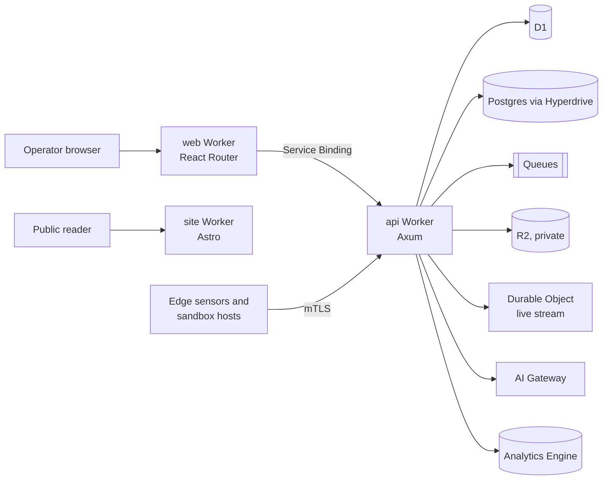

# ADR 0009: Axum on Workers and the front end

## Status

Accepted (17 Oct 2026).

Tracking issue: #40. Related: #1, #3, #7, #9, #14, #19, #21, #28, #31, #35, #39, #41.

## Context

Foiled has two sides. The trusted side is the control plane, the API, the operator console and the public pages. The untrusted side is the decoys, sandboxes and capture, which run deliberately vulnerable software.

We want the control plane in Rust and, if it holds up, on Cloudflare Workers, with a front end that also runs on Workers. This ADR records what was checked on 17 Oct 2026 (AEDT), what holds up, and where Workers stops. The checks were documentation reviews and a local compile probe. Nothing has been deployed.

### Verdict: Axum runs on Workers

Yes, with limits.

| Check | Result | Source |
| --- | --- | --- |
| Official support | workers-rs has an `http` feature that switches the fetch handler to `http::Request` / `http::Response` "to use crates which use these standard types such as `axum` and `hyper`". The `worker` crate also has an `axum` feature (`axum 0.8`, `default-features = false`). | [workers-rs README, "http Feature"](https://github.com/cloudflare/workers-rs); [`worker/Cargo.toml`](https://github.com/cloudflare/workers-rs/blob/main/worker/Cargo.toml) |
| Official example | `examples/axum` builds a `Router` with state and calls `router(env).call(req)` from `#[event(fetch)]`. | [workers-rs `examples/axum`](https://github.com/cloudflare/workers-rs/tree/main/examples/axum) |
| Local build probe | `worker 0.8.7` (features `http`, `axum`) + `axum 0.8.9` (no default features) + `maud 0.27` for server-rendered HTML built for `wasm32-unknown-unknown` with exit 0. Release wasm about 1.16 MB. Compiled only, not deployed. | Local probe, 17 Oct 2026 (not published) |

### Limits that shape the code

| Limit | Effect on Foiled | Source |
| --- | --- | --- |
| No Tokio or async-std runtime, no threads, no raw TCP listener. Only runtime-agnostic pieces such as `tokio::sync` work. | No Tokio runtime and no `axum::serve` in `crates/api`. Axum's `tokio` feature and hyper's server features stay off. Background work goes to Queues, Durable Object alarms or cron, not spawned tasks. | [workers-rs README, FAQ](https://github.com/cloudflare/workers-rs#faq) |
| Worker bindings wrap JS futures that are `!Send`. Axum handlers must return `Send` futures. | Every Axum handler that touches a binding (D1, R2, Queues, DO, Hyperdrive, AI, Analytics Engine) is marked `#[worker::send]`. | [`worker-macros`](https://github.com/cloudflare/workers-rs/tree/main/worker-macros) |
| Every crate in the Worker's dependency tree must build for `wasm32-unknown-unknown`. | Check each new dependency before adding it. CI enforces this (see Dependency rule below). | [Workers Rust docs](https://developers.cloudflare.com/workers/languages/rust/) |
| 128 MB memory per isolate. | Stream large evidence to R2 instead of buffering it. | [Workers limits](https://developers.cloudflare.com/workers/platform/limits/) (updated 12 Oct 2026) |
| CPU 10 ms per request on Free; 30 s default and up to 5 min on Paid. | Workers Paid is assumed. 10 ms on Free is too tight for confidence scoring and export jobs. | [Workers limits](https://developers.cloudflare.com/workers/platform/limits/) |
| 64 MiB Worker size; 1 s startup. | Keep the API wasm lean. The probe is about 1.16 MB release. | [Workers limits](https://developers.cloudflare.com/workers/platform/limits/) |
| 10,000 subrequests per request on Paid (50 on Free). | Batch D1 and Postgres work per request. | [Workers limits](https://developers.cloudflare.com/workers/platform/limits/) |
| Request body 100 MB on Free/Pro. | Pcaps and payloads never pass through a Worker request body. Hosts upload to R2 with short-lived URLs (#9). | [Workers limits](https://developers.cloudflare.com/workers/platform/limits/) |
| Cron, Queue consumers and Durable Object alarms get 15 min wall time. HTTP and DO WebSocket connections have no wall-time cap while connected. | Long jobs (correlation, exports) run as Queue consumers. The live stream holds WebSockets in a DO. | [Workers limits](https://developers.cloudflare.com/workers/platform/limits/) |

Plan: Workers Paid is assumed. No Enterprise-only feature is on the MVP path.

### Front-end options

| Option | Fit | Trade-off | Source |
| --- | --- | --- | --- |
| **A. React Router v8 on Workers with static assets** | Cloudflare has a first-party guide and template with the Vite plugin. SSR and client-side data loading for a dense live console, large component and charting ecosystem, talks to the Axum Worker through a Service Binding. | Two languages (TypeScript UI, Rust API). Types shared by generating TS from the OpenAPI spec (#21) rather than by sharing Rust structs. | [React Router guide](https://developers.cloudflare.com/workers/framework-guides/web-apps/react-router/); [Static assets](https://developers.cloudflare.com/workers/static-assets/); [Service bindings](https://developers.cloudflare.com/workers/runtime-apis/bindings/service-bindings/) |
| B. Astro on Workers | First-party guide. Best for the public exploit pages and write-ups (#35): mostly static, Markdown-first, small islands. | Weaker fit for the interactive console. Can be used just for public pages beside option A. | [Astro guide](https://developers.cloudflare.com/workers/framework-guides/web-apps/astro/) |
| C. Rust only: Axum on Workers renders HTML (maud or askama) plus small hand-written JS for live panels | Verified to compile (probe above). One language, one deploy, no Node toolchain. | We build every table, chart and map interaction ourselves. Leptos or Dioxus SSR on Workers was **not verified**; their server integrations lean on Tokio, so treat them as a spike, not a default. | Local probe, 17 Oct 2026; [workers-rs `examples/axum`](https://github.com/cloudflare/workers-rs/tree/main/examples/axum) |

### Data services

| Need | Pick | Stored there | Not stored there | Why and limits | Source |
| --- | --- | --- | --- | --- | --- |
| Config, catalogue, tenants, users, sensor registry | **D1** | Tenants, users and roles, decoy catalogue entries, sensor and host registry, decoy and policy config. | Attempts, IOCs, campaigns, audit log (Postgres). Binary evidence (R2). Secrets (Wrangler secrets only). | 10 GB per database (fixed), single-threaded per database, 30 s per query, 30-day Time Travel. Fine for metadata. | [D1 limits](https://developers.cloudflare.com/d1/platform/limits/) |
| Attempts, IOCs, campaigns, review queue, audit | **Postgres via Hyperdrive** | Attempt rows with `payload_ref` pointers, IOCs, campaigns, confidence evidence, review queue, audit log, long-term radar rollups. | Pcaps, file diffs and payload bytes (R2, by reference only). Config and catalogue (D1). Live socket state (DO). | Pooled connections from Workers to any Postgres (Neon, RDS, self-hosted). `rust-postgres` (v0.19.8+) is on the supported driver list. Room to grow past 10 GB. Picking a Postgres host is out of scope. | [Hyperdrive](https://developers.cloudflare.com/hyperdrive/) |
| Live attempt stream to the console | **Durable Objects** with the Hibernation WebSocket API (or SSE from a DO) | Connected console sockets, per-socket attachment (tenant, filters) and a short in-memory buffer of recent events for fan-out. | The record of any attempt (Postgres is the system of record). Anything that must survive a deploy. | Thousands of clients per object, no duration billing while idle. Batch messages. Deploys drop every connection, so clients must reconnect. 16 KB per-socket attachment. | [DO WebSockets](https://developers.cloudflare.com/durable-objects/best-practices/websockets/) |
| Sensor and host ingest | **Queues** | Attempt and event envelopes in flight from edge sensors (#31) and sandbox hosts (#41), correlation jobs (#28). Up to 14 days if consumers fall behind. | Pcaps, file diffs, payload bytes (sent as an R2 reference). Anything needed after the consumer acknowledges it. | 128 KB per message, 100 per batch, 5,000 msg/s per queue, retention up to 14 days, 25 GB backlog, 15 min consumer wall time. Large evidence goes by reference, not in the message. | [Queues limits](https://developers.cloudflare.com/queues/platform/limits/) |
| Pcaps, file diffs, quarantined payloads | **R2** | Pcaps, file-system diffs, quarantined payloads, export bundles, keyed by `payload_ref` (#9). | Anything public: the bucket is private, never given a public URL. Queryable metadata (Postgres). Config (D1). | 5 GiB single-part upload, multipart to about 5 TiB per object. Bucket is private, never public. | [R2 limits](https://developers.cloudflare.com/r2/platform/limits/) |
| LLM correlation (#28) | **AI Gateway** in front of Workers AI and/or an external provider | Gateway logs and cache entries for prompts and responses, under the logging and retention policy set in #16 and #28 (logging can be off). | Quarantine binaries (hashes and short text extracts only, per #28). Provider API keys (Wrangler secrets). The accepted correlation result (Postgres, as `source=llm` evidence). | Logging, caching, rate limits, retries and model fallback in one place. | [AI Gateway](https://developers.cloudflare.com/ai-gateway/) |
| High-volume counters for the radar (#35) | **Analytics Engine** first; ClickHouse if we outgrow it | Per-event counters: hits by decoy, CVE, technique, port and coarse source. | Raw payloads, full attempt records, anything needed past 3 months. Long-term trends live in Postgres rollups (or ClickHouse later). | Up to 20 blobs, 20 doubles and 1 index per data point, 16 KB of blobs, 250 points per invocation, **3 months retention**. | [Analytics Engine limits](https://developers.cloudflare.com/analytics/analytics-engine/limits/) |
| Edge sensor and host auth | **mTLS** on the ingest hostname, enforced by a WAF rule; the Worker also checks `request.cf.tlsClientAuth` | Client certificates issued from the Cloudflare-managed CA, held in the Cloudflare account. Foiled records the certificate fingerprint per sensor in D1. | Client private keys (they stay on the sensor or host). Zone names and hostnames (never in the public repo). | Cloudflare-managed CA on all plans; bring-your-own CA is Enterprise only, so it is not on the MVP path. | [Enable mTLS](https://developers.cloudflare.com/ssl/client-certificates/enable-mtls/); [mTLS with Workers](https://developers.cloudflare.com/learning-paths/mtls/mtls-workers/); [BYO CA](https://developers.cloudflare.com/ssl/client-certificates/byo-ca/) |

### What does not run on Workers

| Component | Why not Workers | Where it runs | Source |
| --- | --- | --- | --- |
| Decoys, sandboxes, emulators, packet capture | They need KVM (Firecracker), raw sockets, public IPs and arbitrary TCP/UDP ports. | VPS or bare-metal sandbox hosts (#3, #7), driven by the Rust host agent `crates/hostd` (#41) over an authenticated channel. | [Workers limits](https://developers.cloudflare.com/workers/platform/limits/) |
| Decoys in Cloudflare Containers | Ruled out. Container traffic is routed through a Worker, and the Containers FAQ says end users cannot make non-HTTP TCP or UDP requests to an instance. Instances top out at 4 vCPU / 12 GiB. Egress can be blocked (`enableInternet = false`), but hosting deliberately vulnerable software on Cloudflare is a terms question we have **not** cleared. | Not used for decoys. Could be used later for trusted batch jobs only, such as YARA or report rendering. | [Containers FAQ](https://developers.cloudflare.com/containers/faq/); [Containers limits](https://developers.cloudflare.com/containers/platform-details/limits/) |
| Decoys behind the Cloudflare proxy | Attribution needs the real client IP, and a Cloudflare edge in front makes the decoy look wrong (#7). | Decoys are reached directly on the sandbox host's public IPs, never proxied. | #7 |

## Decision

### Back end

The control plane and API are Rust with Axum on Cloudflare Workers via workers-rs (`worker` 0.8.x, features `http` and `axum`), in `crates/api`. Rules for that crate:

- No Tokio runtime and no `axum::serve`. The Worker's `#[event(fetch)]` hands each request to the Axum `Router`.
- Handlers that touch bindings carry `#[worker::send]`, because binding futures are `!Send`.
- Shared types live in `crates/core`, which must stay wasm-compatible. The host agent `crates/hostd` is native Rust and may use Tokio.

### Front end: B+A

Option A (React Router v8 on Workers with static assets) for the operator console in `web/`, plus option B (Astro on Workers) for the public exploit pages and write-ups (#35) in `site/`. The console calls the API Worker over a Service Binding. The public site reads only published, confidence-gated data.

Trade-off: A gives the console SSR, client data loading and a mature charting and table ecosystem, which a dense live view (#14) needs, at the cost of a second language and a Node toolchain; we cover the type gap by generating TypeScript from the OpenAPI spec (#21) instead of sharing Rust structs. B is the better tool for mostly static, Markdown-first public pages, and keeping it as a separate Worker keeps public traffic and SEO concerns away from the trusted console. The cost of B+A is two front-end frameworks to maintain, which we accept because the design system (#39) is plain CSS tokens and our own SVG and is not tied to either. C (all-Rust HTML) stays open as a fallback if the Node toolchain becomes a burden, but it means building every table, chart and map interaction by hand.

Proa: rejected, because its Axum integration pulls in Tokio `full` and mio, which do not build for Workers, and its islands crate fails on wasm32 (`linkme` distributed slices).

### Repo layout

```text
foiled/
├── crates/
│   ├── api/      # Axum Worker (control plane API), wasm32-unknown-unknown, no Tokio runtime
│   ├── core/     # Shared types and schemas, no wasm-incompatible dependencies
│   ├── hostd/    # Sandbox host agent (#41), native Rust, Tokio allowed
│   └── lint/     # Repo checks run in CI (schemas, catalogue data)
├── web/          # Operator console: React Router v8 Worker with static assets, Service Binding to api
└── site/         # Public exploit pages and write-ups (#35): Astro on Workers
```



### Wrangler config sketch

API Worker, `crates/api/wrangler.jsonc`. Binding names only. Every ID is a placeholder. Account IDs, zone names, routes and secrets never go in this file; secrets are set with `wrangler secret put`.

```jsonc
{
  "$schema": "node_modules/wrangler/config-schema.json",
  "name": "foiled-api",
  "main": "build/worker/shim.mjs",
  "build": { "command": "cargo install -q worker-build && worker-build --release" },
  "compatibility_date": "2026-10-01",
  "observability": { "enabled": true },

  // Config, catalogue, tenants, users, sensor registry
  "d1_databases": [
    { "binding": "DB", "database_name": "foiled-config", "database_id": "<d1-database-id>" }
  ],

  // Attempts, IOCs, campaigns, review queue, audit
  "hyperdrive": [
    { "binding": "HYPERDRIVE", "id": "<hyperdrive-config-id>" }
  ],

  // Sensor and host ingest
  "queues": {
    "producers": [
      { "binding": "INGEST", "queue": "foiled-ingest" }
    ],
    "consumers": [
      {
        "queue": "foiled-ingest",
        "max_batch_size": 100,
        "max_retries": 3,
        "dead_letter_queue": "foiled-ingest-dlq"
      }
    ]
  },

  // Pcaps, file diffs, quarantined payloads (private bucket)
  "r2_buckets": [
    { "binding": "EVIDENCE", "bucket_name": "foiled-evidence" }
  ],

  // Live attempt stream (Hibernation WebSocket API)
  "durable_objects": {
    "bindings": [
      { "name": "LIVE_STREAM", "class_name": "LiveStream" }
    ]
  },
  "migrations": [
    { "tag": "v1", "new_sqlite_classes": ["LiveStream"] }
  ],

  // Workers AI, called through AI Gateway (#28)
  "ai": { "binding": "AI" },
  "vars": { "AI_GATEWAY_ID": "<ai-gateway-id>" },

  // Radar counters (#35)
  "analytics_engine_datasets": [
    { "binding": "RADAR", "dataset": "foiled_radar" }
  ]
}
```

Console Worker, `web/wrangler.jsonc`, showing only the Service Binding to the API Worker:

```jsonc
{
  "name": "foiled-web",
  "services": [
    { "binding": "API", "service": "foiled-api" }
  ]
}
```

The ingest Queue consumer runs in the API Worker for the MVP. It can move to its own Worker later without changing producers.

### Dependency rule

CI builds `crates/api` for `wasm32-unknown-unknown` on every PR (#19), with clippy and a release build. Any crate the API Worker pulls in, including `crates/core`, must build for that target. A dependency that needs Tokio's runtime, threads, mio or raw sockets is rejected for `crates/api` and `crates/core`, and belongs in `crates/hostd` if anywhere. The commands are documented in [docs/ci.md](../ci.md).

## Consequences

- One Rust codebase for the trusted control plane, with types in `crates/core` shared with the host agent.
- Two languages on the trusted side (Rust and TypeScript) and two front-end frameworks (React Router and Astro). The OpenAPI spec (#21) is the contract between them.
- Every new Rust dependency on the Worker side needs a wasm32 check, and CI catches the ones that fail.
- Workers Paid is a hard requirement for any real deployment.
- Live console clients must handle reconnects, because every deploy drops DO WebSockets.
- Analytics Engine keeps 3 months only, so long-term radar trends need Postgres rollups.
- Decoys and capture stay on separate sandbox hosts, so the project runs two kinds of infrastructure: Cloudflare for the trusted side and VPS or bare metal for decoys (#3, #7, #41).

### Validation spikes (not yet run)

Neither spike has been run. Nothing is deployed, so the CPU time, wasm size in production, and fan-out numbers below are still open.

| Spike | What it checks | What to record | Status |
| --- | --- | --- | --- |
| 1. Probe Worker | Deploy the probe Worker to a throwaway account and serve one Axum route, one D1 read and one R2 write. | CPU time per request and deployed wasm size. | Not run |
| 2. DO fan-out | Fan out 1,000 synthetic attempt events per minute from one Durable Object over hibernating WebSockets to 50 clients. | Delivery latency, dropped messages, reconnect behaviour after a deploy. | Not run |

If either spike fails, this ADR is revisited before #14 builds on it.

## Alternatives considered

- **C. Rust-only front end** (Axum rendering HTML with maud or askama). Compiles on Workers and avoids Node, but every interactive console element is hand-built. Kept as a fallback, not chosen.
- **A alone or B alone.** A alone puts public, mostly static pages in the console app. B alone is a weak fit for the live console. B+A uses each where it fits.
- **Leptos or Dioxus SSR on Workers.** Not verified; their server integrations lean on Tokio. Would need its own spike.
- **Proa.** Rejected: Tokio `full` and mio do not build for Workers, and its islands crate fails on wasm32 (`linkme`).
- **Cloudflare Containers for decoys.** Rejected: no inbound non-HTTP TCP or UDP, size caps, and an uncleared terms question for hosting vulnerable software.
- **A conventional server (Axum on Tokio on a VM) for the control plane.** Possible, but gives up the managed data services, edge mTLS and scale-to-zero cost profile that Workers provides. Not chosen.
