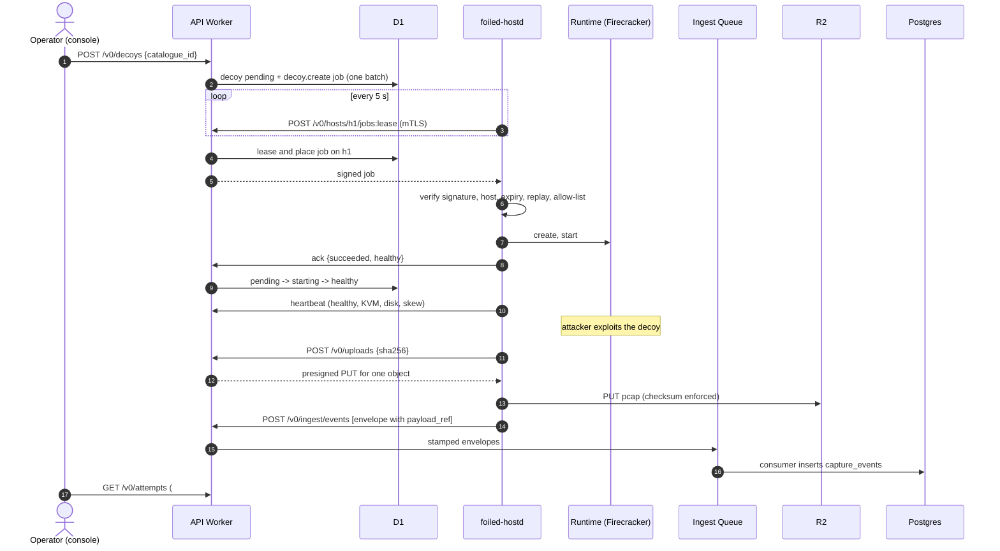

# Host agent protocol

Between the control plane API Worker and `foiled-hostd` on each sandbox host ([ADR 0008](../adr/0008-sandbox-host-agent.md), #41) or edge sensor ([ADR 0007](../adr/0007-edge-ingest.md), #31). All calls go from the host to the ingest hostname over HTTPS with the host's mTLS client certificate. JSON Schemas live in [`schemas/agent/`](../../schemas/agent/); example messages in [`testdata/agent/`](../../testdata/agent/), which CI validates against the schemas and parses into the Rust types.

## Endpoints

| Call | Scope | Request | Response |
| --- | --- | --- | --- |
| `POST /v0/hosts/{host_id}/jobs:lease?max=10` | `host:lease` | empty | `{jobs: [signed job], lease_expires_at}` |
| `POST /v0/hosts/{host_id}/jobs/{job_id}:ack` | `host:report` | [job result](../../schemas/agent/job-result.schema.json) | 204 |
| `POST /v0/hosts/{host_id}/heartbeat` | `host:report` | [heartbeat](../../schemas/agent/heartbeat.schema.json) | 204 |
| `POST /v0/ingest/events` | `host:ingest` | `{events: [capture envelope]}` | 202 |
| `POST /v0/uploads` | `host:upload` | `{decoy_id, attempt_id?, channel, sha256, size}` | presigned PUT for one R2 object |

`{host_id}` must be the certificate's own identity, otherwise 403 `wrong_host`.

Edge sensors (`role = "sensor"` in the agent config) use the same calls under `/v0/sensors/{sensor_id}/...` with `sensor:lease` (lease and ack), `sensor:report` (heartbeat and renewal), `sensor:ingest` and `sensor:upload`; a wrong id is 403 `wrong_sensor`. A sensor only leases jobs placed on it, never unplaced ones. The `host_id` field of a job body or heartbeat carries the sensor id.

Identity calls (#31, [edge-sensor.md](../deploy/edge-sensor.md)):

| Call | Auth | Request | Response |
| --- | --- | --- | --- |
| `POST /v0/enrol` | one-time enrolment token in the body; no client certificate | [enrol request](../../schemas/agent/enrol-request.schema.json) | [enrol response](../../schemas/agent/enrol-response.schema.json) |
| `POST /v0/{hosts\|sensors}/{id}/certificate:renew` | mTLS, `host:report` or `sensor:report`, only as itself | `{csr_pem}` | enrol response; the previous certificate works for 24 more hours |

## Signed job

```json
{ "body": "<JSON text of the job body>", "sig": "<hex Ed25519 signature over body>", "key_id": "k1" }
```

The [job body](../../schemas/agent/job.schema.json):

| Field | Notes |
| --- | --- |
| `job_id` | Unique. Used to acknowledge. |
| `host_id`, `tenant_id`, `decoy_id` | The host refuses jobs for any other host id. |
| `kind` | One of the job types below. |
| `reason` | `{code, text}`. Required on every destructive kind; passed to the audit log. |
| `decoy` | Run parameters for `decoy.create`, `decoy.rotate`, `decoy.reset`: `catalogue_id`, `decoy_kind`, `generation`, `artefact`, `listen_ports`, `hard_deadline`. |
| `idempotency_key` | Each key runs at most once per host, across restarts. |
| `issued_at`, `expires_at` | Unix ms. Expired jobs and jobs issued more than 5 minutes ahead of the host clock are refused. |

`artefact` is what the local allow-list is checked against: `sha256:<hex>` (OCI image digest), `emulator:<id>/<profile>`, or `module:<id>/<profile>[@sha256:<hex>]`. It is `null` when the catalogue entry has no pinned artefact yet, and the host refuses such a job.

## Job types

| Kind | Runtime calls (ADR 0002) | State reported on success |
| --- | --- | --- |
| `decoy.create` | create, start | `healthy` |
| `decoy.start` | start | `healthy` |
| `decoy.stop` | stop (freeze networking) | `stopped` |
| `decoy.rotate` | stop, capture flush, forensic snapshot if the reason indicates compromise, destroy, create (new generation), start | `healthy` |
| `decoy.reset` | as rotate, from the clean baseline | `healthy` |
| `decoy.mark_compromised` | stop, capture flush, forensic snapshot | `quarantined` |
| `decoy.destroy` | stop, capture flush, forensic snapshot if compromise, destroy | `destroyed` |
| `decoy.snapshot` | forensic snapshot | unchanged |
| `capture.flush` | capture flush | unchanged |
| `host.drain` | stop every running decoy | unchanged |

Failures: a failed containment step (stop, destroy) reports `failed` with the decoy left `stopped`; it is never republished. Evidence steps (flush, snapshot) are best effort and never block containment.

## Job result

```json
{ "job_id": "job-1", "outcome": "succeeded", "decoy_state": "healthy", "detail": null }
```

`outcome` is `succeeded`, `failed` or `rejected` (the gate refused the job; `detail` says why). The control plane applies `decoy_state` by walking the allowed transitions in [rotation.md](../rotation.md): for example `pending` to `healthy` passes through `starting`, and a successful rotate or reset always passes through `rotating`, which bumps the generation. A state that cannot be reached is refused with 409. Every ack is audited as `job.ack`; rejections are audited as denied.

## Leases

A lease holds a job for 5 minutes. A job not yet placed on a host is placed on the first host that leases it, along with its decoy. If the lease lapses without an ack, the same host can lease it again; the idempotency key stops it running twice there. Acks are accepted once, only from the leasing host.

## Sequence



## Control plane outage

Running decoys keep running. Envelopes go to the on-disk buffer (default 1 GiB on a host, 256 MiB on an edge sensor, oldest whole segments dropped first and counted in `dropped_events`). No new jobs run, but a job already leased finishes and its ack is retried. When the control plane returns, the buffer drains in batches of up to 100; ingest ignores any `event_id` it already has, so a crash between send and local commit causes no duplicates. A 401 or 403 (revoked or retired certificate) stops the drain and keeps the buffer; any other refusal resends the batch one event at a time and drops only the refused events, counted in `dropped_events`. A decoy whose `hard_deadline` passes during the outage is frozen by the host.
