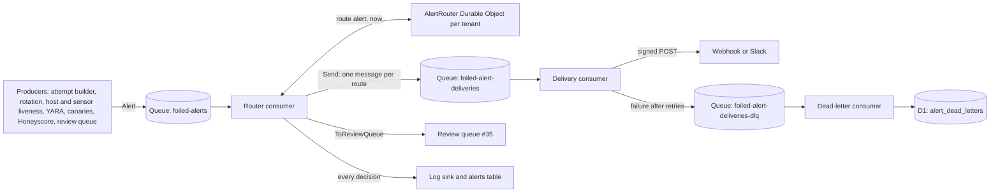

# Alerting

Status: event types, payload, config, dedupe, rate limits, routing decisions and webhook signing are in place as pure logic in `foiled_core::alerting` ([crates/core/src/alerting.rs](../crates/core/src/alerting.rs)). The delivery worker described below lands with the control plane integration (#21). Owner: #15.

Related: rotation alert events and reason codes ([rotation.md](rotation.md#alert-events), #8), Honeyscore ([fingerprint-resistance.md](fingerprint-resistance.md#alert-types-for-15), #18), capture disk caps ([ADR 0005](adr/0005-capture-layer.md), #9), hooks ([instrumentation.md](instrumentation.md), #32), attempts (#25), canaries (#17, `docs/canaries.md`, planned), review queue (#35, `docs/radar.md`, planned), edge sensors (#31), host agent ([agent/protocol.md](agent/protocol.md), #41), retention ([privacy-and-retention.md](privacy-and-retention.md), #16), console (#14).

Files:

- Config: [configs/alerting.yaml](../configs/alerting.yaml), schema [schemas/alerting-config.schema.json](../schemas/alerting-config.schema.json).
- Payload schema: [schemas/alert.schema.json](../schemas/alert.schema.json), examples in [testdata/alerts/](../testdata/alerts/).
- `foiled-lint` validates both, and [crates/lint/tests/alerting.rs](../crates/lint/tests/alerting.rs) checks them against the Rust types.

## Rules

1. **Never page on every connection.** A connection, a probe or a scanner sweep never raises an alert on its own. Alerts come from state changes (#25), hooks (#32), YARA (#11), canaries (#17), rotation (#8) and fleet health.
2. **One page per attempt.** An attempt raises at most one high alert. Anything else it raises is medium or lower and goes to the review queue.
3. **Critical alerts link to evidence.** Every critical alert links to a console attempt or a review queue item. The schema and `Alert::validate` both enforce this.
4. **Noise is bounded.** Every alert is deduplicated, then rate limited per type and per route. Suppressed alerts are logged, not lost.
5. **No SMS.** Routes are webhook, Slack-compatible webhook, email (documented, not delivered yet) and the log sink. SMS is out of scope.
6. **No secrets in config.** `configs/alerting.yaml` names Worker secrets; it never holds a URL with a token, a signing key or a password.
7. **Alerting never acts.** It does not block IPs, change firewalls or notify CERTs. Containment is rotation's job (#8).

## Severities

Alert severities use the capture envelope scale, `info < low < medium < high < critical`.

| Severity | Default handling |
| --- | --- |
| `critical` | Sent to every matching route. Deduplicated, never rate limited. Must link to an attempt or a queue item. |
| `high` | Sent to matching routes (webhook, Slack). Deduplicated and rate limited. |
| `medium` | Becomes a review queue item (#35) when `review_queue_for_medium` is true (the default). Otherwise routed like any other severity. |
| `low` | Log sink, and any route an operator opts in with `min_severity: low`. |
| `info` | Log sink only. |

Per-type overrides go in `severity_overrides`. An override replaces the producer's severity before routing, so the payload carries the effective severity.

## Event types

Dedupe keys are built from the facts below plus a time bucket of the dedupe window, taken from the alert's own `ts`. Windows are configurable per type (minimum 60 s).

| Type | Default severity | Raised by | When | Dedupe key | Default window |
| --- | --- | --- | --- | --- | --- |
| `vuln_path_hook_fired` | high | Attempt builder (#25, #32) | A hook fired at the trigger stage. Medium when the same attempt also raised `decoy_compromised`. | src IP + CVE | 1 h |
| `cve_assessed` | medium | Confidence layer (#12, #27) | A CVE assessment tier was promoted, for example possible to likely. | subject (CVE id) | 1 day |
| `predisclosure_spike` | high | Predisclosure watchlist (#12, #35) | A watchlist path or signature spiked with no matching advisory. | subject (watchlist id) | 1 h |
| `campaign_updated` | medium | Campaign clustering (#33, `campaign::alerts`) | A campaign was created, grew or merged. Low while the campaign is `emerging` ([campaigns.md](campaigns.md#alerts)). | campaign id | 1 day |
| `edge_sensor_offline` | high | Sensor liveness (#31) | An edge sensor stopped forwarding past its grace period. | subject (sensor id) | 1 h |
| `review_queue_item` | low | Review queue (#35) | A queue item was created. Never itself sent to the queue. | subject (queue item id) | 1 day |
| `decoy_compromised` | high | Attempt builder, rotation (#8) | Attempt reached post-exploitation, or a decoy entered `quarantined` with a compromise reason: `reverse_shell`, `egress_blocked`, `yara_match` or `canary_used`. | decoy + type | 1 h |
| `canary_used` | critical | Canary listener or egress proxy (#17) | A canary minted for a decoy generation was used. Links to the attempt the canary is attached to. | decoy + type | 1 h |
| `yara_match` | high | YARA on quarantine (#11) | A quarantined file matched a rule at or above the configured severity. | decoy + type | 1 h |
| `honeyscore_high` | medium | Honeyscore self-check (#18) | A public decoy IP scored at or above the threshold. One alert per IP; `decoy_id` is null and `links` lists each decoy. | subject (public IP) | 1 day |
| `capture_disk_pressure` | high | Host agent (#41, ADR 0005) | Capture volume passed 80 %; new decoys are paused on the host. | subject (host id) | 1 h |
| `rotation_failed` | critical | Rotation (#8) | Entry into `failed` from `rotating`, or freeze not confirmed within `freeze_ack_timeout`. | decoy + type | 1 h |
| `host_offline` | high | Host heartbeats (#41) | A sandbox host missed its heartbeats past the lease timeout. | subject (host id) | 1 h |
| `rotation_storm` | high | Rotation storm guard (#8) | More than `max_rotations_per_hour` for one decoy. | decoy + type | 1 h |
| `decoy_burnt` | medium | Rotation (#8, #18) | `honeyscore_high` fired and the pool had no spare IP. | decoy + type | 1 day |
| `decoy_rotated` | info | Rotation (#8) | A rotation succeeded. Log sink only. | decoy + type | 1 h |

When a fact is missing (for example an alert with no `src_ip`), the key falls back to the `alert_id`, which only collapses exact repeats.

### Alerts from attempts

`alerts_from_attempt` turns one attempt (#25) into alerts:

- **Probe only:** nothing. This is what keeps scanner noise out of every channel.
- **Exploit with a hook hit:** one `vuln_path_hook_fired`, high, with the first trigger hit's CVE as `cve_id`.
- **Post-exploitation:** one `decoy_compromised`, high. If the attempt also had a hook hit, `vuln_path_hook_fired` is raised at medium, so it lands in the review queue as a CVE assess-as candidate instead of paging a second time.
- **Exploit through matchers only:** nothing here. The confidence layer raises `cve_assessed` when the evidence earns it (#12).

Alert ids are deterministic (`alr_` plus 24 hex characters of SHA-256 over the type, tenant and attempt id), so rebuilding attempts from evidence raises the same ids and receivers can drop repeats.

### Critical alerts without an attempt

`rotation_failed` can happen with no attempt (for example a `max_lifetime` rotation). The producer first creates a review queue item for it (an operations item in the #35 queue) and links it as `queue_item`. `canary_used` links the attempt the canary signal is attached to; when the generation is already gone, the signal still attaches to the attempt record ([rotation.md](rotation.md#triggers-and-reason-codes)). A critical alert that fails `Alert::validate` is a bug: the worker still writes it to the log sink and logs `alert_invalid` at error level.

## Payload

Schema: [schemas/alert.schema.json](../schemas/alert.schema.json). Webhook routes post this body as `application/json`.

| Field | Type | Notes |
| --- | --- | --- |
| `alert_id` | string | `alr_` plus 24 hex characters. Stable across retries. |
| `ts` | integer | Unix milliseconds of the event that raised the alert. |
| `severity` | enum | Effective severity after overrides. |
| `type` | enum | One of the event types above. |
| `decoy_id` | string or null | Null for host, sensor and per-IP alerts. |
| `attempt_id` | string or null | Null when the alert is not about one attempt. |
| `campaign_id` | string, optional | Present for campaign alerts and attempts already clustered. |
| `summary` | string | One line, at most 500 characters, plain text. No payload bytes, no secrets. |
| `links[]` | array | `{kind, href}`. `kind` is `attempt`, `queue_item`, `decoy`, `campaign`, `host`, `sensor` or `docs`. `href` is a console path; the worker prefixes `console_base_url` when it renders. |
| `src_ip` | string, optional | Attacker source when the alert is about one source. |
| `cve_id` | string, optional | CVE or demo id the alert is about. |
| `subject` | string, optional | Host id, sensor id, public IP, CVE id or queue item id for alerts not about one decoy. |

Example ([testdata/alerts/canary-used.json](../testdata/alerts/canary-used.json)):

```json
{
  "alert_id": "alr_ae9a2c010830e5da5f433054",
  "ts": 1792285923000,
  "severity": "critical",
  "type": "canary_used",
  "decoy_id": "dcy-demo-1",
  "attempt_id": "att_5d0c1e8a2b7f40c19e63aa01",
  "summary": "Canary vt-canary-env-api-key planted in dcy-demo-1 generation 12 was used from 198.51.100.23",
  "links": [
    { "kind": "attempt", "href": "/attempts/att_5d0c1e8a2b7f40c19e63aa01" },
    { "kind": "decoy", "href": "/decoys/dcy-demo-1" }
  ],
  "src_ip": "198.51.100.23"
}
```

`src_ip` is attacker data and counts as personal information under [privacy-and-retention.md](privacy-and-retention.md). It is included because operators triage on it. Operators who send alerts to a third-party chat service should treat that service as another place the data is held.

## Routes

| Kind | Delivery | Secrets (Worker secret names in config) | MVP |
| --- | --- | --- | --- |
| `log` | One structured JSON line per routed alert on the control plane (Workers Logs). Required, at least one enabled. Not rate limited. | none | Yes |
| `webhook` | `POST` of the payload, signed with `X-Foiled-Signature`. | `url_env`, `signing_secret_env` | Yes |
| `slack_webhook` | `POST {"text": ...}` to a Slack-compatible incoming webhook. The text is the severity, type, summary and the absolute console links. The URL itself is the secret. | `url_env` | After webhook |
| `email` | Email through an operator SMTP relay (the relay's HTTP submission API or a TCP socket from the Worker). Documented only; the worker does not send email yet, so config validation rejects an enabled email route. | `smtp_relay_env`, `to_env` | No |

Each route has `min_severity`, an optional `types` filter and an optional `rate_limit`. A route receives an alert when it is enabled, the effective severity is at or above `min_severity`, and the type is in `types` (or `types` is empty).

### Review queue instead of paging

With `review_queue_for_medium: true` (the default), a medium alert returns `ToReviewQueue` instead of `Send`. The worker creates or updates a review queue item (#35), keyed by the alert's dedupe key, so a repeat updates the same item:

| Alert type | Queue item type (#35) |
| --- | --- |
| `vuln_path_hook_fired` (demoted to medium) | CVE assess-as confirmation |
| `cve_assessed` | CVE assess-as confirmation |
| `campaign_updated` | Campaign merge proposal, or a campaign card when nothing needs merging |
| `honeyscore_high`, `decoy_burnt` | Operations item (harden, move or retire the decoy) |

Creating an item raises `review_queue_item` (low), which goes to the log sink by default. `review_queue_item` itself never returns `ToReviewQueue`, so there is no loop.

## Dedupe and rate limits

`Router::route(alert, now)` returns one of:

- `Send(route_ids)`: deliver to these routes.
- `Suppressed { reason }`: `duplicate`, `type_rate_limited`, `route_rate_limited` or `no_route`.
- `ToReviewQueue`: create a queue item instead of paging.

Order of evaluation:

1. Apply `severity_overrides`.
2. **Dedupe.** Build the key from the table above and the time bucket (`ts` divided by the window). If the key was seen, `Suppressed { duplicate }`. Keys are kept for one extra window so late or retried alerts still collapse.
3. **Review queue fallback** for medium.
4. **Route match.** No enabled route accepts the severity and type: `Suppressed { no_route }`.
5. **Per-type cap.** A token bucket per type (default burst 5, refill 20 per hour). Empty: `Suppressed { type_rate_limited }`. Skipped for critical.
6. **Per-route bucket.** Each matching route with a `rate_limit` takes a token; routes with an empty bucket are dropped from the list. If none are left: `Suppressed { route_rate_limited }`. Skipped for critical.

Duplicates do not use up tokens, because dedupe runs first.

The issue's dedupe keys map as follows: source IP + CVE + hour for hook hits, campaign id + day for campaign updates, decoy + type + hour for decoy events. Host, sensor, IP and CVE events use their subject.

Memory is bounded. `Deduper` holds at most `dedupe.max_keys` keys (default 10,000 per tenant). Expired keys are dropped on every check; when it is full, the key closest to expiry is evicted. Eviction can let one duplicate through; it never lets memory grow.

`TokenBucket` is integer and pure: `burst` tokens, one token back every `3600 / per_hour` seconds, never above `burst`, and a `now` earlier than the last refill adds nothing. `per_hour: 0` means the bucket never refills.

Every decision, including `Suppressed`, is written as one log line (`alert_decision`, with `alert_id`, `type`, `severity`, `decision`, `reason`, `routes`) and counted in `alerts_suppressed_total{type, reason}`. Suppressed alerts stay visible in the console alert history; they are just not delivered.

## Webhook signing

- The signature is HMAC-SHA256 over the exact request body bytes, keyed with the value of the Worker secret named by `signing_secret_env`, hex encoded in lower case: `sign_webhook(secret, body)`.
- It is sent as `X-Foiled-Signature: <hex>`. The worker also sends `X-Foiled-Alert-Id` and `Content-Type: application/json`.
- Receivers recompute the HMAC over the raw body before parsing, compare in constant time, drop repeats by `alert_id`, and may reject alerts whose `ts` is older than their own tolerance.
- Test vector (RFC 4231 test case 2): key `Jefe`, data `what do ya want for nothing?`, signature `5bdcc146bf60754e6a042426089575c75a003f089d2739839dec58b964ec3843`. The unit test `hmac_rfc4231_case_2` checks it.
- Set the secrets with `wrangler secret put FOILED_ALERT_WEBHOOK_URL` and `wrangler secret put FOILED_ALERT_WEBHOOK_SECRET`. Rotate the signing secret by adding the new value, letting the receiver accept both, then removing the old one.

Slack-compatible webhooks do not verify signatures; the secret URL is the only control, so keep it in a Worker secret.

## Delivery worker



- **Producers** build an `Alert`, call `Alert::validate`, and send it to the `foiled-alerts` Queue. They do not deliver anything themselves.
- **Router consumer** passes each alert to the tenant's `AlertRouter` Durable Object, which holds the `Router` (dedupe and bucket state). A Durable Object is single-threaded, so concurrent consumers see one consistent state. The object persists the serialised `Router` to its storage after each batch, so an eviction does not reset dedupe or buckets. Config changes rebuild the router.
- **Fan-out.** `Send` becomes one message per route on `foiled-alert-deliveries`, so a retry only repeats the route that failed. The `log` route is written directly by the router consumer.
- **Delivery consumer** reads the URL and signing secret from Worker secrets, renders links absolute with `console_base_url`, signs, and posts with a 10 s timeout.
- **Retries.** Network errors, timeouts, `408`, `429` and `5xx` are retried with backoff (30 s, 2 min, 10 min, 30 min, 1 h; `Retry-After` honoured up to 1 h), using the Queue's per-message retry delay. Other `4xx` responses are configuration errors and go straight to the dead letter queue.
- **Dead letter.** After the last retry the message moves to `foiled-alert-deliveries-dlq`. Its consumer writes an `alert_dead_letters` row in D1 (`alert_id`, `route_id`, `type`, `severity`, attempts, last status, last error, first and last try) and the console shows a banner. A dead-lettered critical alert is logged at error level. Dead letters are never re-sent through the same route automatically; an operator can replay them from the console.
- **Delivery failure logging.** Every failed try is logged on the control plane as one line, and counted in `alert_deliveries_total{route, outcome}`:

```json
{"event":"alert_delivery_failed","alert_id":"alr_ae9a2c010830e5da5f433054","route_id":"ops-webhook","try":2,"status":503,"error":"upstream returned 503","next_retry_in_s":600}
```

Log lines and dead-letter rows carry the route id, never the URL or the secret.

## Config

[configs/alerting.yaml](../configs/alerting.yaml) ships with only the log sink on. The webhook, Slack and email routes are present but disabled until the operator sets the named Worker secrets.

| Key | Meaning |
| --- | --- |
| `version` | `1`. |
| `console_base_url` | Console origin for links, `https://` only, no credentials or query. |
| `review_queue_for_medium` | Medium alerts become review queue items. Default `true` in the shipped file. |
| `routes[]` | `id`, `kind`, `enabled`, `min_severity`, `types`, `url_env`, `signing_secret_env`, `smtp_relay_env`, `to_env`, `rate_limit {burst, per_hour}`. |
| `severity_overrides` | Map of type to severity. |
| `dedupe.max_keys`, `dedupe.windows` | Memory bound and per-type windows in seconds. |
| `type_limits` | Per-type token buckets. |

`AlertingConfig::validate` (run by `Router::new`) and the schema both reject: a value in an `*_env` field that is not an upper-case variable name (a pasted URL or token fails), a webhook without a signing secret, an enabled email route, no enabled log route, a burst of 0, a window under 60 s, duplicate route ids and an unknown alert type.

## Tabletop: 100 scanner hits

Setup: 20 sources in 198.51.100.0/24 send 100 HTTP requests to five decoys in ten minutes. None reach the vulnerable path.

| Step | Result |
| --- | --- |
| Capture and grouping (#9, #25) | 100 events become attempts per source and decoy, all in `probe`. |
| `alerts_from_attempt` | No alerts. Probes never page. |
| Console | The attempts and the noise score show in the attempts view; nothing is sent. |

Worst case: every one of the 100 hits fires the hook, from 100 different sources, within 100 s. Each attempt raises `vuln_path_hook_fired` (high), each with a different source, so dedupe does not collapse them. The per-type cap does: the first 5 are sent, the other 95 are `Suppressed { type_rate_limited }` and logged. If one source sends the same CVE to 100 decoys inside one clock hour, dedupe (source + CVE + hour) sends one alert.

Both cases are unit tests: `tabletop_100_scanner_probes_give_bounded_alerts` and `tabletop_100_mass_exploit_hits_are_bounded`.

## Tabletop: one hook and exploit

Setup: `203.0.113.7` probes `dcy-demo-1` (catalogue `foiled/demo-app/1.0.0`), the upload hook fires at `trigger` for `FOILED-DEMO-0001`, then at `post_exploit`, then the guest tries egress to 192.0.2.80.

| Step | Result |
| --- | --- |
| Grouping | One attempt: `probe`, then `exploit` (hook trigger), then `post-exploitation` (hook post-exploit). Egress joins the same attempt. |
| `alerts_from_attempt` | `decoy_compromised` (high) and `vuln_path_hook_fired` (medium, demoted). |
| Routing | `decoy_compromised` returns `Send(["log", "ops-webhook"])`. `vuln_path_hook_fired` returns `ToReviewQueue` and becomes a CVE assess-as confirmation item. |
| Rotation (#8) | The compromise reason starts the rotation. When the egress rule fires, `egress_blocked` is a further reason on the same generation; any `decoy_compromised` it raises has the same decoy + type + hour key and is suppressed as a duplicate. |

Result: one high alert and one queue item, both linking to the attempt. The unit test `tabletop_single_exploit_chain_is_one_high_alert_and_a_queue_item` checks it.

## Out of scope

- Automatic firewall blocks or any other action on an alert.
- Automatic notification of CERTs or third parties.
- SMS and phone paging.
- Email delivery (documented above, not built in this milestone).
