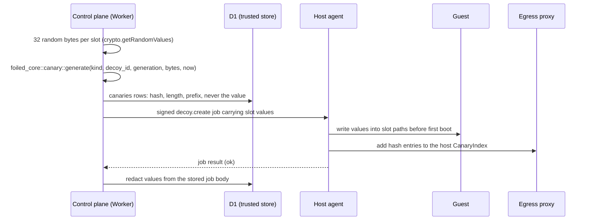

# Canaries

Status: design for v0.3, tracks #17. Generation, formats, the hash index and the `.env` renderer are in place in [crates/core/src/canary.rs](../crates/core/src/canary.rs). The D1 table, the beacon listener Worker, the egress proxy scan and the Canarytokens webhook land with the control plane (#21), the host agent (#41) and the Foiled egress proxy (#4).

Related: network isolation and the egress proxy ([ADR 0003](adr/0003-network-isolation.md), #4), catalogue `canary_slots` ([catalogue.md](catalogue.md), [entry schema](../catalogue/schema/entry.schema.json), #5), capture envelopes ([ADR 0005](adr/0005-capture-layer.md), #9), rotation and the `canary_used` reason ([rotation.md](rotation.md), #8), alerting (#15), retention (#16), contribute-back ([contribute-back.md](contribute-back.md), #37), licence register ([compliance/licence-register.md](compliance/licence-register.md), #38), emulators and decoy modules (#30), host agent ([agent/protocol.md](agent/protocol.md), #41), threat model control C5 ([threat-model.md](threat-model.md)).

A canary is a planted value that has no use except as a tripwire. Attackers who dump config files often try the credentials they find somewhere else. When a value that only ever existed inside one decoy generation shows up in an outbound request or at a URL only that decoy knew about, that is close to proof that data was taken and used. Foiled plants canaries in every sandbox generation, keeps a hash of each in the trusted store, and raises a critical `canary_used` alert on any match.

## Rules

1. **Never real credentials.** No canary is a working credential for any third-party service, and no format copies a real provider's format closely enough to collide with one. Every Foiled-native value carries a visible `vt-canary-`, `vt_canary_`, `VTCANARY` or `vtcanary` marker, or points at a reserved `.invalid` host.
2. **Fail closed.** If a canary reaches a real service, the service rejects it. Nothing in this design asks a third party to accept, store or forward a canary.
3. **Trusted store only.** Canary values exist in the signed create job, in the guest and briefly in host agent memory. The control plane keeps a SHA-256 hash, a length and a short prefix per value, not the value. Values are never committed to git, never written to logs and never put in capture envelopes, exports or shared feeds.
4. **Fresh per generation.** Every `decoy.create`, `decoy.rotate` and `decoy.reset` mints new values ([rotation.md](rotation.md), step 5). Old ones are retired, not deleted, so late use is still caught and attributed.
5. **No email canaries that reach third parties.** Foiled does not plant email addresses at domains it does not control and never sends mail to trigger or test a canary.

## Canary types and placement

The five kinds match the `canary_slots` enum in the [catalogue entry schema](../catalogue/schema/entry.schema.json). A catalogue entry declares slots as guest paths plus a kind; the host agent writes the value at start.

| Kind | Format | Typical placement paths | How use is detected |
| --- | --- | --- | --- |
| `api_key` | `vt-canary-ak-<32 hex>` | `/srv/<app>/.env` (the demo app uses `/srv/demo-app/.env`), `/var/www/html/.env`, `/opt/<app>/config/secrets.yml` | Beacon listener (the `.env` also sets `API_BASE_URL` to the beacon), egress proxy scan |
| `database_url` | `postgres://vt_canary_<8 hex>:<24 hex>@db.internal.invalid:5432/app` | Same `.env` as `DATABASE_URL`, `/etc/<app>/database.yml` | Egress proxy scan; a Postgres or MySQL decoy that logs login attempts (#30) |
| `cloud_access_key` | access key id `VTCANARY<12 base32>` (20 characters), secret `vtcanary<32 base62>` (40 characters) | Same `.env` as `AWS_ACCESS_KEY_ID` and `AWS_SECRET_ACCESS_KEY`, `/root/.aws/credentials`, `/home/<user>/.aws/credentials` | Beacon listener (the `.env` sets `AWS_ENDPOINT_URL` to the beacon), egress proxy scan of SigV4 `Authorization` headers |
| `ssh_private_key` | Unencrypted OpenSSH Ed25519 private key, unique per decoy generation, comment `vt-canary-<canary id>` | `/root/.ssh/id_ed25519` (mode `0600`) with the matching `id_ed25519.pub`, `/home/<user>/.ssh/id_ed25519` | SSH decoys (Cowrie, #30) that log offered public keys, egress proxy scan |
| `admin_password` | `vt-canary-<20 base62>` | The honeypot app's own fake admin UI: replaces the decoy-only `default_credentials` password at start, for example the demo app's `admin` login | The app's own login log (a successful login is an application event); egress proxy scan; any other Foiled decoy that logs passwords |

Notes on the formats:

- **Cloud keys.** Real AWS access key ids are 20 characters and start with a four-letter type code beginning with `A`, such as `AKIA` for long-term keys or `ASIA` for temporary ones. `VTCANARY` is not a code AWS issues, so a Foiled cloud canary can never be a live AWS key and AWS rejects it with an invalid-token error. The same id is used for any S3-compatible or other provider env var names; no format is copied from another provider.
- **Database URLs.** `.invalid` is reserved and never resolves (RFC 2606), so a client that uses the URL as-is fails before any network traffic. Attackers who copy the password to another host are caught by the password needle.
- **SSH keys.** The key is a real Ed25519 keypair (generated with `ed25519-dalek` from the minted bytes) in OpenSSH's `openssh-key-v1` format, so `ssh-keygen` and `ssh` load it. The core tests check it against a known answer from `ssh-keygen -y`. It unlocks nothing: its public key is installed only on Foiled SSH decoys that watch for it.
- **Admin passwords.** These are only ever used by the decoy's own fake admin UI. They are never set as Cowrie or other SSH decoy login credentials, because a guessable login would let scanners trip it by accident ([contribute-back.md](contribute-back.md) explains how replayed canaries leave through DShield).
- **Realism trade-off.** A visible marker can tell a careful attacker that the file is planted. Rule 1 wins over realism. Most credential harvesting is automated and does not read the values.

Emulators (#30) can also carry canaries: an emulator profile may refer to a slot by `{{canary.<kind>}}` placeholders in its fake files (for example a fake `.env` served by an HTTP emulator), and the host agent fills them from the same create job. The placeholder syntax is defined with the emulation plug-in design (#30).

## Generation and storage

### Flow



1. On `decoy.create`, `decoy.rotate` and `decoy.reset`, the API draws 32 bytes from the Worker's CSPRNG for each `canary_slots` item and calls `foiled_core::canary::generate`. Generation is deterministic given those bytes, the kind, the decoy id and the generation, which keeps core wasm-safe and testable. Values are HMAC-SHA256 outputs keyed by the random bytes, so the ids in the message cannot weaken them.
2. In the same D1 batch that writes the decoy row and the job, the API writes one `canaries` row per canary and one `canary_needles` row per needle (see below). Only hashes and short prefixes are stored.
3. The values go to the host in the signed create job, as a planned `decoy.canaries` array of `{slot_path, kind, canary_id, value}` added to the job schema with #41. The job travels over the host's mutual TLS connection like every other job.
4. The host agent writes each value into the guest's writable volume before first boot: files at slot paths owned by the app user, `0600` for SSH keys. Several slots on one `.env` path are rendered together with `render_env_file`. It then builds the hash index for the egress proxy and drops the values from memory.
5. After the host reports the job result, or when the job expires, the API replaces each `value` in the stored job body with `null` and keeps `body_sha256` so the original signature can still be audited.

Generated values never appear in this repository. Test fixtures use canary ids and the visibly fake formats above, never a value that is planted anywhere.

### What is stored where

| Place | Holds | Lifetime |
| --- | --- | --- |
| D1 `canaries`, `canary_needles` | Canary id, decoy id, generation, kind, slot path, state, SHA-256, length, 8-character prefix | Until the decoy's records are purged (#16) |
| D1 `jobs` | The value, only until the job result or expiry, then redacted | Job retention |
| Host agent memory | Values while planting | Seconds |
| Host egress proxy index | Hash entries for every live and retired generation on that host | Until the decoy is destroyed and its retention ends |
| Guest disk | The values, at slot paths | The generation; wiped on destroy ([rotation.md](rotation.md), step 4) |
| Beacon listener | Hash entries read from D1 | Cached per request batch |

### D1 table sketch

```sql
CREATE TABLE canaries (
  canary_id          TEXT PRIMARY KEY,               -- cn_<16 hex>
  tenant_id          TEXT NOT NULL,
  decoy_id           TEXT NOT NULL,
  generation         INTEGER NOT NULL,
  kind               TEXT NOT NULL CHECK (kind IN
                       ('api_key','database_url','cloud_access_key','ssh_private_key','admin_password')),
  slot_path          TEXT NOT NULL,
  source             TEXT NOT NULL CHECK (source IN ('foiled','canarytokens')),
  external_token_id  TEXT,                           -- Canarytokens token id, else NULL
  state              TEXT NOT NULL CHECK (state IN ('active','retired','triggered')),
  created_at         INTEGER NOT NULL,
  retired_at         INTEGER,
  first_hit_at       INTEGER,
  UNIQUE (decoy_id, generation, slot_path, kind)
);
CREATE INDEX canaries_by_decoy ON canaries (decoy_id, generation);

CREATE TABLE canary_needles (
  sha256      TEXT PRIMARY KEY,                      -- hex SHA-256 of the needle
  canary_id   TEXT NOT NULL REFERENCES canaries (canary_id),
  prefix      TEXT NOT NULL,                         -- first 8 bytes
  len         INTEGER NOT NULL
);
```

A needle is a substring the scanners look for. Most kinds have one needle (the value). A cloud key has two (the id and the secret). A database URL has one, its password, which also covers the whole URL. An SSH key has two: the PEM as written and the base64 public key blob that shows up in `authorized_keys` files and SSH decoy logs. The `CanaryIndex` type in core is exactly this table's content, so it serialises to and from the rows without ever holding a value.

The 8-byte prefix is stored so the scanners can find candidates cheaply. For API keys, admin passwords, cloud key ids and secrets it is the fixed fake marker; for the database password it is 8 of 24 hex digits, leaving 64 bits unknown.

## Detection

Every detector runs the same code: `CanaryIndex::scan(bytes)` hashes each candidate that starts with an indexed prefix over the indexed length and compares it with the stored hashes. Matches are exact, so near misses (one character changed, truncated, a different decoy's key) never hit. The scan is linear in the input for each distinct prefix and length; with a few hundred canaries per host that is cheap without Aho-Corasick.

### Egress proxy inspection

The egress proxy on each sandbox host ([ADR 0003](adr/0003-network-isolation.md#egress-proxy-and-resolver)) already logs every request a decoy makes, allowed, denied or canned. With canaries it also scans:

- the request line and all headers of every plain HTTP request;
- the first 64 KiB of every plain HTTP request body, read before the proxy answers, so a denied upload is still scanned;
- for `CONNECT`, only the target host and port, because the proxy does not break TLS by default;
- with active inspection turned on for named hosts (audited, off by default), the decrypted request line, headers and body prefix.

The logging resolver applies the same scan to query names, which catches canaries smuggled out in DNS labels.

On a match the host agent sends an `egress` capture envelope with severity `critical` and `data.detector: egress_proxy` (fixture: [canary-egress-proxy-hit.json](../testdata/capture/canary-egress-proxy-hit.json)). A canary in the guest's own outbound traffic means an attacker is acting on the box, so the host agent may freeze locally as it does for `egress_blocked`, when `local_freeze_on` lists `canary_used` ([rotation.md](rotation.md#local-fast-path); we suggest adding it to the default), then the compromise path follows. The Squid stand-in cannot scan headers or bodies; until the Foiled proxy ships, the host agent scans the logged URL only.

### Beacon listener

The beacon listener is an operator-run Worker that accepts any HTTP request and reports matches. It holds no data worth stealing and never makes an outbound request, so a request to it cannot be turned into a callback to the attacker.

- **URL.** `https://<beacon host>/c/<canary id>`. The path carries the token id (the canary id, which is not secret). `render_env_file` writes it into the `.env` as `API_BASE_URL` next to `API_KEY`, and as `AWS_ENDPOINT_URL` next to the cloud key, which AWS SDKs and the AWS CLI honour, so a stolen key used with stock tools goes to the beacon instead of a real provider.
- **Hostname.** Use a hostname that does not share a zone, certificate or naming pattern with the control plane, so the beacon does not point an attacker at the operator. The beacon is not a decoy, so running it behind Cloudflare is fine.
- **Matching.** A request matches if the path carries a known canary id (`CanaryIndex::by_id`) or if the request line, headers or the first 16 KiB of the body contain a canary value (`CanaryIndex::scan`). The second case catches SigV4 `Credential=VTCANARY...` headers sent to any path, including the AWS SDK's own paths.
- **Response.** A bland `401` (`{"error":"invalid_api_key"}`) for every request. It never returns `200` or data, so the canary fails closed even at the beacon.
- **Reporting.** The listener writes an `egress` envelope with severity `critical`, `data.detector: beacon`, the canary id, kind and generation, `matched_in` (`path`, `authorization`, `header`, `query`, `body`), method, path and user agent, and the client address as `src` (fixture: [canary-beacon-hit.json](../testdata/capture/canary-beacon-hit.json)). It enqueues straight onto the ingest Queue through a binding, not through the public ingest API. Rate limits per source address keep a scanner from flooding the queue.

Canary values are never sent to the beacon by Foiled itself, and Foiled does not test canaries against real services.

### Decoy-side matches

Other decoys can recognise canaries too, through the same index: an SSH decoy (#30) that logs an offered public key matching an SSH canary's blob, a Postgres or MySQL emulator that logs a `vt_canary_` user name with a matching password, or the demo app logging a successful admin login with a canary password. These arrive as normal `application` events; the ingest consumer runs `scan` on their credential fields and adds the canary hit.

### Canarytokens as an external service

[Canarytokens](https://github.com/thinkst/canarytokens) can be used alongside the Foiled-native canaries, as a separate service the operator runs or uses. It is never part of Foiled.

- **Deployment.** Self-host the upstream Canarytokens Docker images on a separate host and hostname, or use the hosted canarytokens.org service once its terms are checked (the [licence register](compliance/licence-register.md) marks that as **verify**). Foiled talks to it only over HTTP.
- **Token types.** URL (web bug) and DNS tokens fit the `api_key` slot (as an `API_BASE_URL` or webhook URL) and need nothing else. Canarytokens' AWS key tokens are real, permissionless AWS credentials in some AWS account; they are opt-in, only with a self-hosted server in the operator's own AWS account, and never the hosted service's keys. Email-alerting tokens that send mail to third parties are not used.
- **Enrolment.** The operator creates a pool of tokens in their Canarytokens server and enrols each token id into the trusted store, through a planned `POST /v1/canaries/external` endpoint or the CLI (#21). Enrolment writes a `canaries` row with `source: canarytokens`, `external_token_id`, the kind and the hash of the planted value. At create, the API assigns an unused token from the pool to the decoy generation and sends it in the job like any other value; rotation retires it and assigns a fresh one.
- **Alerts.** The Canarytokens server's webhook points at a planned Foiled receiver (`/v1/canaries/canarytokens-webhook`, authenticated by a shared secret). The receiver treats the webhook body as untrusted, looks up the token id, and writes the same `egress` envelope with `data.detector: canarytokens`.
- **Licence.** Canarytokens is GPLv3 with Thinkst's clarifications. No Canarytokens code, library or SDK is imported, vendored or linked into the MIT core. Embedding it in proprietary or commercial software needs a licence from Thinkst. See the [licence register](compliance/licence-register.md) row and rule 6.

Foiled-native canaries remain the default because they work with no extra service.

## Capture envelope

Canary hits use the existing [capture envelope](../schemas/capture-event.schema.json) rather than a separate schema: channel `egress`, severity `critical`, the decoy id, catalogue id and generation of the canary (not of whatever made the request), and these `data` fields:

| Field | Meaning |
| --- | --- |
| `detector` | `egress_proxy`, `beacon` or `canarytokens` (decoy-side matches keep their own channel) |
| `canary_id` | The canary that matched |
| `canary_kind` | One of the five kinds |
| `canary_generation` | Generation the canary was minted for |
| `matched_in` | Where in the request it matched |
| `verdict`, `host`, `method`, `path`, `user_agent` | As for other egress events |

The value and its prefix are never in the envelope. `CanaryHit::capture_data` builds the canary fields. Contribute-back builds outbound records from an allow-list, so `canary_*` fields never leave; the `strip_non_shareable` backstop currently matches `canary` and `canary.*` keys, and #37 should extend it to `canary_*`.

## Alert type for #15

Defined here, routed, deduplicated and rate-limited by alerting (#15, `docs/alerting.md`, planned):

| Event | Default severity | When | Dedupe key | Payload notes |
| --- | --- | --- | --- | --- |
| `canary_used` | critical | Any canary hit from the egress proxy, the beacon listener, the Canarytokens webhook or a decoy-side match. | `canary_id` + source address + hour | `summary` such as "Canary api_key from dcy-demo-1 (generation 3) used from 203.0.113.45 at the beacon", the decoy id (the sandbox id), catalogue id, generation, kind, detector, `matched_in`, whether the generation is still live, and links to the decoy, the attempt and the envelope. Never the value. |

`canary_used` is also a reason code ([rotation.md](rotation.md#triggers-and-reason-codes)): if the matched generation is still live, the decoy is marked compromised and rotated with a best-effort snapshot; if it is already retired, the alert is raised and attached to the attempt with no rotation. The rotation's own `decoy_compromised` alert follows ([rotation.md](rotation.md#alert-events)); #15 may group the two.

## Tabletop: attacker exfiltrates `.env` and uses the key

Setup (example data): decoy `dcy-demo-1` runs `foiled/demo-app/1.0.0`, generation 3, published on `203.0.113.10:8080`. The entry's slot `/srv/demo-app/.env` (`api_key`) was filled at create, and the operator's beacon host is `beacon.example.net`.

| Time | What happens | Foiled response |
| --- | --- | --- |
| T+0 | `198.51.100.23` exploits the demo upload path traversal (`FOILED-DEMO-0001`) and reads `../.env`. | Hook and application events as in [mvp-walkthrough.md](mvp-walkthrough.md). The response body leaves through the inbound connection, not the proxy, so no canary hit yet. |
| T+0 | The attacker now holds `API_BASE_URL=https://beacon.example.net/c/cn_<16 hex>` and `API_KEY=vt-canary-ak-<32 hex>`. | Nothing. |
| T+1 h | From `203.0.113.45`, the attacker runs `GET /c/cn_<16 hex>/v1/users` with `Authorization: Bearer vt-canary-ak-...`. | The beacon matches the path token id and the bearer value, answers `401`, and enqueues an `egress` envelope, severity `critical`, `decoy_id: dcy-demo-1`, `generation: 3`. |
| T+1 h | Ingest processes the envelope. | `canary_used` alert at critical naming `dcy-demo-1`. If generation 3 is still live: mark compromised, rotate, new canaries for generation 4. If it was already rotated: alert only, linked to the T+0 attempt. |

The core test `tabletop_exfil_env_then_use_key_at_beacon` in [crates/core/src/canary.rs](../crates/core/src/canary.rs) runs this sequence: it mints the canary, renders the `.env`, builds the attacker's request from the file contents only, matches it with the index, and checks the resulting envelope passes the capture checks and never contains the key.

## Code

[crates/core/src/canary.rs](../crates/core/src/canary.rs) is pure and builds for `wasm32-unknown-unknown`:

- `CanaryKind`, `Canary { id, decoy_id, generation, kind, value, created_at }`. `Debug` redacts the value.
- `generate(kind, decoy_id, generation, rng_bytes, created_at)`: the caller supplies 32 random bytes and the time.
- `CanaryIndex` (`insert`, `scan`, `by_id`) and `CanaryHit { canary_id, decoy_id, generation, kind, offset }`.
- `render_env_file(canaries, beacon_base_url)` and `beacon_url(base, canary_id)`.

## Out of scope

- Commercial canary products and any canarytokens.org dependency beyond the optional integration above.
- Email canaries that send mail to, or plant addresses at, third parties.
- Document and binary canaries (Office files, PDFs with beacons). They may come later through Canarytokens.
- Testing canaries against real services.
