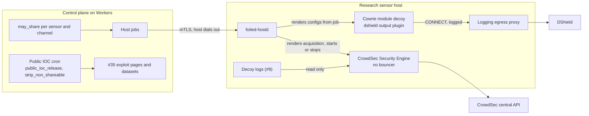

# Contribute back

Status: Draft for v0.3. Owner: #37. Related: #35 (exploit pages and datasets), #38 (licence and data-terms register), #16 (privacy and retention), #31 (edge sensors), #30 (decoy modules), #4 (network isolation), #41 (host agent), #34 (IOCs), #27 (confidence), #17 (canaries).

Foiled consumes community threat intel (GreyNoise, CrowdSec, DShield, Shadowserver), so its research sensors should give signal back. [research/landscape.md](research/landscape.md) argues for this contribute-to-consume model in its "Contribution back" section. This doc sets out each channel, where it is configured, what it sends, what is never sent, and how to test it.

This is a design the project follows, not legal advice. Data terms change; operators should check the current terms of each service and take their own advice before turning a channel on, especially for commercial use.

## Summary

| Channel | What leaves | Runs on | Research sensors | Edge sensors | Config |
| --- | --- | --- | --- | --- | --- |
| DShield | SSH and Telnet login attempts from Cowrie decoys, in DShield's log format | Cowrie module decoy, through the logging egress proxy | On by default | Off until the sensor owner opts in | `channels.dshield` |
| CrowdSec | Signals from unmodified Hub scenarios | CrowdSec Security Engine on the sensor host | On by default | Off until the sensor owner opts in | `channels.crowdsec` |
| SentryPeer | SIP bad actor data through SentryPeer's peer-to-peer sharing | SentryPeer module decoy (#30) | Off; needs a network rule first | Not offered | `channels.sentrypeer` |
| Public IOCs | Delayed, analyst-confirmed, high-confidence IOCs | API Worker (scheduled), published through #35 | On by default | Not published, even with an opt-in, unless an operator adds `edge` | `public_iocs` |

Policy file: [configs/contribute-back.yaml](../configs/contribute-back.yaml). Code: [crates/core/src/share.rs](../crates/core/src/share.rs) (`SharePolicy`, `may_share`, `public_ioc_release`, `strip_non_shareable`). `foiled-lint` checks that the shipped file parses into `SharePolicy` and passes its rules.

## Rules every channel follows

1. **Foiled-origin only.** We share what our own sensors observed. We never pass on data we received from someone else, including enrichment results, threat feeds, other people's blocklists or indicators found by pivoting in a paid tool.
2. **Opt-in per sensor.** Each sensor has a recorded choice. Research sensors default to opted in; edge sensors default to opted out. A channel sends data from a sensor only if `may_share(policy, sensor_kind, sensor_opted_in, channel)` is true: the channel is enabled, the channel may run on that sensor kind, and the sensor is opted in.
3. **Allow-list first, deny-list as backstop.** Records built by Foiled (public IOCs, datasets) start from an explicit list of fields per channel. `strip_non_shareable` then removes anything on the never-shared list at any depth, in case a field slipped through. The number of removed keys goes to the audit log.
4. **Live community data is never used for testing.** Tests run against a fixture with outbound sharing disabled or pointed at a stub. Synthetic attacks are never sent into DShield or CrowdSec, because that would poison data other people rely on.
5. **Every change is audited.** Turning a channel on or off, changing a sensor's choice, and every public IOC release are written to the audit log (#21).

## Opt-in model

| | Research sensor (#7) | Edge sensor (#31) |
| --- | --- | --- |
| Who runs it | Foiled operators, on hosts we control | A customer or fleet partner, on their host |
| Default | `research_sensors_default: on` | `edge_sensors_default: off`. `on` fails the policy check: customer sensor data is shared only after an explicit opt-in. |
| How the choice is recorded | `share_opt_in` on the sensor record in D1; null means "use the default" | Same, set only by the sensor owner's tenant admin |
| Local veto | Not needed | The edge sensor agent has its own local setting, off by default. It renders a channel only if the control plane allows it **and** the local setting is on, so a control-plane mistake cannot turn sharing on for a customer. |
| Community channels | DShield and CrowdSec on, SentryPeer off | DShield and CrowdSec offered after opt-in; SentryPeer not offered |
| Public IOCs | Yes, after the delay and confirm | No. Edge sightings never count towards a public IOC unless an operator adds `edge` to `public_iocs.sensor_kinds`, and even then only for opted-in sensors. |

An edge sensor that opts in to DShield or CrowdSec uses the sensor owner's own DShield account and CrowdSec machine registration, not Foiled's. Their contribution counts for them.

## Where each channel runs

[ADR 0001](adr/0001-architecture.md) lists contribute back as a scheduled Worker job reading from the trusted store, so that hosts do not talk to third parties on Foiled's behalf. The public IOC channel follows that. The three community channels cannot: each is an agent that acts on the host's own logs, and the third party counts only signals from that agent. They are bounded exceptions:

- The decision is still made centrally. The API Worker runs `may_share` for each sensor and channel and puts the result in the host or sensor job. The host agent (#41) or edge sensor agent (#31) renders a channel's config only when the job says so. With no job, nothing is rendered.
- Each channel reaches exactly one third-party service over a path that is logged and that the network rules (#4) already account for.
- None of them can reach the control plane, the trusted store or another tenant's data.

When this doc is accepted, the Contribute back row in ADR 0001 should be amended to point here.

## DShield

DShield (SANS Internet Storm Center) takes honeypot and firewall logs from volunteers. Cowrie, our MVP SSH and Telnet module (#30), ships a `dshield` output plugin that submits login attempts directly.

**Use the Cowrie plugin, not the DShield sensor installer.** The installer is built for a dedicated device: it installs its own Cowrie and web honeypot, moves the real SSH daemon to another port and owns the firewall. That conflicts with Foiled's host layout ([deploy/vps.md](deploy/vps.md)) and network isolation ([ADR 0003](adr/0003-network-isolation.md)). The plugin does one job inside the Cowrie container we already run.

What it sends, per login attempt (check the pinned Cowrie release; this is the format at the time of writing): date, time, time zone, source IP, attempted username and attempted password. Batches go to DShield's submission endpoint over HTTPS, signed with the account's API key.

Config pointers:

| Setting | Where | Notes |
| --- | --- | --- |
| Channel on or off, sensor kinds | `channels.dshield` in [configs/contribute-back.yaml](../configs/contribute-back.yaml) | |
| Contact email | Environment variable named by `channels.dshield.contact_email_env` (default `FOILED_DSHIELD_CONTACT_EMAIL`) | The policy file holds the variable name only. The address goes in the User-Agent DShield asks clients to send, so they can reach the operator about bad submissions. |
| DShield user id and API key | Environment variables `FOILED_DSHIELD_USERID` and `FOILED_DSHIELD_AUTH_KEY` in a root-owned environment file read by `foiled-hostd` (for example `/etc/foiled/contribute-back.env`, `root:foiled-agent 0640`, added to the unit with `EnvironmentFile=`) | Never in the policy file, `hostd.toml`, the catalogue or the repo. Use an account dedicated to Foiled research sensors, not a personal one. |
| Cowrie plugin section | Rendered by `foiled-hostd` into the Cowrie module's config at decoy start: `[output_dshield]` with `enabled`, `userid`, `auth_key`, `batch_size` | Rendered only when the job allows the channel. Otherwise the section is absent. Other Cowrie enrichment outputs (GreyNoise, VirusTotal and so on) stay off on decoys with this channel on. |
| Egress | One entry in the egress allow-list ([configs/proxy/egress-allowlist.yaml](../configs/proxy/egress-allowlist.yaml)) rendered by `foiled-hostd`: the DShield submission host only (`secure.dshield.org` in the Cowrie plugin at the time of writing), port 443, `CONNECT`, `clients.decoys` set to that Cowrie decoy, `expires` set to the decoy's next rotation (#8) | The entry is never written by hand into the shipped file. No other decoy can use it. |

Risks we accept, and how they are bounded:

- **The API key sits inside a decoy container.** An attacker who breaks out of Cowrie's emulated shell into the container could read it and submit false data under our account. That is how DShield's own sensors work too (the key lives on the honeypot). Bound: a dedicated account, one key per research host where DShield allows it, rotation on every decoy reset (#8), and revocation from the DShield portal. The key cannot reach anything else.
- **Attempted credentials leave.** The DShield format includes the username and password the client tried. Most are wordlist guesses, but credential-stuffing lists can hold real people's leaked credentials, which may be personal information (#16). This is the one exception to "nothing beyond source IP": the format needs these fields and the plugin runs unmodified, so the channel is on only for research sensors by default and can be turned off per sensor.
- **A replayed canary leaves.** If an attacker takes a canary credential (#17) from one decoy and tries it against an SSH decoy, the value reaches DShield. The canary has already done its job at that point; treat it as exposed and rotate it. Never plant canary values as Cowrie login credentials.

An alternative that keeps the key off the host, a Worker that submits in the same format from the trusted store, is listed under [Open questions](#open-questions).

## CrowdSec

The CrowdSec Security Engine parses local logs, runs scenarios and sends signals to CrowdSec's central API. In return the sensor gets the community blocklist.

**Unmodified Hub scenarios only.** CrowdSec's consensus counts a signal only when it comes from a Hub scenario whose content still matches the published version (checked by content hash). Their docs say a honeypot running a modified scenario does not count. The reason is poisoning: a honeypot sees only hostile traffic, so a scenario edited to fire on a single hit, or a custom scenario, could push many addresses into everyone's blocklist on thin evidence. CrowdSec drops those signals from consensus. So on Foiled sensor hosts:

- Install scenarios and collections from the Hub as published, pinned to the engine version. Do not edit them, do not install local or custom scenarios, and do not add local overrides that change scenario logic.
- `cscli hub list` must show no tainted or local items. `foiled-hostd` runs the same check as a health probe and reports a failure if any item is tainted, because signals from that host would no longer count.
- Leave parsers to the Hub too. Which decoy logs the engine reads depends on which formats a Hub parser covers; the acquisition file lists only those. A decoy whose log format no Hub parser covers does not feed CrowdSec.

**Detection only, no bouncer.** Do not install a bouncer or any remediation component on a sensor host. Blocking attackers would stop the decoys from seeing the traffic they exist to see.

What leaves (per CrowdSec's documentation at the time of writing): for each alert, the source IP, scenario name and version, alert start and stop times, and the machine identity. Keep the console's context sharing off (for example `cscli console disable context`; check the pinned version), because context can attach log lines that hold payloads.

Config pointers:

| Setting | Where | Notes |
| --- | --- | --- |
| Channel on or off, sensor kinds | `channels.crowdsec` in [configs/contribute-back.yaml](../configs/contribute-back.yaml) | |
| Engine install | Pinned package on the sensor host, run as its own service in the host network namespace, local API on `127.0.0.1` only | Decoys cannot reach it: the host input chain drops anything from sandbox interfaces ([ADR 0003](adr/0003-network-isolation.md)). |
| Log acquisition | Rendered by `foiled-hostd` from the decoy logs written by the capture layer (#9), read-only | Rendered only when the job allows the channel. |
| Machine credentials | The engine's own credential file, created by `cscli capi register` on the host | Never in the policy file or the repo. |
| Host egress | Add CrowdSec's central API and Hub hosts to the host outbound table in [deploy/vps.md](deploy/vps.md) for the `crowdsec` process, only on hosts with the channel on | |

When the channel is off for a sensor, the engine is stopped and its central API registration removed, and the host outbound entries are removed.

## SentryPeer

SentryPeer is a SIP honeypot (GPL, run only as a separate container, #30) with its own peer-to-peer sharing of bad actor data. Joining it is optional and only applies on hosts where the SIP module runs.

The channel ships **off** (`channels.sentrypeer.enabled: false`) even for research sensors. Peer-to-peer mode does not travel as HTTPS through the logging proxy (at the time of writing it uses a distributed hash table over UDP; check the pinned release), and [ADR 0003](adr/0003-network-isolation.md) gives decoys no other way out. Turning it on needs a scoped, logged network rule for the SentryPeer container agreed in #4 first. Until then `foiled-hostd` renders SentryPeer with peer-to-peer mode explicitly disabled, whatever the upstream default is.

When it is on, what leaves is what SentryPeer itself shares (source IP and SIP call metadata it records). Foiled adds nothing to it. Edge sensors are not offered this channel.

## Delayed public IOCs

Foiled publishes indicators its own sensors observed, after a delay, on #35 public exploit pages and in downloadable datasets. This runs as a scheduled Worker job on the trusted side, as ADR 0001 describes. Published IOCs are Foiled's own work and are released under CC BY 4.0, which allows reuse with attribution.

### Defaults

| Knob | Default | Meaning |
| --- | --- | --- |
| `public_iocs.enabled` | `true` | Off means nothing is published. |
| `public_iocs.sensor_kinds` | `[research]` | Only sightings from these kinds count, and only from opted-in sensors. |
| `public_iocs.delay_days` | `7` | Days after `first_seen` before release. |
| `public_iocs.min_confidence` | `high` | Lowest confidence band (#27) that may be released. |
| `public_iocs.tlp` | `clear` | Label released IOCs carry. |
| Analyst confirm | Always required | Fixed in code, no knob. An unconfirmed IOC is never released, whatever its age or band. |

### Release rule

`public_ioc_release(policy, first_seen_ms, confirmed, band, now_ms)` returns one of:

- `Never` if the channel is off, the TLP label does not allow release, the IOC is not analyst-confirmed, or its band is below `min_confidence` (unknown band names count as below).
- `Hold { until_ms }` if it is eligible but `now_ms` is before `first_seen_ms + delay_days`. The job checks again at `until_ms`.
- `Release` once `now_ms` reaches `first_seen_ms + delay_days`. The boundary is inclusive: at exactly seven days the IOC is released.

`first_seen_ms` is the earliest sighting on a sensor that may share on this channel. Sightings from opted-out or edge sensors are left out, so the timeline does not leak when a customer's sensor saw something first.

Why a delay: a fresh indicator is most useful to defenders who already have it privately (operators, paid feed subscribers under #13, and the sensor owner) and is still being investigated. Seven days is long enough for an analyst to confirm or reject and for a write-up to be drafted, and short enough that the indicator is still useful to the public. Operators can raise it. Lowering it to `0` is allowed but still needs a confirm.

### TLP knob

| `tlp` | What happens on `Release` |
| --- | --- |
| `clear` | Published on public exploit pages and in the open dataset. |
| `green` | Published only in the account-gated community dataset (#35 gate), not on public pages. |
| `amber`, `amber+strict`, `red` | `public_ioc_release` returns `Never`. Nothing leaves through this channel. |

### What a released IOC contains

Allow-listed fields only: indicator type and value, `first_seen` and `last_seen` from shareable sensors, sighting count, the linked assessment in "we assess as" wording, ATT&CK technique ids, and a link to the exploit page. Before publishing, the job also:

- runs `strip_non_shareable` on the record;
- drops any IOC whose evidence came from an enrichment pivot rather than a sensor observation (the IOC record from #34 carries its origin);
- drops any value that matches a canary in the canary registry (#17);
- redacts secrets in URLs and paths the same way #35 redacts payloads.

When #35's radar doc and exploit page template land, they should link here for the delay, confirm and TLP rules rather than restating them.

## Never shared

Whatever the channel, sensor or setting:

- **Third-party enrichment fields:** anything from GreyNoise, CrowdSec CTI, DShield, Shadowserver or Hunt.io. `strip_non_shareable` removes keys named after a provider or prefixed with it (`greynoise.`, `crowdsec.`, `dshield.`, `shadowserver.`, `huntio.`, and the same names with `_`).
- **Tenant identifiers:** `tenant_id` and anything that names a customer.
- **Customer sensor data without an opt-in:** nothing from an edge sensor leaves unless its owner opted in, and the edge agent's local setting is also on.
- **Payload bodies:** `payload_body` and raw request or session content. Hashes may be shared as IOCs.
- **Canary values:** `canary` and anything under it (#17).
- **Personal information beyond the source IP,** with the one documented exception of attempted credentials in the DShield format (see [DShield](#dshield)).
- **Credentials of any kind:** DShield keys, CrowdSec machine credentials, Foiled tokens. Never in the policy file, published data or the repo.

## Data terms

- **DShield:** DShield data is CC BY-NC-SA 4.0 and their API page says "do not resell the data". Foiled respects this by sharing and publishing Foiled-origin observations only. DShield enrichment results never appear in a public IOC, a dataset or a paid feed (#13). Data we submit to DShield is used by DShield under their terms; we keep our own copy of our own observations.
- **CrowdSec:** CTI results are enrichment only and never republished. Signals are sent under CrowdSec's community terms. Commercial embedding of CrowdSec data needs their partnership programme, which is out of scope here.
- **GreyNoise, Shadowserver, Hunt.io:** enrichment only, never shared or republished.
- **SentryPeer:** GPL code, separate container only, never imported into Foiled.

The licence and data-terms register ([licence register](compliance/licence-register.md), #38) is the source of truth for each service's terms and whether its data may appear in a paid feed. Privacy and retention rules ([privacy and retention](privacy-and-retention.md), #16) still apply: an IOC purged by retention before its release date is never published, and a release never brings back purged data.

## Tabletop: opt-out

Setup: one research sensor R1 and one customer edge sensor E1 (tenant `demo-tenant`), both running a Cowrie module decoy. Default policy. E1's owner has made no choice, so E1 is opted out. A client at 203.0.113.50 tries the same ten SSH logins against both.

| Step | E1 (edge, opted out) | R1 (research, default on) |
| --- | --- | --- |
| Control plane builds the job | `may_share(Edge, false, Dshield)` and `Crowdsec` are false. The job has no sharing block. Audit: "dshield denied: edge sensor not opted in". | `may_share(Research, true, Dshield)` is true. The job carries the DShield and CrowdSec channels. |
| Agent renders config | No `[output_dshield]` section, no DShield egress allow entry, no CrowdSec engine. The edge agent's local setting is off as well, so it would refuse even a job that asked. | `[output_dshield]` enabled with credentials from the environment file. One allow entry for the DShield submission host scoped to this decoy. CrowdSec engine running with Hub scenarios. |
| Attack arrives | Capture envelopes go to ingest only. | Capture envelopes go to ingest. Cowrie batches the ten attempts. |
| Outbound | Proxy log: zero `CONNECT`s to the DShield host from E1's decoy. No CrowdSec central API traffic. | Proxy log: `CONNECT` to the DShield host from R1's Cowrie decoy, matched rule = the rendered entry. CrowdSec pushes its signals if a scenario fired. |
| Public IOC, seven days later, after confirm | E1's sightings are ignored. An IOC seen only on E1 is never published. | 203.0.113.50 counts with `first_seen` from R1. Released at `first_seen + 7 days`, no `tenant_id`, no enrichment fields. |

Expected result: E1 sends nothing to DShield or CrowdSec and contributes nothing to public IOCs. R1 sends to DShield through the Cowrie plugin. The unit tests `tabletop_edge_sensor_opted_out_sends_nothing` and `tabletop_research_sensor_with_cowrie_plugin_sends_to_dshield` in [crates/core/src/share.rs](../crates/core/src/share.rs) check the decision half of this.

## Test plan

### Unit tests (CI, now)

`cargo test -p foiled-core share` covers: the opt-out tabletop decisions, research opt-out, edge opt-in, disabled channels, the delay boundary (one millisecond before, exactly at, and after seven days), a policy-set delay, saturation on overflow, unconfirmed never public, bands below the minimum and unknown band names, TLP gating, stripping at any depth with look-alike keys kept, and policy problems (edge default on, a contact email instead of a variable name, wrong version). `cargo test -p foiled-lint` checks the shipped [configs/contribute-back.yaml](../configs/contribute-back.yaml) equals `SharePolicy::default()`.

### Research sensor fixture

A fixture host built per [deploy/vps.md](deploy/vps.md) on a private network with no public exposure: `foiled-hostd`, the logging egress proxy, one Cowrie module decoy, and an attacker client in its own network namespace using 198.51.100.10. The fixture never submits to the real DShield or CrowdSec.

DShield path:

| Id | Test | Pass when |
| --- | --- | --- |
| D1 | Start the decoy with the sensor opted in. | The rendered Cowrie config has `[output_dshield]` enabled with the user id and key from the environment file; the config file is readable only by the decoy; the egress allow-list has exactly one DShield entry, scoped to this decoy, expiring at the decoy's rotation. |
| D2 | Point the fixture resolver's answer for the DShield submission host at a local stub whose certificate comes from a fixture-only CA trusted by the fixture Cowrie image. Drive more login attempts than `batch_size`. | The stub receives a signed batch with only date, time, time zone, source IP, username and password per attempt. No Foiled ids, tenant ids or enrichment fields. The proxy log shows the `CONNECT` with the rendered entry as the matched rule. |
| D3 | Opt the sensor out and restart the decoy. Drive the same attempts. | No `[output_dshield]` section, no allow entry, zero `CONNECT`s to the DShield host, stub receives nothing. Audit log records the opt-out. |
| D4 | Start a second, non-Cowrie decoy and try to reach the DShield host from it. | Proxy denies it: the entry is scoped to the Cowrie decoy only. |

CrowdSec path:

| Id | Test | Pass when |
| --- | --- | --- |
| C1 | Install the pinned engine and the Hub collections listed for the fixture. | `cscli hub list` shows no tainted or local items; `cscli bouncers list` is empty; the local API listens on `127.0.0.1` only. |
| C2 | Replay a fixture log (in a format a listed Hub parser covers, using 198.51.100.10 as the source) through the engine with the central API not registered. | A Hub scenario fires (`cscli alerts list`), and nothing leaves the host. |
| C3 | Edit one installed scenario locally. | `cscli hub list` marks it tainted and the `foiled-hostd` health probe reports a failure for the CrowdSec channel. Restore it and the probe passes. |
| C4 | Opt the sensor out. | The engine is stopped, its central API registration removed and the host outbound entries for CrowdSec gone. |
| C5 | From the Cowrie decoy, try to reach the engine's local API. | Dropped by the host input chain. |

Live check on a real research sensor, after the fixture passes: with real internet traffic only, confirm submissions appear in the DShield account's report view and that `cscli capi status` succeeds and the engine's metrics show alerts sent to the central API. Do not drive synthetic traffic at a live sensor for this.

### Edge sensor fixture (when #31 lands)

Repeat D3 and C4 on an edge sensor fixture with the default opt-out, then with the control plane allowing a channel while the edge agent's local setting is off. Pass when nothing is rendered in either case.

## Open questions

- **DShield from the Worker instead of the plugin.** A scheduled Worker could submit Foiled-origin Cowrie login events from the trusted store in the same format. That keeps the API key off sensor hosts, fits ADR 0001's one-way rule, and would let us drop attempted passwords if DShield accepts that. The cost is our own submitter to maintain and a dependency on DShield accepting submissions from one source for many sensors. Revisit after the fixture runs.
- **CrowdSec parsers for decoy log formats.** If no Hub parser covers the formats #9 and #30 write, the channel sees little. Confirm with CrowdSec's docs whether a custom parser in front of unmodified Hub scenarios still counts before writing one.
- **SentryPeer network rule.** Needs a scoped rule in #4 before the channel can be turned on.
- **Shadowserver partner feeds and upstream patches** (Cowrie, Conpot, SNARE and TANNER, Heralding) are contribution paths from [research/landscape.md](research/landscape.md) that this doc does not cover.

## Related

- [research/landscape.md](research/landscape.md): contribute-to-consume and each service's terms.
- [adr/0001-architecture.md](adr/0001-architecture.md): component placement, including the Contribute back row.
- [adr/0003-network-isolation.md](adr/0003-network-isolation.md) and [configs/proxy/egress-allowlist.yaml](../configs/proxy/egress-allowlist.yaml): how the DShield path leaves a decoy.
- [deploy/modes.md](deploy/modes.md): research and edge sensors.
- [threat-model.md](threat-model.md): operator commitments on sharing.
- [compliance/licence-register.md](compliance/licence-register.md) (#38) and [privacy-and-retention.md](privacy-and-retention.md) (#16).
- `docs/radar.md` (#35) and `docs/deploy/edge-sensor.md` (#31): planned.
