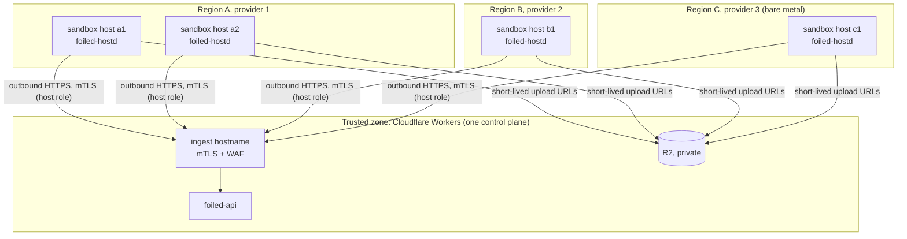

# Cloud sketch: research sensors in more than one region

Status: Sketch, not MVP. Owner: #7. Related: #4 (network isolation), #8 (rotation), #16 (retention and data location), #31 (enrolment), #40 (Workers control plane), #41 (host agent).

The MVP is one sandbox host ([modes.md](modes.md)). A radar needs more vantage points. This sketch shows how research sensors grow to several regions and providers without changing the trust model. Terraform modules and Kubernetes operators are out of scope for #7.

## Shape

## Rules

- **The control plane is always outside the hostile networks.** It runs on Workers. No sandbox host, cloud VPC or provider network ever hosts a control-plane component, a database or a copy of a secret.
- **Every host is a research sensor built with [vps.md](vps.md)**, with its own mTLS identity (host role, #31). Hosts do not share keys, and no host can see another host's jobs or evidence (#41).
- **No network path between hosts.** No VPC peering, shared private network or VPN mesh between sandbox hosts. The private management path (WireGuard or Tailscale) is for operators to reach hosts; ACLs block host to host traffic on it.
- **Hosts dial out, nothing dials in.** The same outbound-only egress rules apply in every region: Cloudflare (ingest and R2), update endpoints, DNS and time.
- **Spread across providers and networks.** Different ASNs and regions give the radar more diverse vantage points and stop one provider's abuse desk or outage from taking the whole fleet offline. Record the provider and ASN per host in the host registry (D1) so the radar (#35) can weight by vantage point.
- **Each host is disposable.** A compromised host is revoked and rebuilt, not cleaned in place (#8, #31).

## Running on a public cloud

The same rules carry over to a cloud VM, with a few cloud-specific additions:

| Cloud concern | Rule |
| --- | --- |
| Account or project | A separate cloud account or project for sandbox hosts, with nothing else in it. Never the account that holds anything trusted. |
| Instance identity | No instance role, service account or managed identity with any cloud API permission. A compromised host must not be able to call the cloud's own APIs. |
| Instance metadata service | Block it from the sandboxes (#4 forward chain) and from the agent (`IPAddressDeny=link-local` in `foiled-hostd.service`). On providers that support it, require session tokens and set the hop limit to 1. |
| Security groups or cloud firewall | Mirror the host firewall: inbound only the published decoy ports on the decoy IP, nothing else public; outbound only what [vps.md](vps.md) lists. Keep the host firewall as well; the cloud firewall is a second layer, not a replacement. |
| Nested virtualisation | Firecracker needs KVM. Use instance types with nested virtualisation or bare-metal instances. Without KVM the host can only run the Docker fallback, which is not for public exposure. |
| Public IPs | A dedicated static IP for the decoy frontend, so rotation (#8) can keep the same address. |
| Snapshots and backups | Off for guest volumes. If you snapshot the capture volume, encrypt it and apply the same retention as #16. |
| Cost | Egress to R2 is the main variable. Use capture caps from [vps.md](vps.md) and upload only what #9 needs. |

## Data location

Evidence lands in R2 from every region. If an operator needs captures to stay in one jurisdiction, use an R2 bucket with a jurisdiction restriction for that operator's evidence and record the choice per host. #16 owns the retention and personal information rules that apply whatever the region.

## Not covered here

- Edge sensors on customers' hosts: #31.
- Infrastructure as code (Terraform modules) and Kubernetes operators: later, out of scope for #7.
- Cross-host live migration of decoys: out of scope (#8).
