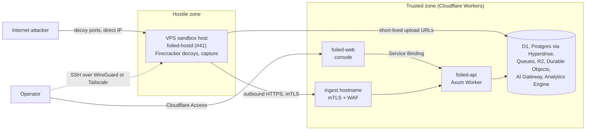

# Deployment modes

Status: Draft for the MVP. Owner: #7. Related: #31 (edge sensors), #40 (Workers control plane), #41 (host agent), #35 (radar).

Foiled has three kinds of deployment. Two run decoys, one runs the trusted side.

| | Research sensor | Edge sensor | Central backend |
| --- | --- | --- | --- |
| What it is | A sandbox host we (or a self-hosting operator) run, with the full runtime and capture on the box. | A lightweight sensor on someone else's host that forwards telemetry to a central backend. | The control plane, ingest, attempts, confidence and radar on Cloudflare Workers. |
| Runs | `foiled-hostd` (#41), Firecracker micro-VMs (#3), emulation modules (#30), the network boundary (#4), capture (#9). | Mostly emulations (#30), or a thin proxy that forwards connections. Full Firecracker is optional and documented as heavy (#31). | `foiled-api`, `foiled-web`, `foiled-site` Workers, D1, Postgres via Hyperdrive, Queues, R2, Durable Objects, AI Gateway, Analytics Engine (#40). |
| Whose host | Ours, or the operator's own. | The customer's or a fleet partner's. | Cloudflare. |
| Trust | Hostile zone. Holds only its own mTLS identity. | Hostile zone on a host we do not control. Holds only its own mTLS identity, bound to one tenant. | Trusted zone. Holds all secrets and data stores. |
| Talks to the backend | Dials out over HTTPS with mTLS (host role). | Dials out over HTTPS with mTLS (sensor role). | Never dials into a sensor or host. |
| Offline behaviour | Decoys keep running, events buffer locally (1 GiB, oldest-drop), backlog drains on reconnect (#41). | Same buffer semantics (#31). | Not applicable. |
| Guide | [vps.md](vps.md) | #31 (`docs/deploy/edge-sensor.md`, planned) | [workers.md](workers.md) |
| Milestone | **MVP** | **Not MVP.** v0.2 (#31). | **MVP** |

## MVP topology

The MVP is exactly **one Workers control plane plus one VPS sandbox host running the host agent (#41)**.

No edge sensors, no second host, no tenancy beyond a single operator org. Everything else in this folder is the path beyond the MVP.

## What crosses each boundary

### Research sensor and central backend

| Direction | Crosses | Never crosses |
| --- | --- | --- |
| Host to backend | Heartbeats (health, KVM present, free disk, running decoys, agent version, clock skew). Capture envelopes (#9) in batches. Job results. Evidence uploads (pcaps, file diffs, quarantined payloads) straight to R2 through short-lived single-object URLs, with only a `payload_ref` in the event. | Shell access, logs of the operator's SSH sessions, anything from other hosts. Large artefacts never pass through a Worker request body. |
| Backend to host | Signed jobs with expiry and idempotency key (`decoy.create`, `decoy.stop`, `decoy.rotate` and the others in #41). Short-lived upload URLs. Catalogue digests for the local allow-list. Release metadata for signed updates. | Database credentials, admin or operator tokens, Cloudflare API tokens, R2 credentials, other hosts' data, free-form commands. The backend never opens a connection to the host. |

### Edge sensor and central backend (not MVP, #31)

| Direction | Crosses | Never crosses |
| --- | --- | --- |
| Sensor to backend | Capture envelopes (#9) and attempt summaries (#25), heartbeats, enrolment requests with a one-time bootstrap token. Pcaps, if the sensor captures them, by R2 reference. | Anything from other tenants. Confidence scores or CVE links decided on the sensor; the backend computes confidence from evidence (threat model C24). |
| Backend to sensor | The sensor's identity certificate, its decoy configuration, revocation, signed release metadata. | Database credentials, admin tokens, other tenants' data, other sensors' identities. |

### Operators, the public and the central backend

| Direction | Crosses | Never crosses |
| --- | --- | --- |
| Operator browser to console | Console traffic, after Cloudflare Access (identity provider and MFA). | Anything without an Access session. |
| MCP and scripts to API | Scoped API calls (#21, #24), after Access service token and bearer token checks. | Admin scopes on tokens minted for automation, unless an operator grants them on purpose. |
| Backend to public site | Published, confidence-gated, redacted and delayed data (#35, #37). | Tenant identifiers, raw payloads, paid enrichment fields (#38), anything below the publish threshold. |
| Backend to third parties | Observables only (IP, hash, domain) to enrichment providers (#11); redacted text to the LLM via AI Gateway (#28). | Payloads, personal information beyond what #16 allows. Enrichment results are never resold or republished. |

## Edge mode (not MVP)

Edge sensors are **not part of the MVP**. Their design lives in #31: enrolment with a one-time bootstrap token, mTLS identity certificates, renew and revoke flows, signed builds and update verification, the offline buffer, and tenancy (`tenant_id` on sensors, decoys and attempts, with token scopes that cannot cross tenants). Do not build edge features before #31's ADR (`docs/adr/0007-edge-ingest.md`, planned) is accepted.

### Tabletop: edge sensor compromise

Scenario: an attacker gets root on a customer's edge sensor host, takes the sensor's private key and certificate, and tries to turn them into control-plane admin access.

Expected outcome: **the stolen identity cannot mint control-plane admin tokens.** It can at most ingest as that one sensor, for that one tenant, until it is revoked. The controls below are expected to be implemented in #31 (with #21 for token scopes). This table is the acceptance test for them.

| Step | Attacker action | Expected control (implemented in #31 unless noted) | Expected result |
| --- | --- | --- | --- |
| 1 | Copies the sensor's key and certificate to their own machine. | Identity is a client certificate from the Cloudflare-managed CA, bound in D1 to one sensor and one tenant. Anomaly flag when the sensor's source IP or ASN jumps unexpectedly. | Connection works from the new IP, and an anomaly is raised for the operator. |
| 2 | Calls admin or token-minting routes on the ingest hostname. | The ingest hostname serves only ingest and lease routes; everything else returns 404 there ([workers.md](workers.md)). | 404. |
| 3 | Calls the console or API hostname with the client certificate. | Those hostnames require Cloudflare Access and a scoped bearer token (#21). A client certificate is not a credential there. | Blocked by Access. |
| 4 | Calls a token-minting endpoint with the sensor identity anyway. | The sensor role has ingest scopes only. Minting tokens needs a human operator session with an admin scope, through Access with MFA (#21). Sensor and host roles are listed side by side with human roles in #31 and none of them can mint tokens. | 403, audited. |
| 5 | Reuses the one-time bootstrap token to enrol a second, "clean" sensor. | Bootstrap tokens are single use, short-lived and deleted from the sensor after enrolment. | Rejected. |
| 6 | Sends events claiming another sensor or tenant. | Identity and `tenant_id` are stamped from the certificate, never read from the event body (threat model C20). | Events are recorded as the stolen sensor, in its own tenant only. |
| 7 | Sends events that set a high confidence or a CVE link. | Confidence is computed from evidence on the backend, never accepted from an event (C24, #27). | No effect on confidence beyond ordinary evidence. |
| 8 | Floods ingest to hide activity or exhaust the queue. | Per-identity rate limits and schema validation before enqueue; 128 KB message cap (#9). | Excess rejected; alert raised (#15). |
| 9 | Looks for credentials on the sensor host. | The sensor holds no database credentials, no admin tokens and no Cloudflare API tokens (#31 constraint, threat model C17). | Nothing to find. |
| 10 | Keeps using the key after discovery. | Revocation of the Cloudflare-managed client certificate; the WAF rule blocks revoked certificates and the Worker rejects unknown fingerprints (#31). | Blocked at the edge after revocation. |

The same table applies to a stolen research-sensor host certificate, with the host role in place of the sensor role (#41). The VPS-side controls are mapped in [vps.md](vps.md#threat-model-mapping).

## Scaling past one host

For more research sensors in more regions, see [cloud-sketch.md](cloud-sketch.md). The control plane stays on Workers and outside every hostile network in every layout.

## Rotation

Decoy rotation and reset (compromised or aged sandboxes) are owned by #8 ([rotation](../rotation.md), planned). Certificate renewal and revocation for hosts and sensors are owned by #31.
