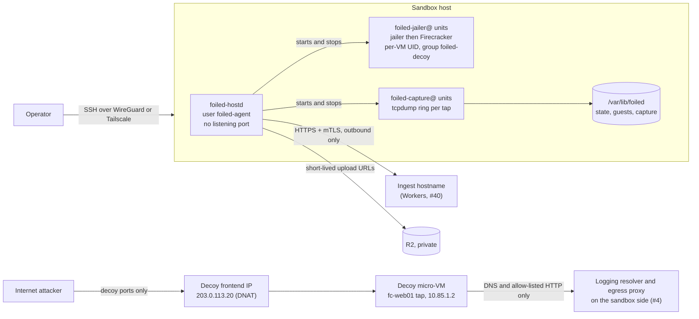

# Research sensor on a VPS

Status: Draft for the MVP. Owner: #7. Related: #3 (runtime), #4 (network isolation), #8 (rotation), #9 (capture), #31 (enrolment and mTLS), #40 (Workers control plane), #41 (host agent).

This guide brings up one **research sensor**: a Linux host you control that runs decoys, captures what hits them, and reports to the Foiled control plane on Cloudflare Workers. It is the only sensor mode in the MVP. See [modes.md](modes.md) for how it compares with edge sensors and the central backend.

The control plane does **not** run on this host. It runs on Workers ([workers.md](workers.md), #40). The host runs the sandbox host agent `foiled-hostd` (#41), which dials out to the control plane. Nothing on the host accepts management traffic from the internet.

Placeholders used below: `203.0.113.10` is the host's primary public IP, `203.0.113.20` is the decoy frontend IP, `ingest.example.com` is the ingest hostname. Replace them with your own values and keep your real values out of this repository.

## Contents

- [Requirements](#requirements)
- [Host layout](#host-layout)
- [Linux users](#linux-users)
- [Interfaces and ports](#interfaces-and-ports)
- [Disk layout](#disk-layout)
- [Host firewall](#host-firewall)
- [Private management path](#private-management-path)
- [Services](#services)
- [Bring-up checklist](#bring-up-checklist)
- [Verification](#verification)
- [Docker fallback (not for public exposure)](#docker-fallback-not-for-public-exposure)
- [Threat-model mapping](#threat-model-mapping)
- [Rotation and rebuild](#rotation-and-rebuild)

## Requirements

| Item | Requirement | How to check |
| --- | --- | --- |
| OS | Ubuntu Server LTS (24.04 or 26.04), minimal install, x86_64 or arm64. | `lsb_release -a` |
| KVM | `/dev/kvm` present. On a VPS this needs a provider that offers nested virtualisation, or a dedicated or bare-metal server. Without KVM you can only run the [Docker fallback](#docker-fallback-not-for-public-exposure), which is not for public exposure. | `ls -l /dev/kvm` and `grep -cE 'vmx\|svm' /proc/cpuinfo` (non-zero) |
| Size (starting point) | 4 vCPU, 8 GiB RAM, a 30 GiB system disk and a second block device of at least 120 GiB for Foiled data. One web decoy plus capture fits comfortably. Add about 1 vCPU and 1 GiB RAM per extra micro-VM. | `nproc`, `free -g`, `lsblk` |
| Public IPs | One primary IPv4 for the host's own outbound traffic. A second, dedicated IPv4 for decoys is recommended so the decoy frontend and the host's own address are separate. IPv6 off on the decoy frontend for the MVP (#4). | Provider panel |
| Provider terms | The provider allows honeypots and deliberately vulnerable software, and you know its abuse contact process. | Provider terms, in writing |
| Control plane | A deployed Foiled control plane ([workers.md](workers.md)) with the ingest hostname protected by mTLS, and an enrolment token for this host (#31, host role). | Console shows the host as pending |

Read the operator responsibilities checklist in [threat model](../threat-model.md) (#2) before exposing any decoy.

## Host layout



Rules that hold for the whole host:

- `foiled-hostd` dials out to the control plane over HTTPS with an mTLS client certificate. It never listens on a TCP or UDP port. The control plane never connects in (#41).
- No management service (SSH, metrics, agent API, database) listens on a public IP. SSH is reachable only over a private path such as WireGuard or Tailscale.
- Only the decoy frontend publishes ports, and only the ports listed in each decoy's catalogue entry (#5), through DNAT into the decoy (#4).
- The host runs nothing else: no control plane, no database, no unrelated workloads.
- The host holds no database credentials, no admin tokens and no Cloudflare API tokens. Its only credential is its own mTLS identity.

## Linux users

| User | Type | Login | Runs | Owns or can write | Notes |
| --- | --- | --- | --- | --- | --- |
| Your admin account (for example `ops`) | Human | SSH key only, over the private path. `sudo` with a password. | Interactive admin | Home directory | No password SSH, no root SSH. One named account per person. |
| `foiled-agent` | System user and group, `/usr/sbin/nologin`, home `/var/lib/foiled` | None | `foiled-hostd.service`, `foiled-capture@.service` | `/var/lib/foiled` (state, buffer, capture). Reads `/etc/foiled/hostd.toml` and its key in `/etc/foiled/tls/`. | No sudo. Not in `docker`, `kvm`, `adm` or `sudo` groups. Can start and stop only `foiled-jailer@` and `foiled-capture@` units, through the polkit rule below. |
| `foiled-decoy` | System user and group, `/usr/sbin/nologin`, no home | None | Group for every decoy micro-VM. The jailer runs each Firecracker process as a per-VM UID from a reserved range (example: 200000 to 200999) with primary group `foiled-decoy`, so no two VMs share a UID (threat model C3). | Only its own jail directory under `/srv/jailer` and its own writable guest overlay under `/var/lib/foiled/guests/decoys/<id>/` | Never used for anything outside decoys. Emulation module containers (#30) also run as `foiled-decoy` (rootless) if #3 picks that path. |
| `root` | System | Console only, no SSH | systemd, nftables, the jailer before it drops privileges, `foiled-vmctl` | Everything | Used only by systemd units with fixed command lines. |

Create the service accounts:

```sh
sudo groupadd --system foiled-agent
sudo useradd --system --gid foiled-agent --home-dir /var/lib/foiled --no-create-home --shell /usr/sbin/nologin foiled-agent
sudo groupadd --system foiled-decoy
sudo useradd --system --gid foiled-decoy --no-create-home --shell /usr/sbin/nologin foiled-decoy
```

The UID range for micro-VMs must not overlap any real account. Check `/etc/login.defs` (`SYS_UID_MAX`, `UID_MAX`) and `/etc/subuid` before picking it.

## Interfaces and ports

### Interfaces

| Interface | Example | What listens on it | What may reach it |
| --- | --- | --- | --- |
| Primary public (`eth0`), primary IP | `203.0.113.10` | Nothing. | Return traffic for the host's own outbound connections only. |
| Primary public (`eth0`), decoy frontend IP | `203.0.113.20` | Nothing on the host itself. Published decoy ports are DNAT'd straight into the decoy (#4). | Anyone, on published decoy ports only. |
| Private management (`tailscale0` or `wg0`) | Tailnet or WireGuard address | `sshd` on 22/tcp. | Operators on your private network only. |
| Sandbox side (taps `fc-<id>`, or the bridge from ADR 0003) | `10.85.0.0/16` | The logging resolver and egress proxy from #4, on the sandbox gateway address only. | Decoys, for DNS and allow-listed egress only. Nothing else on the host (threat model C16). |
| Loopback (`lo`) | `127.0.0.1`, `::1` | Local-only helpers, if any. `foiled-hostd` uses a Unix socket in `/run/foiled-hostd/`, not a TCP port. | The host itself. |

### Inbound ports

| Port | Protocol | Interface | Listener | Purpose |
| --- | --- | --- | --- | --- |
| Published decoy ports, for example 80 and 443 for a web decoy | TCP | Decoy frontend IP only | The decoy, via DNAT (#4) | Attack surface. Set per decoy by its catalogue entry (#5). |
| 22 | TCP | `tailscale0` or `wg0` only | `sshd` | Operator management. Never on a public IP. Because management SSH is not public, 22/tcp on the decoy frontend is free for an SSH decoy (#30). |
| 53 (example, ADR 0003 sets it) | UDP and TCP | Sandbox side only | Logging resolver (#4) | DNS for decoys. |
| 3128 (example, ADR 0003 sets it) | TCP | Sandbox side only | Logging egress proxy (#4) | Allow-listed egress for decoys. Empty allow-list by default. |
| None | | | `foiled-hostd` | The agent has no listening port at all. |

### Outbound connections from the host

| Destination | Port | Process | Why |
| --- | --- | --- | --- |
| Ingest hostname (`ingest.example.com`, on Cloudflare) | 443/tcp | `foiled-hostd` | Job leases, capture envelopes, heartbeats. mTLS client certificate required (#31, #41). |
| R2 S3 endpoint (`<account-id>.r2.cloudflarestorage.com`, on Cloudflare) | 443/tcp | `foiled-hostd` | Uploads pcaps, file diffs and quarantine with short-lived single-object URLs (#9). The real hostname contains your account ID, so it lives only in host config, never in this repo. |
| Update endpoints: Ubuntu archive and security mirrors, and the Foiled release host | 80/tcp, 443/tcp | `apt`, `unattended-upgrades`, release download | OS security updates. Signed Foiled releases (#31 signing rules). |
| DNS resolver you pin (for example a public resolver over DNS over TLS) | 53, 853 | `systemd-resolved`, the sandbox logging resolver | Name resolution. |
| Time source (for example `time.cloudflare.com`) | 123/udp | `chrony` or `systemd-timesyncd` | Job expiry checks and heartbeats depend on a correct clock (#41). |
| Private path coordination (Tailscale control and relay servers, or your WireGuard hub) | Provider-specific | `tailscaled` or the kernel WireGuard peer | Keeps the management path up. The host dials out, so no inbound public port is needed. |

Everything else outbound is dropped and counted. Decoy egress is a separate path through the forward chain and proxy that #4 owns; the table above is only for the host's own processes.

## Disk layout

Put Foiled data on its own block device, split into logical volumes so a full capture volume cannot fill the system disk, and a decoy filling its disk cannot starve capture.

| Mount | Backing | Size (for 120 GiB data disk) | Mount options | Owner and mode | Holds |
| --- | --- | --- | --- | --- | --- |
| `/` | System disk | 30 GiB | defaults | root | OS, `/usr/local/bin/foiled-hostd`, `/usr/local/lib/foiled/` (jailer, Firecracker, helpers), `/srv/jailer` (VM chroots, needs exec), `/etc/foiled/` |
| `/var/lib/foiled` | LV `foiled/state` | 10 GiB | `nodev,nosuid,noexec` | `foiled-agent:foiled-agent 0750` | Agent state, the offline event buffer in `buffer/` (#41, #31), staged release downloads |
| `/var/lib/foiled/guests` | LV `foiled/guests` | 55 GiB | `nodev,nosuid,noexec` | `foiled-agent:foiled-decoy 0750` | `images/`: catalogue images by digest, read-only to decoys (#5, #6). `decoys/<id>/`: per-decoy writable overlays, wiped on rotation and never reused (#8). |
| `/var/lib/foiled/capture` | LV `foiled/capture`, optionally LUKS2 | 45 GiB | `nodev,nosuid,noexec` | `foiled-agent:foiled-agent 0700` | Pcap rings, file-system diffs and quarantine staging waiting for upload to R2 (#9). Never mounted into any decoy. |
| `/var/log/journal` | System disk | capped at 2 GiB | | root | journald, with `SystemMaxUse=2G` in `/etc/systemd/journald.conf` |

Leave the remaining 10 GiB of the volume group free so you can grow a volume later with `lvextend -r`.

```sh
# Example with the data disk at /dev/vdb. Check lsblk first: this wipes the device.
sudo pvcreate /dev/vdb
sudo vgcreate foiled /dev/vdb
sudo lvcreate -L 10G -n state foiled
sudo lvcreate -L 55G -n guests foiled
sudo lvcreate -L 45G -n capture foiled
sudo mkfs.ext4 -L foiled-state /dev/foiled/state
sudo mkfs.ext4 -L foiled-guests /dev/foiled/guests
sudo mkfs.ext4 -L foiled-capture /dev/foiled/capture   # skip if you use the encrypted option below
```

`/etc/fstab` entries (capture shown unencrypted; see the next section for the encrypted option):

```text
/dev/foiled/state    /var/lib/foiled          ext4  nodev,nosuid,noexec  0 2
/dev/foiled/guests   /var/lib/foiled/guests   ext4  nodev,nosuid,noexec  0 2
/dev/foiled/capture  /var/lib/foiled/capture  ext4  nodev,nosuid,noexec  0 2
```

### Encrypted capture volume (option)

Pcaps and quarantined payloads can hold personal information and data stolen from other victims (#16). Encrypting the capture volume protects it if the provider's disk, snapshot or backup leaks, and lets you crypto-erase it when you decommission the host by destroying the LUKS header. It does not protect against someone who has root on the running host.

Pick how the key is supplied:

| Option | Unlock | Protects against | Cost |
| --- | --- | --- | --- |
| A. Passphrase typed over the private path after each boot (recommended for research sensors) | `crypttab` with `noauto`; an operator runs `systemctl start systemd-cryptsetup@capture.service` over SSH | Disk images, snapshots and backups taken while the host is off or by the provider | Capture is down after a reboot until someone unlocks it. Decoys that need capture do not start until then. |
| B. TPM2-sealed key (`systemd-cryptenroll --tpm2-device=auto`) | Automatic at boot | Disks moved to another machine | Needs a TPM or vTPM, which most VPS products do not offer. |
| C. Key file on the system disk | Automatic at boot | Very little; only crypto-erase at decommission | Do not treat this as encryption at rest. |

```sh
# Option A
sudo cryptsetup luksFormat --type luks2 /dev/foiled/capture
sudo cryptsetup open /dev/foiled/capture capture
sudo mkfs.ext4 -L foiled-capture /dev/mapper/capture
```

```text
# /etc/crypttab
capture  /dev/foiled/capture  none  luks,noauto

# /etc/fstab (replaces the plain capture line above)
/dev/mapper/capture  /var/lib/foiled/capture  ext4  nodev,nosuid,noexec,noauto,nofail,x-systemd.requires=systemd-cryptsetup@capture.service  0 2
```

`foiled-capture@.service` has `RequiresMountsFor=/var/lib/foiled/capture`, so capture never writes to the underlying directory on the state volume when the encrypted volume is locked. The agent reports capture as unavailable in its heartbeat and does not start decoys whose catalogue entry requires capture.

### Pcap disk caps

These are the defaults for the MVP. #9 owns the final numbers.

| Cap | Default | Enforced by |
| --- | --- | --- |
| Per-decoy ring | 20 files of 100 MB each, about 2 GB per decoy. The oldest file is overwritten when the ring wraps. | `tcpdump -C 100 -W 20` in `foiled-capture@.service` |
| Snap length | Full packets by default. Set a short snap length (for example `-s 256`) for header-only capture where #16 minimisation calls for it. | `foiled-capture@.service` |
| Upload and delete | Closed ring files are uploaded to R2 and deleted locally once the upload is confirmed. Local copies are a staging area, not an archive. R2 retention follows #16 (pcaps 14 days by default). | `foiled-hostd` |
| Pressure warning | Capture volume above 80% used: the agent raises `capture_disk_pressure` (#15) and refuses new decoy launches. | `foiled-hostd` |
| Hard stop | Capture volume above 95% used: the agent stops capture units for the oldest unpublished decoys first, keeps published decoys capturing, and reports it in the heartbeat. | `foiled-hostd` |
| Volume ceiling | The capture logical volume size (45 GiB above). Capture cannot spill onto the system disk or the state volume. | LVM |
| Offline buffer | Event buffer in `/var/lib/foiled/buffer` capped at 1 GiB with oldest-drop, same semantics as edge sensors. | `foiled-hostd` (#41, #31) |

## Host firewall

The host firewall covers the host's own traffic: input to the host and output from host processes. The decoy path (DNAT, forward chain, sandbox egress) lives in its own table owned by #4 (`configs/nftables/honeypot.nft`, planned). Keep the two tables separate. A packet dropped by any base chain on a hook is dropped, so this table never needs a forward chain.

Egress from the host is allowed only to the ingest hostname, R2, update endpoints, DNS and time. The ingest hostname and R2 sit on Cloudflare anycast addresses, so an IP rule can only narrow egress to Cloudflare's published ranges, not to one hostname. The hostname-level control is that `foiled-hostd` only ever connects to the hostnames in its config and pins the ingest server certificate. If you want the firewall itself to enforce hostnames, route the agent through a local forward proxy that allows by SNI; that is optional for the MVP.

```nft
# /etc/nftables.d/foiled-host.nft (example; load from /etc/nftables.conf)
table inet foiled_host {
  # Filled by the refresh script below. Cloudflare ranges cover the ingest hostname,
  # R2 and time.cloudflare.com.
  set cloudflare_v4 { type ipv4_addr; flags interval; }
  set cloudflare_v6 { type ipv6_addr; flags interval; }
  set updates_v4    { type ipv4_addr; flags interval; }
  set updates_v6    { type ipv6_addr; flags interval; }
  set resolvers_v4  { type ipv4_addr; elements = { 1.1.1.1, 1.0.0.1 }; }

  chain input {
    type filter hook input priority filter; policy drop;
    iif "lo" accept
    ct state established,related accept
    ct state invalid drop
    # Management SSH only over the private path. Never on a public IP.
    iifname { "tailscale0", "wg0" } tcp dport 22 accept
    # Decoys may reach only the logging resolver and egress proxy (#4). Ports are examples;
    # rename "fc-*" to match the sandbox-side interfaces ADR 0003 defines.
    iifname "fc-*" udp dport 53 accept
    iifname "fc-*" tcp dport { 53, 3128 } accept
    iifname "fc-*" counter drop
    # Basic ICMP so the host behaves like a normal server.
    icmp type { echo-request, destination-unreachable, time-exceeded } limit rate 10/second accept
    icmpv6 type { echo-request, destination-unreachable, packet-too-big, time-exceeded, parameter-problem, nd-neighbor-solicit, nd-neighbor-advert, nd-router-advert } accept
    counter drop
  }

  chain output {
    type filter hook output priority filter; policy drop;
    oif "lo" accept
    ct state established,related accept
    # Traffic inside the private management tunnel.
    oifname { "tailscale0", "wg0" } accept
    # The tunnel itself. Tailscale: match the tailscaled service by cgroup.
    # WireGuard instead: ip daddr <hub-ip> udp dport <hub-port> accept
    socket cgroupv2 level 2 "system.slice/tailscaled.service" accept
    # DNS and DNS over TLS to the pinned resolvers only.
    ip daddr @resolvers_v4 udp dport 53 accept
    ip daddr @resolvers_v4 tcp dport { 53, 853 } accept
    # Time.
    ip daddr @cloudflare_v4 udp dport 123 accept
    # Ingest hostname and R2: Cloudflare ranges, HTTPS only.
    ip daddr @cloudflare_v4 tcp dport 443 accept
    ip6 daddr @cloudflare_v6 tcp dport 443 accept
    # OS updates and signed Foiled releases.
    ip daddr @updates_v4 tcp dport { 80, 443 } accept
    ip6 daddr @updates_v6 tcp dport { 80, 443 } accept
    # IPv6 neighbour discovery and path MTU.
    meta l4proto ipv6-icmp accept
    limit rate 5/minute log prefix "foiled-host-egress-drop "
    counter drop
  }
}
```

Notes on the rules:

- `tailscaled` runs as root on Ubuntu, so a user match would open egress for every root process. The `socket cgroupv2` match limits the exception to the `tailscaled` service. nftables resolves the cgroup path when the ruleset loads, so load this table after `tailscaled` has started (for example with a drop-in `After=tailscaled.service` on `nftables.service`, or reload the ruleset once Tailscale is up). With plain WireGuard, make the sensor the peer that dials out to your hub with `PersistentKeepalive` set, and allow only UDP to the hub's address and port.
- Replies to decoys from the sandbox-side resolver and proxy are covered by the `established,related` rule.
- The sandbox logging resolver and egress proxy (#4) make their own upstream connections from the host. DNS upstream is covered by the resolver rule. When an operator adds a destination to a decoy's egress allow-list (empty by default, threat model C10), the matching output rule belongs in #4's config and should match the proxy's service user with `meta skuid`, never open egress for every host process.
- Never allow SMTP (25, 465, 587) or IRC from the host or the sandboxes (threat model C11).

Refresh script for the address sets, run daily from a root systemd timer (sketch):

```sh
#!/bin/sh
# /usr/local/lib/foiled/refresh-egress-sets
set -eu
fill() { # $1 set name, then addresses or ranges on stdin
  nft flush set inet foiled_host "$1"
  nft add element inet foiled_host "$1" "{ $(paste -sd, -) }"
}
curl -fsS https://www.cloudflare.com/ips-v4 | fill cloudflare_v4
curl -fsS https://www.cloudflare.com/ips-v6 | fill cloudflare_v6
# Update endpoints: resolve the mirrors and the release host you actually use.
for h in archive.ubuntu.com security.ubuntu.com; do dig +short A "$h"; done | grep -E '^[0-9.]+$' | sort -u | fill updates_v4
for h in archive.ubuntu.com security.ubuntu.com; do dig +short AAAA "$h"; done | grep ':' | sort -u | fill updates_v6
```

Add your Foiled release host to the `for` loops once signed releases exist (#31). Until then, install agent updates by hand over the private path.

## Private management path

SSH is reachable only over WireGuard or Tailscale. Set this up first, while you still have the provider's console as a fallback.

1. Install Tailscale (or WireGuard) and join the host to your private network. Use an identity provider with hardware-key MFA for the tailnet, and an ACL that lets only operator devices reach port 22 on sensors.
2. Confirm you can SSH in over the private address.
3. Load the host firewall above. Public 22/tcp is now dropped by the input chain.
4. Harden `sshd`: `PasswordAuthentication no`, `KbdInteractiveAuthentication no`, `PermitRootLogin no`, `AllowUsers ops` (your admin accounts). Optionally add `ListenAddress` for the private address as a second layer. Ubuntu starts `sshd` through `ssh.socket`, and a socket bound to a Tailscale or WireGuard address fails if that interface is not up yet at boot, so treat the firewall as the primary control and `ListenAddress` as defence in depth.
5. Tailscale SSH is a reasonable alternative to `sshd` if you want SSH tied to tailnet identity. The same rule applies: nothing on a public IP.

The provider's out-of-band console stays the break-glass path. Protect the provider account with hardware-key MFA too.

## Services

Suggested systemd units live in `deploy/systemd/`. They describe the intended privilege split; the binaries they call are built in #41, #3 and #4.

| Unit | Runs as | Capabilities | Does |
| --- | --- | --- | --- |
| [`foiled-hostd.service`](../../deploy/systemd/foiled-hostd.service) | `foiled-agent` | None | The agent. Leases jobs, verifies signatures, digests and expiry, writes per-decoy job specs and `jailer.env` under `/var/lib/foiled/guests/decoys/<id>/`, starts and stops the units below, uploads evidence, sends heartbeats. |
| [`foiled-jailer@.service`](../../deploy/systemd/foiled-jailer@.service) | root, then a per-VM UID in group `foiled-decoy` | Root only until the jailer drops privileges | One unit per decoy. `foiled-vmctl` validates the job spec against fixed policy, stages the image, creates the netns, tap and DNAT. The jailer then runs Firecracker. Never restarts on its own (threat model C4). |
| [`foiled-capture@.service`](../../deploy/systemd/foiled-capture@.service) | `foiled-agent` | `CAP_NET_RAW` | One unit per decoy tap. Writes the pcap ring to the capture volume. |

Why the agent has no capabilities: creating taps and editing nftables needs `CAP_NET_ADMIN`, and with that capability a compromised agent could flush the sandbox egress rules (#4). Instead, network setup happens in the root-run `foiled-vmctl` step of each `foiled-jailer@` unit, which takes no free-form rules: guest addresses must fall inside `10.85.0.0/16`, published ports must come from the decoy's catalogue entry, egress rules are never opened, and the image digest must be on the local allow-list. If ADR 0008 (#41) moves network setup into the agent, its bounding set becomes `CAP_NET_ADMIN` and nothing else, and the template says so in a comment.

The agent starts and stops those units through systemd over D-Bus. Allow exactly that with a polkit rule:

```js
// /etc/polkit-1/rules.d/50-foiled-hostd.rules
polkit.addRule(function (action, subject) {
  if (action.id === "org.freedesktop.systemd1.manage-units" &&
      subject.user === "foiled-agent") {
    var unit = action.lookup("unit");
    var verb = action.lookup("verb");
    if (unit && /^foiled-(jailer|capture)@[a-z0-9-]{1,12}\.service$/.test(unit) &&
        (verb === "start" || verb === "stop")) {
      return polkit.Result.YES;
    }
  }
});
```

Decoy IDs on the host are short (at most 12 characters) because tap names such as `fc-<id>` must fit the Linux 15-character interface name limit.

Files the agent needs:

| Path | Owner and mode | Content |
| --- | --- | --- |
| `/etc/foiled/hostd.toml` | `root:foiled-agent 0640` | Ingest URL, host ID, R2 endpoint, buffer cap, control-plane job-signing public key. No secrets. |
| `/etc/foiled/tls/host.key` | `foiled-agent:foiled-agent 0400` | The host's mTLS private key, generated on the host during enrolment (#31). Never copied off the host. |
| `/etc/foiled/tls/host.crt` | `root:foiled-agent 0644` | Client certificate from the Cloudflare-managed CA. |
| `/etc/foiled/allowlist/` | `root:foiled-agent 0750` | Catalogue digests this host may run (#5, #6). |

TLS for decoys that need a real certificate (so the decoy looks less fake) is terminated inside the decoy path, not on the host. #4 records the frontend choice. Caddy's automatic HTTPS or certbot both work; HTTP-01 challenges need port 80 published on the decoy frontend. Certificates appear in Certificate Transparency logs, so use a decoy domain that has no link to your control-plane domain (see [cloudflare.md](cloudflare.md)).

## Bring-up checklist

1. Provision Ubuntu Server LTS. Confirm KVM, size and provider terms from [Requirements](#requirements).
2. Create your named admin account with an SSH key. Set up the [private management path](#private-management-path) and confirm SSH over it.
3. Install base packages: `sudo apt install nftables chrony unattended-upgrades cryptsetup lvm2 tcpdump`. Enable `unattended-upgrades` for security updates.
4. Create the [Linux users](#linux-users).
5. Build the [disk layout](#disk-layout), including the encrypted capture volume if you chose it. Cap journald at 2 GiB.
6. Load the [host firewall](#host-firewall) and the refresh timer. From this point there is no public SSH.
7. Apply the sandbox network config from ADR 0003 (#4): bridge or taps, forward chain, logging resolver, egress proxy.
8. Install the jailer, Firecracker and `foiled-vmctl` to `/usr/local/lib/foiled/` (root-owned, `0755`), and `foiled-hostd` to `/usr/local/bin/`.
9. Enrol the host (#31, host role): the agent generates its key on the host, uses the one-time enrolment token, and stores the certificate. Delete the enrolment token afterwards.
10. Install the systemd units and polkit rule, then `sudo systemctl enable --now foiled-hostd`.
11. Run every check in [Verification](#verification). Only then let the console publish a decoy.

## Verification

Run these after bring-up and after every host change. #41 owns the automated version of the "no management port" check.

| Check | Command | Expected |
| --- | --- | --- |
| No listener on a public address | `sudo ss -H -tulpn` | Every listener is on `127.0.0.1`, `::1`, the private management address or the sandbox gateway address. Nothing on `203.0.113.10`, `203.0.113.20`, `0.0.0.0` or `[::]`. |
| No management port reachable from outside | From a machine you own, outside the private network: `nmap -Pn -sS -p- 203.0.113.10 203.0.113.20` and `nmap -Pn -sU --top-ports 200 203.0.113.10 203.0.113.20` | Only the published decoy ports on `203.0.113.20`. Nothing open on `203.0.113.10`. Scan only addresses you are responsible for. |
| Agent hardening | `systemd-analyze security foiled-hostd.service` | Exposure rated "OK" or better. Review anything flagged medium or above. |
| Agent has no listening socket | `sudo ss -H -tulpn \| grep foiled-hostd` | No output. |
| Host egress is narrow | `curl -m 5 -sS https://example.org` on the host | Fails (timeout or reset). |
| Ingest is reachable and needs a client certificate | `curl -m 5 -sS -o /dev/null -w '%{http_code}\n' https://ingest.example.com/` without a certificate | `403` from the WAF rule (#31). With the host certificate, the agent's heartbeat appears in the console. |
| Agent cannot touch other units | `sudo -u foiled-agent systemctl stop ssh.service` | Refused by polkit. |
| Decoy containment | The four network tests in ADR 0003 (#4): from inside a sandbox, internet, control-plane IP and other-sandbox requests fail; only the published port accepts inbound. | As stated in ADR 0003. |
| Capture caps | `df -h /var/lib/foiled/capture` and the ring file count per decoy | Within the [pcap disk caps](#pcap-disk-caps). |

## Docker fallback (not for public exposure)

If the host has no KVM, the runtime (#3) can run decoys as plain containers. This is for local development, labs and testing catalogue entries. It is **not** for public exposure:

- A container shares the host kernel, so a kernel exploit from a decoy reaches the host directly. The threat model requires a hypervisor boundary for internet-facing decoys (C1, R2 in [threat model](../threat-model.md)).
- Docker's published ports insert DNAT rules ahead of the host's input filtering, so `-p 80:80` on a public host bypasses the host firewall above.
- The runtime refuses the Docker fallback when the host is marked `publicly_exposed` (#3, #24). Do not work around that.

If you use it for a lab:

- Bind published ports to loopback or the private management address only, for example `-p 127.0.0.1:8080:80`, and reach them over the private path.
- Never mount the Docker socket into a container. No `--privileged`, no `--network host`, no host PID or IPC namespaces (C2).
- Run containers with `--read-only`, `--cap-drop ALL`, `--security-opt no-new-privileges` and a non-root user, as #3 and #30 describe.
- Do not add `foiled-agent` or any human account to the `docker` group on a sensor. Membership is equivalent to root.

## Threat-model mapping

[threat model](../threat-model.md) (#2) defines the scenarios and the `C` controls. This table maps the two scenarios #7 must cover onto what this guide puts in place.

### Operator credential theft

| Scenario | Threat-model controls | Where this guide implements it | How to check |
| --- | --- | --- | --- |
| An operator's SSH key is stolen | R7; C14 | SSH only over the private path with MFA on the tailnet identity; no public SSH; named accounts, key only, `sudo` with a password. A stolen key alone reaches nothing from the internet. | `nmap` check in [Verification](#verification); tailnet ACL review |
| Access to the host is used to reach the control plane | C17 | The host holds only its own mTLS key and the job-signing public key. No database credentials, admin tokens or Cloudflare API tokens live on it, so host access does not become control-plane access. | Review `/etc/foiled` against the "Files the agent needs" table in [Services](#services) |
| A stolen console session or API token is used to run commands on the host | C19, C30, C31, C32 | The agent accepts only signed, expiring, idempotent jobs of fixed types for digests on its local allow-list. There is no shell job. The console sits behind Cloudflare Access ([workers.md](workers.md)). | #41 test cases for forged, replayed and expired jobs |
| A deploy token on an operator laptop is stolen | C33 | Deploy tokens never go on the sensor. Deploys are manual and scoped ([workers.md](workers.md)). | Nothing Cloudflare-related on the host except the client certificate |
| The provider account is taken over | R7 | Provider account with hardware-key MFA; the encrypted capture volume (option A) keeps snapshots unreadable; rebuild from scratch after an incident. | Provider account security settings |

### Pivot to the control plane

| Scenario | Threat-model controls | Where this guide implements it | How to check |
| --- | --- | --- | --- |
| A decoy guest tries to reach the agent or other host services | C16 | `foiled-hostd` has no listening port. The host input chain drops everything from `fc-*` except the resolver and proxy ports. | `ss` check; ADR 0003 tests |
| A decoy guest tries to reach the ingest hostname | C9, C15 | Decoy egress is default deny in #4's forward chain. Only host processes leave through the host output chain. | ADR 0003 tests |
| A management port is exposed by mistake | C14 | Input chain policy drop; SSH only on private interfaces; Docker fallback forbidden on public hosts. | `ss` and external `nmap` checks |
| An attacker who escaped to the host steals the agent's key | C17, R4 | The key can lease only this host's jobs and post this host's evidence. Revoke it and rebuild the host (#31, #8). | #41 acceptance test for a stolen host certificate |
| An attacker on the host abuses evidence uploads | C18 | Upload URLs are short-lived and single-object; the host holds no R2 credentials. | #9 tests |
| An attacker on the host forges jobs for itself | C19 | The host holds only the control plane's public verification key. It cannot sign jobs. | #41 forged-job test |
| An attacker on the host uses it against the internet | R1, threat model breakout step 10 | Host output chain allows only Cloudflare, update endpoints, DNS and time. Compromise triggers host rebuild (#8). | Egress `curl` check |
| A compromised agent widens sandbox egress | C9 | The agent has no `CAP_NET_ADMIN`; network rules are applied only by the root-run `foiled-vmctl` step with fixed policy. | `systemd-analyze security`; the unit files |

## Rotation and rebuild

Compromised or aged decoys are rotated by the control plane, never rebooted into service from their current disk. The rotation sequence, triggers and failure handling are in #8 ([rotation](../rotation.md), planned). Host certificate renewal and revocation are in #31. If you suspect the host itself is compromised, take it offline, revoke its certificate in the console, and rebuild it from scratch with this guide. Do not try to clean it in place.
