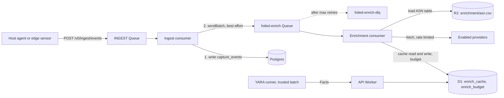

# Enrichment

Status: Fact contract, provider config, response parsers, the local ASN table, export redaction, the D1 `enrich_cache` table and the API's read path in place. The `foiled-enrich` Queue consumer that writes the cache, the `enrich_budget` table and the YARA batch job land with the data layer; until the consumer runs, the cache is empty and reads return no context. Owner: #11.

Related: capture layer ([ADR 0005](adr/0005-capture-layer.md), #9), attempts and the noise score (#25), ATT&CK mapping (#26), confidence layer (#27), actor matching (#29), campaigns (#33), exports (#13), contribute-back ([contribute-back.md](contribute-back.md), #37), retention ([privacy-and-retention.md](privacy-and-retention.md), #16), licence and data-terms register ([compliance/licence-register.md](compliance/licence-register.md), #38), research notes ([research/landscape.md](research/landscape.md#enrichment-integrations)).

Config: [configs/enrichment.yaml](../configs/enrichment.yaml), validated in CI against [schemas/enrichment-config.schema.json](../schemas/enrichment-config.schema.json). Fact contract: [schemas/fact.schema.json](../schemas/fact.schema.json). Code: [crates/core/src/enrichment.rs](../crates/core/src/enrichment.rs). Fixtures: [testdata/enrichment/](../testdata/enrichment/).

## Contents

- [What enrichment does](#what-enrichment-does)
- [Observables](#observables)
- [Facts](#facts)
- [Provider interface](#provider-interface)
- [Providers](#providers)
- [YARA on quarantined files](#yara-on-quarantined-files)
- [Pipeline](#pipeline)
- [Cache, TTLs and rate limits](#cache-ttls-and-rate-limits)
- [Failure and degradation](#failure-and-degradation)
- [Keys and secrets](#keys-and-secrets)
- [How Facts are consumed](#how-facts-are-consumed)
- [Enrichment only, never resold](#enrichment-only-never-resold)
- [Privacy and safety](#privacy-and-safety)
- [Testing](#testing)
- [Open items](#open-items)

## What enrichment does

A raw source IP or file hash says little on its own. Enrichment adds context an operator can triage with: who routes the IP, whether it is internet background noise or a known benign service, what other sensors have seen it do, and which YARA rules a quarantined file matches. The results are **Facts** that hang off **observables**. Attempts (#25) join to Facts through the observables they carry.

Enrichment runs off the capture hot path, in its own Queue consumer, and is cached. A provider that is down, slow or out of quota costs some context, never a capture event.

The issue sketch suggested a Go-style `pkg/enrichment/` package and an on-disk cache under `data/enrichment-cache/`. The control plane runs on Workers ([ADR 0001](adr/0001-architecture.md), [ADR 0009](adr/0009-axum-workers-and-front-end.md)), so the pure logic lives in `foiled-core` and the cache is a D1 table instead.

## Observables

| Kind | Example | Normalisation | Where it comes from |
| --- | --- | --- | --- |
| `ip` | `203.0.113.7` | Parsed and printed canonically. IPv4-mapped IPv6 becomes IPv4. | `src.ip` of most events; `dst.ip` of `egress` events, where the decoy is the source and the destination is the attacker's choice. |
| `domain` | `stage2.example.invalid` | Lower case, trailing dot dropped, labels checked. | `data.host` on `egress` events, `data.query` on `dns` events. |
| `sha256` | `9f86d0...0a08` | Lower-case hex, 64 characters. | The hash in `payload_ref` and `data.body_sha256`. Quarantine already holds sha1 and md5 beside the file. |
| `url` | `https://example.invalid/x.sh` | `http`, `https` or `ftp` with a host, no whitespace, at most 2048 characters. | Stage-2 URLs from hooks and emulators (#32), when they land. |

`observables_for_event` in `foiled-core` extracts these from a capture envelope. It skips private, loopback, link-local, carrier-grade NAT, unique local, multicast and unspecified addresses, because those belong to the operator's own network and are never sent to a third party (`Observable::is_external_lookup_eligible`). Documentation ranges pass so that the fixtures exercise the full path.

## Facts

A Fact is one thing a provider asserts about one observable. The contract is [schemas/fact.schema.json](../schemas/fact.schema.json) and the Rust type is `foiled_core::enrichment::Fact`.

| Field | Type | Meaning |
| --- | --- | --- |
| `provider` | string | Provider id from the config, or `yara`. |
| `key` | string | Dotted key namespaced by provider or topic: `greynoise.noise`, `crowdsec.mitre_techniques`, `dshield.count`, `asn.number`, `geo.country`, `yara.match`. |
| `value` | any JSON | The asserted value. Provider text is untrusted: control characters are removed, strings are clipped to 256 characters and lists to 64 items. |
| `confidence` | integer 0-100 | The provider's **own** certainty. It is an input to the confidence layer (#27), never a final link score. Where a provider reports no certainty, Foiled uses a fixed per-provider default (below). |
| `observed_at` | integer | Unix milliseconds when the provider was asked. |
| `ttl_secs` | integer | How long the Fact may be used before it is fetched again. |
| `raw_ref` | string, optional | Where the source is kept: a cache row key or an `r2://` reference. Never the raw response itself. |

A Fact does not carry its observable. Facts are stored and passed around grouped by observable (`ObservedFacts`, `CacheEntry`), which keeps the join to attempts in one place.

Confidence defaults:

| Provider | Confidence | Why |
| --- | --- | --- |
| `local_asn` | 90 | Routing data from a dataset the operator chose. |
| `greynoise` | 80 | Direct observation by their sensor network, no certainty field. |
| `crowdsec` | from the response: `high` 90, `medium` 60, `low` 30, absent 50 | CrowdSec reports its own confidence. |
| `dshield` | 70 | Sensor report counts, no certainty field. |
| `yara` | the rule's `confidence` meta, default 50 | Rule authors know how specific their rule is. |

## Provider interface

The issue sketched `Enrich(ctx, Observable) ([]Fact, error)`. In Foiled it is split in two so the logic stays pure and testable:

```rust
pub trait Provider {
    fn id(&self) -> &str;
    fn supports(&self, kind: ObservableKind) -> bool;
    fn enrich(&self, observable: &Observable, now_ms: i64) -> Result<Vec<Fact>, EnrichError>;
}
```

- **Local providers** (the ASN table, test fakes) implement `Provider` directly in `foiled-core`.
- **Network providers** live in the Worker. The consumer builds the request from the config, fetches it, and hands the body to a pure parser in `foiled-core` (`parse_greynoise_community`, `parse_crowdsec_smoke`, `parse_dshield_ip`). Each parser takes the body and a `Stamp` (`observed_at`, `ttl_secs`, `raw_ref`) and returns `Result<Vec<Fact>, ParseError>`. No parser touches the network or the clock.

`Ok(vec![])` means "the provider knows nothing about this observable" and is cached like any other answer. `Err` is never cached as a Fact. `enrich_all` runs a set of providers over a set of observables, collects Facts by observable, and records each failure without stopping the run.

## Providers

All third-party providers ship **off**. The table lists what each one adds and which variable names the config expects. Values are names of Worker secrets, never the keys.

| Id | Observables | Key variables | Facts | Default | Terms |
| --- | --- | --- | --- | --- | --- |
| `local_asn` | ip | none | `asn.number`, `asn.org`, `geo.country` | on, inert until a dataset is uploaded | Dataset licence (MaxMind GeoLite2 EULA or the IP-to-ASN dataset's own terms). Never committed. |
| `greynoise` | ip | `GREYNOISE_API_KEY` (optional for Community) | `greynoise.noise`, `.riot`, `.classification`, `.name`, `.last_seen` | off | Enrichment only. |
| `crowdsec` | ip | `CROWDSEC_CTI_KEY` | `crowdsec.reputation`, `.behaviors`, `.attack_details`, `.mitre_techniques`, `.cves` | off | Enrichment only; commercial embedding needs CrowdSec's partnership programme. |
| `dshield` | ip | `DSHIELD_CONTACT_UA` (contact User-Agent, no key) | `dshield.count`, `.attacks`, `.mindate`, `.maxdate` | off | CC BY-NC-SA 4.0 and "do not resell". |
| `shadowserver` | ip | `SHADOWSERVER_API_KEY`, `SHADOWSERVER_API_SECRET` | ASN and network context (parser planned) | off | Vetted access, per-subscriber terms. |
| `huntio` | ip, domain | `HUNTIO_API_KEY` | C2 and infrastructure pivots (parser planned) | off | Paid, optional. Endpoint comes from the operator's contract. |
| `abuseipdb` | ip | `ABUSEIPDB_KEY` | Abuse confidence and report counts (parser planned) | off | Treated as third-party data until the register says otherwise. |

### Local ASN and country

The MVP local provider is an IP-range-to-ASN table held in memory and searched with a binary search (`AsnTable`). It handles IPv4 and IPv6 and needs no network.

Operators download a dataset themselves, for example MaxMind GeoLite2 ASN and Country (free account and licence key from MaxMind) or a public IP-to-ASN range dataset. **No dataset is ever committed to this repository**, and no build step downloads one. Convert it to a simple CSV:

```text
start_ip,end_ip,asn,org,country
192.0.2.0,192.0.2.255,64496,"Example Docs Net, Pty Ltd",AU
2001:db8::,2001:db8:0:ffff:ffff:ffff:ffff:ffff,64499,Example IPv6 Net,AU
```

`org` may contain commas and may be quoted. `asn` may carry an `AS` prefix. `country` is two letters or empty. Ranges must not overlap; the loader reports the line of the first overlap. GeoLite2 ships networks as CIDR blocks, so expand each block to its first and last address and join ASN and Country on the network. Upload the file to R2 at `dataset_key` (`enrichment/asn.csv` by default). The consumer loads it once per isolate and reloads when the object's ETag changes. A full IPv4 and IPv6 table fits in Worker memory for most datasets; if it does not, keep only the families you need or move the ranges into a D1 table keyed by zero-padded hex start address.

### GreyNoise Community

`GET https://api.greynoise.io/v3/community/{ip}`. `noise` and `riot` are required booleans. An IP GreyNoise has never seen still returns both flags as `false`, which is useful ("not background noise"), so it yields two Facts. A body without the flags, such as a rate-limit message, is a provider error. The free tier allows about 50 lookups a week, so the shipped limit is seven a day and the cache TTL is a day.

### CrowdSec CTI

`GET https://cti.api.crowdsec.net/v2/smoke/{ip}` with the key in `x-api-key`. The parser keeps `reputation`, the `name` of each behaviour and attack detail, ATT&CK technique ids from `mitre_techniques` (ids that do not look like `T1234` or `T1234.567` are dropped), and CVE ids from `cves` (malformed ids are dropped). "Not found" is a provider error, not an empty answer, so it is not cached as knowledge.

### DShield

`GET https://isc.sans.edu/api/ip/{ip}?json` with a User-Agent that names a contact, taken from `DSHIELD_CONTACT_UA`, for example `foiled-enrich (contact: soc@example.org)`. The parser keeps `count` (reports), `attacks` (targets), `mindate` and `maxdate`. Counts may arrive as numbers, numeric strings or null; null fields produce no Fact. Contributing to DShield is a separate, opt-in channel ([contribute-back.md](contribute-back.md)).

### Shadowserver, Hunt.io, AbuseIPDB

These are config entries today. Their parsers land when an operator needs them, following the same pattern: a pure function over the body, Facts keyed under the provider id, a fixture under `testdata/enrichment/providers/`, and no live call in CI. Shadowserver is also where operators subscribe their own sensor ranges for remediation reports. Hunt.io is for C2 and infrastructure pivots on stage-2 URLs and callback IPs.

## YARA on quarantined files

YARA scanning is a **separate trusted batch job**. It never runs on the control plane request path, never in a Worker, never on a decoy host, and never executes a sample.

- **Where:** an operator-run analysis runner (a container or VM the operator trusts, with no access to decoy networks), on a schedule.
- **Input:** the runner asks the API for quarantined objects it has not scanned with the current ruleset and receives short-lived, read-only R2 URLs. It reads bytes only. Quarantine metadata already says `executed: false` and that never changes.
- **Rules:** `rules/yara/` (planned path). The default set is empty. A few example rules written for Foiled and dedicated to the public domain (CC0-1.0) ship beside it. Operators add their own rules or vetted public sets whose licences allow it.
- **Output:** each match becomes a Fact with `provider: yara`, `key: yara.match`, the `sha256` observable, `value: {rule, ruleset, ruleset_version, tags}`, `confidence` from the rule's `confidence` meta (default 50) and `raw_ref` pointing at the quarantined object. The rule name is also appended to `yara_matches` in the quarantine `meta.json` ([schemas/quarantine-meta.schema.json](../schemas/quarantine-meta.schema.json)). See [testdata/enrichment/facts/yara-match.json](../testdata/enrichment/facts/yara-match.json).
- **Engine:** libyara or YARA-X as a separate process on the runner. Neither is linked into Foiled's crates.

Example rules (public domain, CC0-1.0):

```yara
rule foiled_example_shell_dropper
{
    meta:
        description = "Shell one-liner that downloads a file and pipes it to a shell"
        author = "Foiled contributors"
        licence = "CC0-1.0"
        confidence = 60
    strings:
        $curl = /curl[^|\n]{1,200}\|\s*(ba)?sh/
        $wget = /wget[^|\n]{1,200}-O\s*-[^|\n]{0,50}\|\s*(ba)?sh/
    condition:
        filesize < 64KB and any of them
}

rule foiled_example_php_eval_base64
{
    meta:
        description = "PHP file that evaluates base64-decoded input, a common web shell pattern"
        author = "Foiled contributors"
        licence = "CC0-1.0"
        confidence = 50
    strings:
        $php = "<?php" nocase
        $eval = /eval\s*\(\s*base64_decode\s*\(/ nocase
    condition:
        $php and $eval
}

rule foiled_example_elf_upload
{
    meta:
        description = "ELF executable, for example a stage-2 implant written by an upload exploit"
        author = "Foiled contributors"
        licence = "CC0-1.0"
        confidence = 40
    condition:
        uint32(0) == 0x464c457f
}
```

YARA matches are Foiled-origin observations made with Foiled's or the operator's own rules, so they are not on the never-redistribute list. A rule from a third-party set keeps that set's licence; check it before publishing match names.

## Pipeline



1. The ingest consumer ([ADR 0005](adr/0005-capture-layer.md)) writes the batch to Postgres and only then calls `observables_for_event` on each event, removes duplicates across the batch, and sends one message per observable to `foiled-enrich`:

   ```json
   {
     "v": 1,
     "observable": { "kind": "ip", "value": "203.0.113.7" },
     "tenant_id": "t1",
     "event_id": "evt-0001",
     "attempt_id": null,
     "first_seen": 1792285323000,
     "priority": "high"
   }
   ```

   The send is best effort. If it fails, the ingest consumer logs it and still acknowledges the capture batch, because the events are already stored. A cron sweep re-sends observables of recent attempts that have no fresh cache row.

2. The enrichment consumer (`max_batch_size` 10, `max_concurrency` 1, `max_retries` 5, dead-letter queue `foiled-enrich-dlq`) takes each message and, for every enabled provider that supports the observable kind:
   - skips the provider if a fresh cache row exists (`CacheEntry::is_fresh`);
   - for network providers, takes one unit of the provider's minute and day budget in D1, or retries the message later if the budget is spent;
   - fetches with a 5 second timeout and `redirect: manual` (a redirect is an error), passes the body to the parser, and upserts the cache row with the Facts, or with an empty Fact list for "knows nothing";
   - for `local_asn`, looks the IP up in the in-memory table.

3. When all providers for a message are done, the consumer acknowledges it. If some providers failed, it acknowledges anyway and the next sweep retries only the providers with no fresh row. A message is retried as a whole only when D1 itself is unavailable.

Budget goes first to observables from attempts in `exploit` or `post-exploitation` state (#25), because free quotas cannot cover every probe-only scanner. The ingest consumer sets `priority` to `high` for events of severity `high` or `critical` and `normal` otherwise; the enrichment consumer defers `normal` messages when a provider's day budget is more than 80 percent spent.

## Cache, TTLs and rate limits

**Store: D1.** The cache and the rate-limit counters live in D1, not KV. Reasons:

- **Counters need consistent writes.** KV is eventually consistent (changes can take up to a minute to reach other locations) and limits writes to the same key to about one a second, so two consumer invocations would both see budget left and overspend a seven-a-day GreyNoise quota. D1 has a single primary, so `UPDATE ... WHERE used < limit RETURNING used` is atomic.
- **Retention needs queries.** The purge job (#16) deletes cache rows past their per-provider TTL with `DELETE ... WHERE provider = ? AND fetched_at < ?`. If an operator shortens a provider's TTL because its terms change, existing rows are caught on the next run. KV's per-key expiry cannot be changed retroactively without listing every key.
- **Attempt views need lookup by observable.** The console and the scoring job read all Facts for an attempt's handful of observables in one indexed query.
- **Volume is small.** Writes are bounded by provider quotas, so D1 write cost and single-region latency do not matter off the hot path.

Third-party Facts are **not** copied into Postgres. Exports (#13) read Postgres, so keeping provider data in D1 means an export cannot pick it up by accident. Only derived numbers, such as the noise score on an attempt, are stored with the attempt.

`enrich_cache` is created by [migrations/d1/0004_enrich_cache.sql](../migrations/d1/0004_enrich_cache.sql) (with a `CHECK` on `kind` and `ttl_secs`). `enrich_budget` is still a sketch and lands with the consumer that uses it:

```sql
CREATE TABLE enrich_budget (
  provider     TEXT NOT NULL,
  window       TEXT NOT NULL,       -- minute | day
  window_start INTEGER NOT NULL,    -- unix ms, truncated to the window
  used         INTEGER NOT NULL,
  PRIMARY KEY (provider, window, window_start)
);
```

**Keys:** `provider:kind:value`, for example `greynoise:ip:203.0.113.7` (`Observable::cache_key`, `CacheEntry::key`). The cache is shared by all tenants of one deployment because the operator owns the provider key; who may **see** the Facts is a separate rule (below).

**TTLs:** each provider has `ttl_secs` in [configs/enrichment.yaml](../configs/enrichment.yaml): a day for reputation providers, seven days for ASN. An empty answer uses `cache.negative_ttl_secs` (six hours). After an error or a spent budget the provider is not asked again for `cache.error_backoff_secs`. The retention planner's `enrichment_cache` TTLs in [configs/retention.yaml](../configs/retention.yaml) are an upper bound on how long a row is kept at all; a Fact past its own `ttl_secs` is not used for scoring even if the row still exists.

**Rate limits:** `rate_limit.per_minute` and `rate_limit.per_day` per provider. The shipped numbers are conservative placeholders for free tiers; set them to your plan.

### Reading the cache

The API reads cached Facts for the addresses it is about to show: ASN refs on IOCs ([iocs.md](iocs.md#asn-context), #34) and the `asn`, `as_org` and `country` columns of `GET /v0/exports/iocs.csv`. Campaign clustering (#33) reads source-address ASN numbers the same way, and clusters without ASN features if the cache cannot be read.

- **One store call per response.** `Store::enrichment_cache(observables, now, max_statements)` returns the raw rows; the Worker store builds a plan with `d1_sql::enrich_lookup_plan` and sends it as **one D1 batch**. The plan removes duplicates first, keeps the first `max_statements * 98` observables (routes pass them newest first, so the oldest go without context when the budget runs out), groups them by kind and chunks them at 98 values per `SELECT ... WHERE kind = ?1 AND value IN (...) AND fetched_at + ttl_secs * 1000 > ?2` (D1 binds at most 100 parameters). The budget is `Limits::enrichment_lookup_statements`, 20 by default (1,960 observables), which leaves room for the request's other queries inside the D1 Free plan's 50 queries per Worker invocation; raise it on a paid plan (1,000). An IOC page (`limit`, up to 200 addresses) needs at most three statements; a CSV export of a month's source addresses needs one per 98.
- **The rules live in one function.** `foiled_core::enrichment::usable_facts` (called through `foiled_api::enrichment::cached_facts`) keeps a row only while it is fresh (`fetched_at + ttl_secs`) and younger than the retention cap for its provider (`enrichment_cache` in [configs/retention.yaml](../configs/retention.yaml)), keeps a Fact only while it is fresh (`observed_at + ttl_secs`) and only when it names the row's own provider, and drops third-party providers (and Facts keyed under a known third-party namespace such as `greynoise.`) while `show_to_tenants` is false. Third party is decided by an **allowlist**: only `local_asn` (the operator's own table) and `yara` (Foiled's own rules) are first party (`enrichment::FIRST_PARTY`), so a provider added to the config later is hidden until someone decides otherwise. The retention config and `show_to_tenants` come from `configs/retention.yaml` and `configs/enrichment.yaml`, bundled into the Worker at build time like `configs/mcp.yaml`; if a bundled file does not parse, the shipped defaults apply.
- **A cache failure never fails the response.** If D1 cannot be read the store logs it, the route returns its normal answer without enrichment context, sets `x-foiled-enrichment: unavailable`, and IOC lists also set `enrichment_unavailable: true`.
- **Exports add the never-resell rule.** The CSV's ASN columns pass through `ioc::export_refs`, which drops every provider on `NEVER_REDISTRIBUTE`, `local_asn` included, so with the shipped providers they stay empty. IOC responses mark such refs `shareable: false` and `ioc::redact_for_export` drops them.
- **Bad rows are skipped.** A row with an unknown kind, an invalid value, negative numbers or Facts that do not parse (`CacheEntry::from_row`) is logged and ignored, never trusted.

The cache is shared by every tenant of a deployment, but a tenant only ever asks about observables from its own events, so reading it reveals nothing about other tenants.

## Failure and degradation

- **A provider failure never drops a capture event.** Events are written to Postgres before any enrichment message exists, and the ingest consumer acknowledges its batch whether or not the enrichment send succeeded.
- **One provider failing does not stop the others.** `enrich_all` and the consumer record a failure per provider and keep going. The attempt view shows "GreyNoise: unavailable" rather than nothing.
- **Missing Facts are neutral.** `noise_inputs` returns `None` for a provider that was off or failed, and #25 and #27 treat `None` as no evidence, not as evidence of anything.
- **Bad responses are errors, not Facts.** A body that is not JSON, has the wrong shape or carries a provider error message becomes `ParseError` and is retried later.
- **Dead letters** keep the observable and the provider error for an operator to inspect. They never hold a payload.

## Keys and secrets

- Keys exist only as Worker secrets on the API Worker (`wrangler secret put GREYNOISE_API_KEY` and so on). The config holds the variable **name**. The schema only accepts upper-case names, which also rejects a pasted key.
- CI never has provider keys and never calls a provider. Every test runs on fixtures.
- Keys are never logged, never echoed in errors and never sent anywhere except the provider's own HTTPS endpoint.
- Shadowserver requests are signed with `SHADOWSERVER_API_SECRET`; the secret never leaves the Worker.

## How Facts are consumed

**Noise score on attempts (#25).** `noise_inputs(facts)` returns `NoiseFacts { greynoise_noise, greynoise_riot, crowdsec_reputation }` for the attempt's source IP, newest value wins. GreyNoise `noise: true` pushes the attempt toward the `mass` band, `riot: true` marks the source as a known benign service, and a CrowdSec reputation of `malicious` or `suspicious` is recorded as evidence beside the fleet-wide hit count and decoy types touched. All three are optional inputs; the fleet counts still produce a score when every provider is off.

**Confidence layer (#27).** Facts reach #27 in two ways. First, through the noise score, as evidence with `source: noise_score`: high noise lowers confidence that the activity is a targeted novel exploit, but cannot alone suppress a vuln-path hook or a sequence fingerprint, and GreyNoise RIOT strongly down-ranks actor and campaign auto-links. Second, directly, as evidence with `source: enrichment`, weighted by the configured weight times the Fact's `confidence / 100`. Enrichment evidence is capped so that it can never alone take a link to `high`, the evidence entry names the provider and Fact key so nothing is hidden, and a Fact past its `ttl_secs` contributes nothing.

**ATT&CK mapping (#26).** Foiled's own technique labels come from what the decoy saw. CrowdSec's `crowdsec.mitre_techniques` and `crowdsec.behaviors` are an outside check on them: when CrowdSec agrees with a technique Foiled already assigned, the `attempt_technique` link gains a small `enrichment` evidence entry; when CrowdSec lists a technique Foiled did not see, it is shown as a hint for the analyst and never creates a link on its own. CrowdSec `cves` are used the same way as a cross-check for CVE mapping (#12).

**Actor matching (#29).** Infrastructure Facts are inputs to actor and campaign matching: `asn.number` and `asn.org`, `geo.country`, and Hunt.io C2 and infrastructure pivots for stage-2 URLs and callback IPs. They raise the score of a "possible association" only alongside behavioural evidence from the capture itself; ASN or country alone never names an actor, and a link supported only by third-party Facts stays internal to the operator's console. YARA matches on quarantined payloads are tool evidence for the same matching (#29) and campaign clustering (#33).

## Enrichment only, never resold

Third-party enrichment is for the entitled operator's own triage. GreyNoise, CrowdSec CTI, DShield, Shadowserver, Hunt.io and AbuseIPDB data, and anything derived mainly from them, is **never resold, republished, put in Foiled's own paid feed or public IOC dumps, or contributed back**. DShield data is CC BY-NC-SA 4.0 and marked "do not resell". The rules and the reasons are in the licence and data-terms register, [compliance/licence-register.md](compliance/licence-register.md) (#38).

In code:

- `redact_for_export(facts)` drops every Fact whose provider is in `NEVER_REDISTRIBUTE` (`greynoise`, `crowdsec`, `dshield`, `shadowserver`, `huntio`, `abuseipdb`, `local_asn`), and also every Fact whose key is namespaced under one of them, so relabelled data is still caught. Every export, public page and share path (#13, #35, #37) calls it before serialising Facts.
- `local_asn` is on the list because its dataset may be GeoLite2, which the register keeps out of exports until a row there says otherwise. YARA Facts are Foiled-origin and pass.
- `strip_non_shareable` in `foiled_core::share` removes provider-named fields from contribute-back records ([contribute-back.md](contribute-back.md)).
- `show_to_tenants: false` (the shipped value) keeps third-party Facts out of every API response today, whoever asks: the API has no separate operator role yet, so there is no caller it could show them to. The planned operator console (#14) is where an operator-only view belongs. Setting `show_to_tenants: true` shows them to every caller of the tenant-facing routes, which is the operator's call under their own provider terms.
- Adding a provider means adding it to the config schema, to `NEVER_REDISTRIBUTE` unless the register says its data may be shared, and a row to the register. The config schema rejects providers it does not list, and a lint test checks that every configured provider is on the never-redistribute list.

This describes the design constraints Foiled follows. It is not legal advice; operators should check provider terms with their own counsel.

## Privacy and safety

- **Only observables leave.** Providers receive an IP, a domain, a hash or a URL. Payloads, request bodies, credentials, tenant ids and decoy addresses are never sent ([threat-model.md](threat-model.md)).
- **No private addresses.** Private, loopback, link-local, carrier-grade NAT and unique local addresses are never sent out.
- **No phone home.** The only outbound calls are to the endpoints of providers the operator turned on. Nothing is sent to Foiled's authors, and there is no telemetry.
- **Provider output is hostile input.** Text is stripped of control characters and clipped, lists are capped, ids are pattern-checked, and the console renders Facts as plain text.
- **Retention.** Cache rows are capture-derived data and follow the `enrichment_cache` TTLs in [configs/retention.yaml](../configs/retention.yaml) ([privacy-and-retention.md](privacy-and-retention.md)).

## Testing

`cargo test -p foiled-core enrichment` and `cargo test -p foiled-lint` cover:

- observable validation and normalisation, and the private-address rule;
- each parser against hand-written response fixtures in [testdata/enrichment/providers/](../testdata/enrichment/providers/) (documentation IPs and ASNs, fake CVE ids, no real data), including not-found answers, provider errors, wrong types and clipping;
- the ASN table on [testdata/enrichment/asn.csv](../testdata/enrichment/asn.csv): IPv4, IPv6, IPv4-mapped input, inclusive edges, gaps, overlaps, bad rows and a thousand-range binary search;
- cache freshness, Fact freshness and overflow at extreme TTLs;
- reading cache rows (`CacheEntry::from_row`, `usable_facts`): expired rows and Facts, the retention cap, Facts under another provider's name and third-party visibility; and in `crates/api` the D1 lookup SQL against SQLite (freshness, chunking under the bound parameter limit, the overall cap, a hostile value) and the IOC and export routes over cached rows;
- `noise_inputs` and `redact_for_export`;
- a fake provider and an always-failing provider run over attempts built from the capture fixtures: the fake provider's Facts attach to the attempt through its source IP, the failing provider is recorded, and no event is lost;
- the Fact fixtures in [testdata/enrichment/facts/](../testdata/enrichment/facts/) pass both the schema and the Rust type, and the shipped config passes its schema with every third-party provider off.

No test or code path makes a network call.

## Open items

- Verify current endpoints, quotas and terms for each provider before turning it on (marked **verify** in the register).
- Parsers for Shadowserver, Hunt.io and AbuseIPDB.
- The `foiled-enrich` consumer that writes `enrich_cache`, the `enrich_budget` migration and the sweep cron. The read path and the table are in place.
- An operator-only view of third-party Facts (needs an operator role, #14).
- The YARA runner and the `rules/yara/` directory.
- Counsel review of the derived-fields rule for the exported noise score (register, "Never include in a paid feed or public dump").
