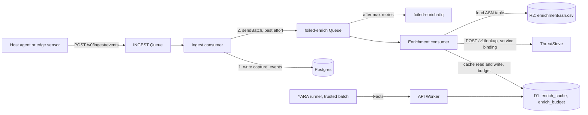

# Enrichment

Status: Fact contract, provider config, the local ASN table, the ThreatSieve adapter, export redaction, the D1 tables, the API's read path, and the `foiled-enrich` producer and consumer in place, tested with fakes. Not yet: the sweep cron, the YARA batch job, and a run against a live ThreatSieve. Deployment steps are in [Deploying the consumer](#deploying-the-consumer). Owner: #11.

**ThreatSieve is the hub.** Foiled has one external intel provider, ThreatSieve, the operator's own threat intel platform. ThreatSieve holds the source integrations (GreyNoise, CrowdSec, IPtoASN, NVD, EPSS, CISA KEV, OSV, MITRE ATT&CK and feeds), their keys, quotas and licence records; Foiled asks it about a batch of observables and gets back normalised answers with each source's terms attached. Foiled never calls GreyNoise, CrowdSec or any other source directly.

Related: capture layer ([ADR 0005](adr/0005-capture-layer.md), #9), attempts and the noise score (#25), ATT&CK mapping (#26), confidence layer (#27), actor matching (#29), campaigns (#33), exports (#13), contribute-back ([contribute-back.md](contribute-back.md), #37), retention ([privacy-and-retention.md](privacy-and-retention.md), #16), licence and data-terms register ([compliance/licence-register.md](compliance/licence-register.md), #38), research notes ([research/landscape.md](research/landscape.md#enrichment-integrations)).

Config: [configs/enrichment.yaml](../configs/enrichment.yaml), validated in CI against [schemas/enrichment-config.schema.json](../schemas/enrichment-config.schema.json). Fact contract: [schemas/fact.schema.json](../schemas/fact.schema.json). Code: [crates/core/src/enrichment.rs](../crates/core/src/enrichment.rs). Fixtures: [testdata/enrichment/](../testdata/enrichment/).

## Contents

- [What enrichment does](#what-enrichment-does)
- [Observables](#observables)
- [Facts](#facts)
- [Provider interface](#provider-interface)
- [Providers](#providers)
- [YARA on quarantined files](#yara-on-quarantined-files)
- [Pipeline](#pipeline)
- [Cache, TTLs and rate limits](#cache-ttls-and-rate-limits)
- [Failure and degradation](#failure-and-degradation)
- [Keys and secrets](#keys-and-secrets)
- [How Facts are consumed](#how-facts-are-consumed)
- [Enrichment only, never resold](#enrichment-only-never-resold)
- [Privacy and safety](#privacy-and-safety)
- [Testing](#testing)
- [Deploying the consumer](#deploying-the-consumer)
- [Open items](#open-items)

## What enrichment does

A raw source IP or file hash says little on its own. Enrichment adds context an operator can triage with: who routes the IP, whether it is internet background noise or a known benign service, what other sensors have seen it do, and which YARA rules a quarantined file matches. The results are **Facts** that hang off **observables**. Attempts (#25) join to Facts through the observables they carry.

Enrichment runs off the capture hot path, in its own Queue consumer, and is cached. A provider that is down, slow or out of quota costs some context, never a capture event.

The issue sketch suggested a Go-style `pkg/enrichment/` package and an on-disk cache under `data/enrichment-cache/`. The control plane runs on Workers ([ADR 0001](adr/0001-architecture.md), [ADR 0009](adr/0009-axum-workers-and-front-end.md)), so the pure logic lives in `foiled-core` and the cache is a D1 table instead.

## Observables

| Kind | Example | Normalisation | Where it comes from |
| --- | --- | --- | --- |
| `ip` | `203.0.113.7` | Parsed and printed canonically. IPv4-mapped IPv6 becomes IPv4. | `src.ip` of most events; `dst.ip` of `egress` events, where the decoy is the source and the destination is the attacker's choice. |
| `domain` | `stage2.example.invalid` | Lower case, trailing dot dropped, labels checked. | `data.host` on `egress` events, `data.query` on `dns` events. |
| `sha256` | `9f86d0...0a08` | Lower-case hex, 64 characters. | The hash in `payload_ref` and `data.body_sha256`. Quarantine already holds sha1 and md5 beside the file. |
| `url` | `https://example.invalid/x.sh` | `http`, `https` or `ftp` with a host, no whitespace, at most 2048 characters. | Stage-2 URLs from hooks and emulators (#32), when they land. |
| `cve` | `CVE-2099-0001` | Upper case, `CVE-YYYY-NNNN` with four or more digits. | The CVE id of a vulnerability-path hook hit (`hook.cve`). Demo ids (`FOILED-DEMO-...`) are never looked up. |

`observables_for_event` in `foiled-core` extracts these from a capture envelope. It skips private, loopback, link-local, carrier-grade NAT, unique local, multicast and unspecified addresses, because those belong to the operator's own network and are never sent to a third party (`Observable::is_external_lookup_eligible`). Documentation ranges pass so that the fixtures exercise the full path.

## Facts

A Fact is one thing a provider asserts about one observable. The contract is [schemas/fact.schema.json](../schemas/fact.schema.json) and the Rust type is `foiled_core::enrichment::Fact`.

| Field | Type | Meaning |
| --- | --- | --- |
| `provider` | string | Provider id from the config, or `yara`. |
| `key` | string | Dotted key namespaced by provider or topic: `asn.number`, `geo.country`, `cve.kev_listed`, `threatsieve.classification`, `yara.match`. |
| `value` | any JSON | The asserted value. Provider text is untrusted: control characters are removed, strings are clipped to 256 characters and lists to 64 items. |
| `confidence` | integer 0-100 | The provider's **own** certainty. It is an input to the confidence layer (#27), never a final link score. Where a provider reports no certainty, Foiled uses a fixed per-provider default (below). |
| `observed_at` | integer | Unix milliseconds when the provider was asked. |
| `ttl_secs` | integer | How long the Fact may be used before it is fetched again. |
| `raw_ref` | string, optional | Where the source is kept: a cache row key or an `r2://` reference. Never the raw response itself. |

A Fact does not carry its observable. Facts are stored and passed around grouped by observable (`ObservedFacts`, `CacheEntry`), which keeps the join to attempts in one place.

Confidence defaults:

| Provider | Confidence | Why |
| --- | --- | --- |
| `local_asn` | 90 | Routing data from a dataset the operator chose. |
| `threatsieve` network (`asn.`, `geo.`, prefix) | 85 | Routing registry data via ThreatSieve's IPtoASN import. |
| `threatsieve` reputation and scanner | ThreatSieve's `confidence`, 50 when null | ThreatSieve reports its own (heuristic, uncalibrated) confidence. |
| `threatsieve` CVE (`cve.`) | 90 | Catalogue data: NVD, EPSS, KEV, OSV. |
| `threatsieve.related` | at most 20; `model_inferred` 5 | Relationships are analyst context, never attribution. |
| `yara` | the rule's `confidence` meta, default 50 | Rule authors know how specific their rule is. |

## Provider interface

The issue sketched `Enrich(ctx, Observable) ([]Fact, error)`. In Foiled it is split in two so the logic stays pure and testable:

```rust
pub trait Provider {
    fn id(&self) -> &str;
    fn supports(&self, kind: ObservableKind) -> bool;
    fn enrich(&self, observable: &Observable, now_ms: i64) -> Result<Vec<Fact>, EnrichError>;
}
```

- **Local providers** (the ASN table, test fakes) implement `Provider` directly in `foiled-core`.
- **ThreatSieve** is called from the Worker. `enrich_pipeline::lookup_request` builds the batched request, the Worker sends it over the service binding, and `enrich_pipeline::lookup_outcome` turns the status and body into Facts per observable. Neither function touches the network or the clock.
- Foiled has no direct GreyNoise, CrowdSec or DShield parsers any more: those sources reach Foiled only through ThreatSieve. Their provider ids stay on `NEVER_REDISTRIBUTE` and `KNOWN_THIRD_PARTY`, so their data is still caught if it ever turns up under those names or key namespaces.

`Ok(vec![])` means "the provider knows nothing about this observable" and is cached like any other answer. `Err` is never cached as a Fact. `enrich_all` runs a set of providers over a set of observables, collects Facts by observable, and records each failure without stopping the run.

## Providers

| Id | Observables | Secrets and bindings | Facts | Default | Terms |
| --- | --- | --- | --- | --- | --- |
| `local_asn` | ip | none | `asn.number`, `asn.org`, `geo.country` | on, inert until a dataset is uploaded | Dataset licence (MaxMind GeoLite2 EULA or the IP-to-ASN dataset's own terms). Never committed. |
| `threatsieve` | ip, domain, url, sha256, cve | service binding `THREATSIEVE`, secret `THREATSIEVE_API_KEY` | network, reputation, scanner, CVE, relationships, sources (below) | off | Per source, carried in every answer ([below](#per-source-terms)). |

The config holds the binding and secret **names**, never a key. `threatsieve_restricted` is not a separate provider in the config: it is the provider id the consumer writes ThreatSieve answers under when any contributing source restricts them.

### Local ASN and country

The MVP local provider is an IP-range-to-ASN table held in memory and searched with a binary search (`AsnTable`). It handles IPv4 and IPv6 and needs no network.

Operators download a dataset themselves, for example MaxMind GeoLite2 ASN and Country (free account and licence key from MaxMind) or a public IP-to-ASN range dataset. **No dataset is ever committed to this repository**, and no build step downloads one. Convert it to a simple CSV:

```text
start_ip,end_ip,asn,org,country
192.0.2.0,192.0.2.255,64496,"Example Docs Net, Pty Ltd",AU
2001:db8::,2001:db8:0:ffff:ffff:ffff:ffff:ffff,64499,Example IPv6 Net,AU
```

`org` may contain commas and may be quoted. `asn` may carry an `AS` prefix. `country` is two letters or empty. Ranges must not overlap; the loader reports the line of the first overlap. GeoLite2 ships networks as CIDR blocks, so expand each block to its first and last address and join ASN and Country on the network. Upload the file to R2 at `dataset_key` (`enrichment/asn.csv` by default). The consumer loads it once per isolate and reloads when the object's ETag changes. A full IPv4 and IPv6 table fits in Worker memory for most datasets; if it does not, keep only the families you need or move the ranges into a D1 table keyed by zero-padded hex start address.

With ThreatSieve on, network context arrives from ThreatSieve too (its IPtoASN import), so `local_asn` is optional.

### ThreatSieve

`POST /v1/lookup` over the Cloudflare service binding `THREATSIEVE` (to the `threatsieve-api-production` Worker), so the call never leaves Cloudflare. The binding ignores the URL host; Foiled uses `https://threatsieve/v1/lookup`. The key is a tenant-scoped ThreatSieve API key with scope `intel:read`, held as the Worker secret `THREATSIEVE_API_KEY` and sent as `Authorization: Bearer`. ThreatSieve never calls a paid model for a lookup; it reads its stored data, imported datasets and cached source answers.

Request: up to `batch_size` (at most 500) distinct observables, typed `ipv4`, `ipv6`, `domain`, `url`, `sha256` or `cve`, and the `include` sections from the config. Each answer is mapped to Facts as follows; anything else in the answer is ignored.

| Section | Facts | Notes |
| --- | --- | --- |
| `network` | `asn.number`, `asn.org`, `geo.country`, `threatsieve.prefix` | Kept whether or not `found` is true: ThreatSieve returns network context for any routed address. `country` is the registry country of the range, not where the host is. |
| `reputation` | `threatsieve.classification`, `.score`, `.scanner`, `.benign_service`, `.scanner_name`, `.tags` | Only when `found`. Confidence is ThreatSieve's own. A null `scanner` means unknown, so it produces no Fact. |
| `cve` | `cve.status`, `cve.kev_listed`, `.kev_date_added`, `.kev_ransomware`, `.epss_score`, `.epss_percentile`, `.cvss_base_score`, `.cvss_version`, `.cvss_vector`, `.cwe`, `.osv_ids` | A null `kev` means KEV status is unknown and produces no Fact; `listed: false` is a Fact. |
| `relationships` | `threatsieve.related`: up to 16 of `{id, type, direction, assertion, source_id, target_type, name, mitre}` | Context for an analyst, never attribution. Confidence is capped at 20, and the whole Fact drops to 5 when any relationship is `model_inferred`. Relationship types are ThreatSieve's lower-case, hyphenated ones; MITRE groups come back as `threat-actor`. |
| `sources` | `threatsieve.sources`: up to 16 of `{source_id, license, redistributable, commercial_use, retrieved_at}` | Provenance for every answer with Facts. |
| `pending_sources` | `threatsieve.pending_sources` | A source (GreyNoise, CrowdSec, OSV) is still being fetched; see TTLs below. |

Every Fact gets `raw_ref: threatsieve:<entity_id>` when ThreatSieve has a visible entity, and no `raw_ref` when `entity_id` is null. Answers are mapped back to Foiled's observable by `input` (the spelling Foiled sent), falling back to ThreatSieve's normalised `value`. A result with a per-value `error` (`INVALID_OBSERVABLE`) is not cached; it is recorded as a failure and backs off. Results for types Foiled did not ask about (`md5`, `sha1`, `asn`) are skipped.

Status codes: `200` is mapped as above; `429` is a rate limit, honouring `Retry-After` (seconds, at most an hour; 60 when absent or a date); `413` (`TOO_MANY_OBSERVABLES`, `PAYLOAD_TOO_LARGE`) should never happen because Foiled sends at most 500; `401` and `403` mean the key is wrong or lacks `intel:read`; anything else, including a redirect, is unavailable. ThreatSieve's error `code` is logged when it is a plain upper-case code; its `message` never is.

#### Per-source terms

ThreatSieve keeps a licence record per source and returns `redistributable` and `commercial_use` (null when unknown) for each source behind an answer. Foiled does not split Facts by source, so the strictest terms of an answer win:

- **Every source `redistributable: true` and `commercial_use: true`**: the answer is written under `threatsieve`, as one row shared by all tenants of the deployment. `threatsieve` is first party for visibility (it is the operator's own platform, and these sources allow it), so its Facts are shown to tenants and may be exported.
- **Any source `false`, any `null`, or no sources at all**: the answer is written under `threatsieve_restricted`, **one row per tenant that asked** (`tenant_id` on the row). No other tenant ever reads it, and the tenant that asked sees it only when the operator sets `show_restricted_to_requester: true` (off by default, whatever `show_to_tenants` says). `threatsieve_restricted` is on `NEVER_REDISTRIBUTE`, so it is never exported, published, resold or contributed back. Another tenant asking about the same observable makes its own lookup. Unknown terms are treated as restrictive on purpose.
- An answer with no Facts at all (not found, nothing routed) has nothing to restrict and is a shared "not found" row.

**Showing restricted answers is a licence decision.** Whether a source's terms (for example GreyNoise or CrowdSec with `commercial_use: false`, or a feed with unknown terms) allow the operator to show its data to their tenants at all depends on the operator's agreements with those sources, not on anything Foiled can check. So restricted answers are cached (to save lookups) but hidden from everyone until the operator turns on `show_restricted_to_requester` in `configs/enrichment.yaml`, which they should do only on their counsel's advice. Even then each tenant sees only its own lookups, and nothing restricted is ever exported.

With ThreatSieve's shipped licence records (its migration 0034), GreyNoise, CrowdSec, VirusTotal, ThreatFox, URLhaus, Feodo, MISP and every generic feed make an answer restricted; IPtoASN, EPSS, NVD, CISA KEV and MITRE do not; OSV (`commercial_use: null`) does, so most CVE answers with OSV data are kept per tenant.

## YARA on quarantined files

YARA scanning is a **separate trusted batch job**. It never runs on the control plane request path, never in a Worker, never on a decoy host, and never executes a sample.

- **Where:** an operator-run analysis runner (a container or VM the operator trusts, with no access to decoy networks), on a schedule.
- **Input:** the runner asks the API for quarantined objects it has not scanned with the current ruleset and receives short-lived, read-only R2 URLs. It reads bytes only. Quarantine metadata already says `executed: false` and that never changes.
- **Rules:** `rules/yara/` (planned path). The default set is empty. A few example rules written for Foiled and dedicated to the public domain (CC0-1.0) ship beside it. Operators add their own rules or vetted public sets whose licences allow it.
- **Output:** each match becomes a Fact with `provider: yara`, `key: yara.match`, the `sha256` observable, `value: {rule, ruleset, ruleset_version, tags}`, `confidence` from the rule's `confidence` meta (default 50) and `raw_ref` pointing at the quarantined object. The rule name is also appended to `yara_matches` in the quarantine `meta.json` ([schemas/quarantine-meta.schema.json](../schemas/quarantine-meta.schema.json)). See [testdata/enrichment/facts/yara-match.json](../testdata/enrichment/facts/yara-match.json).
- **Engine:** libyara or YARA-X as a separate process on the runner. Neither is linked into Foiled's crates.

Example rules (public domain, CC0-1.0):

```yara
rule foiled_example_shell_dropper
{
    meta:
        description = "Shell one-liner that downloads a file and pipes it to a shell"
        author = "Foiled contributors"
        licence = "CC0-1.0"
        confidence = 60
    strings:
        $curl = /curl[^|\n]{1,200}\|\s*(ba)?sh/
        $wget = /wget[^|\n]{1,200}-O\s*-[^|\n]{0,50}\|\s*(ba)?sh/
    condition:
        filesize < 64KB and any of them
}

rule foiled_example_php_eval_base64
{
    meta:
        description = "PHP file that evaluates base64-decoded input, a common web shell pattern"
        author = "Foiled contributors"
        licence = "CC0-1.0"
        confidence = 50
    strings:
        $php = "<?php" nocase
        $eval = /eval\s*\(\s*base64_decode\s*\(/ nocase
    condition:
        $php and $eval
}

rule foiled_example_elf_upload
{
    meta:
        description = "ELF executable, for example a stage-2 implant written by an upload exploit"
        author = "Foiled contributors"
        licence = "CC0-1.0"
        confidence = 40
    condition:
        uint32(0) == 0x464c457f
}
```

YARA matches are Foiled-origin observations made with Foiled's or the operator's own rules, so they are not on the never-redistribute list. A rule from a third-party set keeps that set's licence; check it before publishing match names.

## Pipeline



1. The ingest consumer ([ADR 0005](adr/0005-capture-layer.md)) writes the batch to Postgres and only then builds messages with `enrich_pipeline::messages_for_events`: the observables of each event (`observables_for_event`: the attacker's address, payload hashes, egress hosts and DNS queries) and of its IOCs (`ioc::event_observables`: callback and stage-2 addresses, domains and URLs, file and payload hashes), external-eligible only, one per tenant and observable, earliest sighting first, at most 500 a batch with `high` first. It sends them to `foiled-enrich` in chunks of 100:

   ```json
   {
     "v": 1,
     "observable": { "kind": "ip", "value": "203.0.113.7" },
     "tenant_id": "t1",
     "event_id": "evt-0001",
     "attempt_id": null,
     "first_seen": 1792285323000,
     "priority": "high"
   }
   ```

   The send is best effort. If it fails, the ingest consumer logs it and still acknowledges the capture batch, because the events are already stored; the next sighting of the observable sends it again. (A cron sweep that re-sends observables of recent attempts with no fresh row is still open.)

   One Worker serves both queues: workers-rs allows one queue handler, so it dispatches on the batch's queue name, which must match `queue` in `configs/enrichment.yaml`.

2. The enrichment consumer (`foiled_api::enrich_consumer::process_batch`; `max_batch_size` 100, `max_batch_timeout` 30 seconds, `max_concurrency` 1, `max_retries` 5, dead-letter queue `foiled-enrich-dlq`) takes the whole queue batch at once. It drops a message that fails `EnrichMessage::problems` (unknown version, bad tenant, an address that may not leave), then, per message, for `local_asn` and `threatsieve` when enabled for the observable kind (`enrich_pipeline::plan`):
   - skips the provider if a fresh cache row exists that this tenant may read (a shared row, or its own restricted row);
   - skips it while a recent failure is backing off: `error_backoff_secs` after the first failure, doubling with each repeat, at most a day; after a `429` exactly until the `Retry-After` time ThreatSieve gave (`enrich_failures.retry_at`), so the queue's retry at that time is a real lookup and not a skip;
   - for `local_asn`, looks the IP up in the ASN table loaded from R2.

   Every observable that needs ThreatSieve is then gathered across the batch, duplicates once, and sent in lookups of at most `batch_size` (500). Before each lookup:
   - a missing `THREATSIEVE` binding or `THREATSIEVE_API_KEY` secret reports ThreatSieve as not configured and spends nothing; `local_asn` still runs;
   - one unit of ThreatSieve's minute and day budget is taken in D1 (`enrich_budget`, a conditional upsert, so two invocations can never overspend). One lookup is one unit, however many observables it carries;
   - the call has a 10 second timeout: a timer races it, and when the timer wins the subrequest is cancelled through an `AbortSignal` on the request and the messages are retried after 120 seconds, not recorded as a failure (ThreatSieve may have done the work; the retry is usually a cache hit there). `redirect: manual`, and the body is capped at 4 MiB while it is read (a larger `Content-Length` is refused before reading).

   For each answer, every Fact is validated (`Fact::problems`: the schema's id and key patterns, confidence, an 8 KB value cap, and the Fact naming the provider that produced it) and any that fail are dropped. The row is upserted shared or per tenant (above) with the answer's TTL, and the observable's failures are cleared (one query, only when a failure was on record). ThreatSieve answers spellings it folds together once, under the first one sent; `answer_for` gives every Foiled spelling that folds to the same value (`fold_key`: canonical IPs, lower-case domains and hashes, upper-case CVE ids, URLs with a lower-case scheme and host) the same answer. An observable still left out of an answer is not cached as "not found": it is recorded as a failure and backs off. A failed lookup records a failure (a short error line, never a body or a key) for every observable in it.

3. Each message is then acknowledged or retried on its own. ThreatSieve failures are acknowledged (the next sighting retries after the backoff), except a `429`, which retries the messages after `Retry-After`. A message is also retried when D1 fails (30 seconds) or the minute budget is spent (60 seconds); a spent day budget is acknowledged, not retried. After five retries a message goes to `foiled-enrich-dlq`, which holds only the observable and its tenant.

   **D1 queries per batch.** Per message, at most: one cache read, one failure read, one `local_asn` write, one ThreatSieve write per scope (one shared row, or one per asking tenant for a restricted answer) and one failure clear (only when a failure was on record). Per lookup: two or three budget statements and a prune. A full batch of 100 messages is therefore about 500 queries, which needs the **Workers Paid plan** (1,000 D1 queries per invocation). On the Free plan (50) set `max_batch_size` to 8 or less; lookups then carry at most that many observables.

Budget goes first to observables from attempts in `exploit` or `post-exploitation` state (#25). The ingest consumer sets `priority` to `high` for events of severity `high` or `critical` and `normal` otherwise; a lookup is `high` when any message in it is, and `normal` lookups may use only 80 percent of the day budget (`day_limit_for`), keeping the rest for `high` ones. ThreatSieve has its own per-key limit (`LOOKUP_RATE_LIMIT`, 60 a minute by default) and its own per-source daily budgets for GreyNoise and CrowdSec, so Foiled's budget is a ceiling on its own spend, not the only one.

## Cache, TTLs and rate limits

**Store: D1.** The cache and the rate-limit counters live in D1, not KV. Reasons:

- **Counters need consistent writes.** KV is eventually consistent (changes can take up to a minute to reach other locations) and limits writes to the same key to about one a second, so two consumer invocations would both see budget left and overspend the day budget. D1 has a single primary, so `UPDATE ... WHERE used < limit RETURNING used` is atomic.
- **Retention needs queries.** The purge (#16) deletes cache rows past their per-provider TTL with `DELETE ... WHERE provider = ? AND fetched_at <= ?`. If an operator shortens a provider's TTL because its terms change, existing rows are caught on the next run. KV's per-key expiry cannot be changed retroactively without listing every key.
- **Attempt views need lookup by observable.** The console and the scoring job read all Facts for an attempt's handful of observables in one indexed query.
- **Volume is small.** Writes are bounded by provider quotas, so D1 write cost and single-region latency do not matter off the hot path.

Third-party Facts are **not** copied into Postgres. Exports (#13) read Postgres, so keeping provider data in D1 means an export cannot pick it up by accident. Only derived numbers, such as the noise score on an attempt, are stored with the attempt.

`enrich_cache` is created by [migrations/d1/0004_enrich_cache.sql](../migrations/d1/0004_enrich_cache.sql) (with a `CHECK` on `kind` and `ttl_secs`). [migrations/d1/0005_enrich_consumer.sql](../migrations/d1/0005_enrich_consumer.sql) rebuilds it to add `tenant_id` (null for shared rows) and the `cve` kind, keeping every row, and creates `enrich_budget` and `enrich_failures` (with `retry_at`). The budget table, as created:

```sql
CREATE TABLE enrich_budget (
  provider     TEXT NOT NULL,
  window       TEXT NOT NULL,       -- minute | day
  window_start INTEGER NOT NULL,    -- unix ms, truncated to the window
  used         INTEGER NOT NULL,
  PRIMARY KEY (provider, window, window_start)
);
```

**Keys:** `provider:kind:value`, for example `threatsieve:cve:CVE-2099-0001`, plus `@tenant` for a row kept for one tenant, for example `threatsieve_restricted:ip:203.0.113.7@t1` (`Observable::cache_key`, `CacheEntry::key`). Shared rows serve every tenant of one deployment; restricted rows serve only their tenant, and who may **see** shared Facts is a separate rule (below).

**TTLs:** each provider has `ttl_secs` in [configs/enrichment.yaml](../configs/enrichment.yaml): a day for ThreatSieve, seven days for ASN. An answer with no Facts uses `cache.negative_ttl_secs` (six hours). A ThreatSieve row is never cached longer than the answer's `ttl_seconds` (the shortest TTL among its sources: a day for IPtoASN, EPSS, OSV, GreyNoise and CrowdSec, six hours for NVD and feeds, an hour when nothing is known), and never longer than 300 seconds while `pending_sources` is not empty, so the next sighting after five minutes picks up the fetched source. After an error the provider is not asked again for `cache.error_backoff_secs` (doubling with repeats); after a `429`, until `Retry-After` instead. The retention planner's `enrichment_cache` TTLs in [configs/retention.yaml](../configs/retention.yaml) are an upper bound on how long a row is kept at all; a Fact past its own `ttl_secs` is not used for scoring even if the row still exists.

**Purge.** An hourly cron trigger (`17 * * * *` in `wrangler.jsonc`) runs `foiled_api::enrichment::purge` (`enrich_pipeline::enrich_purge_plan`). It always deletes cache rows past their own TTL (no reader may use them) and `enrich_failures` rows last seen more than a day ago with no `Retry-After` still ahead. It deletes rows past their provider's `enrichment_cache` cap in [configs/retention.yaml](../configs/retention.yaml) only when the retention purge is enabled and not a dry run (`purge.enabled`, `purge.dry_run`), the same switches as the rest of #16. Each statement deletes at most 500 rows (`PURGE_BATCH`), so a backlog drains over several runs; the run logs counts only.

**Rate limits:** `rate_limit.per_minute` and `rate_limit.per_day` count ThreatSieve lookups (one per batch, not per observable). The shipped 30 a minute and 5,000 a day sit under ThreatSieve's default per-key limit.

### Reading the cache

The API reads cached Facts for the addresses it is about to show: ASN refs on IOCs ([iocs.md](iocs.md#asn-context), #34) and the `asn`, `as_org` and `country` columns of `GET /v0/exports/iocs.csv`. Campaign clustering (#33) reads source-address ASN numbers the same way, and clusters without ASN features if the cache cannot be read.

- **One store call per response.** `Store::enrichment_cache(observables, now, max_statements)` returns the raw rows; the Worker store builds a plan with `d1_sql::enrich_lookup_plan` and sends it as **one D1 batch**. The plan removes duplicates first, keeps the first `max_statements * 98` observables (routes pass them newest first, so the oldest go without context when the budget runs out), groups them by kind and chunks them at 98 values per `SELECT ... WHERE kind = ?1 AND value IN (...) AND fetched_at + ttl_secs * 1000 > ?2` (D1 binds at most 100 parameters). The budget is `Limits::enrichment_lookup_statements`, 20 by default (1,960 observables), which leaves room for the request's other queries inside the D1 Free plan's 50 queries per Worker invocation; raise it on a paid plan (1,000). An IOC page (`limit`, up to 200 addresses) needs at most three statements; a CSV export of a month's source addresses needs one per 98.
- **The rules live in one function.** `foiled_core::enrichment::usable_facts` (called through `foiled_api::enrichment::cached_facts`) keeps a row only while it is fresh (`fetched_at + ttl_secs`) and younger than the retention cap for its provider (`enrichment_cache` in [configs/retention.yaml](../configs/retention.yaml)), keeps a Fact only while it is fresh (`observed_at + ttl_secs`) and only when it names the row's own provider, and drops third-party providers (and Facts keyed under a known third-party namespace such as `greynoise.`) while `show_to_tenants` is false. Third party is decided by an **allowlist**: only `local_asn` (the operator's own table), `yara` (Foiled's own rules) and `threatsieve` (the operator's own hub, unrestricted answers only) are first party (`enrichment::FIRST_PARTY`), so a provider added to the config later is hidden until someone decides otherwise. A row kept for one tenant (`threatsieve_restricted`) is that tenant's own lookup: the store only returns it to that tenant (and not even that when `show_restricted_to_requester` is off, the default), and `usable_facts` shows it only to that tenant and only with the opt-in. The retention config and `show_to_tenants` come from `configs/retention.yaml` and `configs/enrichment.yaml`, bundled into the Worker at build time like `configs/mcp.yaml`; if a bundled file does not parse, the shipped defaults apply.
- **A cache failure never fails the response.** If D1 cannot be read the store logs it, the route returns its normal answer without enrichment context, sets `x-foiled-enrichment: unavailable`, and IOC lists also set `enrichment_unavailable: true`.
- **Exports add the never-resell rule.** The CSV's ASN columns pass through `ioc::export_refs`, which drops every provider on `NEVER_REDISTRIBUTE` (`local_asn` and `threatsieve_restricted` included), so only unrestricted `threatsieve` network Facts can fill them. IOC responses mark such refs `shareable: false` and `ioc::redact_for_export` drops them.
- **Bad rows are skipped.** A row with an unknown kind, an invalid value, negative numbers or Facts that do not parse (`CacheEntry::from_row`) is logged and ignored, never trusted.

Shared rows are shared by every tenant of a deployment, but a tenant only ever asks about observables from its own events, so reading them reveals nothing about other tenants. Restricted rows are filtered by tenant in the query itself (`tenant_id IS NULL OR tenant_id = ?`).

## Failure and degradation

- **A provider failure never drops a capture event.** Events are written to Postgres before any enrichment message exists, and the ingest consumer acknowledges its batch whether or not the enrichment send succeeded.
- **ThreatSieve failing does not stop `local_asn`.** The consumer records a failure per provider and observable and keeps going.
- **No binding or no key is not an error.** Without the `THREATSIEVE` service binding or the `THREATSIEVE_API_KEY` secret, ThreatSieve is logged once per batch as not configured, no budget is spent and enrichment runs on `local_asn` alone.
- **Missing Facts are neutral.** `noise_inputs` returns `None` when ThreatSieve was off, failed or knows nothing, and #25 and #27 treat `None` as no evidence, not as evidence of anything.
- **Bad responses are errors, not Facts.** A body that is not JSON or is too large becomes `ParseError`, and a non-200 answer a `LookupError`; both are recorded and retried after the backoff.
- **Dead letters** keep the observable and the provider error for an operator to inspect. They never hold a payload.

## Keys and secrets

- The only key is `THREATSIEVE_API_KEY`, a Worker secret on the API Worker (`wrangler secret put THREATSIEVE_API_KEY`). Use a dedicated ThreatSieve key with scope `intel:read` only. The config holds the secret **name**; the schema only accepts upper-case names, which also rejects a pasted key.
- Source keys (GreyNoise, CrowdSec and so on) live in ThreatSieve, never in Foiled.
- CI never has a key and never calls ThreatSieve. Every test runs on fixtures and a fake service.
- The key is never logged, never echoed in errors (`ProviderRequest`'s `Debug` omits headers) and only ever sent over the service binding.

## How Facts are consumed

**Noise score on attempts (#25).** `noise_inputs(usable, ip)` reads ThreatSieve's scanner classification and reputation for the attempt's source IP from `usable`, the output of `usable_facts` for the reading tenant, and returns `NoiseFacts { scanner, benign_service, classification, tags, restricted }`; for each key the newest Fact wins. Only `threatsieve` and `threatsieve_restricted` Facts count. `threatsieve.scanner: true` adds 20 and pushes the attempt toward the `mass` band, `threatsieve.benign_service: true` lifts the score to at least 90 (a known business or research service), and the classification (other than `unknown`) and tags are recorded as evidence beside the fleet-wide hit count and decoy types touched ([attempts.md](attempts.md#noise-score)). Every input is optional; the fleet counts still produce a score when ThreatSieve is off.

Restricted rows stay in bounds because `noise_inputs` only sees what `usable_facts` lets the reader see: a `threatsieve_restricted` row counts for the tenant whose lookup fetched it, once the operator has opted in with `show_restricted_to_requester`, and never for another tenant. `restricted: true` says an input came from such a row; the score's evidence then reads `ThreatSieve (restricted source, console only)`. The API does not feed cached Facts into attempt scores yet (the read model passes no enrichment, so every score today is from fleet counts alone); when it does, any score that leaves the console in an export must be computed without restricted inputs ([licence register](compliance/licence-register.md#never-include-in-a-paid-feed-or-public-dump)).

**Confidence layer (#27).** Facts reach #27 in two ways. First, through the noise score, as evidence with `source: noise_score`: high noise lowers confidence that the activity is a targeted novel exploit, but cannot alone suppress a vuln-path hook or a sequence fingerprint, and a ThreatSieve benign-service classification strongly down-ranks actor and campaign auto-links. Second, directly, as evidence with `source: enrichment`, weighted by the configured weight times the Fact's `confidence / 100`. Enrichment evidence is capped so that it can never alone take a link to `high`, the evidence entry names the provider and Fact key so nothing is hidden, and a Fact past its `ttl_secs` contributes nothing.

**ATT&CK mapping (#26).** Foiled's own technique labels come from what the decoy saw. CrowdSec's `crowdsec.mitre_techniques` and `crowdsec.behaviors` are an outside check on them: when CrowdSec agrees with a technique Foiled already assigned, the `attempt_technique` link gains a small `enrichment` evidence entry; when CrowdSec lists a technique Foiled did not see, it is shown as a hint for the analyst and never creates a link on its own. CrowdSec `cves` are used the same way as a cross-check for CVE mapping (#12).

**Actor matching (#29).** Infrastructure Facts are inputs to actor and campaign matching: `asn.number` and `asn.org`, `geo.country`, and ThreatSieve relationships (`threatsieve.related`) as low-weight context. They raise the score of a "possible association" only alongside behavioural evidence from the capture itself; ASN or country alone never names an actor, and a link supported only by third-party Facts stays internal to the operator's console. YARA matches on quarantined payloads are tool evidence for the same matching (#29) and campaign clustering (#33).

## Enrichment only, never resold

Third-party enrichment is for the entitled operator's own triage. Data from any source ThreatSieve marks as not redistributable or not for commercial use (GreyNoise, CrowdSec, VirusTotal, abuse.ch feeds, MISP and generic feeds, and any source whose terms are unknown), and anything derived mainly from it, is **never resold, republished, put in Foiled's own paid feed or public IOC dumps, or contributed back**, and is shown only to the tenant whose lookup fetched it. The rules and the reasons are in the licence and data-terms register, [compliance/licence-register.md](compliance/licence-register.md) (#38).

In code:

- The consumer writes such answers under `threatsieve_restricted` (see [Per-source terms](#per-source-terms)).
- `redact_for_export(facts)` drops every Fact whose provider is in `NEVER_REDISTRIBUTE` (`threatsieve_restricted`, `local_asn`, and the legacy direct-provider ids `greynoise`, `crowdsec`, `dshield`, `shadowserver`, `huntio`, `abuseipdb`), and also every Fact whose key is namespaced under one of them, so relabelled data is still caught. Every export, public page and share path (#13, #35, #37) calls it before serialising Facts.
- `local_asn` is on the list because its dataset may be GeoLite2, which the register keeps out of exports until a row there says otherwise. YARA Facts are Foiled-origin and pass.
- NVD-derived Facts (`cve.cvss_*`, `cve.cwe`, `cve.status`) need the notice "This product uses the NVD API but is not endorsed or certified by the NVD." wherever they are shown or exported.
- `strip_non_shareable` in `foiled_core::share` removes provider-named fields from contribute-back records ([contribute-back.md](contribute-back.md)).
- `show_to_tenants: false` (the shipped value) keeps third-party Facts on shared rows out of every API response. `show_restricted_to_requester: false` (the shipped value) keeps restricted rows out of every API response too, even for the tenant that asked; see [Per-source terms](#per-source-terms).
- Adding a provider means adding it to the config schema, to `NEVER_REDISTRIBUTE` unless the register says its data may be shared, and a row to the register. The config schema rejects providers it does not list, and a lint test checks the shipped providers and the never-redistribute list.

This describes the design constraints Foiled follows. It is not legal advice; operators should check provider terms with their own counsel.

## Privacy and safety

- **Only observables leave.** Providers receive an IP, a domain, a hash or a URL. Payloads, request bodies, credentials, tenant ids and decoy addresses are never sent ([threat-model.md](threat-model.md)).
- **No private addresses.** Private, loopback, link-local, carrier-grade NAT and unique local addresses are never sent out.
- **No phone home.** The only outbound call is to the operator's own ThreatSieve, over a service binding, when they turn it on. Nothing is sent to Foiled's authors, and there is no telemetry.
- **What ThreatSieve learns.** ThreatSieve sees the observables and the key (so the tenant of the key), and may fetch GreyNoise, CrowdSec or OSV for them under that key's source policy.
- **Provider output is hostile input.** Text is stripped of control characters and clipped, lists are capped, ids are pattern-checked, and the console renders Facts as plain text.
- **Retention.** Cache rows are capture-derived data and follow the `enrichment_cache` TTLs in [configs/retention.yaml](../configs/retention.yaml) ([privacy-and-retention.md](privacy-and-retention.md)). `enrich_failures` rows name observables too and fall under the same class; the hourly purge deletes them once they no longer affect any backoff (see [Purge](#cache-ttls-and-rate-limits)). `enrich_budget` rows hold only counters and the consumer drops those older than a day itself.

## Testing

`cargo test -p foiled-core enrichment`, `cargo test -p foiled-api` and `cargo test -p foiled-lint` cover:

- observable validation and normalisation (including CVE ids), and the private-address rule;
- the ASN table on [testdata/enrichment/asn.csv](../testdata/enrichment/asn.csv): IPv4, IPv6, IPv4-mapped input, inclusive edges, gaps, overlaps, bad rows and a thousand-range binary search;
- cache freshness, Fact freshness and overflow at extreme TTLs;
- reading cache rows (`CacheEntry::from_row`, `usable_facts`): expired rows and Facts, the retention cap, Facts under another provider's name, third-party visibility and tenant-scoped rows; and in `crates/api` the D1 lookup SQL against SQLite (freshness, tenant filtering, chunking under the bound parameter limit, the overall cap, a hostile value) and the IOC and export routes over cached rows;
- `noise_inputs` on ThreatSieve Facts (newest wins, other providers and legacy keys ignored, a tenant's own restricted row counted only with the opt-in and another tenant's never), and the noise score's ThreatSieve evidence in `attempt`;
- `redact_for_export` on the Facts mapped from the ThreatSieve fixture (restricted answers dropped, CVE and network-only answers kept), legacy and relabelled third-party Facts, and `Fact::problems`;
- the purge plan and the purge SQL against SQLite: expired rows, per-provider and default retention caps, the dry-run switch, stale failures and the per-statement bound;
- the pipeline (`enrich_pipeline`): the shipped config, message building and deduplication, the plan with fresh rows, backoff and `Retry-After` (a retry at `Retry-After` is a lookup), folded spellings (`fold_key`, `answer_for`), day budgets by priority, the lookup request (deduplicated, capped at 500, key only in a header), the mapping of [testdata/enrichment/threatsieve/lookup.json](../testdata/enrichment/threatsieve/lookup.json) (restricted and shared answers, unknown terms, network context without `found`, a null `entity_id`, pending sources, a rejected value, an unrequested type, relationships and provenance), and status codes;
- the D1 budget, cache upsert and failure statements against SQLite (`crates/api/src/d1_sql.rs`);
- the consumer end to end (`crates/api/tests/enrich_consumer.rs`) with a fake ThreatSieve service: one lookup per batch, shared and per-tenant rows, another tenant unable to read a restricted row, cache hits on the next batch, chunking by `batch_size`, minute and day budgets never overspent (including the 80 percent share for `normal`), `429` with `Retry-After` and the retry at that time making a lookup, a timeout retried rather than recorded, spellings ThreatSieve folds sharing one answer, other failures backing off and clearing, a missing binding or key spending nothing, the pending TTL cap, bad messages dropped and store failures retried.

No test or code path makes a network call: the fake answers from the fixture and checks the bearer key.

## Deploying the consumer

This repository never deploys ([deploy/workers.md](deploy/workers.md)). An operator does, from their own machine:

1. **Queues.** Create the queue and its dead-letter queue: `wrangler queues create foiled-enrich` and `wrangler queues create foiled-enrich-dlq`. The committed [crates/api/wrangler.jsonc](../crates/api/wrangler.jsonc) already binds `ENRICH` as a producer and consumes `foiled-enrich` with batch size 100, concurrency 1, 5 retries and the dead-letter queue (lower the batch size on the Free plan, see [Pipeline](#pipeline)). The queue name must match `queue` in `configs/enrichment.yaml`.
2. **D1 migrations.** `wrangler d1 migrations apply foiled-config --remote` applies `0004_enrich_cache.sql` and `0005_enrich_consumer.sql` with the rest.
3. **ThreatSieve (optional).** Deploy ThreatSieve (`threatsieve-api-production`) in the same account first, then add the `THREATSIEVE` Service Binding to your private Wrangler config. The committed `wrangler.jsonc` does not bind it, because a deploy that binds a missing Worker fails ([deploy/workers.md](deploy/workers.md#optional-threatsieve)). Create a ThreatSieve API key with scope `intel:read` for this deployment, set its source policy, and store it: `wrangler secret put THREATSIEVE_API_KEY` in `crates/api` (never in the config, `vars` or CI).
4. **Turn it on.** Set `providers.threatsieve.enabled: true` in `configs/enrichment.yaml`, and `rate_limit` to suit ThreatSieve's `LOOKUP_RATE_LIMIT`. The file is bundled into the Worker at build time, so a change needs a redeploy. Check the [licence register](compliance/licence-register.md) first.
5. **ASN dataset (optional with ThreatSieve).** Convert your dataset to the CSV above and upload it to the private evidence bucket at `dataset_key`: `wrangler r2 object put foiled-evidence/enrichment/asn.csv --file asn.csv --remote`. Without it `local_asn` is skipped.
6. **Deploy** as in [deploy/workers.md](deploy/workers.md), then watch the Worker logs for `enrich` warnings and the dead-letter queue for stuck messages.

Nothing here has been run against a live ThreatSieve by this project.

## Open items

- A first run against a live ThreatSieve (ThreatSieve PR #33).
- Feed `noise_inputs` into the attempts read model in the API (#25), with restricted inputs left out of any exported score.
- The sweep cron that re-sends observables of recent attempts with no fresh cache row.
- Turning providers on without a redeploy (the config is bundled at build time).
- An operator-only view of third-party Facts (needs an operator role, #14).
- The YARA runner and the `rules/yara/` directory.
- Counsel review of the derived-fields rule for the exported noise score (register, "Never include in a paid feed or public dump").
