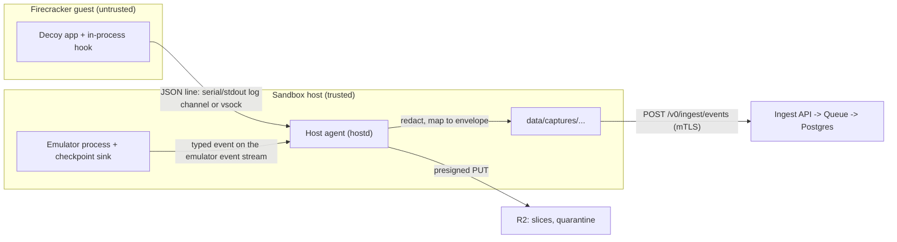

# Vulnerable-path instrumentation hooks

Issue #32. Related: [ADR 0005](adr/0005-capture-layer.md) (capture layer, #9), [ADR 0002](adr/0002-sandbox-runtime.md) (sandbox runtime), [ADR 0008](adr/0008-sandbox-host-agent.md) (host agent, #41), [privacy and retention](privacy-and-retention.md) (#16), [catalogue](catalogue.md) (#5), [rotation](rotation.md).

An HTTP 200 on `/admin` is weak evidence. "The upload path escaped its root with this request, then a shell script landed in `/tmp`" is strong evidence. Hooks give us the second kind: small pieces of trusted code that fire when an exact vulnerable condition runs on a decoy, and report it as a capture envelope on the `hook` channel.

This page covers hook kinds, the manifest, the event fields, how hooks are wired on sandboxes and emulators, post-exploit capture, request slices and redaction, safety rules, and how hook hits feed CVE mapping, confidence, IOCs and attempts.

## Hook kinds

| Kind (`kind`) | Where it runs | Used for | Milestone |
| --- | --- | --- | --- |
| `in_process` | A callback in the decoy app itself, or a library interposed in front of the vulnerable function, baked into the sandbox image at build time (ADR 0004). | Sandboxed apps we can build from source, such as the [demo app](../build/recipes/foiled-demo-app/README.md). | MVP (demo hook), v0.2 for other open source decoys |
| `emulator_checkpoint` | A named checkpoint inside a Foiled emulator, at the point where the emulated vulnerable path runs. | Emulator profiles (#30). | v0.2 |
| `ebpf_uprobe` | A uprobe on the host kernel, attached to a symbol in the decoy's binary. | Only where the decoy process is visible to the host kernel (the Docker lab fallback) and the binary and offsets are pinned by digest. Not possible inside a Firecracker guest. | Optional, v0.2+, only where stable |

We do not patch closed-source binaries to add hooks. For software we cannot build, we use an emulator or an open demo app instead.

## Hook manifest

Every hook has a manifest at `hooks/<id>.yaml`, validated by [`schemas/hook-manifest.schema.json`](../schemas/hook-manifest.schema.json) and parsed into `foiled_core::hooks::HookManifest`. The demo hook is [`hooks/demo-app.upload-path-traversal.yaml`](../hooks/demo-app.upload-path-traversal.yaml).

| Field | Required | Meaning |
| --- | --- | --- |
| `id` | yes | Hook id. Equals the file name and the envelope `hook.hook_id`. |
| `catalogue_ids` | yes | Catalogue entries the hook is baked into. Each of those entries lists the id in `instrumentation_hooks`. |
| `cve_id` | no | The CVE, or a synthetic `FOILED-DEMO-NNNN` id, whose vulnerable path the hook watches. |
| `kind` | yes | `in_process`, `emulator_checkpoint` or `ebpf_uprobe`. |
| `transport` | yes | Where the host agent reads hook lines: `log_channel`, `vsock` or `emulator_events`. |
| `stages` | yes | Which of `trigger`, `post_exploit` and `cleanup` the hook can emit. |
| `trigger` | yes | Plain description of the vulnerable condition that fires the hook. |
| `fields` | yes | Which envelope `hook` fields the hook fills in. |
| `redaction` | yes | `request_slice` (`follow_store_payloads` or `hash_only`), `inline_cap_bytes` (at most 4096) and optional `max_field_chars`. |
| `owner` | yes | Who maintains the hook code. |
| `source` | no | Repository path of the hook code. |

CI rules (`foiled-lint`):

- every file under `hooks/` validates against the manifest schema;
- every id in a catalogue entry's `instrumentation_hooks` has a `hooks/<id>.yaml`, whatever the entry's status;
- the lint's integration test checks each shipped manifest parses into the Rust type, its `id` matches its file name, and every catalogue entry it names declares it.

## Event fields

A hook hit is one capture envelope with `channel: hook` ([schema](../schemas/capture-event.schema.json), `foiled_core::capture::HookEvent`). The hook fields live in the envelope's `hook` object, exactly these names:

| Field | Required | Set by | Meaning |
| --- | --- | --- | --- |
| `hook_id` | yes | hook | Manifest id. |
| `catalogue_id` | yes | hook | Catalogue entry of the decoy. |
| `cve_id` | no | hook | From the manifest. |
| `stage` | yes | hook | `trigger`: the vulnerable condition ran. `post_exploit`: something the attacker did through it (commands, writes, implants). `cleanup`: the attacker removing traces (deleted files, cleared logs, killed processes). |
| `request_slice_ref` | no | host agent | R2 reference to the exact request slice that reached the vulnerable code, when it is stored and too large to inline. See [request slices](#request-slices-and-redaction). |
| `sequence_no` | yes | hook | Monotonic counter from the hook's process (in-process hooks) or session (emulator checkpoints). Orders hits that share a millisecond. |
| `t_offset_ms` | yes | hook | Milliseconds from the start of the request or session the hook is tracking. |
| `cmd_lines[]` | no | hook | Commands the attacker ran or tried to run, each truncated to `max_field_chars`. |
| `file_writes[]` | no | hook | Resolved guest paths written. |
| `implant_refs[]` | no | host agent | R2 `payload_ref`s of quarantined implants, when the host holds the bytes as it builds the envelope. |
| `notes` | no | hook | Short fixed text from the hook code. Never attacker input. |

Everything else about the hit goes in the envelope's free-form `data`: for the demo hook, `request_path`, `resolved_path`, the guest's own timestamp, and the slice hash or inline slice. The envelope `ts` is the host's time of reading the line, not the guest's clock. `source` and `tenant_id` are set at ingest as for every channel.

## Wiring: sandboxes and emulators



### Sandboxes (`in_process`)

1. The hook code is part of the image recipe, so its bytes are covered by `sources.lock` and the image digest. The demo app's hook is `_emit_hook` in [`server.py`](../build/recipes/foiled-demo-app/app/server.py).
2. When the condition holds, the hook writes one JSON line with `"kind": "hook"` and the field names above to the app's log stream. On Firecracker that is the serial or stdout log channel the host already reads (ADR 0002, ADR 0005). A hook that needs its own stream may use a vsock port instead; vsock stays off unless a declared hook needs it (ADR 0002). The Docker lab fallback reads the same lines from `docker logs`.
3. The host agent reads lines from the channel and, for each hook line (this is the contract for `crates/hostd`, which does not parse hook lines yet):
   - drops it unless `hook_id` is in the decoy's `CaptureHooks.instrumentation` list (the catalogue entry's `instrumentation_hooks`) and `stage` is in the manifest's `stages`;
   - drops lines over 16 KiB and rate-limits hook lines per decoy, so a guest cannot flood the buffer;
   - sets `catalogue_id`, `decoy_id`, `generation` and `ts` from its own records, not from the line;
   - applies the request slice rules below;
   - writes the envelope to the local capture buffer for upload.
4. A hook line that fails these checks is kept as an ordinary `application` line, so nothing is lost, but it never becomes a hook hit.

### Emulators (`emulator_checkpoint`)

Foiled emulators (#30) run as host-side processes in their own network namespace and are our own trusted code. A checkpoint calls an in-process sink, which emits a typed hook event straight onto the emulator's JSON event stream. There is no log parsing and no guest in between. The host agent applies the same allow-list, slice and buffer rules. Because the emulator holds any uploaded or written bytes in its virtual file system, the host agent can quarantine them at once and fill `implant_refs` on the same event.

Decoy modules that reuse third-party honeypots (#30) have no hooks; their logs are mapped by the module manifest instead.

### eBPF uprobes (`ebpf_uprobe`, optional)

A host-side uprobe reads arguments at a pinned symbol offset and emits the event from the host agent itself. It is only offered where the binary is pinned by digest and the runtime exposes the process to the host kernel. Never in a Firecracker guest.

## Post-exploit capture

A `trigger` says the vulnerable path ran. What the attacker did next is a `post_exploit` event, and attacker clean-up is a `cleanup` event, both from the same hook id and the same attempt.

| What | Field | Where it comes from |
| --- | --- | --- |
| Commands | `cmd_lines[]` | Emulator checkpoints that parse a command (for example a shell or `CONFIG SET` in an emulator), or an in-process hook wrapping an exec-like call. Each line is truncated to `max_field_chars`. Long sequences are split across several events with increasing `sequence_no` so each envelope stays under 16 KB. Process tracing (the `process` channel, v0.2) adds host-observed execs where the runtime allows. |
| File writes | `file_writes[]` | The resolved guest path, as the hook sees it after the vulnerable code ran. For sandboxes the host confirms it from the filesystem diff on flush ([rotation](rotation.md)); for emulators from the virtual FS write event. |
| Implants | `implant_refs[]` | R2 `payload_ref`s of files moved to quarantine (`r2://<bucket>/<tenant>/<decoy>/<attempt>/quarantine/<sha256>`). Only the host agent sets these, never the guest. |

How a written file reaches quarantine:

- **Emulators.** The host agent copies the bytes from the virtual FS write to `data/quarantine/<sha256>/`, uploads them with a presigned PUT from `POST /v0/uploads`, emits a `quarantine` envelope with `payload_ref`, and puts the same ref in `implant_refs` on the `post_exploit` hook event.
- **Sandboxes.** The guest disk is only read after the generation is paused, by the userspace FS diff parser at flush ([rotation](rotation.md), step 2). The `post_exploit` event goes out at once with `file_writes` and no `implant_refs`. At flush the host quarantines each changed file and emits a `quarantine` envelope with the same `attempt_id`, `payload_ref`, and in `data` the `guest_path`, `sha256` and the `hook_id` whose `file_writes` named that path. Attempt assembly (#25) joins the two by attempt and path. The quarantine `meta.json` records the same `guest_path` and `executed: false`.

Nothing written by an attacker is ever executed by Foiled: the demo app writes uploads to disk and never runs them, and quarantine is never mounted into any decoy (ADR 0005).

## Request slices and redaction

The request slice is the exact part of the request that reached the vulnerable code: for the demo hook, the request target with the `path` parameter; for a deserialisation hook, the blob. The host agent decides how to record it with `foiled_core::hooks::redact_request_slice(bytes, inline_cap, store_payloads)`:

| `store_payloads` (#16) | Slice | Result | In the envelope |
| --- | --- | --- | --- |
| `false` (default), or manifest `request_slice: hash_only` | any | `Hashed { sha256, len }` | `data.request_slice_sha256`, `data.request_slice_len`. The bytes are dropped after matchers and hooks have run on them in flight. |
| `true` | valid UTF-8, at most `inline_cap_bytes` (4 KiB cap) | `Inline(text)` | `data.request_slice` |
| `true` | larger than the cap, or binary | `NeedsUpload { sha256, len }` | Uploaded whole to R2 under the `hook` channel; `hook.request_slice_ref` holds the `payload_ref`, plus `data.request_slice_sha256` and `data.request_slice_len`. |

Other rules:

- Hooks truncate their own string fields (paths, commands) to `max_field_chars` before writing them. The demo app truncates at 2048 characters.
- `notes` is fixed text from the hook code, never copied from the request.
- Request bodies outside the slice are not sent by hooks. The demo hook never writes the upload body to its line.
- Slices and implants stored in R2 follow the TTLs in [privacy and retention](privacy-and-retention.md): objects under the `hook` channel take the `access_log` TTL, implants the `quarantine_file` TTL.

## Safety

- **Hooks fail open for the decoy.** If a hook cannot write its line, it swallows the error and the decoy carries on serving as the real vulnerable software would. A broken hook loses evidence, never the decoy. (#32 states this as "hooks fail closed, decoy still runs": the hook stops, the decoy does not.) Hooks are evidence, not a control: they never block, alter or slow a request.
- **Trusted-zone code only.** Hook code lives in this repository, is reviewed like any other change, and is baked into the image recipe or the emulator at build time. It is never fetched at run time, never loaded from a path inside the decoy, and never attacker-writable. The manifest's `source` points at it.
- **Never phone home.** Hooks write to a local log channel, vsock port or event stream only. They open no sockets and resolve no names. Deny-by-default egress (ADR 0003) would block them anyway.
- **Guest hook lines are untrusted.** After a successful exploit the attacker controls the guest and can forge hook lines. The host agent only accepts declared hook ids and stages, sets identity and time itself, and rate-limits. Confidence (#27) never takes event fields at face value, and a `trigger` that precedes any post-exploit activity is worth more than a later line from an already compromised guest.
- **No illegal patching.** We do not patch closed-source binaries to add hooks. Use an emulator or an open demo app.

## How hook hits are used

`foiled_core::hooks::hook_hits(events)` turns an attempt's events into the ordered list `HookHit { hook_id, cve_id, stage, event_id, ts }`, sorted by `ts`, then `sequence_no`, then `event_id`.

- **#12, CVE mapping tier 3** (vulnerable-code-path trigger detection): a `trigger` hit for a hook whose manifest names a `cve_id`, on a decoy whose catalogue entry declares that hook, is the tier 3 signal for that CVE. Tier 3 consumes hook events; it does not implement hooks.
- **#27, confidence**: each hit becomes evidence with `source: vuln_path_hook` and `ref` set to the hook event id. It is the strongest default tier weight (above sequence fingerprints and signatures), so hook plus sequence can reach `high`.
- **#34, IOC extraction**: `cmd_lines` become `cmdline` IOCs, `implant_refs` and quarantine hashes become `file_sha256`, slice hashes become `payload_sha256`, and the ordered hook pattern feeds the `behaviour_fingerprint`.
- **#25, attempts**: `hook_hits[]` on the attempt is exactly the `hook_hits` output, and quarantine `payload_ref`s land in `payload_refs[]`. A `trigger` hit moves the attempt to `exploit`; a `post_exploit` hit moves it to `post-exploitation`.

## Demo walk-through

The demo app ([recipe](../build/recipes/foiled-demo-app/README.md)) carries the synthetic weakness `FOILED-DEMO-0001`, an unauthenticated file write through `POST /api/upload?path=...`.

1. `POST /api/upload?path=../../../tmp/x.sh` resolves outside the upload root. Before the write, the hook emits a `trigger` line.
2. The app writes the file. Because the name ends in `.sh`, the hook emits a `post_exploit` line with `file_writes: ["/tmp/x.sh"]`. The script is never executed.
3. At flush, the host quarantines `/tmp/x.sh` and emits a `quarantine` envelope with the `payload_ref`.

The envelopes for that sequence are fixtures in [`testdata/capture/`](../testdata/capture/) (`demo-exploit-1-hook-trigger.json`, `demo-exploit-2-hook-post-exploit.json`, `demo-exploit-3-quarantine.json`). They validate against the envelope schema, and `crates/lint/tests/hooks.rs` checks they yield two ordered hook hits plus a quarantine `payload_ref` in the same attempt. The app's own tests cover both hook lines:

```sh
python3 -m unittest discover -s build/recipes/foiled-demo-app/app -v
cargo test -p foiled-core hooks
cargo test -p foiled-lint --test hooks
```

## Adding a hook

1. Write the hook code in the decoy's recipe or emulator, following the safety rules above.
2. Add `hooks/<id>.yaml` and list the id in the catalogue entry's `instrumentation_hooks`.
3. Add capture fixtures under `testdata/capture/` for each stage the hook emits.
4. Run `cargo run -p foiled-lint -- .` and the recipe's tests.
