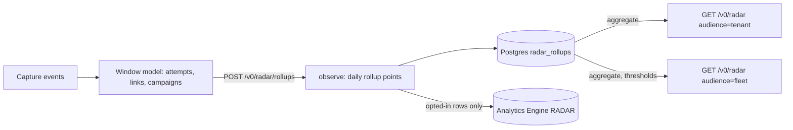

# Radar

Status: built in #35. Related: the review queue ([review-queue.md](review-queue.md)), research write-ups and public exploit pages ([research-writeups.md](research-writeups.md)), the confidence layer ([confidence.md](confidence.md), #27), pre-disclosure tracking ([exploit-attribution.md](exploit-attribution.md#tier-4-pre-disclosure-watchlist-implement-in-v03), #12), campaigns ([campaigns.md](campaigns.md), #33), IOCs ([iocs.md](iocs.md), #34), contribute-back and the share policy ([contribute-back.md](contribute-back.md), #37), edge sensors ([deploy/edge-sensor.md](deploy/edge-sensor.md), #31), alerting ([alerting.md](alerting.md), #15), the operator console (#14), [ADR 0001](adr/0001-architecture.md) and [ADR 0009](adr/0009-axum-workers-and-front-end.md).

The radar is the fleet-wide view of what is being exploited: counts and trends per CVE, ATT&CK technique, campaign and product over time, with headline cards. **It is trusted-side only**: operators see it through the API and the console (#14); there is no public radar ([ADR 0011](adr/0011-public-pages-on-the-web-worker.md)). It counts operator-designated research sensors and, behind thresholds, sensors whose owners opted in. It only ever returns counts, never a tenant, sensor, source address or attempt.

Code: `foiled_core::radar` (pure) and `crates/api/src/routes/radar.rs`. Schemas: [radar-feed.schema.json](../schemas/radar-feed.schema.json) and [radar-point.schema.json](../schemas/radar-point.schema.json). Golden fixtures: `testdata/radar/`.

## How it is built

1. **Rollup.** `POST /v0/radar/rollups` with `{"day": <ms>}` builds the caller's tenant's attempts for one closed UTC day (with a day either side so attempts crossing midnight stay whole), scores every link with analyst overrides applied (#27), clusters campaigns (#33) and calls `radar::observe`. Each point is one key on one day from one sensor and one hashed source, with the best confidence seen. The tenant-day is replaced in Postgres, so a rollup is idempotent. Audited as `radar.rollup`.
2. **Analytics Engine.** Rows from sensors that may feed the radar (opted in, allowed kind) also go to the `RADAR` dataset through the `RadarSink` trait (ADR 0001). Tests use `MemoryRadarSink`. See [what Analytics Engine stores](#what-analytics-engine-stores).
3. **Aggregate.** Reads call `radar::aggregate` over the rollups for a window (default 30 days, at most 92), with the policy below.

A scheduled rollup of every tenant each night needs a tenant list the Worker does not have yet; until then an operator (or a cron that calls the endpoint with an operator token) runs the rollup per tenant.

### What counts

| Dimension | Key | Counted when | Wording |
| --- | --- | --- | --- |
| `cve` | CVE or FOILED-DEMO id | The attempt's CVE link reaches `radar_queue_min` (40) and is not an analyst false positive. | we assess as |
| `technique` | ATT&CK id | The same, for technique links (#26). | we assess as |
| `campaign` | `cmp_` id | The attempt's campaign scores at least `radar_queue_min`. | possible |
| `product` | `vendor/product` | The attempt got past `probe` (#25). Band is the attempt's best link. | observed |

Each point also records whether the link was **publishable** (#27: at least `publish_min`, and never LLM-only, pre-disclosure-only or catalogue-only without an analyst) and whether pre-disclosure evidence (#12) was part of it.

### Research and edge

Only decoys in tenants the operator lists in the API Worker var `RESEARCH_TENANTS` are **research** sensors: Foiled's own vantage points, which share by default and can opt out (#37). Everything else is treated as **edge**: an edge sensor (#31) with its recorded opt-in, and a tenant's own sandbox decoys with their host's recorded opt-in. Missing choices are off. So a customer's decoys never feed the fleet radar until the customer opts in, and then only behind the edge-tenant threshold.

## Policy and privacy

The limits live in the `radar` section of [configs/contribute-back.yaml](../configs/contribute-back.yaml) (`SharePolicy::radar`; a test keeps the file equal to the code default). `foiled-lint` refuses a policy with `min_sources` or `min_edge_tenants` below 2.

| Setting | Default | Effect |
| --- | --- | --- |
| `enabled` | true | Off hides the fleet radar. A tenant's own radar still works. |
| `sensor_kinds` | research, edge | Kinds that may feed the fleet radar. Each sensor must also be opted in. |
| `min_sources` | 3 | A bucket (one key on one day) is shown only with at least this many distinct sources. |
| `min_sensors` | 1 | And at least this many distinct sensors. |
| `min_edge_tenants` | 3 | Edge rows count in a bucket only when this many tenants contribute edge rows to it. Otherwise they are dropped from the bucket and the research rows stand alone. |
| `min_confidence` | medium | Lowest band counted at all. |

### Audiences

| Audience | Route | Data | Thresholds |
| --- | --- | --- | --- |
| `tenant` | `GET /v0/radar` (default), `review:read` | The caller's tenant only, every sensor (the tenant's own data needs no opt-in). | None |
| `fleet` | `GET /v0/radar?audience=fleet`, `review:read` | Every tenant, opted-in sensors of the allowed kinds only. | All |

Both show closed days only and apply `min_confidence`. `suppressed_buckets` says how many buckets or slices were held back; `notes` say when days were held back.

### No differencing

Every number the fleet feed returns must pass the thresholds on its own, and so must anything a reader could compute by subtracting one number from another:

- **Cells.** After the edge-tenant rule has run on the whole bucket, the bucket is split into cells by product and by publishable or not. Every number the feed can show for the bucket (the total, a `product` slice, the publishable part) is a sum of cells.
- **Product filter.** A `product` slice is shown only when **every** product slice of the bucket passes on its own. Then any difference of shown numbers (total minus A minus B, say) is a sum of passing slices, which passes too. With products A and B at three tenants each and C at one tenant, no slice is shown; only the whole bucket is. `crates/core/src/radar.rs` tests the two-way and three-way cases.
- **Publishable split.** `publishable_attempts` is reported only when every (product, publishable) cell of the bucket passes; otherwise it is zero and the day makes no headline.
- Key and dimension filters select whole buckets, so they cannot be differenced.

### Privacy notes

- Rollup rows carry a truncated SHA-256 of the source address so distinct sources can be counted. That is not anonymous on its own (the IPv4 space is small), so the hash is never returned and never written to Analytics Engine.
- Tenant ids, sensor ids and decoy ids are in the rollup rows for scoping and for the edge-tenant threshold, and never in a feed.
- There is no public route for the radar. `crates/api/tests/radar.rs` checks tenant isolation, opt-in, the edge-tenant threshold and that tenant decoys are not research.

### What Analytics Engine stores

One data point per rollup row, only for rows whose sensor may feed the radar under the share policy (opted in, allowed kind):

| Field | Value |
| --- | --- |
| index | `<dimension>:<key>`, for example `cve:CVE-2099-0001` (public identifiers, not the tenant) |
| blobs | dimension, key, `vendor/product`, sensor kind (`research` or `edge`), band |
| doubles | attempts, score, publishable (0 or 1), pre-disclosure (0 or 1), day (Unix ms) |

No tenant, sensor, decoy, source hash or attempt is written. Rows from sensors that did not opt in stay in the tenant's own Postgres rollup only. The dataset is private to the account and keeps three months; long-range trends come from the Postgres rollups. (The ingest consumer separately counts raw events per catalogue entry for operations, as ADR 0009 describes.)

## Feed shape and filters

A feed (`radar-feed.schema.json`) has the applied `policy`, the window actually shown (`since`, `until`), `suppressed_buckets`, `notes`, and:

- `series`: one per key, biggest first within each dimension (at most `limit`, default 20, per dimension). Each has the wording, totals, best band, first and last day shown, one entry per day in the window (`attempts`, `publishable_attempts`, `sources`; zero on days under the thresholds) and a `trend` (second half of the window against the first: `up` at 10% or more, `down` at -10% or less).
- `cards`: headlines, newest first.

Filters: `dimension`, `key` (case-insensitive), `product` (`vendor/product`, applies to every dimension, see [No differencing](#no-differencing)), `since`, `until`, `limit`. No route takes another tenant's id.

### Cards

| Kind | When |
| --- | --- |
| `new_cve_assessment` | A CVE first shown in the last two days of the window, with a high, publishable link. |
| `campaign_emergence` | A campaign first shown in the last two days of the window. |
| `spike` | The last shown day has at least ten attempts and three times the average of the earlier shown days (three shown days or more). |
| `predisclosure_spike` | A spike on a CVE whose counted links carry pre-disclosure evidence (#12). |

Cards are built from `publishable_attempts` only. **A low-confidence or LLM-only link never becomes a headline**: it is not publishable (#27, #28), so it contributes nothing to a card. Headlines keep the cautious wording ("attempts we assess as targeting", "possible new campaign").

Sensor anomalies (a sensor going quiet or a sudden network move) are not cards yet: the signals live in the sensor registry (#31) and the console (#14) will show them.

## Tabletop: novel traffic to a confirmed CVE

1. A research decoy sees consistent traffic to a path with no CVE; the pre-disclosure watchlist records it (#12).
2. An advisory appears and back-matches. The CVE link carries `predisclosure_backmatch` evidence, which alone stays below publish, so it shows on the tenant and fleet radar but is not a headline.
3. The review queue shows a `predisclosure_candidate` (4 hour SLA). An analyst confirms it; the override makes the link publishable.
4. The next rollup counts it as publishable. A jump in attempts now produces a `predisclosure_spike` card.
5. The analyst promotes the item to a write-up draft with the first-seen and advisory dates for the timeline ([research-writeups.md](research-writeups.md)).
