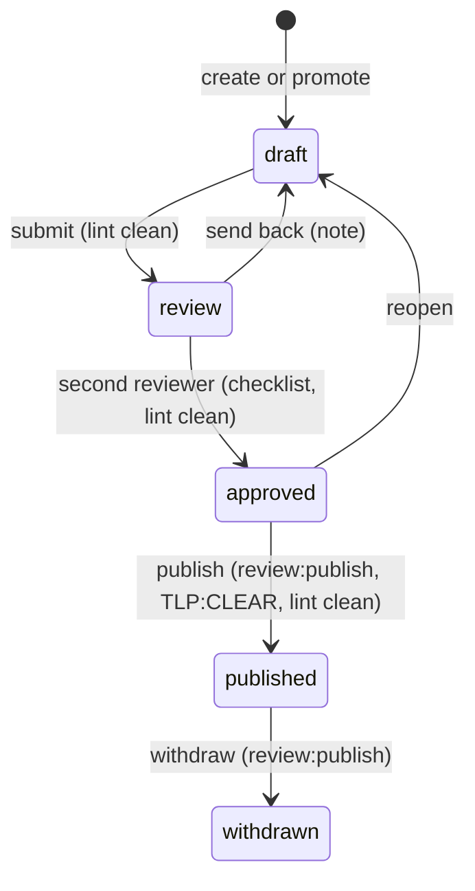

# Research write-ups and public exploit pages

Status: built in #35. Related: [review-queue.md](review-queue.md), [radar.md](radar.md), [confidence.md](confidence.md) (#27), pre-disclosure and advisory dates ([exploit-attribution.md](exploit-attribution.md), #12), IOCs ([iocs.md](iocs.md), #34), the delayed public IOC rules ([contribute-back.md](contribute-back.md#delayed-public-iocs), #37), campaigns (#33), actor possible-association (#29), the design system and voice rules ([ui/design-system.md](ui/design-system.md), [ui/voice.md](ui/voice.md), #39), the console (#14) and [ADR 0011](adr/0011-public-pages-on-the-web-worker.md).

A write-up is a careful public note about exploitation Foiled saw. It is drafted from a review queue item, checked by lint and a second reviewer, and published as an allow-listed snapshot on the public site. Code: `foiled_core::writeup` (lint, workflow, public snapshot), `foiled_core::markdown` (the safe Markdown subset), `crates/api/src/routes/writeups.rs`, `crates/api/src/routes/public.rs` and `web/app/routes/public/`. Schemas: [write-up.schema.json](../schemas/write-up.schema.json), [public-exploit-page.schema.json](../schemas/public-exploit-page.schema.json), [public-exploit-list.schema.json](../schemas/public-exploit-list.schema.json). Goldens: `testdata/write-ups/` and `testdata/public/`.

## Workflow

- Edits happen only in `draft`, with `expected_version`. Every edit and every move is a new version: the whole record is stored in `writeup_versions` (append-only) and audited (`writeup.create`, `writeup.edit`, `writeup.<status>`). `GET /v0/write-ups/{id}/versions` lists them.
- **Second reviewer.** The approver must not be the author, nor anyone who created, edited or submitted the write-up since it was last approved (read from the stored versions). So a reviewer who sends a draft back, edits it and resubmits it cannot then approve it alone. The reviewer ticks every [checklist](#checklist) item; approval through the review queue (`write_up` items) runs the same checks.
- **Publish** needs `review:publish` (an operator scope, never held by MCP tokens), a tenant listed in the Worker var `PUBLISHER_TENANTS` (unset means nobody publishes), TLP:CLEAR, a clean lint, and a slug no other published write-up holds. The version check (compare and set on the write-up) runs before the public snapshot is written, so of two publish requests only the winner writes a page, and the loser changes nothing. Snapshots are stored by version, so an older one never replaces a newer one. A slug held by another write-up puts the write-up back to `approved` (recorded as a `revert.publish` version) without touching the other page. The page is visible from the later of the publish time and `embargo_until`.
- **Withdraw** removes the public page and purges its URLs first, then moves the write-up. If removing the page fails, the write-up stays published and the withdrawal can simply be retried. Withdrawing a write-up that is already withdrawn retries the removal and purge without a new version (see [Caching and withdrawal](#caching-and-withdrawal)).
- If the slug-clash revert itself loses its version check, the request fails with `publish_incomplete` (409) and an audited `writeup.publish_revert_failed`: the write-up reads published but has no page, and the operator withdraws it.
- Nothing is ever posted to social networks or anywhere else. Adding that would need its own explicit operator action and approval.

### From the queue

`promote` on a CVE, pre-disclosure, technique or campaign item creates a draft with the CVE and technique ids, the campaign id, the attempts (at most 50, never published), the first-seen time and `source_item_id`. Its body template has `TODO` markers, which fail lint on purpose, so a draft cannot be submitted until a person has written it.

## Fields

| Field | Notes |
| --- | --- |
| `slug` | Lowercase words joined by hyphens, at most 80 characters. The public path is `/exploited/<slug>`. |
| `title`, `summary` | At most 160 and 400 characters. Shown escaped. |
| `body_md` | The [Markdown subset](#markdown), at most 64 KiB. |
| `tlp` | TLP 2.0. Only `clear` is published on public pages. |
| `embargo_until` | Not visible before this time, even when published. |
| `cve_ids`, `technique_ids` | Normalised (`CVE-2099-0001`, `FOILED-DEMO-0001`, `T1190`, `T1059.004`). |
| `campaign_ids`, `attempt_ids` | Internal context for the timeline and confirmations. Never published. |
| `ioc_ids` | IOCs to release with the page. See [IOCs](#iocs-on-a-page). |
| `first_seen` | First sighting on Foiled sensors. |
| `redacted_payload` | A short excerpt (at most 2,000 characters), run through `foiled_core::redact` on every save, shown as plain text. |

## Lint

`foiled_core::writeup::lint` runs on every read (returned as `lint`) and must have no errors to submit, approve or publish. Each title, summary, body block and list item is checked on its own.

| Rule | Severity | Fails when |
| --- | --- | --- |
| `assessed-wording` | error | A CVE id an analyst has not confirmed appears without "we assess as" in the same paragraph. |
| `confirmed-without-analyst` | error | "confirmed" appears without every CVE or technique named in the paragraph having an analyst confirmation (#27) on the write-up's attempts. "not confirmed" is fine. |
| `actor-wording` | error | A paragraph about an actor (APT plus digits, actor, attributed, attribution, nexus, state-sponsored) lacks "possible association" (#29). |
| `tenant-data` | error | The owner's tenant id (as a whole word), `tenant_id`, or an internal `att_`, `rq_` or `wu_` id appears. |
| `personal-information` | error | An email address appears. |
| `ip-address` | error | An IPv4 address outside the RFC 5737 documentation ranges appears, defanged or not. Indicators go out through the [delayed IOC list](#iocs-on-a-page), never the body. |
| `exploit-code` | error | A fenced code block in a programming or shell language, a code block over 20 lines, or a runnable marker (`curl `, `wget `, `sh -c`, `\| sh`, `powershell`, `base64 -d` and similar) in code or the payload excerpt. Mask with `[REDACTED]` or defang. |
| `placeholder` | error | TODO, TBD, FIXME, XXX, lorem, placeholder or `[insert`. |
| `raw-html` | error | Anything that looks like an HTML tag. It is shown as text, never rendered, but it does not belong in a write-up. |
| `unsafe-link` | error | A link that is not `https://` or site-relative. |
| `sources` | error | CVE ids are set but the body links no source. |
| `em-dash` | error | An em dash (house style). |
| `required`, `length`, `slug` | error | Missing title or summary, or a field over its limit. |
| `tlp` | warning | TLP is not `clear`: the write-up cannot be published publicly. |

Code blocks and the payload excerpt are attacker text, so only the privacy rules (tenant data, personal information, addresses, placeholders) and the exploit-code rule apply to them.

## Checklist

The second reviewer confirms each item; approval fails unless all are true (`Checklist` in the schema).

1. **Privacy** (`tenant_data_removed`): no tenant ids, customer names, sensor, decoy or attempt ids, hostnames or personal information. Lint catches tenant ids and internal ids; the reviewer catches names.
2. **Wording** (`wording_checked`): "we assess as" for unconfirmed CVE links, "possible association" for actors, "confirmed" only where an analyst confirmed.
3. **No exploit code** (`no_exploit_code`): nothing runnable, no full request that reproduces the exploit.
4. **Redaction** (`payloads_redacted`): payload excerpts have secrets masked and commands and URLs defanged.
5. **Sources** (`sources_linked`): every claim about a CVE or advisory links its public source (vendor advisory, NVD, CISA KEV).
6. **Delay rules** (`delay_rules_checked`): IOCs are listed in `ioc_ids` and approved in the queue, not pasted into the body, and the reviewer has checked the delay and TLP from [contribute-back.md](contribute-back.md#delayed-public-iocs).

Tabletop: a draft that mentions the customer's tenant id fails `tenant-data` at submit, and if it somehow reached publish, `page_leaks` refuses to store a snapshot that contains the tenant id or any never-shared key (`tenant_data`, 422).

## Markdown

Bodies are parsed by `foiled_core::markdown` into a tree of blocks and inlines, never into HTML. The public pages render the tree as React elements, so text is escaped by construction and there is no raw HTML path: `<script>` in a body is shown as the text `<script>`.

- Blocks: headings (`#` to `###`, shown as `h2` to `h4` because the title is the only `h1`), paragraphs, `-` or `*` lists, `1.` lists, `>` quotes, `---` rules and fenced code blocks (the language is dropped).
- Inlines: `**strong**`, `*emphasis*`, `` `code` `` and `[text](url)`.
- Links keep only `https://` URLs with a plain host and site-relative paths. `javascript:`, `data:`, `http:`, protocol-relative `//host` and credentials in the host drop the link and keep its text. The front end checks again before rendering and adds `rel="nofollow noopener noreferrer ugc"` to external links.
- Control, bidi and zero-width characters are shown as `\u{...}` escapes in Rust and again by `toPrintable` in the front end.
- Parsing is linear in the input, bodies over 64 KiB are cut and at most 2,000 blocks are kept.

## Public exploit pages

The page template (`public-exploit-page.schema.json`), built only by `writeup::public_page` from an allow-list of fields:

| Field | Shown as |
| --- | --- |
| `title`, `summary`, `body` | The write-up, escaped; the body tree as above. |
| `cves`, `techniques` | Each id with its assessment status: "We assess as" or "Confirmed", the analyst confirm date and the advisory date. |
| `timeline` | First seen on Foiled sensors, advisory published (from the bundled advisories, #12), analyst confirmed, published. This is where the first-seen against advisory lead time shows. |
| `redacted_payload` | The redacted excerpt as plain text. |
| `iocs` | Released indicators: type, defanged display, first-seen day, release time, TLP. Never the raw value. |
| `tlp`, `published_at`, `visible_from`, `version`, `canonical_path` | Metadata. |

Never on a page: tenant, author, reviewer, attempt, campaign, sensor, decoy or IOC ids, raw IOC values, scores, enrichment fields, or HTML.

### IOCs on a page

An IOC listed in `ioc_ids` is released only when all of these hold (the rules in [contribute-back.md](contribute-back.md#release-rule)):

- its `ioc_publication` item is approved in the review queue (the analyst confirm);
- it was seen on a sensor that may feed public IOCs (research sensors by default; edge only if `public_iocs.sensor_kinds` includes it and the sensor opted in);
- its band is at or above `public_iocs.min_confidence` (high by default);
- the policy TLP is `clear` (TLP:GREEN IOCs go to the account-gated dataset only);
- and `public_iocs.delay_days` (7) have passed since the first sighting on such a sensor.

IOCs still in their delay are stored with their release time and filtered out on every read, so a page published early grows its IOC list as the delays pass.

### Caching and withdrawal

- Successful public responses (API and pages) send `Cache-Control: public, max-age=60, s-maxage=60`, with no `stale-while-revalidate`; 404s send `public, max-age=60`; anything else sends `no-store`.
- The public Worker redirects any page, list, sitemap or data URL that carries a query string to the same path without it, so each page has exactly one URL to cache and purge. Built assets keep their query strings.
- On publish and withdrawal the API purges the page URL, its data URL, the list and the sitemap from Cloudflare's cache through the zone purge API (`CachePurger`; needs the vars `PUBLIC_SITE_ORIGIN` and `PUBLIC_ZONE_ID` and the secret `CF_CACHE_PURGE_API_TOKEN` with only *Zone, Cache Purge*). Without them, nothing is purged and pages leave caches when their max-age runs out. A failed purge is recorded in the audit detail (`cache_purge_failed`).
- **Residual window.** After a withdrawal the API stops serving the page at once. A browser or other cache outside Cloudflare that already holds it may keep showing it for up to 60 seconds, and Cloudflare's purge itself takes a few seconds to reach every data centre. Without a purge token, Cloudflare may also serve it for up to 60 seconds.

### What the public routes can read

`GET /v0/public/exploited` and `GET /v0/public/exploited/{slug}` read only the `public_pages` table, and only its `page` column, filtered to `visible_from <= now`. They take no credentials and ignore any that are sent. Drafts, items in review, approved but unpublished, withdrawn, embargoed and TLP:GREEN write-ups are never in that table or never visible. `crates/api/tests/public.rs` tries each of these, plus forged credentials, path tricks and a scan of every response for tenant, principal, sensor and attempt identifiers.

### Public site

The public pages are routes in the existing front end (`web/`), deployed a second time as `foiled-public` with `FOILED_SURFACE=public` ([ADR 0011](adr/0011-public-pages-on-the-web-worker.md)):

| Path | What |
| --- | --- |
| `/exploited` | Published pages, newest first. |
| `/exploited/<slug>` | One page. |
| `/robots.txt`, `/sitemap.xml` | Allow only the public paths; list the published pages. |

There is no public radar: the radar is trusted-side only ([radar.md](radar.md), [ADR 0011](adr/0011-public-pages-on-the-web-worker.md)).

- **Surface guard.** On the public surface the Worker serves only those paths, their data requests and built assets; everything else (the console, `/design`, `/radar`, React Router's `/__manifest`) is a plain 404. Public pages use plain links, so they never need route discovery. A missing or mistyped `FOILED_SURFACE` is treated as public, so a misconfiguration fails closed. The page loaders can only call API paths under `/v0/public/`.
- **Caching.** See [Caching and withdrawal](#caching-and-withdrawal). Console responses send `private, no-store` and `X-Robots-Tag: noindex`.
- **Rate limits.** The public Worker limits each client address to 120 requests a minute with a Workers Rate Limiting binding (`PUBLIC_RATE_LIMIT`, 429 with `Retry-After`), and forwards the address to the API, which keeps its own 120 a minute per client on `/v0/public/*`. The list reads at most 100 pages, and the sitemap lists at most 100.
- **Headers.** `X-Content-Type-Options: nosniff`, `Referrer-Policy`, `X-Frame-Options: DENY` and a Content-Security-Policy with `default-src 'self'`, `object-src 'none'`, `base-uri 'none'` and `frame-ancestors 'none'`.
- **SEO.** Each page has a title, description, absolute canonical link, Open Graph tags and `index, follow`; 404s are `noindex`.
- **Voice.** Wording chips follow [ui/voice.md](ui/voice.md): "We assess as" unless the API says "confirmed". Public pages show no scores.
