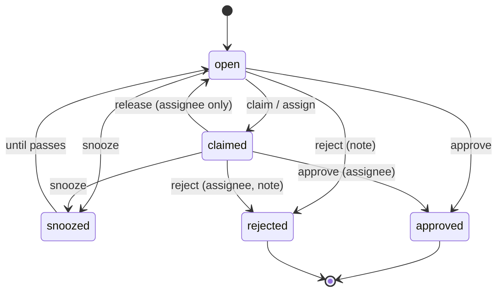

# Review queue

Status: built in #35. The console screens are #14. Related: [radar.md](radar.md), [research-writeups.md](research-writeups.md), [confidence.md](confidence.md) (#27), [exploit-attribution.md](exploit-attribution.md) (#12), [attack-mapping.md](attack-mapping.md) (#26), [campaigns.md](campaigns.md#analyst-actions) (#33), [iocs.md](iocs.md) (#34), [contribute-back.md](contribute-back.md#delayed-public-iocs) (#37), [alerting.md](alerting.md#review-queue-instead-of-paging) (#15), actor possible-association (#29).

One queue for everything that needs a person before it is trusted or published. Code: `foiled_core::review` (state machine, priority, SLA), `crates/api/src/routes/review.rs` (derivation and actions). Schema: [review-item.schema.json](../schemas/review-item.schema.json). Golden: `testdata/review/expected/`.

## Item types

Items are derived on read from the same window model as attempts (default the last 7 days, at most 31 days and 20,000 events), so there is no second copy of the evidence. Only the analyst state is stored.

| Kind | Source | Appears when | SLA | Approve records | Reject records |
| --- | --- | --- | --- | --- | --- |
| `predisclosure_candidate` | CVE link with pre-disclosure back-match evidence (#12) | Link reaches `radar_queue_min` (40) | 4 h | Link override `true_positive` | Link override `false_positive` |
| `cve_link` | Attempt to CVE link (#12, #27) | Link reaches `radar_queue_min` | 24 h | Link override `true_positive`: wording becomes "confirmed" | `false_positive`: score 0 |
| `write_up` | Write-up submitted for review | Status `review` | 48 h | Transition to `approved` (needs a reviewer who is not the author and the full checklist) | Back to `draft` with the note |
| `ioc_publication` | IOC (#34) from a sensor that may feed public IOCs (#37), at or above the release band (default high) | Always, for eligible IOCs | 48 h | Cleared for the delayed public IOC list | Kept private |
| `actor_association` | Actor link from the actor engine (#29, [actor-attribution.md](actor-attribution.md)) | The link needs attention (`review_queue`): pending at or above `radar_queue_min`, or confirmed with attempts added since. Each such change is a new item (`subject.revision`) | 72 h | Actor link decision `confirm` (needs a note), through `record_decision` | Actor link decision `reject` |
| `campaign_label` | Campaign (#33) with no analyst feedback | Confidence reaches `radar_queue_min` | 72 h | Campaign `feedback` `true_positive`, plus a `label` action when a `label` is given | Campaign `feedback` `false_positive` |
| `campaign_merge` | Campaign merge proposal: two campaigns clustering refused to join because one source's attempts were the only bridge (#33 `possible_links`) | Both campaigns are in the window | 72 h | Campaign `merge` action folding the newer into the older | Nothing besides the queue state |
| `false_positive_feedback` | A CVE or technique link an analyst marked `unsure`, for example after a false-positive report from an operator or customer | The `unsure` override exists | 24 h | Link override `true_positive` | Link override `false_positive` |
| `technique_link` | Attempt to technique link (#26) | Link reaches `radar_queue_min` | 72 h | Link override `true_positive` | `false_positive` |

A decision made outside the queue counts: an override on `/v0/attempts/{id}/links`, campaign feedback, or a write-up transition shows the item as decided, and it can no longer be acted on in the queue.

Every item carries `wording` from the confidence layer ("we assess as", "possible", "possible association", "confirmed"), and its `title` is escaped (`timeline::printable`) because it quotes attacker text such as paths and user agents.

### Actor possible-associations (#29)

The queue runs the actor engine (`routes::actors::match_window`, the same matching as `GET /v0/actor-links`) over the window it already built, so actor items cost no second window build. Each pending link with `review_queue` set is an open item; links confirmed or rejected on `/v0/actor-links/{id}/decision` show as decided. Approve and reject go through `routes::actors::record_decision`, so the decision is stored, scored and audited (`actor_link.<decision>`) exactly as on the actor-links route, with its note rules and rate limit. Whatever `record_decision` stores travels with the decision (for example the attempts a decision covers, #88), because the queue does not record actor decisions itself. The item title is the link's own statement, and the wording stays "possible association" unless an analyst confirmed it.

### Alerts (#15)

Medium alerts routed `ToReviewQueue` ([alerting.md](alerting.md#review-queue-instead-of-paging)) describe the same subjects the queue derives: a `cve_assessed` or demoted `vuln_path_hook_fired` alert is the `cve_link` item for that attempt and CVE, and `campaign_updated` is the `campaign_label` or `campaign_merge` item. Operations items for `honeyscore_high` and `decoy_burnt` need a stored item kind and are left for the delivery worker follow-up in #15.

## State and actions

Stored per item: status, assignee, claim time, snooze, decision, note and a version. Writes compare and set on the version, so two analysts cannot both decide an item.

- `claim` takes the item; `assign` gives it to a token id; only the assignee can `release`, `approve` or `reject` a claimed item (anyone with `review:write` can reassign it).
- `snooze` hides it until a time at most 30 days away; it comes back as open (or claimed) when that passes.
- `approve` and `reject` are final. Reject needs a note. A decision runs in three steps, because the store has no transaction across the queue, overrides, campaign actions, actor decisions and write-ups:
  1. The item is claimed with compare and set as `needs_attention`, holding the pending decision, so of two analysts acting at once only one goes on.
  2. The effect is applied where it belongs. Effects are idempotent: campaign actions get ids derived from the item and the decision (`review::effect_id`), overrides and actor decisions are upserts, and a write-up already in the target state is left alone. A retry cannot duplicate them.
  3. The decision is recorded (compare and set from the marker).

  If the effect fails, the item is put back as it was. If that rollback fails, it is audited as `review.rollback_failed` (outcome `failed`) and the item stays `needs_attention`: first in the queue (priority 2,000), listed under `status=needs_attention`, and open to a new decision after one minute (`DECISION_LEASE_MS`). A decision that took effect but could not be recorded is audited as `review.record_failed` and handled the same way.
- A decision can remove its own subject (a merge joins the two campaigns; a decided `unsure` link becomes an ordinary decided `cve_link` item). The action still returns the item as decided.
- `promote` starts a draft write-up from a CVE, pre-disclosure, technique or campaign item ([research-writeups.md](research-writeups.md#from-the-queue)). It does not decide the item.
- Every action is audited as `review.<action>` with the item kind, subject and effect. Link overrides are also audited as `link.override` on the attempt, campaign actions as `campaign.<action>`, and write-up moves as `writeup.<status>`.
- `expected_version` refuses an action if the item changed since it was read (409).

## Priority and SLA

`priority = base(kind) + score + urgency`, where base is 400 for pre-disclosure, 350 write-ups, 300 CVE links and false-positive feedback, 250 actors, 200 IOCs, campaign labels and merge proposals, 150 techniques; score is the link's 0 to 100; urgency grows from 0 to 100 over the SLA and jumps to 200 once overdue. Snoozed and decided items are 0. The list is sorted by priority, then oldest first, then id. `sla_due_at = created_at + sla_hours`, where `created_at` is when the evidence was first seen (or when the write-up was submitted), and `sla_breached` is true for undecided items past it.

## API

| Method and path | Scope | What |
| --- | --- | --- |
| `GET /v0/review-queue` | `review:read` | Items, filtered by `kind`, `status` (`pending` by default: open, claimed and snoozed), `assignee` (`me` or a token id), `sla_breached`, `since`, `until`, `limit`. Returns `total` before the limit. |
| `GET /v0/review-queue/{item_id}` | `review:read` | One item. |
| `POST /v0/review-queue/{item_id}/actions` | `review:write` | `claim`, `assign`, `release`, `approve`, `reject`, `snooze` or `promote`. |

Every route is scoped to the caller's tenant: items are derived from the caller's own data, item ids include the tenant, and another tenant's id is a 404. Actions share a rate limit with write-up writes and radar rollups (240 an hour per token by default). The contract is in [api/openapi.yaml](../api/openapi.yaml).

## Storage

Postgres `review_states` (`migrations/postgres/0010_review_writeups_radar.sql`): one row per item that has had an action, keyed by tenant and item id, with a version for compare and set. Link overrides and campaign actions keep their own tables.
