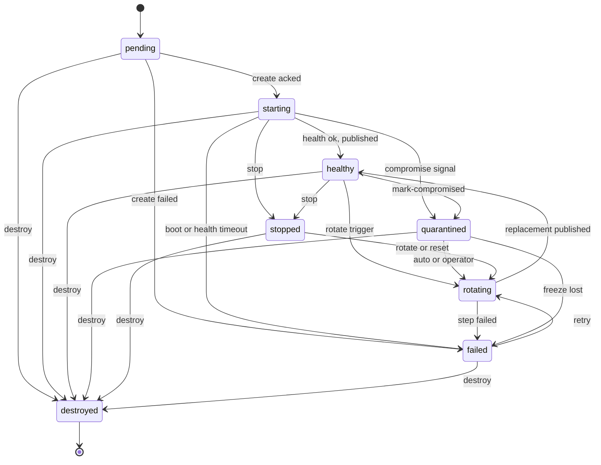
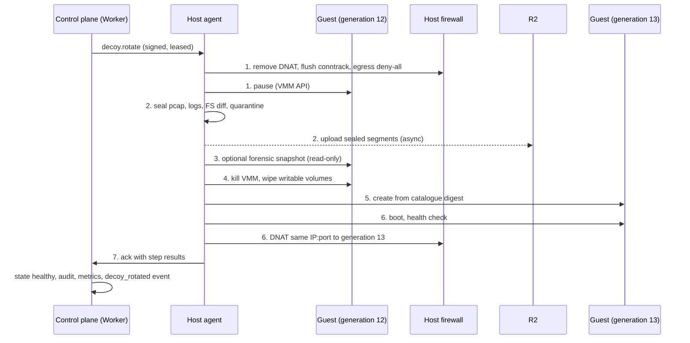
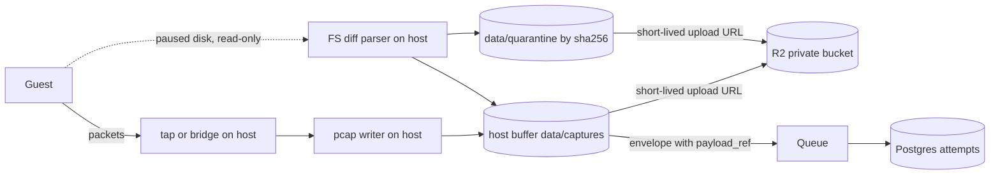

# Rotation and reset of compromised or aged decoys

Status: design, tracks #8. Implemented by the control plane API (#21) and the sandbox host agent (#41).

A decoy that has been owned must not become a durable foothold on the operator's infrastructure. Foiled treats every sandbox guest as disposable: freeze it, keep the evidence on the host, destroy the guest, and boot a clean replacement from the same catalogue digest. Rotation also caps how long any accidental egress misconfiguration (#4) can matter.

This document is the contract for that behaviour. It defines the decoy lifecycle state machine, the rotation sequence as an ordered checklist, the host agent jobs each step maps to, the triggers and their reason codes, the API sketch, audit fields, failure handling and metrics.

Related: runtime interface (#3), network isolation (#4), catalogue entries and digests (#5, #6), capture layer (#9), YARA enrichment (#11), alerting (#15), retention and personal information (#16), canaries (#17), fingerprint resistance and Honeyscore (#18), control plane API (#21), emulation and decoy modules (#30), host agent (#41). Background on burnt decoys and feed age is in [research/lessons.md](research/lessons.md) and [research/landscape.md](research/landscape.md).

## Rules that never bend

1. **Never return a known-compromised guest to service without a rebuild from the catalogue digest.** No in-place reboot, no resume after pause, no restore from a forensic snapshot.
2. **A guest generation is published at most once.** Once a generation has been unpublished (for any reason), the only operations allowed on it are `capture.flush`, `decoy.snapshot` and `decoy.destroy`. The host agent enforces this locally, so a bug or a forged instruction in the control plane cannot republish an old guest.
3. **Capture data never lives inside the guest.** Everything needed after rotation is on host paths or in R2 before the guest is destroyed (see [Capture data path](#capture-data-path-outside-the-guest)).
4. **Containment beats evidence.** If a step that only gathers evidence fails (snapshot, upload), rotation still proceeds unless the operator asked for `snapshot: required`. If a step that provides containment fails (freeze, destroy), the decoy stays stopped and unpublished.
5. **Forensic snapshots are read-only and access-controlled.** They are never mounted into a guest, never used as a boot source, and only readable through an audited API scope.
6. **Never ask the guest to shut itself down.** A compromised guest's shutdown hooks are attacker code. All stop, pause and kill actions come from the host side (VMM API, cgroup kill, container runtime).
7. **Never mount a guest-writable disk on the host kernel.** The filesystem inside it is attacker-controlled input. Read it with a userspace parser or a throwaway helper microVM with the disk attached read-only.

## Terms

| Term | Meaning |
| --- | --- |
| Decoy | The control plane record (`decoy_id`). Stable across rotations, so attempts, metrics and history stay linked. |
| Generation | One concrete guest built for a decoy. Starts at 1 and increments on every rotation or reset. Host paths and guest-writable volumes are keyed by `(decoy_id, generation)`. |
| Catalogue digest | The image or emulator digest pinned on the decoy at creation (#5, #6). Rotation always rebuilds from this digest, never from a tag. |
| Published | The decoy's public IP and port forward to the guest. Only `healthy` decoys are published. |
| Freeze | Unpublish the public port, drop existing conntrack entries for the guest, set egress to deny-all, and pause the guest vCPUs (or container). |
| Baseline snapshot | Optional clean snapshot of a fresh generation taken after first boot and before it is ever published. Used by `:reset` as a fast boot source. Never contains attacker activity. |
| Forensic snapshot | Read-only copy of a compromised or retired generation's memory and writable disk. Evidence only, never a boot source. |

## Lifecycle state machine

The API (#21) and the host agent (#41) both implement this state machine in Rust. The shared enum and transition check belong in `crates/core` so the Worker and `crates/hostd` cannot drift.

### States

| State | Guest | Published | Meaning |
| --- | --- | --- | --- |
| `pending` | none | no | Record created, `decoy.create` queued or leased, nothing confirmed by the host yet. |
| `starting` | booting | no | Guest created and booting (`decoy.start` in flight), health checks not yet passing. |
| `healthy` | running | yes | Health checks pass, public port forwards to this generation. The only published state. |
| `rotating` | old generation frozen or gone, new one being built | no (after step 1) | A `decoy.rotate` job has been leased. Sub-step is tracked in `rotation_step`. |
| `stopped` | stopped or absent | no | Stopped on purpose by an operator. Leaving this state always rebuilds from digest. |
| `quarantined` | paused | no | Marked compromised and frozen. Evidence held. Waiting for automatic rotation or operator review. |
| `failed` | stopped or absent | no | Something went wrong (create, start, or rotation mid-way). Same guarantees as `stopped`, plus `last_error`. Needs a retry (`:rotate`, `:reset`) or `:destroy`. |
| `destroyed` | absent | no | Terminal. Guest and writable volumes wiped, port reservation released. Record kept for audit and history. |

Every state except `healthy` is unpublished. `stopped`, `quarantined` and `failed` hold the decoy's port (and IP, where the host owns it) reserved so a replacement can reuse it. Only `destroyed` releases the reservation.

### Allowed transitions

| From | To | Driven by |
| --- | --- | --- |
| `pending` | `starting` | Host acks `decoy.create`, control plane issues `decoy.start`. |
| `pending` | `failed` | `decoy.create` rejected (digest not on host allow-list, expired job) or failed. |
| `pending` | `destroyed` | `:destroy` before the host built anything. |
| `starting` | `healthy` | Host acks `decoy.start`: health checks pass and the port is published. |
| `starting` | `failed` | Boot or health check timeout. |
| `starting` | `quarantined` | Operator `:mark-compromised` during boot (for example a suspect image). |
| `starting` | `stopped` | Operator `:stop`. |
| `starting` | `destroyed` | Operator `:destroy`. |
| `healthy` | `rotating` | Host leases `decoy.rotate` (any rotate trigger, or `:rotate` / `:reset`). |
| `healthy` | `quarantined` | Host acks the freeze issued by `:mark-compromised`. |
| `healthy` | `stopped` | Host acks operator `:stop`. |
| `healthy` | `destroyed` | Host acks `:destroy` (which freezes, flushes and destroys). |
| `rotating` | `healthy` | Host acks the composite job: replacement healthy and published. |
| `rotating` | `failed` | Any step fails or the job expires. Fail-safe leaves the decoy stopped and unpublished. |
| `quarantined` | `rotating` | Automatic rotation (`on_compromise: rotate`) or operator `:rotate` / `:reset`. |
| `quarantined` | `failed` | Host reports it could not keep the guest frozen (for example VMM crashed while paused and cleanup failed). |
| `quarantined` | `destroyed` | Operator `:destroy`. |
| `stopped` | `rotating` | Operator `:rotate` or `:reset` (restart always means rebuild). |
| `stopped` | `destroyed` | Operator `:destroy`. |
| `failed` | `rotating` | Operator or retry policy `:rotate` / `:reset`. |
| `failed` | `destroyed` | Operator `:destroy`. |

Anything not in this table is rejected with `409 Conflict`. In particular:

- There is no `stopped -> starting`, `quarantined -> starting` or `failed -> starting`. Coming back from any unpublished state goes through `rotating`, which rebuilds from digest. This is how rule 1 and rule 2 are enforced at the control plane.
- `rotating -> destroyed` is not allowed directly. A `:destroy` during rotation returns `409` until the rotation lands in `healthy` or `failed` (bounded by the job expiry).
- `:mark-compromised` on a decoy already in `rotating` does not change state. It sets the `compromised` flag and adds the reason to the in-flight rotation, which upgrades the snapshot policy if the snapshot step has not run yet.

### Who changes state

API calls create jobs. They never change state directly. The control plane writes a new state only when the host agent reports a lease, a step result or a job ack. The one exception is entry into `pending`, which the API writes when it accepts a create request.

This means the console never shows `quarantined` for a decoy that is still published on a host that went offline. Instead it shows the current state plus `pending_action: mark_compromised`, and raises a `rotation_failed` alert (#15) if the host has not confirmed the freeze within `freeze_ack_timeout` (default 60 s).



### Rust sketch

Indicative only. Names may change during implementation, the transition set may not without updating this document.

```rust
#[derive(Clone, Copy, Debug, PartialEq, Eq, serde::Serialize, serde::Deserialize)]
#[serde(rename_all = "snake_case")]
pub enum DecoyState {
    Pending,
    Starting,
    Healthy,
    Rotating,
    Stopped,
    Quarantined,
    Failed,
    Destroyed,
}

impl DecoyState {
    pub fn can_transition_to(self, next: DecoyState) -> bool {
        use DecoyState::*;
        matches!(
            (self, next),
            (Pending, Starting | Failed | Destroyed)
                | (Starting, Healthy | Failed | Quarantined | Stopped | Destroyed)
                | (Healthy, Rotating | Quarantined | Stopped | Destroyed)
                | (Rotating, Healthy | Failed)
                | (Quarantined, Rotating | Failed | Destroyed)
                | (Stopped, Rotating | Destroyed)
                | (Failed, Rotating | Destroyed)
        )
    }

    /// Only `Healthy` may have a public port forwarding to a guest.
    pub fn is_published(self) -> bool {
        matches!(self, DecoyState::Healthy)
    }

    pub fn is_terminal(self) -> bool {
        matches!(self, DecoyState::Destroyed)
    }
}
```

A table-driven unit test should assert every pair in the transition table above returns `true` and every other pair returns `false` (64 pairs).

## Rotation sequence

The sequence is one composite host agent job, `decoy.rotate`, that the agent runs step by step on the host. It is composite so that it completes even if the control plane drops out after the lease (#41 offline behaviour), and so the fail-safe lives next to the guest rather than across a network hop. The single-step jobs (`decoy.stop`, `capture.flush`, `decoy.snapshot`, `decoy.destroy`, `decoy.create`, `decoy.start`) exist on their own for operator stop and destroy, for `:mark-compromised`, and for recovery.

### Checklist

Each step is idempotent: the agent checks host state first and treats "already done" as success. Each step has a sub-key `<idempotency_key>/<step>` and is written to a local rotation journal (`spool/jobs/<job_id>.json`) before and after it runs, so an agent restart resumes from the journal. On resume the agent always re-runs step 1 first.

1. **Freeze networking.** Job: `decoy.stop` with `{mode: "freeze"}`. Runtime: `Stop` (pause variant).
   - [ ] Remove the public DNAT / forward rule for every published port of this generation. New inbound packets on the public port are dropped (not reset) until step 6.
   - [ ] Delete conntrack entries for the guest address so live attacker sessions are cut.
   - [ ] Replace the guest's egress policy with deny-all, including any allow-list entries from #4. DNS goes to the logging sinkhole only.
   - [ ] Pause the guest from the host: Firecracker `PATCH /vm {"state": "Paused"}`, `docker pause` / cgroup freeze for module containers, `SIGSTOP` for emulator processes.
   - [ ] Confirm by reading back the firewall ruleset and VMM state. Record `frozen_at`.
   - On failure: hard-kill the VMM or container and remove all rules tagged with this `decoy_id`. If the rules still cannot be removed, report `freeze_failed`, mark the host suspect and request `host.drain` (see [Failure handling](#failure-handling)).
2. **Flush capture buffers.** Job: `capture.flush`. Runtime: none (host-side capture only, #9).
   - [ ] Close and seal the current pcap segment for the guest tap or bridge, `fsync`, record sha256.
   - [ ] Drain application log tails (HTTP and protocol logs) into sealed JSON lines segments.
   - [ ] Compute the filesystem diff of the paused generation's writable volume against the read-only base image for the catalogue digest (MVP channel in #9). Use a userspace parser or helper microVM, never a host kernel mount (rule 7).
   - [ ] Copy every new or changed regular file into `data/quarantine/<sha256>/` with `meta.json` (#9). Never execute. Queue YARA (#11) on the quarantined copy, on the host or in the enrichment pipeline, never in the guest.
   - [ ] Emit capture envelopes for the sealed segments with `payload_ref`. Start R2 uploads using short-lived upload URLs minted by the control plane (#41 `/v0/uploads`).
   - Done means sealed and durable on host disk. R2 upload completes asynchronously through the offline buffer and does not block step 4.
   - On failure: rotation stops in `failed`. The guest is still paused and unpublished, so nothing is lost by waiting for an operator.
3. **Optional read-only forensic snapshot.** Job: `decoy.snapshot` with `{kind: "forensic"}`. Runtime: `Snapshot`.
   - Policy `snapshot`: `none`, `best_effort` or `required`. Default is `best_effort` when any compromise reason is attached, `none` for routine reasons (`max_lifetime`, `idle`, `honeyscore_high`, `health_failed`).
   - [ ] Check free disk against `snapshot_max_bytes` and the host disk floor. If short, skip with `snapshot_skipped: disk_low`.
   - [ ] Firecracker: create a full snapshot (memory file plus VM state) of the paused VM and a copy of the writable volume. Module containers: export the container's writable layer. Emulators: copy the plug-in state directory only.
   - [ ] Write to `data/forensics/<decoy_id>/<snapshot_id>/`, write a `manifest.json` with sha256 of each file, the catalogue digest, generation and reasons.
   - [ ] Make it read-only: files `0440`, directory `0550`, owned by the agent user and a dedicated forensics group, no execute bit anywhere.
   - [ ] Upload to the private forensics bucket in R2 (see [Forensic snapshots](#forensic-snapshots)) and record `snapshot_id` on the rotation.
   - On failure: with `best_effort`, record `snapshot_outcome: failed` and continue. With `required`, stop in `failed` (guest paused, unpublished).
4. **Destroy the guest.** Job: `decoy.destroy`. Runtime: `Destroy`.
   - [ ] Kill the VMM (`SIGKILL`), container or emulator process. No graceful shutdown inside the guest (rule 6).
   - [ ] Remove the tap device or container network endpoint, cgroup and VMM sockets.
   - [ ] Wipe every guest-writable volume for this generation (see [Quarantine volumes and wipe rules](#quarantine-volumes-and-wipe-rules)).
   - [ ] Leave `data/captures/`, `data/quarantine/` and `data/forensics/` untouched.
   - [ ] Revoke canary values (#17) minted for this generation in the trusted store as "retired", so later use is still detected and attributed to this generation.
   - On failure: stop in `failed`. The old guest stays killed or paused and unpublished. A leftover volume is reported as an orphan for garbage collection.
5. **Create the replacement from the same catalogue digest.** Job: `decoy.create`. Runtime: `Create(spec)`, or `Restore(baseline)` for `:reset`.
   - [ ] Use the `catalogue_digest` stored on the decoy record, not a tag and not "latest". Check it against the host's local digest allow-list (#41) and re-verify the base image hash on disk.
   - [ ] Increment `generation`. Create fresh writable volumes from the read-only base image. Nothing from the previous generation is attached.
   - [ ] Mint fresh canary values for the new generation (#17) and inject them through the catalogue entry's `canary_slots`.
   - [ ] Re-inject per-decoy identity material (hostname, SSH host keys, TLS certificate) from the host store so the replacement looks the same to scanners (#18). Regenerate it instead when the reason is `honeyscore_high` and the IP is changing.
   - [ ] For `:reset`, restore from a baseline snapshot whose digest matches the decoy. Refuse any snapshot with `kind: forensic`. Reseed guest entropy after restore (for example VMGenID where the guest kernel supports it); if the image cannot reseed, fall back to a cold `Create`.
   - On failure: stop in `failed` (no guest, unpublished).
6. **Start and reattach published ports.** Job: `decoy.start` with `{publish: [...]}`. Runtime: `Start`.
   - [ ] Boot the guest and wait for the catalogue health check (listener up, banner or HTTP probe matches) within `start_timeout`.
   - [ ] Install the DNAT / forward rule from the reserved public IP and port to the new guest address, tagged with `(decoy_id, generation)`.
   - [ ] Probe the public path from the host's external side once and record `published_at`.
   - On failure: remove any rule this step installed, kill the new guest, stop in `failed`.
7. **Emit the event.** Part of the `decoy.rotate` job ack.
   - [ ] Ack the job with the per-step results. The control plane moves the decoy to `healthy`, writes the rotation record and audit entries, updates metrics, and publishes a `decoy_rotated` lifecycle event to the live stream (Durable Object) and to alerting (#15).
   - [ ] If the job ack cannot be delivered, the agent buffers it (#41 offline buffer). The decoy is already serving, so this is a reporting delay, not a safety issue.

Ordering invariants the agent checks before each step:

- Steps 2 to 7 never run unless step 1 is confirmed in the journal.
- Step 4 never runs unless step 2 is confirmed (evidence is sealed outside the guest first).
- Step 6 never publishes unless steps 4 and 5 succeeded in this job and the health check passed.

### Job mapping

| Step | Host agent job (#41) | Runtime method (#3) | Default timeout | On failure |
| --- | --- | --- | --- | --- |
| 1 Freeze networking | `decoy.stop` (`mode: freeze`) | `Stop` | 10 s | Hard kill, strip rules, else `host.drain` |
| 2 Flush capture | `capture.flush` | none (host capture, #9) | 120 s | `failed`, guest paused |
| 3 Forensic snapshot (optional) | `decoy.snapshot` (`kind: forensic`) | `Snapshot` | 300 s | Skip if `best_effort`, else `failed` |
| 4 Destroy guest | `decoy.destroy` | `Destroy` | 30 s | `failed`, orphan volume reported |
| 5 Create replacement | `decoy.create` | `Create` or `Restore(baseline)` | 120 s | `failed`, no guest |
| 6 Start and reattach ports | `decoy.start` (`publish`) | `Start` | 120 s | Rules removed, guest killed, `failed` |
| 7 Emit event | ack of `decoy.rotate` | none | buffered | Reporting delay only |
| All of the above | `decoy.rotate` (composite) | all of the above | job `expires_at` | `failed` |

Timeouts are defaults and configurable per catalogue entry. The composite job's `expires_at` is the sum plus a margin. A job leased after `expires_at` is rejected by the agent (#41).

### Composite job sketch

Indicative. The real schema lives with the agent protocol under `schemas/agent/` (#41).

```json
{
  "job_id": "job_01HZYX0000DEMO0001",
  "type": "decoy.rotate",
  "idempotency_key": "dcy_demo01:g12:egress_blocked",
  "expires_at": "2026-10-17T03:20:00Z",
  "reason": { "code": "egress_blocked", "text": "guest SYN to 198.51.100.77:3333 blocked" },
  "reasons": ["egress_blocked"],
  "decoy_id": "dcy_demo01",
  "from_generation": 12,
  "catalogue_id": "FOILED-DEMO-0001",
  "catalogue_digest": "sha256:0000000000000000000000000000000000000000000000000000000000000000",
  "source": { "kind": "cold" },
  "snapshot": "best_effort",
  "ip_policy": "keep",
  "publish": [{ "public_ip": "203.0.113.10", "port": 8080, "proto": "tcp" }]
}
```

`source.kind` is `cold` for `:rotate` and `baseline` (with `snapshot_id`) for `:reset`. The job is signed by the control plane like every other job (#41).



### Applying the sequence to each decoy kind

| Step | Firecracker sandbox | Decoy module container (#3, #30) | Emulator process (#30) |
| --- | --- | --- | --- |
| Freeze | VMM pause, tap rules removed | Cgroup freeze, port publish removed | `SIGSTOP`, listener rule removed |
| Flush | pcap on tap, FS diff of writable drive | pcap on bridge, diff of writable layer, module logs | pcap, application events, virtual FS writes |
| Snapshot | Memory and VM state plus writable drive | Writable layer export | State directory copy |
| Destroy | Kill VMM, wipe drive | Remove container and volumes | Kill process, wipe state directory |
| Create | New drive from base image by digest | New container from image digest | New process from emulator digest |

## Capture data path (outside the guest)

Nothing Foiled needs after rotation is stored inside the guest. The guest only ever sees its own writable volume, which is destroyed in step 4.



On-host layout (paths relative to the agent's data root, for example `/var/lib/foiled/`):

| Path | Contents | Writable by guest | Lifetime |
| --- | --- | --- | --- |
| `images/<digest>/` | Read-only base images | Never | Until the digest is removed from the allow-list |
| `guests/<decoy_id>/<generation>/` | Guest-writable volumes, VMM sockets | The guest's own volume only | Destroyed in step 4 |
| `data/captures/<decoy_id>/<attempt_id>/<channel>/` | pcap, app logs, FS diff (#9) | Never | Pruned after R2 confirms upload |
| `data/quarantine/<sha256>/` | Quarantined files and `meta.json` (#9) | Never, never bind-mounted back | Pruned after R2 confirms upload |
| `data/forensics/<decoy_id>/<snapshot_id>/` | Forensic snapshots, read-only | Never | Pruned after R2 confirms upload and retention (#16) allows |
| `spool/` | Offline buffer and rotation journals | Never | Oldest-drop cap (#41) |

Upstream, sealed segments go to R2 by `payload_ref` in the #9 format `r2://<bucket>/<tenant>/<decoy-id>/<attempt-id>/<channel>/<sha256>`, and the envelope that carries the `payload_ref` goes through Queues. Large artefacts never pass through a Worker request body (#41). Suggested addition to the #9 envelope: an optional `generation` field so evidence can be tied to the exact guest it came from.

## Triggers and reason codes

Every rotation, reset or compromise mark carries one primary `reason_code` and a list of all reasons that fired for the same generation. Reason codes are snake_case, stable, and part of the API contract.

| `reason_code` | Kind | Source | Default action | Compromise | Snapshot default |
| --- | --- | --- | --- | --- | --- |
| `max_lifetime` | Automatic, time | Control plane scheduler (Cron Trigger) | Rotate | No | `none` |
| `idle` | Automatic, time | Control plane scheduler | Rotate | No | `none` |
| `reverse_shell` | Automatic, capture signal | Host capture (#9), local freeze | Mark compromised, then rotate | Yes | `best_effort` |
| `egress_blocked` | Automatic, capture signal | Host egress rules and proxy logs (#4), local freeze | Mark compromised, then rotate | Yes | `best_effort` |
| `yara_match` | Automatic, capture signal | YARA on quarantined file (#11) | Mark compromised, then rotate | Yes | `best_effort` |
| `canary_used` | Automatic, capture signal | Canary listener or egress proxy match (#17) | Mark compromised, then rotate | Yes | `best_effort` |
| `honeyscore_high` | Automatic, external check | Scheduled Honeyscore self-check (#18) | Rotate with `ip_policy: new` where possible, raise `decoy_burnt` | No | `none` |
| `health_failed` | Automatic, liveness | Host health checks | Rotate | No | `none` |
| `operator_manual` | Manual | Console, CLI or MCP (#14, #24) via the API | Whatever the operator called | If called via `:mark-compromised` | Operator choice |

That gives seven automatic triggers (two time-based, four capture signals, one external check) plus `health_failed`, and one manual trigger.

Trigger details:

- **`max_lifetime`.** Generation age exceeds `max_lifetime` (default 24 h for sandboxes, 7 days for emulators), with per-decoy jitter of plus or minus 10 % so the fleet does not rotate in lockstep and the schedule is not predictable from outside. If an attacker session is live, wait up to `drain_grace` (default 10 min) for it to end, then rotate anyway.
- **`idle`.** No inbound sessions for `idle_window` (default 12 h) and generation age above `min_lifetime` (default 1 h). A decoy that sees nothing for that long is often broken, filtered upstream or not yet indexed, and a quiet moment is the cheapest time to reset the clock without cutting a session.
- **`reverse_shell`.** A guest-initiated TCP connection attempt that follows an inbound exploit on the same generation and matches a shell pattern: interactive shell bytes on the inbound session, a connect-back to the attacker's address or a common listener port, or (v0.2, eBPF exec tracing in #9) a shell process with socket file descriptors.
- **`egress_blocked`.** Any guest-initiated connection that hits the deny-by-default rule, or that hits an allow-list entry outside its expected pattern (#4), after the generation was first published. Egress during `starting` before publish is image noise, logged against the catalogue entry instead.
- **`yara_match`.** A file in the FS diff or quarantine matches a rule (#11) at or above the configured severity, for example rules tagged miner, webshell or backdoor.
- **`canary_used`.** A canary value minted for this generation (#17, [canaries.md](canaries.md)) is seen at the canary listener or in egress proxy logs. This often arrives after the generation is gone. If the generation is already destroyed, the signal is attached to the attempt and alert only, no rotation.
- **`honeyscore_high`.** The scheduled Honeyscore check (#18, disabled by default, operator-supplied key) scores the decoy's public IP at or above the configured threshold. The IP is burnt, so keeping it does not help: prefer a new IP and regenerate identity material.
- **`health_failed`.** The guest crashed or failed health checks while `healthy`. It is never restarted in place, it is rotated.
- **`operator_manual`.** Any human action. `reason_text` is required.

### Local fast path

`reverse_shell` and `egress_blocked` are detected on the host, and the host agent may perform step 1 (freeze) locally, without waiting for a signed job, when the local policy `local_freeze_on` lists the reason (default: both). It then reports the signal and the freeze. This works while the control plane is unreachable. The agent never destroys, snapshots or creates without a signed job: freeze is the only local action because it is the only one that is always safe.

### Coalescing and storm guard

- Automatic triggers use a deterministic idempotency key `<decoy_id>:g<generation>:<reason_code>`, so a burst of identical signals creates one job.
- Further reasons for the same generation are appended to the in-flight rotation's `reasons[]`. The primary reason is `operator_manual` whenever a human acted. Otherwise priority is: compromise reasons (first to fire), then `honeyscore_high`, `health_failed`, `max_lifetime` and `idle`.
- Storm guard: more than `max_rotations_per_hour` (default 6) for one decoy moves it to `quarantined` with exponential backoff (5 min doubling to 1 h) between rotations and raises `rotation_storm` (#15). Repeated re-exploitation is useful data, but it should not turn into a resource loop. Repeated `health_failed` within the window goes to `failed` instead, since a crash loop needs a human.

## Control plane API sketch

These are additions to `/v0/decoys` in #21. All three are trusted-interface-only, require the `decoys:write` scope, require an `Idempotency-Key` header, and return `202 Accepted` with a job reference. Host identities (`host:*` scope) cannot call them: hosts report signals as capture envelopes and the control plane decides.

Issue #8 names these as `MarkCompromised(id, reason)`, `Rotate(id)` and `ResetToSnapshot(id, snapshot)`. They map to the paths below.

### `POST /v0/decoys/{id}:mark-compromised`

```json
{
  "reason": { "code": "operator_manual", "text": "Unexpected cron entry seen in live session" },
  "snapshot": "best_effort",
  "on_compromise": "rotate"
}
```

- Sets `compromised = true` on the current generation, issues `decoy.stop` (`mode: freeze`) then `capture.flush`. The decoy enters `quarantined` when the host confirms the freeze.
- `on_compromise`: `rotate` (default) issues `decoy.rotate` straight after; `hold` keeps the guest paused and unpublished for operator review. A held guest can still only be rotated or destroyed.
- Allowed from `starting`, `healthy`, `rotating` (flag only) and `quarantined` (adds a reason). Otherwise `409`.

### `POST /v0/decoys/{id}:rotate`

```json
{
  "reason": { "code": "operator_manual", "text": "Rotate before conference demo" },
  "snapshot": "none",
  "ip_policy": "keep"
}
```

- Issues `decoy.rotate` with `source.kind: cold`.
- `ip_policy`: `keep` (default), `new` (request a different public IP from the host pool, used by `honeyscore_high`), `any` (allow a host move if the current host cannot take it).
- Allowed from `healthy`, `stopped`, `quarantined`, `failed`. Otherwise `409`.

### `POST /v0/decoys/{id}:reset`

```json
{
  "reason": { "code": "operator_manual", "text": "Fast reset after workshop" },
  "snapshot_id": "snap_demo_baseline_0001",
  "fallback": "rotate"
}
```

- Issues `decoy.rotate` with `source.kind: baseline`. Same seven steps, step 5 restores from the baseline snapshot instead of a cold create.
- `snapshot_id` is optional; when omitted the newest baseline for the decoy's digest on that host is used.
- Returns `422` if the snapshot is `kind: forensic`, belongs to another digest, or does not exist. With `fallback: rotate` (default) and no baseline available, it behaves as `:rotate`.
- Allowed from the same states as `:rotate`.

### Shared request and response rules

- `reason.code` is required and must be one of the reason codes above. Clients calling these endpoints use `operator_manual`; the automatic codes are used by the control plane's own policy evaluator, acting as `actor_kind: system`.
- `reason.text` is required for `operator_manual`, optional otherwise, max 500 characters, stored as given (it may contain personal information, #16).
- Same `Idempotency-Key` and same body within 24 h returns the original response. Same key with a different body returns `422`.
- Response:

```json
{
  "decoy_id": "dcy_demo01",
  "state": "healthy",
  "pending_action": "rotate",
  "job_id": "job_01HZYX0000DEMO0002",
  "audit_id": "aud_01HZYX0000DEMO0002"
}
```

- `409` bodies include `state` and `allowed_actions` so clients do not need a copy of the transition table.
- Existing `:stop` and `:destroy` from #21 also require `reason` and write the same audit fields.

### Audit log

Every request to these endpoints, every automatic trigger decision, every state change and every rotation step result writes one append-only audit row (Postgres, `/v0/audit` in #21).

| Field | Type | Notes |
| --- | --- | --- |
| `actor` | string | User id, token id, MCP client id, `policy:<rule>` for system, or `host:<host_id>`. |
| `actor_kind` | enum | `user`, `api_token`, `mcp`, `system`, `host`. |
| `action` | string | `decoy.mark_compromised`, `decoy.rotate`, `decoy.reset`, `decoy.stop`, `decoy.destroy`, `decoy.state_changed`, `decoy.rotation_step`, `forensics.read`. |
| `decoy_id` | string | |
| `reason_code` | enum | From the reason code table. |
| `reason_text` | string | Free text, may be empty for automatic triggers. |
| `job_id` | string | Host agent job, when one was created. |
| `idempotency_key` | string | From the request header or the deterministic trigger key. |
| `ts` | RFC 3339 UTC | Time the control plane recorded the row. |
| `outcome` | enum | `accepted`, `rejected`, `succeeded`, `failed`, `skipped`. |

Recommended extra fields: `audit_id`, `request_id`, `from_state`, `to_state`, `generation`, `catalogue_digest`, `host_id`, `step`, `error`.

```json
{
  "audit_id": "aud_01HZYX0000DEMO0003",
  "actor": "policy:egress_blocked",
  "actor_kind": "system",
  "action": "decoy.rotate",
  "decoy_id": "dcy_demo01",
  "reason_code": "egress_blocked",
  "reason_text": "guest SYN to 198.51.100.77:3333 blocked",
  "job_id": "job_01HZYX0000DEMO0001",
  "idempotency_key": "dcy_demo01:g12:egress_blocked",
  "ts": "2026-10-17T03:14:07Z",
  "outcome": "accepted",
  "from_state": "quarantined",
  "to_state": "rotating",
  "generation": 12,
  "host_id": "host_demo_syd1"
}
```

## Public IP and port across rotations

The replacement keeps the same public port, always, and should keep the same public IP, so scanners and search engines see a short outage rather than a service that moved or flapped.

How this works: the port (and, where the host owns it, the IP) is reserved on the decoy record from creation until `destroyed`. The replacement is built on the same host, so step 6 only retargets the DNAT rule from the old guest address to the new one. During steps 1 to 5 the public port drops packets silently rather than refusing, which looks like a transient network fault from outside.

When keeping the IP is not possible:

| Situation | What happens |
| --- | --- |
| Host drained, failed or out of capacity (KVM lost, disk floor reached) | Replacement is built on another host with `ip_policy: any`. The IP changes unless the provider supports a movable floating IP that the operator has configured. Cross-host live migration is out of scope. |
| `honeyscore_high` | The IP is the problem. Prefer a new IP from the host pool (`ip_policy: new`). If the pool is empty, keep the IP, rotate anyway, and raise `decoy_burnt` so the operator can harden (#18) or retire the decoy. |
| Provider reclaimed or null-routed the IP, or abuse handling requires moving | New IP, recorded with the cause. |
| Operator explicitly asks for `ip_policy: new` | New IP. |

When the IP changes, the `decoy_rotated` event carries `ip_changed: true` with old and new addresses, reverse DNS is updated per #18, and attempts stay linked through the stable `decoy_id`. The port never changes during rotation: a different port is a different decoy.

## Quarantine volumes and wipe rules

- **Guest-writable volumes are per generation and never reused.** Root overlays, data volumes and scratch disks live under `guests/<decoy_id>/<generation>/` and are never attached to another generation, another decoy, or the same decoy after a rotation.
- **Wipe on destroy.** After the FS diff (step 2) and any snapshot copy (step 3), delete the volume files. For block-backed volumes (LVM thin, raw partitions), issue discard (`blkdiscard`) before removing the volume. Where volumes are encrypted per generation (recommended for block-backed hosts), destroying the key is the wipe; overwrite alone is not reliable on SSDs.
- **Base images are read-only and shared.** `images/<digest>/` is never attached writable. The agent re-hashes it against the digest before each create; a mismatch rejects the create and raises an alert.
- **Capture, quarantine and forensic paths are never mounted into any guest.** Quarantine is never bind-mounted back as writable (#9). Forensic snapshots are never mounted at all on the host kernel, and never used as a boot source.
- **Orphans.** The heartbeat (#41) reports guest volumes with no matching live generation. The agent deletes orphans older than `orphan_grace` (default 1 h) and reports each deletion.
- **Local pruning.** Capture and quarantine buffers are deleted only after R2 confirms the upload (#9). Forensic copies are deleted locally after R2 confirms and retention (#16) allows.

## Forensic snapshots

- Written once, by the host agent, into `data/forensics/<decoy_id>/<snapshot_id>/`, then made read-only (`0440` files, `0550` directory, forensics group). The agent drops its own write permission after the manifest is written.
- Uploaded to a separate private R2 bucket from evidence, with key layout `r2://<forensics-bucket>/<tenant>/<decoy-id>/snapshots/<snapshot-id>/<sha256>`. Upload URLs are scoped to one object and one host (#9, #41). The control plane never mints a write URL for a key that already exists. Use R2 bucket lock rules where available to stop overwrite or early deletion.
- Never public, no public bucket URL. Read access needs a separate `forensics:read` scope, a `reason`, and writes a `forensics.read` audit row. Downloads use a short-lived URL for one object.
- Memory images and disk copies can contain attacker data and third-party personal information. Retention follows #16, default shorter than ordinary evidence.
- Analysis happens offline with external tools (for example Volatility 3 for memory images). Building memory forensics tooling is out of scope for Foiled.
- The agent and the control plane both refuse any request to boot, restore or mount a snapshot whose `kind` is `forensic`.

## Failure handling

If rotation fails mid-way, the decoy ends in `failed`, which always means **stopped and unpublished**: no public rule forwards to any generation of this decoy, and no generation of it is running unpaused. The previous generation is never brought back.

Mechanisms that guarantee this:

- Step 1 runs first and is re-run first on any resume. Every later failure path starts from an already frozen guest.
- Publish rules are tagged with `(decoy_id, generation)`. On any failure the agent removes every rule tagged with the `decoy_id`, not only the current generation's.
- The rotation journal survives agent restarts. On start-up the agent unpublishes and kills any guest with an open (unfinished) rotation journal before doing anything else, then reports `failed`.
- The agent enforces `expires_at` itself: it never runs step 6 (publish) after the job has expired, and an expired job fails safe on the host.
- The control plane moves a `rotating` decoy to `failed` when no ack arrives by `expires_at` plus `ack_grace` (default 5 min). An ack replayed inside that window still lands the decoy in `healthy`. If the host reconnects later with a published new generation, the control plane keeps `failed` and issues `decoy.stop` and `decoy.destroy` for that generation (rule 2), then the operator retries. This costs one extra rotation but keeps "`failed` means unpublished" true on both sides.
- `rotation_failed` alert (critical, #15) on every entry into `failed` from `rotating`.

### State table

| Failure point | Decoy state | Old generation | New generation | Public port | Evidence on host | Operator next step |
| --- | --- | --- | --- | --- | --- | --- |
| Step 1 freeze, rule removal fails | `failed`, host suspect | Hard-killed | none | Agent strips all decoy rules; if that also fails, `host.drain` and alert, host's public interface is filtered by the provider firewall as last resort | Up to the moment of kill | Investigate host before any retry |
| Step 1 freeze, pause fails | `failed` | Hard-killed | none | Unpublished | Up to the moment of kill, no memory snapshot | `:rotate` |
| Step 2 flush fails | `failed` | Paused | none | Unpublished | Partial, guest disk still intact for retry | Fix disk or capture, `:rotate` (re-runs flush) |
| Step 3 snapshot fails, `best_effort` | continues | Paused, then destroyed | built | Republished at step 6 | Sealed capture, no snapshot | None, `snapshot_outcome: failed` recorded |
| Step 3 snapshot fails, `required` | `failed` | Paused | none | Unpublished | Sealed capture, guest intact | Free disk, `:rotate` with `snapshot: required` |
| Step 4 destroy fails | `failed` | Killed or paused, volume may remain | none | Unpublished | Sealed capture and snapshot | Orphan GC or `:destroy`, then `:rotate` |
| Step 5 create fails (digest not allowed, image hash mismatch, no capacity) | `failed` | Destroyed | none or partial, cleaned up | Unpublished | Complete | Fix allow-list or image, `:rotate`, or `ip_policy: any` |
| Step 6 health check fails | `failed` | Destroyed | Killed | Unpublished | Complete | Check image and catalogue health check, `:rotate` |
| Step 6 publish fails | `failed` | Destroyed | Killed | Rule removed | Complete | Check host firewall, `:rotate` |
| Step 7 ack delayed, replayed before `expires_at` plus `ack_grace` | `rotating`, then `healthy` | Destroyed | Running, published | Published | Complete | None, agent replays the ack |
| Host offline after lease, no ack by `expires_at` plus `ack_grace` | `failed` | Per journal, never republished | Unpublished and destroyed on reconnect if it was published | Unpublished once reconciled | Buffered locally, drains on reconnect | Wait for reconnect, then `:rotate` |

Retries: a `failed` decoy can be retried with `:rotate` or `:reset`. An optional retry policy (`auto_retry: 1`, off by default) may retry once after `retry_delay` (default 5 min) for failures in steps 5 and 6 only. Freeze and destroy failures always wait for a human.

## Metrics

Written as Analytics Engine data points by the control plane when it processes rotation acks and state changes, with the full rotation record kept in Postgres alongside the audit log for exact queries.

| Metric | Type | Dimensions | Notes |
| --- | --- | --- | --- |
| `rotation_time_to_rotate_seconds` | Distribution | `catalogue_id`, `reason_code`, `outcome`, `host_id` | Trigger accepted to replacement published (step 7). |
| `rotation_time_to_freeze_seconds` | Distribution | `catalogue_id`, `reason_code`, `local_freeze` | Signal to confirmed freeze. This is the containment number to watch. |
| `rotation_unpublished_seconds` | Distribution | `catalogue_id`, `reason_code` | Step 1 to step 6, the outage scanners see. |
| `rotations_total` | Counter | `catalogue_id`, `decoy_id`, `reason_code`, `outcome` | Gives rotations per catalogue entry and per decoy. |
| `rotation_reasons` | Counter | `reason_code`, `primary` (true/false) | The reasons histogram, including secondary reasons. |
| `rotation_failures_total` | Counter | `catalogue_id`, `step`, `error` | Feeds `rotation_failed` alerting (#15). |
| `forensic_snapshot_bytes` | Distribution | `catalogue_id`, `decoy_kind`, `outcome` | Capacity planning for snapshot storage. |
| `decoys_by_state` | Gauge | `state`, `host_id` | From heartbeats and state changes. |

Console views (#14): time-to-rotate p50/p95 per catalogue entry, rotations per entry over 30 days, and a reasons histogram. A catalogue entry with a high compromise rotation rate is a good research target; one with a high `health_failed` rate needs fixing.

## Alert events

Defined here, routed and rate-limited by #15:

| Event | Default severity | When |
| --- | --- | --- |
| `decoy_compromised` | high | Decoy entered `quarantined` with a compromise reason. |
| `decoy_rotated` | info (log sink only) | Rotation succeeded. Carries `generation_from`, `generation_to`, `reasons`, `public_ip`, `public_port`, `ip_changed`, `duration_ms`, `snapshot_id`, `job_id`. |
| `rotation_failed` | critical | Entry into `failed` from `rotating`, or freeze not confirmed within `freeze_ack_timeout`. |
| `rotation_storm` | high | Storm guard engaged. |
| `decoy_burnt` | medium | `honeyscore_high` fired (#18). |

## Tabletop: attacker drops a cryptominer

Setup (example data): decoy `dcy_demo01` runs catalogue entry `FOILED-DEMO-0001`, a web app with demo RCE `CVE-2099-0001`, published on `203.0.113.10:8080`, generation 12, Firecracker on host `host_demo_syd1`. Egress is deny-by-default with DNS to the logging sinkhole (#4).

| Time | What happens | Foiled response |
| --- | --- | --- |
| T+0 s | `198.51.100.23` sends the exploit. The POST body carries a base64 miner binary and a config naming `pool.example.net:3333`. | pcap on the tap and the HTTP access log record it on the host. |
| T+2 s | Exploit writes `/tmp/.x/xm` and `/tmp/.x/config.json`, adds a cron entry for persistence, starts the miner. | Nothing visible yet from the network side. Process exec tracing (v0.2) would see it here. |
| T+3 s | Miner resolves `pool.example.net` (sinkhole logs the query) and sends a SYN to `198.51.100.77:3333`. Deny rule drops it. | **`egress_blocked` fires first.** Local fast path: the agent freezes the guest (unpublish, conntrack flush, deny-all, pause) and reports. Time-to-freeze is about one second. |
| T+4 s | Control plane receives the signal. | Decoy `quarantined`, `decoy_compromised` alert, `on_compromise: rotate` issues `decoy.rotate` with `snapshot: best_effort`. |
| T+5 s to T+40 s | Steps 2 and 3. | pcap and logs sealed. FS diff lists the miner, its config and the modified crontab. Each file is copied to `data/quarantine/<sha256>/` with `meta.json`. YARA (#11) matches a miner rule: **`yara_match`** is appended as a secondary reason. Forensic snapshot (memory with the running miner, plus the writable drive) written read-only. |
| T+40 s to T+90 s | Steps 4 to 6. | Generation 12 killed and its drive wiped. Generation 13 built from `sha256:...` of `FOILED-DEMO-0001`, health check passes, DNAT on `203.0.113.10:8080` retargeted. |
| T+90 s | Step 7. | Decoy `healthy`, `decoy_rotated` event, time-to-rotate about 87 s. If the attacker comes back, they find a clean box with no cron entry, and the second exploit is captured as a new attempt. |

Had the miner pulled its binary with `curl | sh` instead, the download itself would hit the deny rule at T+1 s and `egress_blocked` would fire before anything ran.

What remains for analysis, all outside the destroyed guest:

- On the host until R2 confirms, then in R2 by `payload_ref`: pcap segment with the exploit request and the blocked SYNs; HTTP access log lines; sinkhole DNS log; FS diff for generation 12.
- `data/quarantine/<sha256>/` for the miner binary, its config and the crontab, each with `meta.json` and the YARA result attached by enrichment.
- `data/forensics/dcy_demo01/<snapshot_id>/`: memory image and writable drive copy, read-only, then in the forensics bucket behind `forensics:read`.
- Postgres: capture envelopes and the attempt row, the rotation record (`reasons: [egress_blocked, yara_match]`, step timings, `snapshot_id`), and audit rows for the signal, the freeze, every step and the state changes.

What is gone: the running miner, the cron entry and anything else the attacker left in generation 12. They exist only in the FS diff, the quarantine copies and the read-only snapshot.

If egress had been misconfigured and the pool connection succeeded, `egress_blocked` would not fire. The YARA match on the next flush (or `max_lifetime` at the latest, within 24 h plus jitter) would still rotate the decoy, which is why rotation bounds the cost of an egress mistake. A host-side CPU saturation signal from cgroup statistics is a candidate future trigger for exactly this case.

## Configuration sketch

Per catalogue entry, overridable per decoy. Indicative only, the real file belongs with the catalogue (#5).

```yaml
rotation:
  max_lifetime: 24h
  lifetime_jitter: 10%
  drain_grace: 10m
  idle_window: 12h
  min_lifetime: 1h
  on_compromise: rotate        # rotate | hold
  local_freeze_on: [reverse_shell, egress_blocked]
  snapshot:
    compromise: best_effort    # none | best_effort | required
    routine: none
    max_bytes: 8GiB
  ip_policy: keep              # keep | new | any
  storm_guard:
    max_rotations_per_hour: 6
    backoff: { initial: 5m, max: 1h }
  freeze_ack_timeout: 60s
  auto_retry: 0
```

## Out of scope

- Memory forensics tooling. Use external tools on the read-only snapshots.
- Cross-host live migration. A host move is a cold rebuild with a possible IP change.
- Changing a decoy's catalogue digest. Rotation always rebuilds the same digest. Moving to a new digest is a new decoy (or a later, separate redeploy action).
